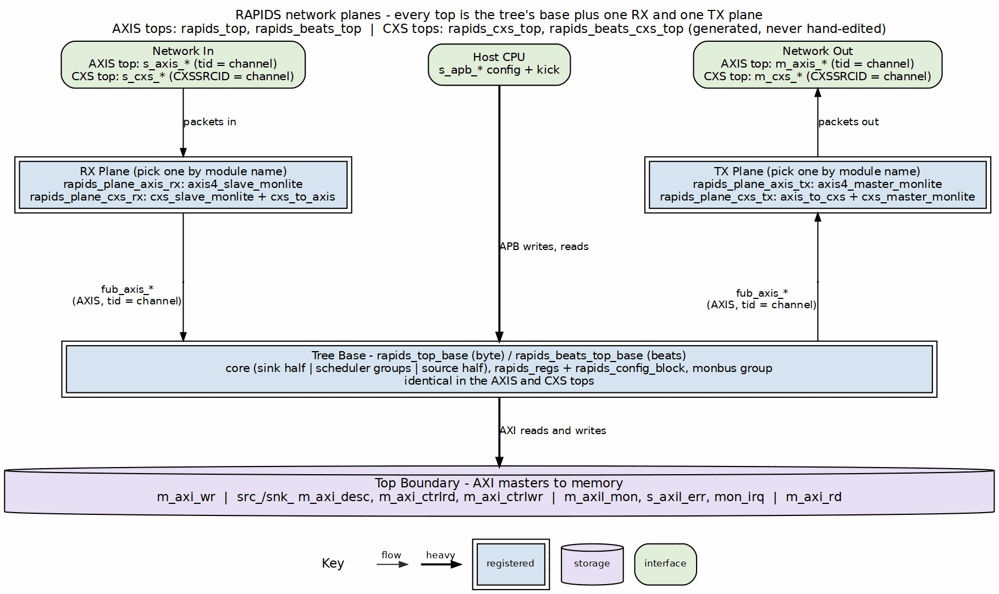

<!-- RTL Design Sherpa Documentation Header -->
<table>
<tr>
<td width="80">
  
</td>
<td>
  <strong>RTL Design Sherpa</strong> · <em>Learning Hardware Design Through Practice</em> 
  
    <a href="https://github.com/sean-galloway/RTLDesignSherpa">GitHub</a> ·
    <a href="https://github.com/sean-galloway/RTLDesignSherpa/blob/main/docs/DOCUMENTATION_INDEX.md">Documentation Index</a> ·
    <a href="https://github.com/sean-galloway/RTLDesignSherpa/blob/main/LICENSE">MIT License</a>
  
</td>
</tr>
</table>

---

<!-- End Header -->
# CXS Network Interface

## Overview

The network side of RAPIDS is a swappable **network plane**. Each top is the
tree's base (core, registers, monitor group) plus one receive (RX) plane and
one transmit (TX) plane, and the plane is chosen by the top's module name:

- `rapids_beats_top`, `rapids_top`: AXI-Stream planes; the `s_axis_*` and
  `m_axis_*` ports described in the AXIS Interface chapter.
- `rapids_beats_cxs_top`, `rapids_cxs_top`: CXS planes; an `s_cxs_*` link
  into the sink half and an `m_cxs_*` link out of the source half.

The core never sees CXS. Every plane presents the same AXIS stream
(`tid` = channel) to the core, so the descriptor engines, schedulers, SRAM
buffers and AXI engines are identical in the AXIS and CXS tops. All four tops
are generated from the tree's base by `bin/gen_plane_tops.py`.

### Figure 3.6.1: Network Planes

**Source:** [ch03_network_planes.dot](../assets/graphviz/ch03_network_planes.dot)

## Link Profile

The CXS planes use one fixed profile of Arm IHI 0079 (CXS) Issue D. Issue D
is the first issue with the SRCID, TGTID and USER sidebands, which RAPIDS
needs to carry the channel and the byte strobes.

| Property | Value |
|----------|-------|
| Links | One per direction: `s_cxs_*` into the sink half, `m_cxs_*` out of the source half |
| Channel | `CXSSRCID` carries the RAPIDS channel (the AXIS `tid`) |
| `CXSTGTID` | The AXIS `tdest` |
| `CXSUSER` | `{tuser, tstrb}`; `tuser` is dropped when `DATA_WIDTH/8 + AXIS_USER_WIDTH > 128` |
| Packets per flit / start alignment | `CXSMAXPKTPERFLIT` = 2, 16-byte alignment; one AXIS packet is one CXS packet |
| Stream framing | Per stream, keyed on the channel bits of `CXSSRCID`: channels may interleave mid-packet |
| Link control | Explicit credit return, activation and deactivation; idle deactivation after `CXS_IDLE_CYCLES` |
| Parity | Off |
| Data width | `DATA_WIDTH` up to 1024 (`CXSUSER` is at most 128 bits and carries `tstrb`) |

: CXS Link Profile

Channels interleave on one link. The byte-granular source arbitrates per drain
block while a packet spans its whole descriptor, so with two or more source
channels active the egress switches channel in the middle of a packet. That is
legal CXS (streams may interleave, IHI 0079D 2.5.2) because every block on the
link frames packets per stream rather than per link.

## Credits

One credit permits one flit (IHI 0079D 2.1). Credits are a single pool for
the whole link: a credit grant carries no ID, so it cannot be reserved for one
channel.

| Parameter | Default | Meaning |
|-----------|---------|---------|
| `CXS_MAX_CREDIT` | 32 | Credits the receiver grants. The grant-to-flit-to-free round trip is about 3 cycles, so 32 sustains one flit per cycle with margin for link pipelining or a clock crossing |
| `CXS_RX_FIFO_DEPTH` | `CXS_MAX_CREDIT` | The sink plane's receive FIFO; it is the credit pool, so every granted credit is backed by space |
| `CXS_CREDIT_BEYOND_SPEC` | `CXS_MAX_CREDIT > 63` | Above the spec's limit of 63 the link is built beyond spec, and the far end must be built the same way |
| `CXS_IDLE_CYCLES` | 32 | Idle cycles before the TX plane deactivates the link |

: CXS Top Parameters

The credit count is not tied to `SRAM_DEPTH`. `SRAM_DEPTH` is the beats each
channel buffers in each direction; the credit pool only has to cover the link's
round trip.

## Signal List

The sink link (`s_cxs_*`) is a CXS receiver; the source link (`m_cxs_*`) is a
CXS transmitter. Direction is given at the RAPIDS top.

| Signal | Sink (`s_cxs_*`) | Source (`m_cxs_*`) | Width | Description |
|--------|------------------|--------------------|-------|-------------|
| `*_cxs_valid` | input | output | 1 | Flit valid |
| `*_cxs_data` | input | output | `DATA_WIDTH` | Flit data |
| `*_cxs_cntl` | input | output | `CXS_CNTL_PW` | Packet start/end control (CXSCNTL) |
| `*_cxs_srcid` | input | output | `AXIS_ID_WIDTH` | Source ID; the channel |
| `*_cxs_tgtid` | input | output | `AXIS_DEST_WIDTH` | Target ID; the AXIS `tdest` |
| `*_cxs_user` | input | output | `CXS_UW` | `{tuser, tstrb}` |
| `*_cxs_crdgnt` | output | input | 1 | Credit grant |
| `*_cxs_crdrtn` | input | output | 1 | Credit return |
| `*_cxs_activereq` | input | output | 1 | Link activation request |
| `*_cxs_activeack` | output | input | 1 | Link activation acknowledge |
| `*_cxs_deacthint` | output | input | 1 | Deactivation hint |

: CXS Link Signals

| Signal | Direction | Description |
|--------|-----------|-------------|
| `snk_cxs_link_state`, `src_cxs_link_state` | output [1:0] | `{ACTIVEREQ, ACTIVEACK}` of each link |
| `snk_cxs_protocol_error`, `src_cxs_protocol_error` | output | Sticky: the endpoint saw a CXS protocol violation |
| `snk_cxs_unsupported` | output | Sticky: a received flit that AXIS framing cannot represent |

: CXS Status Signals

## Flow Control and the Sink Contract

The byte-granular sink holds `s_axis_tready` low on an AXIS top until the
channel's descriptor has been fetched. On a CXS top the same backpressure
appears as credits: the receive FIFO fills and the sink plane stops granting
credits until the core drains it.

## Monitoring

Each CXS plane carries a `cxs_monitor_lite` in place of the AXIS monitor-lite.
It is programmed from the same CSRs (`SNK.WRMON_*` for the sink plane,
`SRC.RDMON_*` for the source plane) and reports with the same agent IDs (0x09
sink, 0x0A source). Its packets are tagged `PROTOCOL_CXS` and join the half's
3:1 `monbus_arbiter` as client 1, exactly where the AXIS plane's packets go.
See the Monitor Bus Interface chapter.

## Routing and Payload Type (Proposed)

A proposal (2026-10-16, not implemented) gives every packet a header carrying
its destination coordinate, source coordinate, payload type (`cfg` / `prog` /
`mem`), length and target address. The header belongs to the tile network,
not to CXS, and is described once in the compute-engine tile's
[`TILE_SPEC.md`](../../../../../compute-eng-ip/tile/docs/TILE_SPEC.md) Section 11. CXS only transports it, as the first flit
of the packet. Nothing on this page changes: `CXSSRCID` keeps the channel, so
per-stream framing is the same. The descriptor fields that supply the header
are in the Descriptor Format chapter.
