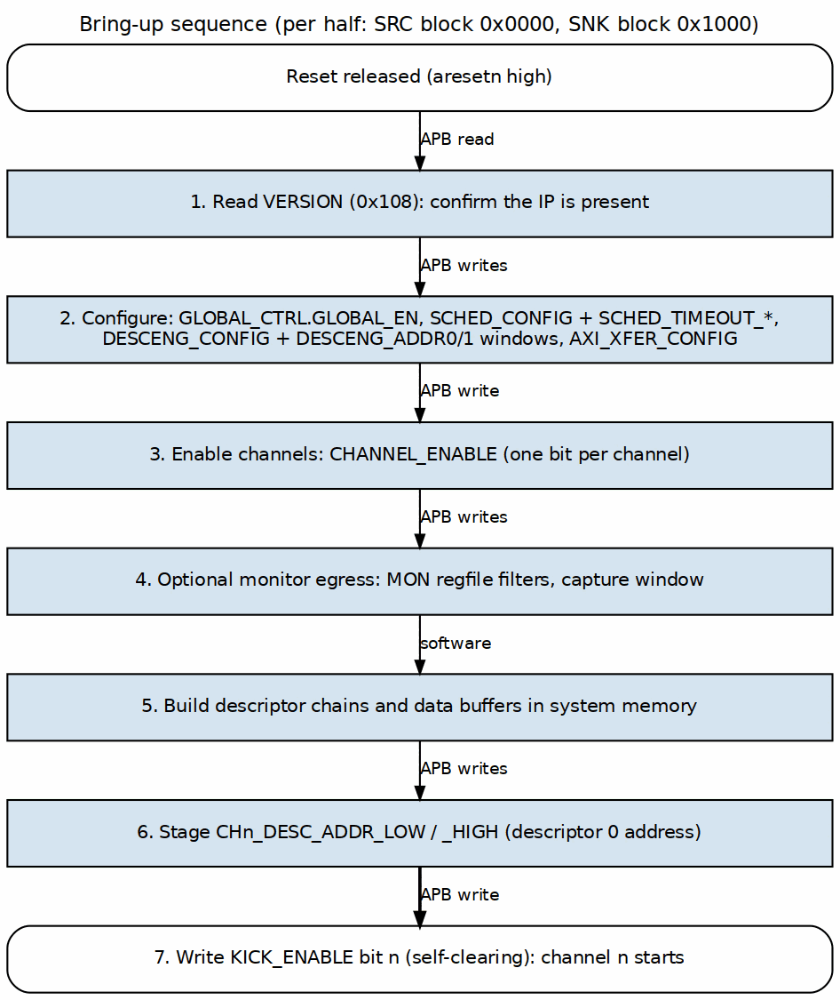

<!-- RTL Design Sherpa Documentation Header -->
<table>
<tr>
<td width="80">
  <a href="https://github.com/sean-galloway/RTLDesignSherpa">
    
  </a>
</td>
<td>
  <strong>RTL Design Sherpa</strong> · <em>Learning Hardware Design Through Practice</em><br>
  <sub>
    <a href="https://github.com/sean-galloway/RTLDesignSherpa">GitHub</a> ·
    <a href="https://github.com/sean-galloway/RTLDesignSherpa/blob/main/docs/DOCUMENTATION_INDEX.md">Documentation Index</a> ·
    <a href="https://github.com/sean-galloway/RTLDesignSherpa/blob/main/LICENSE">MIT License</a>
  </sub>
</td>
</tr>
</table>

---

<!-- End Header -->

# Initialization Sequence

## Overview

This section describes how software brings up RAPIDS Beats and starts a
transfer. Every register named here is a register of the PeakRDL
`rapids_engine_regs` register file (`rtl/macro_beats/rapids_engine_regs.rdl`),
using the names in the generated per-instance map `rapids_regmap.py`. The two
halves share one layout: **SRC at 0x0000** and **SNK at 0x1000**. Each half is
initialized on its own, and the offsets in the
[Register Map](02_register_map.md) are relative to the half.

The code below uses `reg_wr(half, NAME, value)` and `reg_rd(half, NAME)` as
shorthand for an APB access to register `NAME` in the SRC or SNK half. Resolve
the names through the generated map instead of hard-coding offsets.

## Boot Sequence

### Figure 5.3.1: Bring-Up Sequence



**Source:** [ch05_boot_sequence.dot](../assets/graphviz/ch05_boot_sequence.dot)

## What the Hardware Requires

A channel runs a descriptor only when every one of these terms is true. They
are ANDed in `rapids_config_block`, so a missing one leaves the channel idle
without raising an error:

| Term | Register.field | Reset | Effect when 0 |
|------|----------------|-------|---------------|
| Global enable | `GLOBAL_CTRL.GLOBAL_EN` | 0 | Masks `CH_EN`, `SCHED_EN`, `DESCENG_EN` and every monitor enable in the half |
| Channel enable | `CHANNEL_ENABLE.CH_EN[n]` | 0 | The scheduler stays in `CH_IDLE` with a descriptor waiting |
| Scheduler enable | `SCHED_CONFIG.SCHED_EN` | 1 | All schedulers in the half are disabled |
| Descriptor engine enable | `DESCENG_CONFIG.DESCENG_EN` | 1 | No descriptor is fetched |
| Descriptor window | `DESCENG_ADDR0_BASE/_LIMIT`, `DESCENG_ADDR1_BASE/_LIMIT` | 0 / 0xFFFFFFFF | A descriptor address outside both windows is refused and the channel errors |
| Kick | `KICK_ENABLE.KICKn` | -- | Nothing is fetched until the bit is written |

: Conditions for a Channel to Run

`GLOBAL_EN` and `CH_EN` both reset to 0. The other enables reset to 1, and both
descriptor windows reset to the full 32-bit range, so a minimal bring-up only
has to write `CHANNEL_ENABLE`, `GLOBAL_CTRL`, the staged address and
`KICK_ENABLE`.

## Detailed Steps

### Step 1: Verify Hardware Presence

```c
// VERSION (0x108): MINOR[7:0], MAJOR[15:8], NUM_CHANNELS[23:16]
uint32_t version = reg_rd(SRC, VERSION);
uint8_t minor    = (version >>  0) & 0xFF;   // 0x5A (90) in this release
uint8_t major    = (version >>  8) & 0xFF;   // 0x00: pre-release, version 0.90
uint8_t num_ch   = (version >> 16) & 0xFF;   // 8

if (num_ch == 0) {
    printf("ERROR: RAPIDS not detected\n");
    return -1;
}
```

There is no separate configuration register. The channel count is the only
build parameter that software can read back. Data width and SRAM depth are
not readable from the register file.

### Step 2: Optional Reset

`GLOBAL_CTRL.GLOBAL_RST` and `CHANNEL_RESET.CH_RST[n]` are ordinary read/write
bits. They do **not** self-clear. A channel is held in reset (scheduler forced
to `CH_IDLE`, descriptor engine reset) for as long as its bit, or
`GLOBAL_RST`, reads 1. Software must write the bit back to 0 to release it.

```c
// Pulse the global reset: set, then clear. Keep GLOBAL_EN at 0 meanwhile.
reg_wr(half, GLOBAL_CTRL, GLOBAL_CTRL_GLOBAL_RST);   // bit 1
reg_wr(half, GLOBAL_CTRL, 0);

// Every scheduler should now report idle (SYSTEM_IDLE = AND of SCHED_IDLE).
while (!(reg_rd(half, GLOBAL_STATUS) & 1)) { }
```

### Step 3: Configure the Engine

```c
// Scheduler: SCHED_EN[0] TIMEOUT_EN[1] ERR_EN[2] COMPL_EN[3] PERF_EN[4]
reg_wr(half, SCHED_TIMEOUT_CYCLES, 1000);   // write-progress window, in clocks
reg_wr(half, SCHED_TIMEOUT_LIMIT,  4);      // fatal after 4 stalled windows; 0 = never
reg_wr(half, SCHED_CONFIG, SCHED_EN | TIMEOUT_EN | ERR_EN | COMPL_EN);

// Descriptor engine: DESCENG_EN[0] PREFETCH_EN[1] FIFO_THRESH[5:2]
reg_wr(half, DESCENG_CONFIG, DESCENG_EN | PREFETCH_EN | (4 << 2));

// Descriptor address windows (lower 32 bits). A fetch address outside
// both windows is refused and the channel enters CH_ERROR.
reg_wr(half, DESCENG_ADDR0_BASE,  desc_region_base);
reg_wr(half, DESCENG_ADDR0_LIMIT, desc_region_base + desc_region_size - 1);

// Burst sizing: RD_XFER_BEATS[7:0] WR_XFER_BEATS[15:8]
//               ALLOC_SIZE[23:16]  DRAIN_SIZE[31:24]
reg_wr(half, AXI_XFER_CONFIG, (16 << 24) | (16 << 16) | (8 << 8) | 8);
```

The SRC half uses the read-side fields and the SNK half uses the write-side
fields. Writing the whole word in both halves does no harm.

### Step 4: Optional Monitor and Interrupt Egress

The only interrupt output is `mon_irq`. It comes from the top-level
`monbus_axil4_group_1wr` and pulses once per error record that group has
written to the error window (`cfg_mon_err_base_addr` .. `cfg_mon_err_limit_addr`);
`mon_err_rec_count` counts those records. The scheduler error and completion packets travel on the CORE
protocol. For both halves, the group takes its CORE filter from the **SRC**
half's `WRMON_*` registers:

```c
// CORE packets: PKT_MASK bit[type] = 1 DROPS that type; reset is 0xFFFF.
reg_wr(SRC, WRMON_PKT_MASK, ~((1u << 0) | (1u << 1)) & 0xFFFF);  // pass Error, Completion

// ERR_SELECT[3:0] bit[type] = 1 routes that type to the error window (-> mon_irq pulse).
// Bit 0 = Error.  Bit 1 = Completion, which includes the gen_irq descriptor event.
reg_wr(SRC, WRMON_ERR_CFG, (0xFF << 8) | (1u << 0));             // keep ERR_MASK reset value
```

Packets that are passed but not selected for the error window go to the trace
window, over the same `m_axil_mon_*` master. The group, `mon_irq` and
`mon_err_rec_count` exist only when `USE_AXI_MONITORS = 1`. With `USE_AXI_MONITORS = 0`, `mon_irq` is
tied to 0, and software must poll `SCHED_ERROR` and `SCHEDULER_IDLE` instead.

### Step 5: Build Descriptors

```c
// rapids_pkg::descriptor_t, 256 bits (see Descriptor Format)
for (int i = 0; i < NUM_RX_DESC; i++) {
    desc[i].src_addr            = 0;                        // unused by a sink transfer
    desc[i].dst_addr            = rx_buffer + i * FRAME_SIZE;
    desc[i].length              = FRAME_LEN;   // BEATS in RAPIDS Beats, BYTES in byte-granular RAPIDS
    desc[i].next_descriptor_ptr = (i < NUM_RX_DESC - 1) ? (uint32_t)&desc[i + 1] : 0;
    desc[i].valid               = 1;                        // 0 -> CH_ERROR
    desc[i].last                = (i == NUM_RX_DESC - 1);
    desc[i].gen_irq             = 1;                        // completion event RAPIDS_EVENT_IRQ
}
__sync_synchronize();   // descriptors visible before the kick
```

The descriptors must lie inside a `DESCENG_ADDR0`/`DESCENG_ADDR1` window.

### Step 6: Enable

```c
reg_wr(half, CHANNEL_ENABLE, 1u << ch);          // CH_EN[n]
reg_wr(half, GLOBAL_CTRL,    GLOBAL_CTRL_GLOBAL_EN);   // bit 0; GLOBAL_RST stays 0
```

## Initialization Timing

```wavedrom
{
  "signal": [
    {"name": "pclk", "wave": "p................"},
    {},
    ["APB writes (one half)",
      {"name": "VERSION read", "wave": "010.............."},
      {"name": "GLOBAL_RST set/clear", "wave": "0.1.0............"},
      {"name": "SCHED_* / DESCENG_* / AXI_XFER_CONFIG", "wave": "0...1...0........"},
      {"name": "CHANNEL_ENABLE", "wave": "0........10......"},
      {"name": "GLOBAL_CTRL.GLOBAL_EN", "wave": "0.........10....."}
    ],
    {},
    ["Hardware state",
      {"name": "cfg_channel_reset[n]", "wave": "0..1.0..........."},
      {"name": "cfg_channel_enable[n]", "wave": "0..........1....."},
      {"name": "CH_STATE[n]", "wave": "=................", "data": ["CH_IDLE"]}
    ]
  ],
  "config": {"hscale": 1},
  "head": {"text": "Initialization Sequence Timing"}
}
```

`cfg_channel_enable[n]` is `CH_EN[n] & GLOBAL_EN`, so it asserts only after the
last of the two writes.

## Starting Transfers

### Kick a Channel

Stage the descriptor address, then launch it with a single write to
`KICK_ENABLE`. The address registers only store the value, so writing them
does not start anything. Each `KICKn` bit is a singlepulse field and clears
itself. One 32-bit write can launch several channels on the same clock.

```c
reg_wr(half, CH0_DESC_ADDR_LOW,  (uint32_t)((uint64_t)&desc[0]));
reg_wr(half, CH0_DESC_ADDR_HIGH, (uint32_t)((uint64_t)&desc[0] >> 32));
reg_wr(half, KICK_ENABLE, 1u << 0);              // KICK0
```

The APB write completes as soon as the request is raised. The RTL holds the
request until the descriptor engine accepts it, so a completed write does not
mean the engine has accepted the kick.

```wavedrom
{
  "signal": [
    {"name": "clk", "wave": "p..........."},
    {},
    {"name": "APB write KICK_ENABLE", "wave": "010........."},
    {"name": "KICK0 (singlepulse)", "wave": "0.10........"},
    {"name": "descriptor fetch (AR/R)", "wave": "0..1..0....."},
    {"name": "descriptor_valid", "wave": "0.....10...."},
    {},
    {"name": "CH_STATE[0]", "wave": "=......=.=..", "data": ["CH_IDLE","CH_FETCH_DESC","CH_XFER_DATA"]},
    {"name": "SCHEDULER_IDLE[0]", "wave": "1......0...."}
  ],
  "config": {"hscale": 1.5},
  "head": {"text": "Channel Kick and Start"}
}
```

## Completion and Interrupt Handling

There is no interrupt status register and no per-channel interrupt clear.
Software sees completion in one of two ways:

- **Polling.** `SCHEDULER_IDLE.SCHED_IDLE[n]` returns to 1 when the scheduler is
  back in `CH_IDLE` after the last descriptor of a chain. A channel in
  `CH_ERROR` never reports idle, and `SCHED_ERROR.SCHED_ERR[n]` reads 1 for it
  instead. Poll both registers, or the loop will hang on a faulted channel.
  Do not poll `CHANNEL_IDLE`, `AXI_WR_COMPLETE`, or the SNK half's
  `AXI_RD_COMPLETE`. Those fields are not driven at the top level and
  always read 0 (see the [Register Map](02_register_map.md)).
- **mon_irq.** If Step 4 routed Completion packets to the error window, every
  descriptor completion lands there, and so does every error. A completion is
  reported as `RAPIDS_EVENT_DESC_COMPLETE`, or as `RAPIDS_EVENT_IRQ` when the
  descriptor's `gen_irq` is set. The descriptor engine's descriptor-loaded
  completions land there too. `mon_irq` is a pulse per
  record; the handler latches it and reads the records out of the error window
  up to `mon_err_rec_count`.

```c
void rapids_irq_handler(void) {
    // one mon_irq pulse per record landed: read every record not yet seen
    while (last_seen != mon_err_rec_count()) {
        mon_record_t r = err_window_read(last_seen++);   // err_base + (n % capacity) * 24
        if (r.pkt_type == PKT_TYPE_ERROR) {
            handle_channel_error(r.half, r.channel_id);   // see Error Handling
        } else if (r.pkt_type == PKT_TYPE_COMPLETION) {
            process_completed_buffer(r.half, r.channel_id, r.event_data);
        }
    }
}
```

To run the channel again, stage the next chain's first descriptor address and
write its `KICK_ENABLE` bit. No re-enable is needed, because `CH_EN` stays set.

## Reset and Recovery

### Per-Channel Reset

```c
void reset_channel(int half, int ch) {
    // Assert, then release: CH_RST is NOT self-clearing.
    reg_wr(half, CHANNEL_RESET, 1u << ch);
    reg_wr(half, CHANNEL_RESET, 0);

    while (!(reg_rd(half, SCHEDULER_IDLE) & (1u << ch))) { }
    // SCHED_ERROR[ch] is the CH_ERROR state, so it reads 0 again here.
}
```

The scheduler's error state is sticky. The only ways out of `CH_ERROR` are a
channel reset (`CH_RST[n]`) or a global reset (`GLOBAL_RST`). The reset leaves
`CH_EN[n]` and the staged descriptor address unchanged. After the reset,
re-stage the address if it should change, then kick.

### Global Reset

```c
void reset_rapids_half(int half) {
    reg_wr(half, GLOBAL_CTRL, GLOBAL_CTRL_GLOBAL_RST);   // GLOBAL_EN = 0, RST = 1
    reg_wr(half, GLOBAL_CTRL, 0);                        // release
    while (!(reg_rd(half, GLOBAL_STATUS) & 1)) { }       // SYSTEM_IDLE
    rapids_init_half(half);                              // Steps 3-6 again
}
```

`GLOBAL_RST` drives every channel's reset in that half only. The other half,
and the shared monitor group's error window, are not affected.
