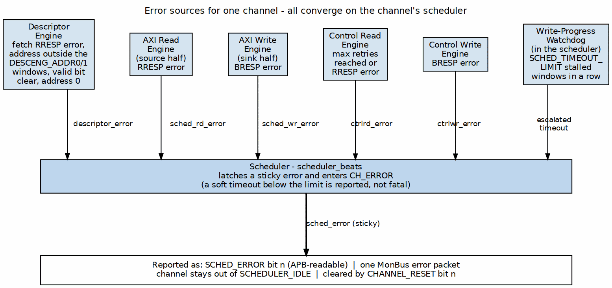
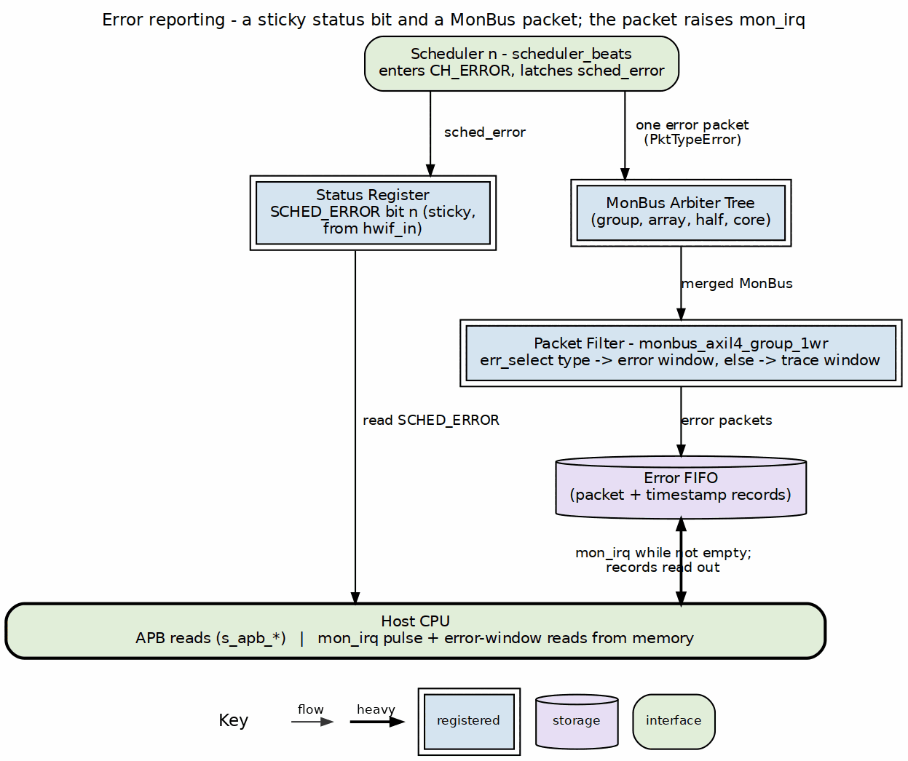
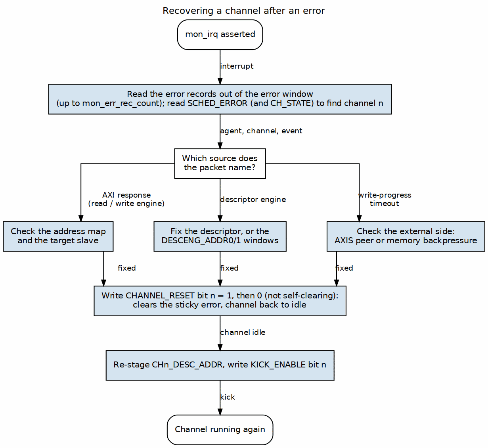

<!-- RTL Design Sherpa Documentation Header -->
<table>
<tr>
<td width="80">
  <a href="https://github.com/sean-galloway/RTLDesignSherpa">
    
  </a>
</td>
<td>
  <strong>RTL Design Sherpa</strong> · <em>Learning Hardware Design Through Practice</em><br>
  <sub>
    <a href="https://github.com/sean-galloway/RTLDesignSherpa">GitHub</a> ·
    <a href="https://github.com/sean-galloway/RTLDesignSherpa/blob/main/docs/DOCUMENTATION_INDEX.md">Documentation Index</a> ·
    <a href="https://github.com/sean-galloway/RTLDesignSherpa/blob/main/LICENSE">MIT License</a>
  </sub>
</td>
</tr>
</table>

---

<!-- End Header -->

# Error Handling

## Overview

This section covers how RAPIDS Beats detects an error, how it reports one, and
how software recovers. Every fatal error in a channel ends the same way. The
channel's scheduler latches it and moves to the sticky `CH_ERROR` state, and it
stays there until software resets the channel. No per-channel error-status
register holds an error code. Software has three sources of information: the
`SCHED_ERROR` bit, the `CH_STATE` readback, and the MonBus error packet.

## Error Categories

### Figure 5.4.1: Error Sources



**Source:** [ch05_error_sources.dot](../assets/graphviz/ch05_error_sources.dot)

## Error Detection

### AXI Response Errors

RAPIDS checks the response on every AXI transaction it issues: descriptor
fetches, source-half data reads, sink-half data writes, and the control
read/write engines.

| Response | Code | Description | Typical Cause |
|----------|------|-------------|---------------|
| OKAY | 2'b00 | Normal success | -- |
| EXOKAY | 2'b01 | Exclusive OK | -- |
| SLVERR | 2'b10 | Slave error | Memory protection, invalid access |
| DECERR | 2'b11 | Decode error | Address not mapped |

: AXI Response Codes

```wavedrom
{
  "signal": [
    {"name": "clk", "wave": "p.............."},
    {},
    ["AXI Write (sink half)",
      {"name": "awvalid", "wave": "01.0..........."},
      {"name": "wvalid", "wave": "0.1.1.0........"},
      {"name": "wlast", "wave": "0...1.0........"}
    ],
    {},
    ["AXI Response",
      {"name": "bvalid", "wave": "0.....1.0......"},
      {"name": "bresp", "wave": "x.....=.x......", "data": ["SLVERR"]}
    ],
    {},
    ["Error Handling",
      {"name": "sched_wr_error", "wave": "0.....1........"},
      {"name": "CH_STATE[n]", "wave": "=......=.......", "data": ["CH_XFER_DATA","CH_ERROR"]},
      {"name": "SCHED_ERROR[n]", "wave": "0......1......."}
    ]
  ],
  "config": {"hscale": 1.5},
  "head": {"text": "AXI Slave Error Detection"}
}
```

### Descriptor Errors

The descriptor engine and the scheduler apply a small, fixed set of checks.
None of them has its own status code. Each one sets the channel's
`SCHED_ERROR` bit, and the descriptor-engine checks also emit a MonBus error
packet.

| Check | Where | Error condition |
|-------|-------|-----------------|
| Address window | Descriptor engine | The fetch address is outside both `DESCENG_ADDR0_BASE..DESCENG_ADDR0_LIMIT` and `DESCENG_ADDR1_BASE..DESCENG_ADDR1_LIMIT`. The fetch is refused and never issued. |
| Null pointer | Descriptor engine | The descriptor address is 0 |
| Fetch response | Descriptor engine | `RRESP` is not OKAY on the descriptor read |
| Valid bit | Scheduler (`CH_FETCH_DESC`) | The descriptor's `valid` bit is 0 |

: Descriptor Checks

The hardware does not check length, alignment, or direction. A descriptor with
a zero or oversized length is software's responsibility. The software
validation example at the end of this section shows one way to catch it.

```wavedrom
{
  "signal": [
    {"name": "clk", "wave": "p.........."},
    {},
    {"name": "descriptor_valid", "wave": "01.0......."},
    {"name": "descriptor.valid", "wave": "x0.x......."},
    {},
    {"name": "CH_STATE[n]", "wave": "=.=.=......", "data": ["CH_IDLE","CH_FETCH_DESC","CH_ERROR"]},
    {"name": "SCHED_ERROR[n]", "wave": "0...1......"},
    {"name": "MonBus error packet", "wave": "0....10...."}
  ],
  "config": {"hscale": 1.5},
  "head": {"text": "Invalid Descriptor (valid bit clear)"}
}
```

### Timeout Detection

Only the scheduler's write-progress watchdog can put a channel into
`CH_ERROR` by itself. The control-read retry budget has a similar effect. The
AXI monitors' timeouts only report.

| Mechanism | Register | Reset value | Result |
|-----------|----------|-------------|--------|
| Write-progress watchdog | `SCHED_TIMEOUT_CYCLES.TIMEOUT_CYCLES` (clocks per window), `SCHED_TIMEOUT_LIMIT.LIMIT` (windows) | 1000, 4 | Fatal `CH_ERROR` after `LIMIT` consecutive stalled windows. With `LIMIT = 0` it never escalates. Enabled by `SCHED_CONFIG.TIMEOUT_EN`. |
| Control-read poll budget | `CTRL_CONFIG.CTRLRD_MAX_TRY` | 16 | A `CTRL_READ` descriptor that does not match within the budget raises `ctrlrd_error`, and the channel goes to `CH_ERROR` |
| Monitor transaction timeout | `DAXMON_TIMEOUT`, `RDMON_TIMEOUT`, `WRMON_TIMEOUT` | -- | Emits a MonBus Timeout packet when the monitor's `TIMEOUT_EN` is set. The channel state does not change. |

: Timeout Mechanisms

**Recoverable write-progress timeout.** Each window of `SCHED_TIMEOUT_CYCLES`
clocks that expires without write progress adds one strike to a counter. The
channel goes to the fatal, sticky `CH_ERROR` only after `SCHED_TIMEOUT_LIMIT`
(register 0x208) consecutive stalled windows. Any write progress, either an AW
issue or a B-response commit, clears the strike counter. A limit of 0 disables
escalation entirely, which makes the timeout soft. A channel in `CH_ERROR` is
reported through `SCHED_ERROR` and is deliberately left out of
`SCHEDULER_IDLE`.

```wavedrom
{
  "signal": [
    {"name": "clk", "wave": "p..............|...."},
    {},
    {"name": "CH_XFER_DATA", "wave": "1..............|...."},
    {"name": "window counter", "wave": "=.=.=.=.=.=.=.=|....", "data": ["0","...","999","0","...","999","0","..."]},
    {"name": "write progress (AW / B)", "wave": "0..............|...."},
    {"name": "strikes", "wave": "=.....=.....=..|=...", "data": ["0","1","2","LIMIT"]},
    {},
    {"name": "CH_STATE[n]", "wave": "=..............|=...", "data": ["CH_XFER_DATA","CH_ERROR"]}
  ],
  "config": {"hscale": 1},
  "head": {"text": "Write-Progress Timeout Escalation"}
}
```

## Error Reporting

### Status Registers

| Register | Meaning on error |
|----------|------------------|
| `SCHED_ERROR.SCHED_ERR[n]` | 1 while channel n is in `CH_ERROR`. The bit reads the state directly and clears only on channel reset. |
| `CH_STATE[n].STATE` | One-hot scheduler state. `CH_ERROR` = 7'b0100000. |
| `SCHEDULER_IDLE.SCHED_IDLE[n]` | 0 for a faulted channel, because `CH_ERROR` is not idle |
| `GLOBAL_STATUS.SYSTEM_IDLE` | 0 while any channel in the half is faulted |

: Error-Related Status Registers

The register file does not record which response code or which descriptor
caused the error. That detail travels only in the MonBus error packet.

### MonBus Error Events

Each error episode emits one error packet (`PktTypeError`, CORE protocol).
The packet carries the half's agent ID and the channel ID:

| Emitter | Event code | Event data |
|---------|------------|------------|
| Scheduler (on entering `CH_ERROR`) | `RAPIDS_EVENT_ERROR` (0x0F) | Read-side and write-side sticky error flags. Both clear means the cause was the descriptor engine, a control engine, or the timeout. |
| Descriptor engine | `CORE_ERR_DESCRIPTOR_ENGINE` | The descriptor fetch `RRESP` |

: MonBus Error Packets

`SCHED_CONFIG.ERR_EN` and `COMPL_EN` do not gate error packets. The scheduler
re-arms its one-shot error packet when the channel returns to `CH_IDLE`.

```wavedrom
{
  "signal": [
    {"name": "clk", "wave": "p.........."},
    {},
    {"name": "CH_STATE[n] == CH_ERROR", "wave": "01........."},
    {},
    {"name": "monbus_valid", "wave": "0.10......."},
    {"name": "pkt_type", "wave": "x.=x.......", "data": ["ERROR"]},
    {"name": "protocol", "wave": "x.=x.......", "data": ["CORE"]},
    {"name": "event_code", "wave": "x.=x.......", "data": ["0x0F"]},
    {"name": "channel_id", "wave": "x.=x.......", "data": ["n"]}
  ],
  "config": {"hscale": 1.5},
  "head": {"text": "MonBus Error Event"}
}
```

### Interrupt Generation

There is no separate interrupt status register. A channel error sets that
channel's sticky `SCHED_ERROR` bit and emits one MonBus error packet. The
top-level monitor group writes the packet types that its `err_select`
configuration selects into its error window as 24-byte records. For CORE
packets that configuration is `SRC.MON.WRMON_ERR_CFG.ERR_SELECT`, and bit 0
selects Error. `SRC.MON.WRMON_PKT_MASK` bit 0 must also be clear, because the
reset value masks every type. `mon_irq` pulses once per record landed and
`mon_err_rec_count` counts them. Software reads the records out of the error
window:

### Figure 5.4.2: Error Reporting



**Source:** [ch05_error_reporting.dot](../assets/graphviz/ch05_error_reporting.dot)

## Error Recovery

### Recovery Flow

### Figure 5.4.3: Error Recovery



**Source:** [ch05_error_recovery.dot](../assets/graphviz/ch05_error_recovery.dot)

Every recovery ends the same way. Fix the cause, then reset the channel. Set
its `CHANNEL_RESET` bit and clear it again, because the bit is not
self-clearing. Re-stage the descriptor address and kick. `reset_channel()`
is defined in [Initialization](03_initialization.md).

### Finding the Faulted Channel

```c
void handle_errors(int half) {
    uint32_t faulted = reg_rd(half, SCHED_ERROR) & 0xFF;   // SCHED_ERR[7:0]

    for (int ch = 0; ch < 8; ch++) {
        if (!(faulted & (1u << ch)))
            continue;
        mon_record_t r = find_error_record(half, ch);   // from the error window in memory
        recover_channel(half, ch, &r);
    }
}
```

### AXI Error Recovery

```c
void recover_axi_error(int half, int ch, const mon_record_t *r) {
    // The scheduler packet says which side failed; the address is not latched.
    if (r->rd_err)
        printf("%s ch%d: read-side AXI error\n", half_name(half), ch);
    if (r->wr_err)
        printf("%s ch%d: write-side AXI error\n", half_name(half), ch);
    // Check the address map and the target slave, then:
    reset_channel(half, ch);
    restage_and_kick(half, ch, first_desc_addr[half][ch]);
}
```

### Descriptor Error Recovery

```c
void recover_desc_error(int half, int ch, uint64_t bad_desc) {
    // Window refusal, null pointer, fetch RRESP error, or valid bit clear.
    // Fix the descriptor (or widen DESCENG_ADDR0/1) before re-kicking.
    fix_descriptor(bad_desc);
    reset_channel(half, ch);
    restage_and_kick(half, ch, bad_desc);
}

void restage_and_kick(int half, int ch, uint64_t addr) {
    reg_wr(half, CH_DESC_ADDR_LOW(ch),  (uint32_t)addr);          // CHn_DESC_ADDR_LOW
    reg_wr(half, CH_DESC_ADDR_HIGH(ch), (uint32_t)(addr >> 32));  // CHn_DESC_ADDR_HIGH
    reg_wr(half, KICK_ENABLE, 1u << ch);                          // KICKn
}
```

### Timeout Recovery

```c
void recover_timeout(int half, int ch) {
    // Escalated write-progress timeout: the write side stopped making progress
    // for SCHED_TIMEOUT_LIMIT windows. In the SNK half that usually means the
    // AXIS peer stopped sending or memory stopped accepting writes. In the SRC
    // half, check m_axis_tready.
    printf("%s ch%d: write-progress timeout\n", half_name(half), ch);
    reset_channel(half, ch);
    restage_and_kick(half, ch, first_desc_addr[half][ch]);
}
```

To ride out long stalls without a fatal error, raise
`SCHED_TIMEOUT_CYCLES` or `SCHED_TIMEOUT_LIMIT`, or set the limit to 0. The
timeout is then reported but never escalates.

## Error Prevention

### Best Practices

| Practice | Rationale |
|----------|-----------|
| Validate descriptors before submission | The hardware checks only the window, a null pointer, and the `valid` bit |
| Set `DESCENG_ADDR0/1` to the real descriptor region | A stray `next_descriptor_ptr` is refused rather than fetched |
| Size `SCHED_TIMEOUT_CYCLES` x `SCHED_TIMEOUT_LIMIT` above the worst legitimate stall | Avoids false fatal timeouts |
| Route Error packets to the error window | `mon_irq` reports errors without polling |

: Error Prevention Best Practices

### Descriptor Validation Example

```c
int validate_descriptor(const rapids_descriptor_t *desc) {
    if (!desc->valid)
        return ERR_NOT_VALID;            // the scheduler would fault the channel
    if (desc->length == 0 || desc->length > MAX_BEATS)
        return ERR_LENGTH;               // not checked by hardware
    if (desc->next_descriptor_ptr &&
        !in_desc_window(desc->next_descriptor_ptr))
        return ERR_ADDRESS;              // the descriptor engine would refuse it
    return 0;
}
```
