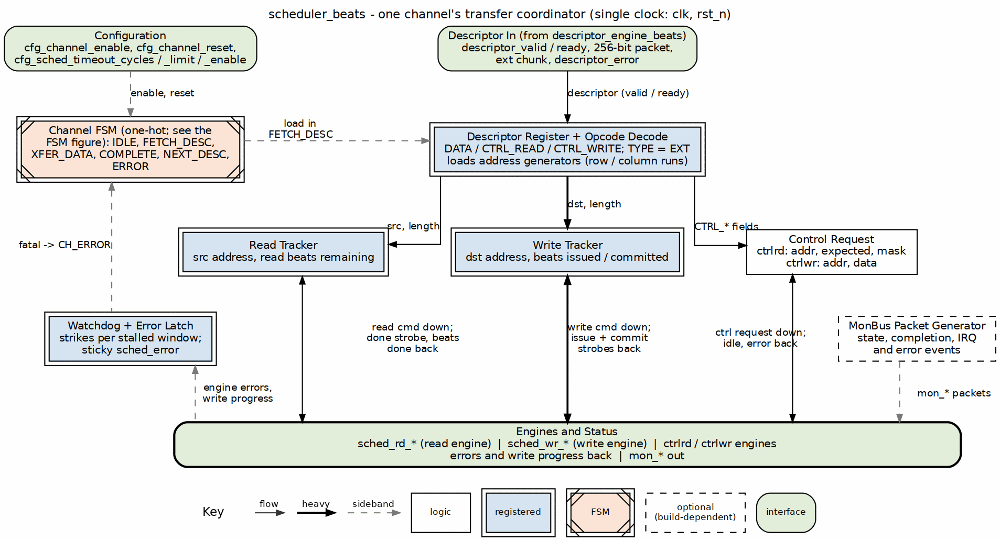
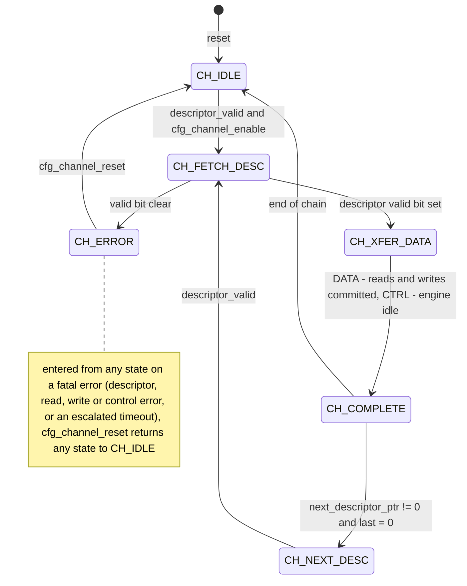
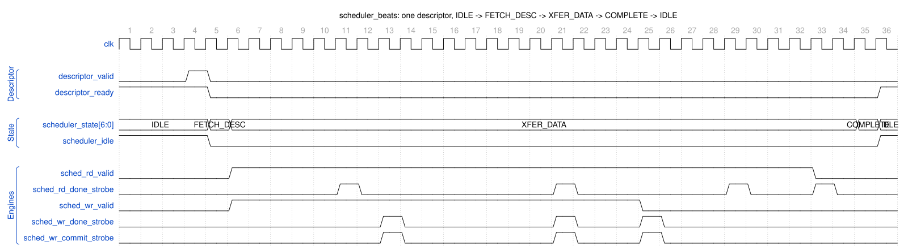

<!-- RTL Design Sherpa Documentation Header -->
<table>
<tr>
<td width="80">
  <a href="https://github.com/sean-galloway/RTLDesignSherpa">
    
  </a>
</td>
<td>
  <strong>RTL Design Sherpa</strong> · <em>Learning Hardware Design Through Practice</em><br>
  <sub>
    <a href="https://github.com/sean-galloway/RTLDesignSherpa">GitHub</a> ·
    <a href="https://github.com/sean-galloway/RTLDesignSherpa/blob/main/docs/DOCUMENTATION_INDEX.md">Documentation Index</a> ·
    <a href="https://github.com/sean-galloway/RTLDesignSherpa/blob/main/LICENSE">MIT License</a>
  </sub>
</td>
</tr>
</table>

---

<!-- End Header -->

# Scheduler Specification

**Module:** `scheduler_beats.sv`
**Location:** `projects/components/dma-ip/rapids/rtl/fub_beats/`
**Status:** Implemented
**Last Updated:** 2025-01-10

---

## Overview

The Scheduler coordinates descriptor-based data transfers for a single RAPIDS channel. It receives descriptors from the descriptor engine, parses transfer parameters, and coordinates read/write operations through the data paths.

### Key Features

- **Descriptor Processing:** Parses 256-bit descriptors for transfer parameters
- **Beat-Based Tracking:** All lengths tracked in beats (data-width units)
- **Concurrent Read/Write:** Simultaneous read and write to prevent deadlock
- **Three descriptor opcodes:** `DATA` (concurrent read/write), `CTRL_READ`
  (consumer gate via the control-read engine), `CTRL_WRITE` (producer doorbell
  via the control-write engine) -- see Control Interface below
- **Timeout Detection:** Configurable watchdog for stalled transfers
- **MonBus Integration:** State transition and error event reporting
- **Error Aggregation:** Combines errors from descriptor engine and data paths

### Block Diagram

### Figure 2.1.1: Scheduler Block Diagram



**Source:** [01_scheduler.dot](../assets/graphviz/01_scheduler.dot)

---

## Parameters

```systemverilog
parameter int CHANNEL_ID = 0;                    // Channel identifier
parameter int NUM_CHANNELS = 8;                  // Total channels in system
parameter int CHAN_WIDTH = $clog2(NUM_CHANNELS); // Channel ID width
parameter int ADDR_WIDTH = 64;                   // Address bus width
parameter int DATA_WIDTH = 512;                  // Data bus width (beats)

// Monitor Bus Parameters
parameter logic [7:0] MON_AGENT_ID = 8'h30;      // RAPIDS Scheduler Agent ID
parameter logic [3:0] MON_UNIT_ID = 4'h1;        // Unit identifier
parameter logic [5:0] MON_CHANNEL_ID = 6'h0;     // Base channel ID

// Descriptor Width
parameter int DESC_WIDTH = 256;                  // RAPIDS descriptor width
```

: Table 2.1.1: Scheduler Parameters

---

## Port List

### Clock and Reset

| Signal | Direction | Width | Description |
|--------|-----------|-------|-------------|
| `clk` | input | 1 | System clock |
| `rst_n` | input | 1 | Active-low asynchronous reset |

: Table 2.1.2: Clock and Reset

### Configuration Interface

| Signal | Direction | Width | Description |
|--------|-----------|-------|-------------|
| `cfg_channel_enable` | input | 1 | Enable this channel |
| `cfg_channel_reset` | input | 1 | Channel soft reset |
| `cfg_sched_timeout_cycles` | input | 32 | Write-progress timeout window (cycles) |
| `cfg_sched_timeout_limit` | input | 8 | Consecutive-timeout windows before fatal escalation (0 = never) |
| `cfg_sched_timeout_enable` | input | 1 | Enable timeout detection |

: Table 2.1.3: Configuration Interface

### Descriptor Engine Interface

| Signal | Direction | Width | Description |
|--------|-----------|-------|-------------|
| `descriptor_valid` | input | 1 | Descriptor valid |
| `descriptor_ready` | output | 1 | Ready to accept descriptor |
| `descriptor_packet` | input | 256 | 256-bit descriptor |
| `descriptor_error` | input | 1 | Error from descriptor engine |

: Table 2.1.4: Descriptor Engine Interface

### Data Read Interface

| Signal | Direction | Width | Description |
|--------|-----------|-------|-------------|
| `sched_rd_valid` | output | 1 | Read request valid |
| `sched_rd_addr` | output | AW | Source address |
| `sched_rd_beats` | output | 32 | Beats to read |
| `sched_rd_done_strobe` | input | 1 | Read complete strobe |
| `sched_rd_beats_done` | input | 32 | Beats completed |
| `sched_rd_error` | input | 1 | Read error |

: Table 2.1.5: Data Read Interface

### Data Write Interface

| Signal | Direction | Width | Description |
|--------|-----------|-------|-------------|
| `sched_wr_valid` | output | 1 | Write request valid (gated on remaining ISSUE beats) |
| `sched_wr_addr` | output | AW | Destination address |
| `sched_wr_beats` | output | 32 | Beats to write |
| `sched_wr_done_strobe` | input | 1 | Write AW-issue strobe (burst accepted on AW) |
| `sched_wr_beats_done` | input | 32 | Beats issued this strobe |
| `sched_wr_commit_strobe` | input | 1 | Write COMMIT strobe (B response received) |
| `sched_wr_commit_beats` | input | 32 | Beats committed this strobe |
| `sched_wr_error` | input | 1 | Write error |

: Table 2.1.6: Data Write Interface

### Control Interface

For `CTRL_READ` / `CTRL_WRITE` descriptors the scheduler drives two per-channel
control engines instead of the data path. Both are request/response handshakes
whose completion is signalled by the engine's `*_idle` going high after issue.

| Signal | Direction | Width | Description |
|--------|-----------|-------|-------------|
| `ctrlrd_valid` | output | 1 | Control-read request valid (to `ctrlrd_engine`) |
| `ctrlrd_ready` | input | 1 | Engine accepted the poll request |
| `ctrlrd_addr` | output | AW | Gate poll address (descriptor `poll_addr`) |
| `ctrlrd_data` | output | 32 | Expected value (descriptor `expected`) |
| `ctrlrd_mask` | output | 32 | Compare mask (descriptor `mask`) |
| `ctrlrd_error` | input | 1 | Engine error (poll retries exhausted / AXI error) |
| `ctrlrd_idle` | input | 1 | `ctrlrd_engine_idle` -- gate satisfied (completion) |
| `ctrlwr_valid` | output | 1 | Control-write request valid (to `ctrlwr_engine`) |
| `ctrlwr_ready` | input | 1 | Engine accepted the doorbell request |
| `ctrlwr_addr` | output | AW | Doorbell address (descriptor `wr_addr`) |
| `ctrlwr_data` | output | 32 | Doorbell value (descriptor `wr_data`) |
| `ctrlwr_error` | input | 1 | Engine error (AXI error) |
| `ctrlwr_idle` | input | 1 | `ctrlwr_engine_idle` -- doorbell written (completion) |

: Table 2.1.7: Control Interface (CTRL_READ / CTRL_WRITE)

A `CTRL_READ` descriptor is a **consumer gate**: the scheduler asserts
`ctrlrd_valid` and holds off the descriptor's completion (and the chain) until
the control-read engine reports the masked poll matched (`ctrlrd_idle`). The poll
retry budget is bounded by `CTRL_CONFIG.CTRLRD_MAX_TRY` (Section 3.12) so a
never-matching gate cannot hang the channel -- exhaustion raises `ctrlrd_error`.
A `CTRL_WRITE` descriptor is a **producer doorbell**: a single-beat write of
`ctrlwr_data` to `ctrlwr_addr`, after which the chain continues. The scheduler
decodes the opcode from the descriptor (`rapids_pkg` `DESC_OP_DATA` /
`DESC_OP_CTRL_READ` / `DESC_OP_CTRL_WRITE`); `DATA` descriptors ignore this
interface. The engines are instantiated per channel in `scheduler_group_beats`
(`u_ctrlrd_engine` / `u_ctrlwr_engine`); see Sections 2.8 and 2.9.

**Completion is gated on write-data COMMIT, not AW issue.** The scheduler
maintains two independent beat counters for the write side:

- `r_write_beats_remaining` decrements on `sched_wr_done_strobe` (AW handshake)
  and drives the destination address and `sched_wr_valid` (writes are requested
  only while ISSUE beats remain).
- `r_write_beats_to_commit` decrements on `sched_wr_commit_strobe` (B response).
  A transfer is considered write-complete only when this counter reaches zero
  (`w_write_complete`), so a channel is never reported done until every issued
  burst has been acknowledged on the B channel.

---

## FSM States

### Figure 2.1.2: Scheduler FSM State Diagram

States and transitions of `scheduler_beats` (one-hot `channel_state_t` in `rapids_pkg`).



### State Encoding

| State | Encoding | Description |
|-------|----------|-------------|
| CH_IDLE | 7'b0000001 | Waiting for a descriptor |
| CH_FETCH_DESC | 7'b0000010 | Descriptor latched and decoded |
| CH_XFER_DATA | 7'b0000100 | Concurrent read/write transfer, or the control operation |
| CH_COMPLETE | 7'b0001000 | Transfer complete; chain check |
| CH_NEXT_DESC | 7'b0010000 | Waiting for the next chained descriptor |
| CH_ERROR | 7'b0100000 | Sticky error; left only by channel reset |
| CH_RESERVED | 7'b1000000 | Reserved |

: Table 2.1.7: FSM State Encoding

---

## Operation

### Descriptor Format

```
Bits [63:0]    - src_addr: Source memory address
Bits [127:64]  - dst_addr: Destination memory address
Bits [159:128] - length: Transfer length in beats
Bits [191:160] - next_ptr: Next descriptor pointer (0 = last)
Bits [195:192] - channel_id: Channel identifier
Bits [196]     - last: Last descriptor flag
Bits [197]     - gen_irq: Generate interrupt
Bits [255:198] - reserved
```

### Transfer Sequence

### Figure 2.1.3: Basic Transfer Timing



**Source:** [scheduler_basic_transfer.json](../assets/wavedrom/scheduler_basic_transfer.json),
captured from `dv/tests/fub_beats/test_scheduler_beats.py` (`basic_flow`, channel 0
of 8, 512-bit, seed 7) with `WAVES=1`.

Reading it: `descriptor_valid` is accepted in IDLE; the FSM steps through
FETCH_DESC into XFER_DATA and `scheduler_idle` drops. In XFER_DATA both engines
are requested at once (`sched_rd_valid` and `sched_wr_valid` high together): the
read engine reports each burst issued on `sched_rd_done_strobe`, the write engine
reports issue on `sched_wr_done_strobe` and the B response on
`sched_wr_commit_strobe` (here the model answers B immediately, so the two
coincide). The write side finishes its beats first and drops `sched_wr_valid`;
when the read side has issued its last burst the FSM moves to COMPLETE and back to
IDLE, and `descriptor_ready` re-asserts for the next descriptor.

---

## Run-Base Generator Flush

The two `stream_run_addr_gen` instances (EXT addressing) are flushed by the registered channel reset: generation stops, results in flight in `dma_address_gen` are discarded and the base FIFO (a `gaxi_drop_fifo_sync`) is dropped whole. Before 2026-10-21 nothing emptied it, and an EXT descriptor following a channel reset that interrupted another EXT descriptor began its second run at the interrupted descriptor's base (rapids BUG-017, found in the byte-granular RAPIDS and fixed in RAPIDS, RAPIDS Beats and STREAM together). `test_*_ext_channel_reset` covers it.

## Error Handling

| Error Source | Detection | Response |
|--------------|-----------|----------|
| Descriptor engine | `descriptor_error` | Transition to CH_ERROR state |
| Read engine | `sched_rd_error` | Set sticky error flag |
| Write engine | `sched_wr_error` | Set sticky error flag |
| Write-progress timeout | Recoverable, escalates after limit | See below |

: Table 2.1.8: Error Handling

### Recoverable Write-Progress Timeout

The write-progress watchdog is recoverable and only escalates to a fatal fault
after a configurable number of consecutive stalled windows:

1. **Window counting:** `r_timeout_counter` increments while
   `sched_wr_valid && !sched_wr_ready` (a write request is stalled). The window
   expires when it reaches `cfg_sched_timeout_cycles`.
2. **Re-arm:** On expiry the counter re-arms (resets to 0) and the scheduler
   keeps waiting; a single expired window is not fatal.
3. **Strike counting:** `r_timeout_strikes` (8-bit) increments once per expired
   window. Any write progress -- `sched_wr_done_strobe` (AW issue) or
   `sched_wr_commit_strobe` (B response) -- clears both the window counter and
   the strike counter.
4. **Escalation:** When `cfg_sched_timeout_limit != 0` and
   `r_timeout_strikes >= cfg_sched_timeout_limit`, the channel escalates to a
   sticky `CH_ERROR` (surfaced on `sched_error`). Total time to escalate is
   approximately `cfg_sched_timeout_limit * cfg_sched_timeout_cycles`.
5. **Never-escalate mode:** `cfg_sched_timeout_limit == 0` is a pure soft
   timeout -- the event may be reported, but the channel never faults.

**`scheduler_idle` excludes `CH_ERROR`.** Only `CH_IDLE` (with no active channel
reset) is reported idle; a faulted channel in `CH_ERROR` is deliberately NOT
reported idle so a wedged channel cannot read back as idle. The fault is
surfaced via `sched_error` instead.

---

## MonBus Events

| Event Code | Description |
|------------|-------------|
| 0x01 | Descriptor received |
| 0x02 | Transfer started |
| 0x03 | Transfer complete |
| 0x04 | Error occurred |
| 0x05 | Timeout |

: Table 2.1.9: MonBus Event Codes

---

**Last Updated:** 2026-07-02
