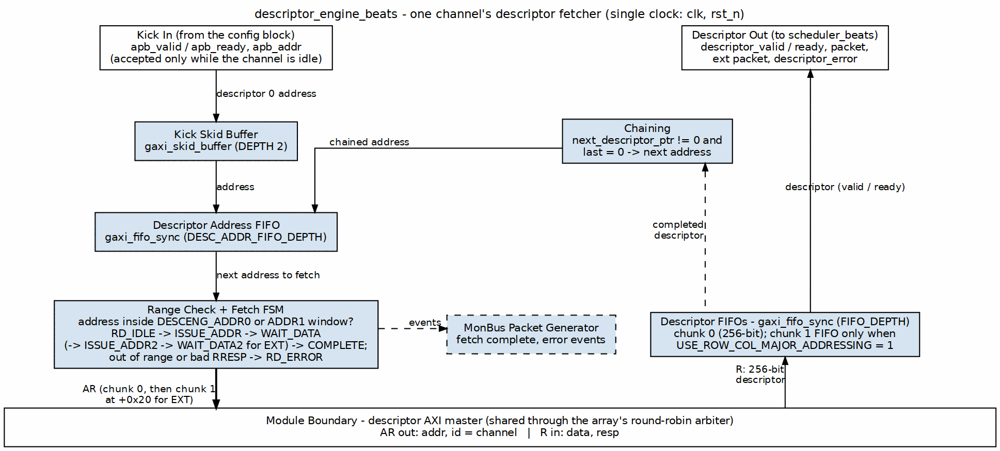
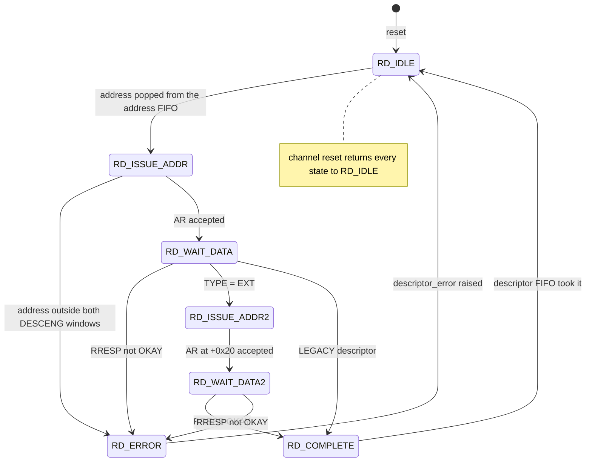
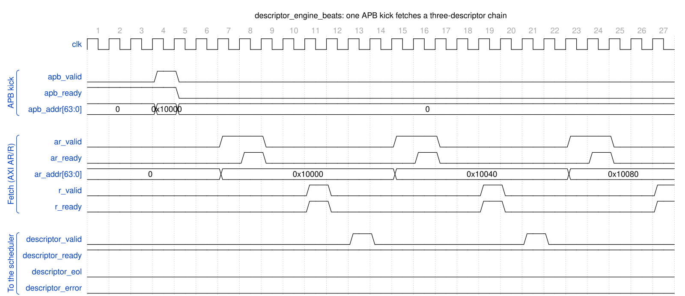

<!-- RTL Design Sherpa Documentation Header -->
<table>
<tr>
<td width="80">
  <a href="https://github.com/sean-galloway/RTLDesignSherpa">
    
  </a>
</td>
<td>
  <strong>RTL Design Sherpa</strong> · <em>Learning Hardware Design Through Practice</em><br>
  <sub>
    <a href="https://github.com/sean-galloway/RTLDesignSherpa">GitHub</a> ·
    <a href="https://github.com/sean-galloway/RTLDesignSherpa/blob/main/docs/DOCUMENTATION_INDEX.md">Documentation Index</a> ·
    <a href="https://github.com/sean-galloway/RTLDesignSherpa/blob/main/LICENSE">MIT License</a>
  </sub>
</td>
</tr>
</table>

---

<!-- End Header -->

# Descriptor Engine Specification

**Module:** `descriptor_engine_beats.sv`
**Location:** `projects/components/dma-ip/rapids/rtl/fub_beats/`
**Status:** Implemented
**Last Updated:** 2025-01-10

---

## Overview

The Descriptor Engine fetches and manages 256-bit descriptors from memory via AXI4. It maintains a prefetch FIFO to hide memory latency and provides parsed descriptors to the scheduler.

### Key Features

- **AXI4 Descriptor Fetch:** Single-beat 256-bit reads
- **Prefetch FIFO:** Configurable depth for latency hiding
- **Address Range Checking:** Validates descriptor addresses
- **Error Detection:** Address violations, AXI errors
- **MonBus Integration:** Fetch events and error reporting

### Block Diagram

### Figure 2.2.1: Descriptor Engine Block Diagram



**Source:** [02_descriptor_engine.dot](../assets/graphviz/02_descriptor_engine.dot)

---

## Parameters

```systemverilog
parameter int CHANNEL_ID = 0;                    // Channel identifier
parameter int NUM_CHANNELS = 8;                  // Total channels
parameter int ADDR_WIDTH = 64;                   // Address bus width
parameter int FIFO_DEPTH = 4;                    // Prefetch FIFO depth

// Monitor Bus Parameters
parameter logic [7:0] MON_AGENT_ID = 8'h10;      // Descriptor Engine Agent ID
parameter logic [3:0] MON_UNIT_ID = 4'h1;        // Unit identifier
```

: Table 2.2.1: Descriptor Engine Parameters

---

## Port List

### Clock and Reset

| Signal | Direction | Width | Description |
|--------|-----------|-------|-------------|
| `clk` | input | 1 | System clock |
| `rst_n` | input | 1 | Active-low asynchronous reset |

: Table 2.2.2: Clock and Reset

### APB Programming Interface

| Signal | Direction | Width | Description |
|--------|-----------|-------|-------------|
| `apb_valid` | input | 1 | Kick-off valid (start descriptor chain) |
| `apb_ready` | output | 1 | Ready to accept kick-off |
| `apb_addr` | input | AW | First descriptor address |

: Table 2.2.3: APB Programming Interface

### Configuration Interface

| Signal | Direction | Width | Description |
|--------|-----------|-------|-------------|
| `cfg_prefetch_enable` | input | 1 | Enable prefetch chaining (0 = on-demand, ~1 ahead) |
| `cfg_fifo_threshold` | input | 4 | Prefetch depth (descriptors buffered ahead when enabled) |
| `cfg_addr0_base` | input | AW | Valid address range 0 base |
| `cfg_addr0_limit` | input | AW | Valid address range 0 limit |
| `cfg_addr1_base` | input | AW | Valid address range 1 base |
| `cfg_addr1_limit` | input | AW | Valid address range 1 limit |

: Table 2.2.4: Configuration Interface

### AXI4 Read Master Interface

| Signal | Direction | Width | Description |
|--------|-----------|-------|-------------|
| `ar_valid` | output | 1 | Address valid |
| `ar_ready` | input | 1 | Address ready |
| `ar_addr` | output | ADDR_WIDTH | Descriptor fetch address |
| `ar_len` | output | 8 | Burst length - 1 |
| `ar_size` | output | 3 | Burst size (log2 bytes) |
| `ar_burst` | output | 2 | Burst type (INCR) |
| `ar_id` | output | AXI_ID_WIDTH | Transaction ID |
| `ar_lock` | output | 1 | Lock type |
| `ar_cache` | output | 4 | Cache attributes |
| `ar_prot` | output | 3 | Protection attributes |
| `ar_qos` | output | 4 | Quality of service |
| `ar_region` | output | 4 | Region identifier |
| `r_valid` | input | 1 | Data valid |
| `r_ready` | output | 1 | Data ready |
| `r_data` | input | 256 | Descriptor payload (fixed 256-bit) |
| `r_resp` | input | 2 | Read response |
| `r_last` | input | 1 | Last beat |
| `r_id` | input | AXI_ID_WIDTH | Response ID |

: Table 2.2.5: AXI4 Read Master Interface

### Scheduler Interface

| Signal | Direction | Width | Description |
|--------|-----------|-------|-------------|
| `descriptor_valid` | output | 1 | Descriptor valid |
| `descriptor_ready` | input | 1 | Scheduler ready |
| `descriptor_packet` | output | 256 | Parsed descriptor (fixed 256-bit) |
| `descriptor_ext_packet` | output | 256 | Extended chunk 1 (0 when unused) |
| `descriptor_error` | output | 1 | Error flag |
| `descriptor_eos` | output | 1 | End of Stream |
| `descriptor_eol` | output | 1 | End of Line |
| `descriptor_eod` | output | 1 | End of Data |
| `descriptor_type` | output | 2 | Packet type |
| `channel_idle` | input | 1 | Scheduler idle (enables APB kick-off) |
| `descriptor_engine_idle` | output | 1 | Engine idle |

: Table 2.2.6: Scheduler Interface

---

## FSM States

### Figure 2.2.2: Descriptor Engine FSM

States and transitions of the `descriptor_engine_beats` fetch FSM.



---

## Operation

### Descriptor Chain Processing

### Figure 2.2.3: Descriptor Chain Timing



**Source:** [descriptor_engine_chain.json](../assets/wavedrom/descriptor_engine_chain.json),
captured from `dv/tests/fub_beats/test_descriptor_engine_beats.py`
(`descriptor_chaining`, 32 channels, seed 7) with `WAVES=1`.

Reading it: one `apb_valid` kick carries the head address (0x10000). The engine
issues an AXI read for it (`ar_valid`, `ar_addr`), the data returns on `r_valid`,
and the parsed descriptor is presented on `descriptor_valid` to a ready
scheduler. Because the descriptor's `next_ptr` points at 0x10040 and `last` is
clear, the engine fetches the next one on its own -- and the one after that at
0x10080 -- with no further APB traffic; `descriptor_eol` marks the last of the
chain. Each fetch costs the same AR -> R -> present latency, so a chain streams
at one descriptor per fetch round trip.

---

## Address Range Checking

Descriptors must fall within configured valid address ranges:

```
Valid if: (addr >= cfg_addr0_base && addr <= cfg_addr0_limit)
       || (addr >= cfg_addr1_base && addr <= cfg_addr1_limit)
```

Invalid addresses generate an error and halt the descriptor chain.

---

## Prefetch and Autonomous Chaining

`cfg_prefetch_enable` and `cfg_fifo_threshold` are functional prefetch controls
(previously declared-but-unused, which left chaining permanently greedy). They
throttle how far ahead the engine fetches chained descriptors by comparing the
output descriptor FIFO occupancy (`w_desc_fifo_count`) against a computed
`w_prefetch_limit`:

```
if      (!cfg_prefetch_enable)      w_prefetch_limit = 1;   // on-demand
else if (cfg_fifo_threshold == 0)   w_prefetch_limit = 1;   // guard (0 would stall)
else                                w_prefetch_limit = cfg_fifo_threshold;

w_prefetch_allows = (w_desc_fifo_count < w_prefetch_limit);
```

- **Prefetch OFF (`cfg_prefetch_enable = 0`):** limit forced to 1, so a chained
  fetch is only allowed when the output FIFO has drained -- the engine stays
  roughly one descriptor ahead of the scheduler (on-demand).
- **Prefetch ON:** the engine buffers up to `cfg_fifo_threshold` descriptors
  ahead.

### Chaining Decision

A chain fetch issues immediately when all of the following hold:

```
w_should_chain = w_chain_eligible     // valid non-last descriptor, in range, no error
              && w_desc_committed      // current descriptor accepted into output FIFO
              && w_prefetch_allows     // occupancy below prefetch limit
              && w_desc_addr_fifo_wr_ready;  // address FIFO has a slot
```

### Deferred (Throttle-Blocked) Chain Fetch

If a descriptor commits and is chain-eligible but the fetch cannot issue this
cycle (throttled by `w_prefetch_allows`, or the address FIFO is full), the owed
fetch is recorded rather than dropped:

- `r_chain_pending` is set and the next-descriptor pointer is held in
  `r_pending_chain_addr`.
- The deferred fetch is reissued (`w_pending_push_fire`) once the output FIFO
  drains enough that `w_prefetch_allows` is true again and the address FIFO has
  a slot, clearing `r_chain_pending`.

---

**Last Updated:** 2026-07-02
