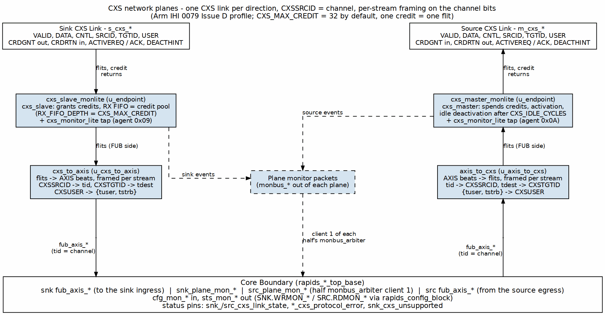

<!-- RTL Design Sherpa Documentation Header -->
<table>
<tr>
<td width="80">
  
</td>
<td>
  <strong>RTL Design Sherpa</strong> · <em>Learning Hardware Design Through Practice</em> 
  
    <a href="https://github.com/sean-galloway/RTLDesignSherpa">GitHub</a> ·
    <a href="https://github.com/sean-galloway/RTLDesignSherpa/blob/main/docs/DOCUMENTATION_INDEX.md">Documentation Index</a> ·
    <a href="https://github.com/sean-galloway/RTLDesignSherpa/blob/main/LICENSE">MIT License</a>
  
</td>
</tr>
</table>

---

<!-- End Header -->
# Network Planes Specification

**Modules:** `rapids_plane_axis_rx.sv`, `rapids_plane_axis_tx.sv`, `rapids_plane_cxs_rx.sv`, `rapids_plane_cxs_tx.sv`
**Location:** `projects/components/dma-ip/rapids/rtl/plane/`
**Generator:** `projects/components/dma-ip/rapids/bin/gen_plane_tops.py`
**Status:** Implemented (rapids TASK-024, TASK-025)

---

## Overview

A network plane is the endpoint between the core's network-side AXIS stream and
the pins: the RX plane feeds the sink half's ingress, the TX plane takes the
source half's egress. Each plane carries the monitor-lite for its port. Both
RAPIDS trees (byte-granular `rtl/top`, beat-granular `rtl/top_beats`) share the
same four planes.

Every plane has the same parameters and the same inner interface, so a top
selects AXIS or CXS by module name alone:

- `fub_axis_*`: the core-facing AXIS stream (`tdata`, `tstrb`, `tlast`,
  `tid` = channel, `tdest`, `tuser`)
- `cfg_mon_*` in, `sts_mon_*` out: the `SNK.WRMON_*` / `SRC.RDMON_*` monitor
  CSRs, from `rapids_config_block`
- `monbus_*` out: client 1 of the half's 3:1 `monbus_arbiter`, entering the core
  on `snk_plane_mon_*` / `src_plane_mon_*`

| Plane | Contents | Outer pins |
|-------|----------|------------|
| `rapids_plane_axis_rx` | `axis4_slave_monlite` (skid stage, `SKID_DEPTH` = 4, + `axis_monitor_lite` tap) | `s_axis_*` |
| `rapids_plane_axis_tx` | `axis4_master_monlite` (skid stage + tap) | `m_axis_*` |
| `rapids_plane_cxs_rx` | `cxs_slave_monlite` (`u_endpoint`) + `cxs_to_axis` (`u_cxs_to_axis`) | `s_cxs_*`, `snk_cxs_*` status |
| `rapids_plane_cxs_tx` | `axis_to_cxs` (`u_axis_to_cxs`) + `cxs_master_monlite` (`u_endpoint`) | `m_cxs_*`, `src_cxs_*` status |

: Table 3.13.1: RAPIDS Network Planes

The monitor counters of every plane are at `u_snk_plane.u_endpoint` and
`u_src_plane.u_endpoint` in the top.

## Generated Tops

| Top | Tree | Base | Planes |
|-----|------|------|--------|
| `rapids_top` | byte | `rapids_top_base` | AXIS |
| `rapids_cxs_top` | byte | `rapids_top_base` | CXS |
| `rapids_beats_top` | beats | `rapids_beats_top_base` | AXIS |
| `rapids_beats_cxs_top` | beats | `rapids_beats_top_base` | CXS |

: Table 3.13.2: Generated Tops

`gen_plane_tops.py` copies the base's parameter and port text verbatim, then
instantiates the base (`u_base`) and the two planes (`u_snk_plane`,
`u_src_plane`). The AXIS tops therefore keep exactly the interface they had
before the split, and existing instantiations are unchanged. Run the generator
with `--check` to fail on a stale top.

## CXS Planes

### Figure 3.13.1: CXS Network Planes

**Source:** [23_cxs_planes.dot](../assets/graphviz/23_cxs_planes.dot)

### Receive (sink) plane

`cxs_slave_monlite` is `cxs_slave` with a `cxs_monitor_lite` tap. `cxs_slave`
grants credits up to `CXS_MAX_CREDIT`, runs the activation handshake, and holds
received flits in a receive FIFO of `RX_FIFO_DEPTH` (default `CXS_MAX_CREDIT`)
entries. The FIFO is the credit pool: a credit is only granted for a free
entry, so a flit always has space. `cxs_to_axis` turns flits back into AXIS
beats: `CXSSRCID` becomes `tid`, `CXSTGTID` becomes `tdest`, and `CXSUSER` is
split into `{tuser, tstrb}`. When the core stops taking beats the FIFO fills,
and the slave stops granting credits; that is the CXS form of the sink's
`tready` backpressure.

`cxs_to_axis` is combinational and stateless, so it can only represent the
flits `axis_to_cxs` makes: at most one START and one END per flit, with a
packet starting at byte 0. Any other flit (a transmitter that packs two packets
into one flit) is still passed on, with `tlast` from END[0], and sets the sticky
`snk_cxs_unsupported`.

### Transmit (source) plane

`axis_to_cxs` packs AXIS beats into flits (`tid` -> `CXSSRCID`, `tdest` ->
`CXSTGTID`, `{tuser, tstrb}` -> `CXSUSER`) and `cxs_master_monlite` sends them,
one credit per flit. The master requests activation when it has a flit to
send and deactivates the link after `CXS_IDLE_CYCLES` idle cycles.

### Per-stream framing

`axis_to_cxs` and both endpoints' control checkers track an open packet per
stream, keyed on the low `CXS_STREAM_SRCID_BITS` = `CIW` bits of `CXSSRCID` (the
channel); `cxs_to_axis` needs no state because each beat carries its own `tid`. The
byte-granular source arbitrates per drain block while a packet spans the whole
descriptor, so with two or more channels active the egress switches channel in
the middle of a packet. Per-link framing (one open packet per link) rejects
that traffic; per-stream framing accepts it, as IHI 0079D 2.5.2 allows.

### Parameters

| Parameter | Default | Description |
|-----------|---------|-------------|
| `CXS_MAX_CREDIT` | 32 | Credits granted by the receiver. One credit is one flit; the grant -> flit -> free round trip is about 3 cycles |
| `CXS_RX_FIFO_DEPTH` | `CXS_MAX_CREDIT` | Receive FIFO depth (the credit pool); need not be a power of two |
| `CXS_CREDIT_BEYOND_SPEC` | `CXS_MAX_CREDIT > 63` | Permits more credits than IHI 0079D allows; the far end must match |
| `CXS_IDLE_CYCLES` | 32 | Idle cycles before the transmitter deactivates the link |
| `CXS_IW`, `CXS_DESTW`, `CXS_UW`, `CXS_CNTL_PW` | derived | Port widths; do not override |

: Table 3.13.3: CXS Plane Parameters

`DATA_WIDTH` must be at most 1024: `CXSUSER` is at most 128 bits and carries
`tstrb` (`DATA_WIDTH/8` bits). `tuser` is dropped from `CXSUSER` when
`DATA_WIDTH/8 + AXIS_USER_WIDTH > 128`.

### Monitoring

The CXS planes drive `cxs_monitor_lite` from the same `cfg_mon_*` CSRs as the
AXIS planes and use the same agent IDs (sink 0x09, source 0x0A). Packets are
tagged `PROTOCOL_CXS`; the top's monitor group filters them through its AXIS
mask slot. A PACKET_END completion carries the channel in `event_data[55:48]`;
`channel_id` holds `{PRCLTYPE[2:0], TGTID[5:0]}`. The lite's output queue is 4
entries deep; when events outrun it the lite drops and counts them (an
Error / EVENT_DROPPED packet), so a check on completions counts delivered plus
dropped.

## Planned Changes

The ID mapping above is provisional. The ID fields, and possibly other fields
or new signals, are expected to change so that a flit can carry routing and
payload type: delta configuration and delta memory traffic as distinct from
endpoint or cell configuration and endpoint or cell memory traffic. The
encoding is not yet defined, and this chapter will be revised when it is.

## Verification

| Suite | Cells |
|-------|-------|
| `dv/tests/top/test_rapids_cxs_top.py` | source, sink, source_bytes, sink_bytes, source_concurrent, sink_concurrent, cxs_mon, ext_addressing |
| `dv/tests/top_beats/test_rapids_beats_cxs_top.py` | source, sink, source_concurrent, sink_concurrent, cxs_mon, ext_addressing |

: Table 3.13.4: CXS Top Test Cells

The concurrent cells start four channels with one `KICK_ENABLE` write, so
channels interleave on the link. Every cell also requires a clean link: no BFM
or wire-monitor violation and the DUT's protocol-error flags low. The core
testbenches drive packets on `plane_mon_*` and require them on the MonBus
output.

---

**Last Updated:** 2026-10-16
