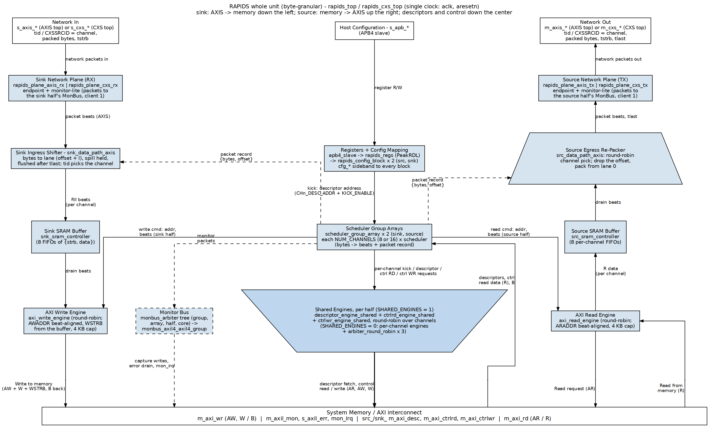

<!-- RTL Design Sherpa Documentation Header -->
<table>
<tr>
<td width="80">
  <a href="https://github.com/sean-galloway/RTLDesignSherpa">
    
  </a>
</td>
<td>
  <strong>RTL Design Sherpa</strong> · <em>Learning Hardware Design Through Practice</em><br>
  <sub>
    <a href="https://github.com/sean-galloway/RTLDesignSherpa">GitHub</a> ·
    <a href="https://github.com/sean-galloway/RTLDesignSherpa/blob/main/docs/DOCUMENTATION_INDEX.md">Documentation Index</a> ·
    <a href="https://github.com/sean-galloway/RTLDesignSherpa/blob/main/LICENSE">MIT License</a>
  </sub>
</td>
</tr>
</table>

---

<!-- End Header -->

# Block Diagram

## Top-Level Architecture

RAPIDS has the same block structure as RAPIDS Beats: a scheduler group array per direction, a data path per direction, and a top level that adds the registers, configuration mapping and monitoring. What the byte design adds sits at the edges of the two data paths: an ingress shifter on the sink, an egress re-packer on the source, and a packet record passed from each scheduler to its data path.

### Figure 2.1.1: RAPIDS Block Diagram



**Source:** [01_byte_block_diagram.dot](../assets/graphviz/01_byte_block_diagram.dot)

## Top-Level Integration (rapids_top, rapids_cxs_top and the 8- and 16-channel tops)

`rapids_core` is wrapped by `rapids_top`, which adds the software register interface, configuration mapping, and monitoring infrastructure. The integration is identical to `rapids_beats_top`: a single APB slave feeds a command/response router into the `rapids_regs` register block, `rapids_config_block` translates the register outputs into the `cfg_*` signals, and a `monbus_axil4_group_1wr` writes the merged monitor stream to memory over one AXI-Lite master (`ERR_SELECT` packets to an error window, the rest to the trace window), with a `mon_irq` pulse and a `mon_err_rec_count` step per error record. The register map, the APB interface and the MonBus interface are shared with RAPIDS Beats; see the linked chapters.

The top-level ports have the same names as `rapids_beats_top`. The only port-level differences are the byte enables: the sink write master's `m_axi_wr_wstrb` is driven from the buffered byte enables instead of all ones, and the two AXI-Stream ports use `tstrb` as a real byte mask.

The network endpoints sit in two network planes outside the core, exactly as in RAPIDS Beats: `rapids_top` uses the AXIS planes and `rapids_cxs_top` the CXS planes, both generated from `rapids_top_base`. The generator also emits `rapids_8ch_top`, `rapids_16ch_top` and their CXS twins, which fix `NUM_CHANNELS` and compile the matching register map. The CXS planes carry `tstrb` in `CXSUSER`, so partial last beats and unaligned starts cross the CXS link intact. See the shared CXS Network Interface chapter.

## Component Summary

### Scheduler Group Array

The scheduler group array manages `NUM_CHANNELS` (8 or 16) independent channels per direction. `SHARED_ENGINES` selects how its engines are built:

| Component | `SHARED_ENGINES = 1` (default) | `SHARED_ENGINES = 0` | Purpose |
|-----------|-------------------------------|----------------------|---------|
| `scheduler` | `NUM_CHANNELS` | `NUM_CHANNELS` | Transfer coordination per channel; converts bytes to beats, issues the packet record |
| Descriptor engine | 1 `descriptor_engine_shared` | `NUM_CHANNELS` `descriptor_engine` | Descriptor fetch and parse |
| Control-read engine | 1 `ctrlrd_engine_shared` | `NUM_CHANNELS` `ctrlrd_engine` | `CTRL_READ` consumer gate |
| Control-write engine | 1 `ctrlwr_engine_shared` | `NUM_CHANNELS` `ctrlwr_engine` | `CTRL_WRITE` producer doorbell |
| AXI-side arbiters | none (each engine owns its master) | 3 round-robin | Merge the per-channel masters onto the descriptor, control-read and control-write ports |

: Scheduler Array Components

A shared engine keeps each channel's behaviour: the same kick policy, chaining, prefetch, errors and channel reset. Fetches carry the channel in ARID, so channels overlap on the bus while each stays in order. The only visible difference is that a polling `CTRL_READ` holds the control-read engine, so other channels' control reads wait behind it; data transfers do not. The MAS Shared Engines chapter has the detail.

### Sink Data Path

Network-to-memory data flow:

| Component | Purpose |
|-----------|---------|
| `snk_data_path_axis` | Ingress: accepts packed bytes, shifts them to `offset + lane`, holds the spill, flushes after TLAST, counts the packet |
| `snk_sram_controller` | Multi-channel SRAM management; each entry is data plus byte enables |
| `axi_write_engine` | AXI4 burst write generation; beat-aligned AWADDR, 4 KB cap, WSTRB from the buffer |
| `alloc_ctrl`, `drain_ctrl` | Space and data availability tracking (unchanged) |

: Sink Path Components

### Source Data Path

Memory-to-network data flow:

| Component | Purpose |
|-----------|---------|
| `axi_read_engine` | AXI4 burst read generation; beat-aligned ARADDR, 4 KB cap |
| `src_sram_controller` | Multi-channel SRAM management (data only) |
| `src_data_path_axis` | Egress: drops the start offset, re-packs from lane 0, sets TSTRB and TLAST |
| `alloc_ctrl`, `drain_ctrl` | Space and data availability tracking (unchanged) |

: Source Path Components

## Hierarchy

```
rapids_top | rapids_cxs_top   (generated by bin/gen_plane_tops.py)
├── u_base: rapids_top_base   (regs, rapids_config_block x2, monbus group)
│   └── u_core: rapids_core
├── u_snk_plane: rapids_plane_axis_rx | rapids_plane_cxs_rx
│   └── axis4_slave_monlite | cxs_slave_monlite + cxs_to_axis
└── u_src_plane: rapids_plane_axis_tx | rapids_plane_cxs_tx
    └── axis4_master_monlite | axis_to_cxs + cxs_master_monlite

rapids_core
├── monbus_arbiter
├── rapids_src
│   ├── scheduler_group_array
│   │   ├── scheduler [0..NC-1]                   (SHARED_ENGINES = 1, default)
│   │   ├── descriptor_engine_shared
│   │   ├── ctrlrd_engine_shared
│   │   ├── ctrlwr_engine_shared
│   │   └── scheduler_group [0..NC-1]             (SHARED_ENGINES = 0 instead)
│   │       ├── scheduler
│   │       ├── descriptor_engine
│   │       ├── ctrlrd_engine
│   │       └── ctrlwr_engine
│   ├── monbus_arbiter (3:1; client 1 = src_plane_mon_*)
│   └── src_data_path_axis
│       └── src_data_path
│           ├── axi_read_engine
│           └── src_sram_controller
└── rapids_snk
    ├── scheduler_group_array (same shape)
    ├── monbus_arbiter (3:1; client 1 = snk_plane_mon_*)
    └── snk_data_path_axis
        └── snk_data_path
            ├── axi_write_engine
            └── snk_sram_controller
```

## Internal Buses

| Bus | Width | Description |
|-----|-------|-------------|
| Descriptor Bus | 256-bit | Parsed descriptor to scheduler |
| Scheduler Command | Variable | Beat count and byte address to the engines |
| Packet Record | Bytes count plus offset | One per descriptor and direction, scheduler to data path |
| Source SRAM Data | `DATA_WIDTH` | Data to and from the source SRAM |
| Sink SRAM Data | `DATA_WIDTH + DATA_WIDTH/8` | Data plus byte enables |
| MonBus | 64-bit | Monitor packets (aggregated) |

: Internal Bus Summary
