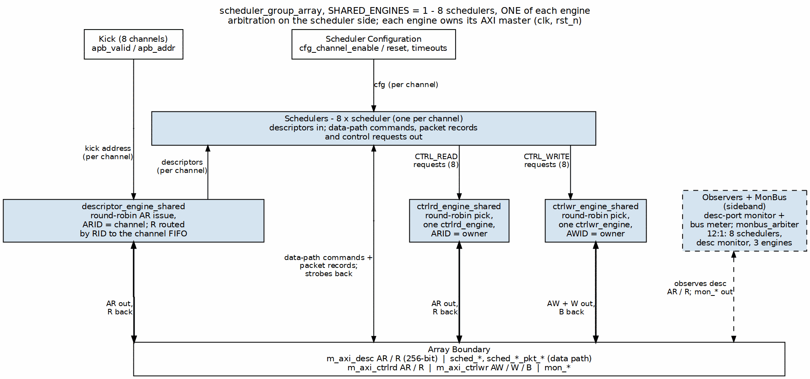
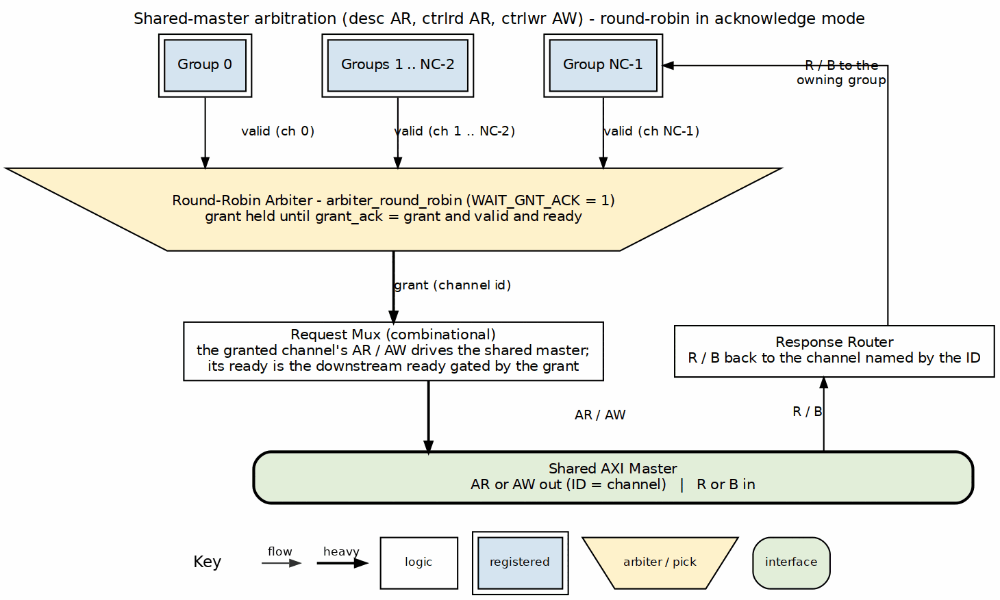

<!-- RTL Design Sherpa Documentation Header -->
<table>
<tr>
<td width="80">
  
</td>
<td>
  <strong>RTL Design Sherpa</strong> · <em>Learning Hardware Design Through Practice</em> 
  
    <a href="https://github.com/sean-galloway/RTLDesignSherpa">GitHub</a> ·
    <a href="https://github.com/sean-galloway/RTLDesignSherpa/blob/main/docs/DOCUMENTATION_INDEX.md">Documentation Index</a> ·
    <a href="https://github.com/sean-galloway/RTLDesignSherpa/blob/main/LICENSE">MIT License</a>
  
</td>
</tr>
</table>

---

<!-- End Header -->

# Scheduler Group Array

**Module:** `scheduler_group_array.sv`
**Location:** `projects/components/dma-ip/rapids/rtl/macro/`
**Status:** Implemented
**Last Updated:** 2026-10-16

---

## Overview

The scheduler group array runs one scheduler per channel and three engines that issue the array's AXI traffic: the descriptor fetch engine, the control-read engine and the control-write engine. `SHARED_ENGINES` (default 1) selects how the engines are built. With 1, the array has one of each engine for every channel, and each engine picks among the schedulers round-robin (see Shared Engines below). With 0, every channel has its own three engines inside a scheduler group, and three AXI-side arbiters merge their masters (the original structure). It also owns the descriptor-AXI monitor and merges every channel's MonBus output with the monitor's into one stream.

Compared with the RAPIDS Beats array, the sharing, arbitration and monitoring are unchanged. The array adds one parameter, `OFF_W`, and the per-channel packet-record ports, which it connects to each group by channel index.

### Key Features

- **One group per channel:** `NUM_CHANNELS` scheduler groups.
- **Shared engines (`SHARED_ENGINES = 1`, default):** one `descriptor_engine_shared`, one `ctrlrd_engine_shared` and one `ctrlwr_engine_shared` per array, arbitrating on the scheduler side and owning their AXI masters.
- **Per-channel engines (`SHARED_ENGINES = 0`):** one scheduler group per channel, and three round-robin arbiters with grant acknowledgment on the AXI side (`u_desc_ar_arbiter`, `u_ctrlrd_ar_arbiter`, `u_ctrlwr_aw_arbiter`).
- **Descriptor-AXI monitor:** a lite AXI read monitor on the shared descriptor master, plus an always-on bus meter for the perf window.
- **Unified MonBus:** one round-robin arbiter over `NUM_CHANNELS + 4` sources (shared engines) or `NUM_CHANNELS + 1` (per-channel engines).
- **Direction gating:** `EN_READ` and `EN_WRITE` let the source array be read-only and the sink array write-only.
- **Per-channel packet records:** vector ports for the byte length and offset of each channel's packet.

### Block Diagram

### Figure 3.2.1: Scheduler Group Array Block Diagram

**Source:** [08_scheduler_group_array.dot](../assets/graphviz/08_scheduler_group_array.dot)

---

## Parameters

| Parameter | Default | Description |
|-----------|---------|-------------|
| `NUM_CHANNELS` | 8 | Number of channels. |
| `CHAN_WIDTH` | `$clog2(NUM_CHANNELS)` | Channel id width. |
| `ADDR_WIDTH` | 64 | Address width. |
| `DATA_WIDTH` | 512 | Data width in bits. |
| `AXI_ID_WIDTH` | 8 | AXI ID width. |
| `DESC_MON_BASE_AGENT_ID` | 16 | Base MonBus agent id of the descriptor engines. |
| `SCHED_MON_BASE_AGENT_ID` | 48 | Base MonBus agent id of the schedulers. |
| `DESC_AXI_MON_AGENT_ID` | 8 | MonBus agent id of the descriptor AXI monitor. |
| `MON_UNIT_ID` | 1 | MonBus unit id. |
| `MON_MAX_TRANSACTIONS` | 16 | Transaction table depth of the descriptor monitor. |
| `EN_READ` | 1 | Enable the read direction in every scheduler. Clear for a sink array. |
| `EN_WRITE` | 1 | Enable the write direction in every scheduler. Clear for a source array. |
| `USE_AXI_MONITORS` | 1 | 0 omits the descriptor-AXI monitor hardware and ties its MonBus source to zero. |
| `USE_ROW_COL_MAJOR_ADDRESSING` | 1 | 0 compiles out the extended addressing path. |
| `GEN_MON` | 1 | 0 omits the per-channel completion and error emitters. |
| `SHARED_ENGINES` | 1 | 1: one descriptor, control-read and control-write engine for the array. 0: one of each per channel. |
| `OFF_W` | `$clog2(DATA_WIDTH/8)` | Width of the packet-record byte offset. New in RAPIDS. |

: Table 3.2.1: Scheduler Group Array Parameters

---

## Port List

Vector ports are `NUM_CHANNELS` wide (`NC`), indexed by channel.

### Clock, Reset and Kick-Off

| Signal | Direction | Width | Description |
|--------|-----------|-------|-------------|
| `clk` | input | 1 | System clock. |
| `rst_n` | input | 1 | Active-low reset. |
| `apb_valid` | input | NC | Per-channel kick-off. |
| `apb_ready` | output | NC | Per-channel ready. |
| `apb_addr` | input | NC x AW | First descriptor address per channel. |
| `cfg_channel_enable` | input | NC | Per-channel enable. |
| `cfg_channel_reset` | input | NC | Per-channel soft reset. |

: Table 3.2.2: Clock, Reset and Kick-Off

### Global Scheduler and Descriptor Engine Configuration

These inputs are applied to every channel.

| Signal | Direction | Width | Description |
|--------|-----------|-------|-------------|
| `cfg_sched_enable` | input | 1 | Master scheduler enable. |
| `cfg_sched_timeout_cycles` | input | 32 | Timeout window in cycles. |
| `cfg_sched_timeout_limit` | input | 8 | Consecutive timeouts before a fatal error. 0 means never. |
| `cfg_sched_timeout_enable` | input | 1 | Enable timeout detection. |
| `cfg_sched_err_enable` | input | 1 | Enable error reporting. |
| `cfg_sched_compl_enable` | input | 1 | Enable CORE Completion packets. |
| `cfg_sched_perf_enable` | input | 1 | Enable performance monitoring. |
| `cfg_desceng_enable` | input | 1 | Master descriptor engine enable. |
| `cfg_desceng_prefetch` | input | 1 | Enable descriptor prefetch. |
| `cfg_desceng_fifo_thresh` | input | 4 | Prefetch threshold. |
| `cfg_desceng_addr0_base`, `_limit` | input | AW | Valid descriptor address range 0. |
| `cfg_desceng_addr1_base`, `_limit` | input | AW | Valid descriptor address range 1. |
| `cfg_ctrlrd_max_try` | input | 9 | Control-read poll retry budget. |
| `tick_1us` | input | 1 | 1 us tick for control-read retry spacing. |

: Table 3.2.3: Global Configuration

### Descriptor Monitor Configuration and Status

| Signal | Direction | Width | Description |
|--------|-----------|-------|-------------|
| `cfg_desc_mon_enable` | input | 1 | Enable the descriptor AXI monitor. |
| `cfg_desc_mon_err_enable` | input | 1 | Enable error packets. |
| `cfg_desc_mon_perf_enable` | input | 1 | Enable performance packets. |
| `cfg_desc_mon_perf_run` | input | 1 | Perf window control. |
| `cfg_desc_mon_timeout_enable` | input | 1 | Enable timeout packets. |
| `cfg_desc_mon_timeout_cycles` | input | 32 | Timeout threshold. |
| `cfg_desc_mon_latency_thresh` | input | 32 | Latency threshold. |
| `cfg_desc_mon_pkt_mask` | input | 16 | Packet type mask. |
| `cfg_desc_mon_err_select` | input | 4 | Error select. |
| `cfg_desc_mon_err_mask`, `_timeout_mask`, `_compl_mask`, `_thresh_mask`, `_perf_mask`, `_addr_mask`, `_debug_mask` | input | 8 each | Per-class event masks. |
| `cfg_sts_desc_mon_busy` | output | 1 | Monitor busy. |
| `cfg_sts_desc_mon_active_txns` | output | 8 | Active transactions. |
| `cfg_sts_desc_mon_error_count` | output | 16 | Error count. |
| `cfg_sts_desc_mon_txn_count` | output | 32 | Transaction count. |
| `cfg_sts_desc_mon_conflict_error` | output | 1 | Conflict error. |

: Table 3.2.4: Descriptor Monitor Configuration and Status

### Descriptor-AXI Perf Window

The perf counters come from an always-on bus meter on the descriptor R channel, not from the monitor. `cfg_desc_mon_perf_run` opens the window: counters clear on its rising edge, count while it is high and hold while it is low. `USE_AXI_MONITORS` does not gate the meter.

| Signal | Direction | Width | Description |
|--------|-----------|-------|-------------|
| `sts_desc_mon_win_active` | output | 1 | Window open. |
| `sts_desc_mon_win_cycles` | output | 32 | Cycles in the window. |
| `sts_desc_mon_prod_cycles` | output | 32 | R valid and ready. |
| `sts_desc_mon_bp_cycles` | output | 32 | R valid, not ready. |
| `sts_desc_mon_starv_cycles` | output | 32 | R ready, not valid. |
| `sts_desc_mon_idle_cycles` | output | 32 | Neither valid nor ready. |
| `sts_desc_mon_beat_count` | output | 32 | R handshakes. |
| `sts_desc_mon_byte_count` | output | 64 | Bytes moved on R (32 per descriptor beat). |
| `sts_desc_mon_burst_count` | output | 32 | AR handshakes. |

: Table 3.2.5: Descriptor-AXI Perf Window

### Status

| Signal | Direction | Width | Description |
|--------|-----------|-------|-------------|
| `descriptor_engine_idle` | output | NC | Per-channel descriptor engine idle. |
| `scheduler_idle` | output | NC | Per-channel scheduler idle. |
| `scheduler_state` | output | NC x 7 | Per-channel FSM state, one-hot. |
| `sched_error` | output | NC | Per-channel scheduler error, sticky. |

: Table 3.2.6: Status

### Shared AXI Masters

The three shared masters carry the same signals as the per-group ports in [Scheduler Group](01_scheduler_group.md), prefixed `desc_axi_`, `ctrlrd_axi_` and `ctrlwr_axi_`. The descriptor master returns 256-bit data. The control read master returns 32-bit data. The control write master is 32 bits wide with a 4-bit strobe. Each is a single interface: the arbiter selects one channel's request onto it and steers the response back by ID.

### Per-Channel Scheduler Data Interface

| Signal | Direction | Width | Description |
|--------|-----------|-------|-------------|
| `sched_rd_valid` | output | NC | Read request per channel. |
| `sched_rd_addr` | output | NC x AW | Working source byte address. |
| `sched_rd_beats` | output | NC x 32 | Beats still to read. |
| `sched_wr_valid` | output | NC | Write request per channel. |
| `sched_wr_ready` | input | NC | Last burst of the descriptor committed. |
| `sched_wr_addr` | output | NC x AW | Working destination byte address. |
| `sched_wr_beats` | output | NC x 32 | Beats still to write. |
| `sched_rd_done_strobe` | input | NC | Read burst issued. |
| `sched_rd_beats_done` | input | NC x 32 | Beats in that burst. |
| `sched_wr_done_strobe` | input | NC | Write AW issued. |
| `sched_wr_beats_done` | input | NC x 32 | Beats in that AW. |
| `sched_wr_commit_strobe` | input | NC | Write B response received. |
| `sched_wr_commit_beats` | input | NC x 32 | Beats committed. |
| `sched_rd_error` | input | NC | Sticky read error. |
| `sched_wr_error` | input | NC | Sticky write error. |

: Table 3.2.7: Per-Channel Scheduler Data Interface

### Per-Channel Packet Record Interface

| Signal | Direction | Width | Description |
|--------|-----------|-------|-------------|
| `sched_rd_pkt_valid` | output | NC | Read-side record pulse per channel. |
| `sched_rd_pkt_ready` | input | NC | Read-side consumer has room. |
| `sched_rd_pkt_bytes` | output | NC x 32 | Packet length in bytes. |
| `sched_rd_pkt_offset` | output | NC x OFF_W | Start offset in the first memory beat. |
| `sched_wr_pkt_valid` | output | NC | Write-side record pulse per channel. |
| `sched_wr_pkt_ready` | input | NC | Write-side consumer has room. |
| `sched_wr_pkt_bytes` | output | NC x 32 | Packet length in bytes. |
| `sched_wr_pkt_offset` | output | NC x OFF_W | Start offset in the first memory beat. |

: Table 3.2.8: Per-Channel Packet Record Interface

Element `[ch]` of each vector connects to the matching port of `scheduler_group[ch]`. The array adds no logic between them. A source array uses only the read set and a sink array only the write set.

### MonBus Interface

| Signal | Direction | Width | Description |
|--------|-----------|-------|-------------|
| `i_mon_time` | input | `monbus_timestamp_t` | Shared monitor timebase. |
| `mon_valid` | output | 1 | Packet valid. |
| `mon_ready` | input | 1 | Consumer ready. |
| `mon_packet` | output | `monitor_packet_t` | Packet. |
| `mon_timestamp` | output | `monbus_timestamp_t` | Timestamp. |

: Table 3.2.9: MonBus Interface

---

## Shared Engines

With `SHARED_ENGINES = 1` the per-channel descriptor and control engines are replaced by one of each for the whole array. The arbitration moves from the AXI side to the scheduler side: each engine picks the next channel to serve round-robin, and it owns its AXI master outright, with no arbiter behind it. ARID and AWID carry the channel. The schedulers, the array's ports and every interface above the array are unchanged.

| Engine | What is shared | What stays per channel |
|--------|----------------|------------------------|
| `descriptor_engine_shared` | AR issuer, address-range comparators, the R path (each beat routed by RID straight into its channel's FIFO), MonBus reporter | State code, one pending fetch address, kick-in-progress flag, owed-beat flag, descriptor FIFO (and EXT chunk-1 FIFO) |
| `ctrlrd_engine_shared` | One `ctrlrd_engine` | Nothing: an owner register says which channel the engine serves |
| `ctrlwr_engine_shared` | One `ctrlwr_engine` | Nothing: an owner register says which channel the engine serves |

: Table 3.2.11: Shared Engines

**Descriptor engine.** Each channel keeps one fetch in flight and stays in order. Different channels' fetches overlap on the bus because each carries its own ARID. Each scheduler sees exactly the per-channel engine's behaviour:
- the same kick policy, and refusal of a kicked address outside both ranges;
- the extended-descriptor second fetch;
- the prefetch throttle, up to the threshold plus one buffered;
- autonomous chaining, the error pulse, and completion and error MonBus packets.

A fetch issues only when its channel's FIFO has a free entry, so a channel that stops consuming can never hold the shared R channel. A channel reset in the middle of a fetch records the owed beat. The beat is drained when it arrives, and the channel takes no new kick until then. Reset also drains the channel's FIFO, so descriptors prefetched for an aborted chain are not delivered afterwards. Once ARVALID is raised, the AR address and ID hold until accepted.

The shared descriptor engine's MonBus output differs from the per-channel engine's in two ways:
- **Range refusal:** the error packet for a refused kicked address carries 0 in its response field. The per-channel engine carried whatever read response it had last latched, which was stale.
- **Colliding events:** packets go through a small FIFO, and two events can occur in one cycle: a refusal on the issue side, and a completion or error on the R side. The issue-side packet waits one cycle. If another collision arrives while it waits, the waiting packet is dropped. The per-channel engine also dropped packets, whenever MonBus backpressured it. Tests that count descriptor-engine packets should allow for this.

**Control engines.** The engine runs one request at a time.
- A request is offered only while the engine is idle, its last MonBus packet has drained, and no error remains from the previous owner. A stale error is cleared with a one-cycle engine reset before the next channel's request is taken.
- The owner sees the engine's idle and error exactly as a dedicated engine would show them; every other channel sees idle 1 and error 0.
- The owner's channel reset resets the engine only while the owner's operation is in flight, so a channel parked in reset cannot hold the engine for everyone else.
- MonBus packets are re-tagged with the owner's channel and agent ID (0x20 + channel for control reads, 0x28 + channel for control writes).

Trade-off: a `CTRL_READ` that keeps polling holds the control-read engine, so other channels' control reads wait behind it. Data transfers are unaffected.

## Shared Master Arbitration (SHARED_ENGINES = 0)

Each shared master has a round-robin arbiter over `NUM_CHANNELS` requesters in acknowledge mode. The grant is held until the granted channel's request is accepted (`grant_ack`), so a granted channel always sees its own valid and ready. The AR or AW ready seen by a channel is the downstream ready gated by that channel's grant.

### Figure 3.2.2: Shared Master Arbitration

**Source:** [11_shared_master_arbitration.dot](../assets/graphviz/11_shared_master_arbitration.dot)

---

## MonBus Aggregation

| Source | Origin | Content |
|--------|--------|---------|
| 0 to NC-1 | `scheduler_group[ch]` (per-channel engines) or `scheduler[ch]` (shared engines) | Per-channel engines: that channel's descriptor engine, scheduler, control read and control write packets. Shared engines: that channel's scheduler packets |
| NC | Descriptor AXI monitor | Descriptor fetch monitor packets |
| NC+1 | Shared descriptor engine (shared engines only) | Every channel's descriptor completion and error packets |
| NC+2 | Shared control-read engine (shared engines only) | Every channel's control-read packets |
| NC+3 | Shared control-write engine (shared engines only) | Every channel's control-write packets |

: Table 3.2.10: MonBus Source Assignment

One round-robin arbiter with acknowledge mode merges the sources into `mon_*`: `NUM_CHANNELS + 4` with shared engines, `NUM_CHANNELS + 1` with per-channel engines. Each source carries its own timestamp alongside the packet.

---

## Differences from RAPIDS Beats

| Item | RAPIDS Beats | RAPIDS |
|------|--------------|--------|
| Parameter `OFF_W` | absent | present |
| `sched_rd_pkt_*`, `sched_wr_pkt_*` vectors | absent | present, wired by channel |
| Everything else | | Unchanged |

: Table 3.2.11: Array Delta

The beats chapter is [Beats Scheduler Group Array](../../rapids_beats_mas/ch03_macro_blocks/02_beats_scheduler_group_array.md).

---

**Last Updated:** 2026-09-30
