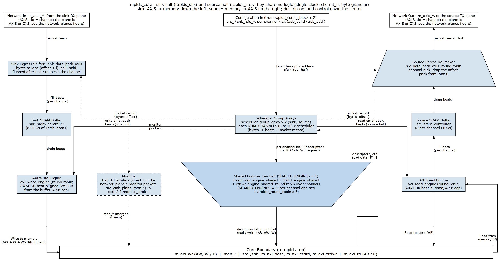

<!-- RTL Design Sherpa Documentation Header -->
<table>
<tr>
<td width="80">
  
</td>
<td>
  <strong>RTL Design Sherpa</strong> · <em>Learning Hardware Design Through Practice</em> 
  
    <a href="https://github.com/sean-galloway/RTLDesignSherpa">GitHub</a> ·
    <a href="https://github.com/sean-galloway/RTLDesignSherpa/blob/main/docs/DOCUMENTATION_INDEX.md">Documentation Index</a> ·
    <a href="https://github.com/sean-galloway/RTLDesignSherpa/blob/main/LICENSE">MIT License</a>
  
</td>
</tr>
</table>

---

<!-- End Header -->

# RAPIDS Core, Sink Half and Source Half

**Module:** `rapids_core.sv`, `rapids_snk.sv`, `rapids_src.sv`
**Location:** `projects/components/dma-ip/rapids/rtl/macro/`
**Status:** Implemented
**Last Updated:** 2026-09-30

---

## Overview

`rapids_core` is a thin structural wrapper over two independent halves. `rapids_src` moves memory to the network. `rapids_snk` moves the network to memory. The halves share no logic and no signals. The core only presents one boundary and merges the two MonBus streams.

The structure, the port naming convention and the register and monitor plumbing are those of RAPIDS Beats. This chapter records what the byte-granular RTL contains and how it differs. The full port tables are in [RAPIDS Core Beats](../../rapids_beats_mas/ch03_macro_blocks/09_rapids_core_beats.md), with the port renames below applied.

### Figure 3.9.1: Core Block Diagram

**Source:** [04_rapids_core.dot](../assets/graphviz/04_rapids_core.dot)

---

## Byte-Granular Content

### Packet Record Nets

Each half declares the packet record nets of its direction and connects them between its scheduler group array and its AXIS data path:

| Half | Nets | Producer | Consumer |
|------|------|----------|----------|
| `rapids_src` | `sched_rd_pkt_valid`, `_ready`, `_bytes`, `_offset` | array read set | `src_data_path_axis` |
| `rapids_snk` | `sched_wr_pkt_valid`, `_ready`, `_bytes`, `_offset` | array write set | `snk_data_path_axis` |

: Table 3.9.1: Packet Record Nets per Half

The offset nets are `$clog2(DW/8)` bits wide. The unused direction of each array is tied off: valid, bytes and offset are left open and ready is held at all ones so nothing stalls. The record nets are internal, so the core port list has no packet record ports.

### Port Renames

The core ports that carry the beat-count unit are renamed. Everything else keeps its Beats name.

| RAPIDS Beats | RAPIDS |
|--------------|--------|
| `cfg_axi_rd_xfer` | `cfg_axi_rd_xfer_beats` |
| `cfg_axi_wr_xfer` | `cfg_axi_wr_xfer_beats` |
| `src_dbg_r_rcvd` | `src_dbg_r_beats_rcvd` |
| `src_dbg_axis_sent` | `src_dbg_axis_beats_sent` |
| `snk_dbg_axis_received` | `snk_dbg_axis_beats_received` |

: Table 3.9.2: Core Port Renames

### Data Ports

| Interface | Signals | Notes |
|-----------|---------|-------|
| Source AXIS | `m_axis_*` | `tstrb` is contiguous, partial on the `tlast` beat. |
| Sink AXIS | `s_axis_*` | `tid` selects the channel. Partial `tstrb` only on `tlast`. |
| Source AXI read | `m_axi_rd_*` | ARADDR is beat-aligned, bursts stop at 4 KB. |
| Sink AXI write | `m_axi_wr_*` | `wstrb` carries the stored byte enables. |

: Table 3.9.3: Data Ports

---

## Parameters

| Parameter | Default | Description |
|-----------|---------|-------------|
| `NUM_CHANNELS` | 8 | Channels. |
| `ADDR_WIDTH` | 64 | Address width. |
| `DATA_WIDTH` | 512 | Data width in bits. The board uses 256. |
| `AXI_ID_WIDTH` | 8 | AXI ID width. |
| `SRAM_DEPTH` | 512 | Words per channel. |
| `PIPELINE` | 1 | Write engine pipelining. |
| `AR_MAX_OUTSTANDING`, `AW_MAX_OUTSTANDING` | 8 | Outstanding bursts. |
| `W_PHASE_FIFO_DEPTH`, `B_PHASE_FIFO_DEPTH` | 64, 16 | Write engine queues. |
| `AXIS_ID_WIDTH`, `AXIS_DEST_WIDTH`, `AXIS_USER_WIDTH` | 8, 4, 1 | AXIS side widths. |
| `DESC_MON_BASE_AGENT_ID` | 16 | Descriptor engine agents. |
| `SCHED_MON_BASE_AGENT_ID` | 48 | Scheduler agents. |
| `DESC_AXI_MON_AGENT_ID` | 8 | Descriptor AXI monitor. |
| `MON_UNIT_ID`, `MON_MAX_TRANSACTIONS` | 1, 16 | Monitor unit id and table depth. |
| `USE_AXI_MONITORS` | 1 | 0 omits the monitor hardware. |
| `USE_ROW_COL_MAJOR_ADDRESSING` | 1 | 0 compiles out extended addressing. |
| `GEN_MON` | 1 | 0 omits the completion and error emitters. |
| `SHARED_ENGINES` | 1 | 1: one descriptor, control-read and control-write engine per half ([Shared Engines](../ch02_fub_blocks/10_shared_engines.md)). 0: one of each per channel. |
| `TILE_HDR`, `TILE_SRC_COORD` | 0, 14'h3000 | Tile packet header on both network ports ([Tile Packet Header](14_tile_header.md)). Needs `SHARED_ENGINES = 1`. |

: Table 3.9.4: Core Parameters

The network endpoint and its monitor-lite moved to the top's network planes (rapids TASK-024), so `SNK_AXIS_MON_AGENT_ID`, `SRC_AXIS_MON_AGENT_ID` and `ACLK_MHZ` are top parameters now. The core takes each plane's monbus packets on `src_plane_mon_*` / `snk_plane_mon_*`. See `docs/rapids_planes.md`.

### Channel Reset Routing

Each half has its own configuration block, and that block drives the half's per-channel reset from its `CHANNEL_RESET.CH_RST` field ORed with `GLOBAL_CTRL.GLOBAL_RST`. The core exposes it as `src_cfg_channel_reset` and `snk_cfg_channel_reset`, and each half forwards it twice: to its scheduler group array (scheduler, descriptor engine, control engines) and to its byte data path (`src_data_path_axis` or `snk_data_path_axis`, through which it reaches the AXI engine and the SRAM wrapper). A reset therefore reaches every block that holds a sticky flag or an in-flight beat of the channel, and a channel reset recovers every error class without `aresetn`. Table 3.9.5 lists the blocks reached.

| Half | Blocks reached | Chapter |
|------|----------------|---------|
| `rapids_snk` | scheduler, `axi_write_engine`, `snk_sram_controller`, `snk_data_path_axis` | [Sink Data Path AXIS](04_snk_data_path_axis.md) |
| `rapids_src` | scheduler, `axi_read_engine`, `src_sram_controller`, `src_data_path_axis` | [Source Data Path AXIS](07_src_data_path_axis.md) |

: Table 3.9.5: Channel Reset Routing

The two halves are independent: a reset of a sink channel does not touch the source channel with the same index, so software resets both directions of a channel by writing both halves' reset fields. A reset of one channel never disturbs another channel of the same half.

---

## Differences from RAPIDS Beats

| Item | RAPIDS Beats | RAPIDS |
|------|--------------|--------|
| Half structure, monitor merge | | Unchanged |
| Packet record nets inside each half | absent | present |
| Data path instances | `*_axis_beats` | byte-granular `*_axis` |
| Beat-unit port names | no suffix | `_beats` suffix, see Table 3.9.2 |

: Table 3.9.6: Core Delta

The Beats chapters for the halves are folded into the core chapter there.

---

**Last Updated:** 2026-09-30
