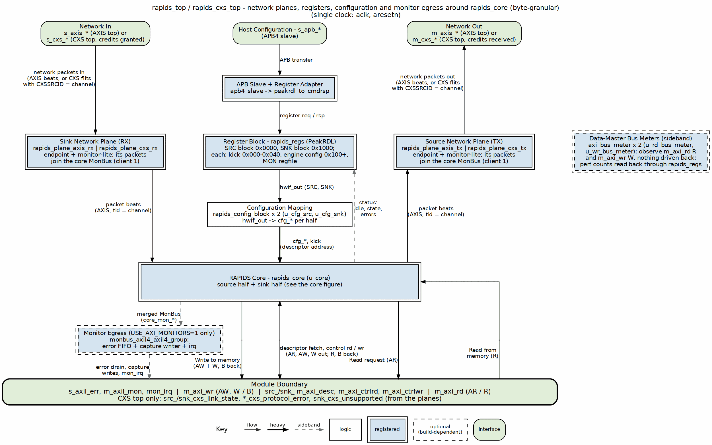

<!-- RTL Design Sherpa Documentation Header -->
<table>
<tr>
<td width="80">
  
</td>
<td>
  <strong>RTL Design Sherpa</strong> · <em>Learning Hardware Design Through Practice</em> 
  
    <a href="https://github.com/sean-galloway/RTLDesignSherpa">GitHub</a> ·
    <a href="https://github.com/sean-galloway/RTLDesignSherpa/blob/main/docs/DOCUMENTATION_INDEX.md">Documentation Index</a> ·
    <a href="https://github.com/sean-galloway/RTLDesignSherpa/blob/main/LICENSE">MIT License</a>
  
</td>
</tr>
</table>

---

<!-- End Header -->

# RAPIDS Top

**Module:** `rapids_top.sv`, `rapids_cxs_top.sv`, `rapids_8ch_top.sv`, `rapids_8ch_cxs_top.sv`, `rapids_16ch_top.sv`, `rapids_16ch_cxs_top.sv` (all generated), `rapids_top_base.sv`
**Location:** `projects/components/dma-ip/rapids/rtl/top/`
**Status:** Implemented
**Last Updated:** 2026-10-17

---

## Overview

`rapids_top` is the synthesizable top level. It wraps [RAPIDS Core](09_rapids_core.md) with an APB4 register interface, two config blocks, the register file, per-channel bus meters and the MonBus AXI-Lite group. It has the same hierarchy as RAPIDS Beats. Only the beat-count unit names differ.

The byte-granular behavior is entirely below the top: the packet record nets are internal to the core halves, so the top port list has no new signals. The full port list is in [Top-Level Port List](../../rapids_beats_mas/ch01_overview/02_port_list.md) and the top integration description is in [RAPIDS Beats Top](../../rapids_beats_mas/ch03_macro_blocks/12_rapids_beats_top.md).

Both tops are generated by `bin/gen_plane_tops.py` from `rapids_top_base`: `rapids_top` adds the AXIS network planes and `rapids_cxs_top` the CXS planes, one CXS link per direction with `CXSSRCID` carrying the channel. The CXS planes carry `tstrb` in `CXSUSER`, so the byte-granular partial last beats and unaligned starts cross the link intact; that caps `DATA_WIDTH` at 1024. The planes are shared with RAPIDS Beats: see [Network Planes](../../rapids_beats_mas/ch03_macro_blocks/13_network_planes.md) and the [CXS Interface Specification](../../rapids_beats_mas/ch04_interfaces/04_cxs_interface_spec.md).

### Channel-Count Variants

The generator also emits fixed-width variants that pair `NUM_CHANNELS` with the register map built for it:

| Top | `NUM_CHANNELS` | Register map | Filelist |
|-----|----------------|--------------|----------|
| `rapids_top`, `rapids_cxs_top` | 8 (parameter) | 8-channel | `rtl/filelists/top/rapids_top.f`, `rapids_cxs_top.f` |
| `rapids_8ch_top`, `rapids_8ch_cxs_top` | 8 | 8-channel | `rapids_8ch_top.f`, `rapids_8ch_cxs_top.f` |
| `rapids_16ch_top`, `rapids_16ch_cxs_top` | 16 | 16-channel (`regs/generated_16ch/`) | `rapids_16ch_top.f`, `rapids_16ch_cxs_top.f` |

: Table 3.12.1: Top Variants

`rapids_top_base` stops elaboration if `NUM_CHANNELS` is larger than the register map compiled with it. The 16-channel map is described in the HAS [16-Channel Register Map](../../rapids_has/ch05_programming/02_register_map_16ch.md).

### Figure 3.12.1: Top Hierarchy

**Source:** [10_rapids_top.dot](../assets/graphviz/10_rapids_top.dot)

---

## APB Address Map

The APB address is 13 bits. Bit 12 selects the half.

| Range | Content |
|-------|---------|
| `0x0000` to `0x003F` | Source staged descriptor addresses. |
| `0x0040` | Source kick-off, one single-pulse bit per channel. |
| `0x0040` to `0x0FFF` | Source configuration registers. |
| `0x1000` to `0x103F` | Sink staged descriptor addresses. |
| `0x1040` | Sink kick-off, one single-pulse bit per channel. |
| `0x1040` to `0x1FFF` | Sink configuration registers. |

: Table 3.12.2: APB Address Map

The monitor register windows sit at `+0x800` of each half's 4 KB space. With `USE_MON_REGS` clear the windows answer with an APB error, so a host can tell a build without monitors from a zero setting.

---

## Parameters

| Parameter | Default | Description |
|-----------|---------|-------------|
| `NUM_CHANNELS` | 8 | Channels. |
| `DATA_WIDTH` | 512 | Data width in bits. The board uses 256. |
| `ADDR_WIDTH` | 64 | Address width. |
| `AXI_ID_WIDTH` | 8 | AXI ID width. |
| `SRAM_DEPTH` | 4096 | Words per channel at the top. |
| `APB_ADDR_WIDTH`, `APB_DATA_WIDTH` | 13, 32 | APB widths. |
| `MON_MAX_TRANSACTIONS` | 16 | Monitor table depth. |
| `SNK_AXIS_MON_AGENT_ID`, `SRC_AXIS_MON_AGENT_ID` | 9, 10 | Network-plane monitor agent ids (AXIS or CXS plane). |
| `ACLK_MHZ` | 100 | Clock in MHz for the network-plane monitor tick. |
| `USE_AXI_MONITORS` | 1 | 0 omits the monitors and the MonBus AXI-Lite group. |
| `USE_ROW_COL_MAJOR_ADDRESSING` | 1 | 0 compiles out extended addressing. |
| `GEN_MON` | 1 | 0 omits the completion and error emitters. |
| `SHARED_ENGINES` | 1 | 1: one descriptor, control-read and control-write engine per half. 0: one of each per channel. See [Shared Engines](../ch02_fub_blocks/10_shared_engines.md). |
| `TILE_HDR`, `TILE_SRC_COORD` | 0, 14'h3000 | Tile packet header; needs `SHARED_ENGINES = 1` and `DATA_WIDTH` of at least 256. See [Tile Packet Header](14_tile_header.md). |
| `TILE_CREDITS` | 0 | End-to-end tile credits and the legal-destination mask (`SRC.TILE_ADV_WINDOW`, `SRC.TILE_LEGAL_DEST_LO` / `_HI`, `SRC.TILE_CREDIT_STATUS`); needs `TILE_HDR = 1`. See [Tile Packet Header](14_tile_header.md). |
| `USE_MON_REGS` | `USE_AXI_MONITORS != 0` | Wire the monitor register windows. |
| `AR_MAX_OUTSTANDING`, `AW_MAX_OUTSTANDING` | 8 | Outstanding bursts. |
| `PIPELINE` | 1 | Write engine pipelining. |
| `AXIS_ID_WIDTH`, `AXIS_DEST_WIDTH`, `AXIS_USER_WIDTH` | 8, 4, 1 | AXIS side widths. |

: Table 3.12.3: Top Parameters

Clock and reset are `aclk` and `aresetn`. `cam_clear` synchronously clears the MonBus group transaction tables.

Each half's configuration block drives its per-channel reset vector (`src_cfg_channel_reset`, `snk_cfg_channel_reset`) from `SRC`/`SNK.CHANNEL_RESET.CH_RST` and `GLOBAL_CTRL.GLOBAL_RST`. The top wires each vector to its half of the core (see [RAPIDS Core](09_rapids_core.md)), and it reaches every block that can hold a channel error: a channel reset recovers every error class, including the AXI response and sink packet length errors, and `aresetn` is needed only at power-up. The top has no port change.

---

## Differences from RAPIDS Beats

| Item | RAPIDS Beats | RAPIDS |
|------|--------------|--------|
| Module | `rapids_beats_top` | `rapids_top` |
| Core instance | `rapids_core_beats` | `rapids_core` |
| Register file, APB map, config blocks | | Unchanged |
| Bus meter beat counters | `r_rd`, `r_wr` | `r_rd_beats`, `r_wr_beats` |
| Config nets | `*_xfer` | `*_xfer_beats` |
| Port list | | Unchanged |

: Table 3.12.4: Top Delta

The register-file field names `RD_XFER_BEATS` and `WR_XFER_BEATS` are the same in both designs. Their meaning is beats in both, since bursts are beat-based.

---

**Last Updated:** 2026-09-30
