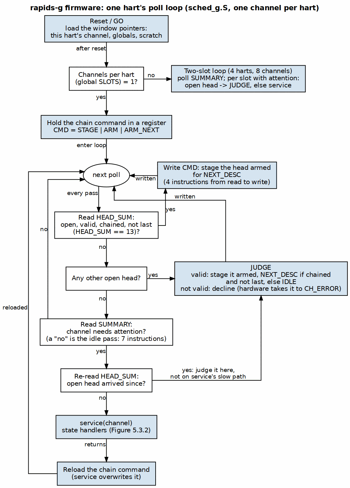
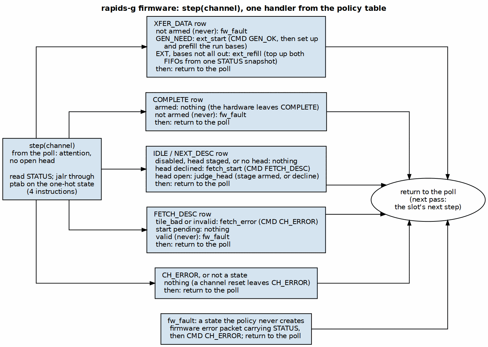

<!-- RTL Design Sherpa Documentation Header -->
<table>
<tr>
<td width="80">
  
</td>
<td>
  <strong>RTL Design Sherpa</strong> · <em>Learning Hardware Design Through Practice</em> 
  
    <a href="https://github.com/sean-galloway/RTLDesignSherpa">GitHub</a> ·
    <a href="https://github.com/sean-galloway/RTLDesignSherpa/blob/main/docs/DOCUMENTATION_INDEX.md">Documentation Index</a> ·
    <a href="https://github.com/sean-galloway/RTLDesignSherpa/blob/main/LICENSE">MIT License</a>
  
</td>
</tr>
</table>

---

<!-- End Header -->

# rapids_seq_g and the Scheduler Firmware

**Module:** `rapids_seq_g.sv`; firmware `rtl/fw_g/sched_g.S`
**Location:** `projects/components/dma-ip/rapids/rtl/macro_g/`
**Status:** Implemented (rapids TASK-034, TASK-037, TASK-035, TASK-036, TASK-038)
**Last Updated:** 2026-10-23

---

## rapids_seq_g

One `gatling_core`, used unchanged through its own filelist, with the three memories it needs, each answering in one stage as gatling requires:

| Block | What | Size |
|---|---|---|
| Instruction memory | the firmware image, from `sched_g_fw.svh`; one read port serves every hart (the barrel fetches for one context per cycle). A ROM, or with `FW_WRITABLE` = 1 the same block RAM with a second port the host loads through (below) | `IMEM_WORDS` = 1024 |
| Scratch | per-hart memory, indexed `{context, word}`; the run-base generator state of each slot | `SCRATCH_WORDS` = 128 per hart (256 at four slots) |
| Window decoder | routes a data access to the slot's `scheduler_g` by context and slot | -- |

: Table 5.3.1: rapids_seq_g

Parameters: `NUM_CHANNELS` (4, 8 or 16), `NUM_HARTS` (4, 8 or 16, dividing `NUM_CHANNELS` with at most four slots per hart; default `NUM_CHANNELS`, one hart and one slot per channel; hart h serves channels h + `NUM_HARTS` x s), `IMEM_WORDS`, `SCRATCH_WORDS` (a power of 2, at least 64 per slot; a smaller scratch would alias slot 1 onto slot 0, and elaboration refuses it), `FW_WRITABLE` (0 = ROM, 1 = loadable; Loading Firmware Live).

### Data Memory Map

| Address | Region |
|---|---|
| 0x0000_0000 | instruction memory (fetch only; a data read returns 0) |
| 0x1000_0000 | slot 0 window (Section 5.2), word-indexed |
| 0x1000_0100 + 0x100 s | slot s window (s < SLOTS) |
| 0x1000_1000 | SUMMARY: `[SLOTS-1:0]` `seq_attn` of this hart's slots |
| 0x1000_1004 | SLOTS: slots per hart (1, 2 or 4) |
| 0x1000_3000 | register mailbox (below), aliased by context |
| 0x2000_0000 | scratch, aliased by context |

: Table 5.3.2: Data memory map

Contexts stay implicit (gatling PRD 7): every hart runs the same image, and "slot 0" is a different channel for each, chosen by the context the access comes from. Reads are registered (address in X, data in W); window writes are registered into `scheduler_g` one cycle after X, so a hart's next instruction, `NUM_HARTS` (at least four) cycles later, always sees the effect of its own write. Each hart issues one instruction every `NUM_HARTS` clocks: at the default 8 harts an instruction costs a hart 8 clocks, which is the unit of every firmware cost in Section 5.5.

### Register Mailbox

Each hart can read and write its own half's PeakRDL registers -- the same `rapids_regs` the host programs, config and status alike -- through a mailbox in its data memory map at 0x1000_3000, aliased by context:

| Offset | Word | What |
|---|---|---|
| +0x00 | REG_ADDR | byte offset within the half, `[11:0]` |
| +0x04 | REG_WDATA | write data |
| +0x08 | REG_CTRL | `[0]` go, `[1]` write; a store with go set posts the access |
| +0x0C | REG_STATUS | `[0]` busy, `[1]` done, `[2]` error (the response's PSLVERR) |
| +0x10 | REG_RDATA | read data, valid once done |

: Table 5.3.3: Register mailbox, per hart

The firmware posts an access and polls REG_STATUS: a single-stage barrel cannot stall on a bus. A store to REG_* while the hart's own access is busy is ignored, so a hart polls for done before it posts the next one. The scheduler firmware does not use the mailbox today; the path is there for firmware that reads or adjusts its half's configuration, and `test_rapids_g_regpath` proves it (below).

#### A Serialized Path

**The register path is serialized, end to end.** The register block has one command/response path (`peakrdl_to_cmdrsp` in front of `rapids_regs`), and exactly one access is on it at any time. One agent -- the host's APB, or one hart of one gatling -- is granted the path, sends its one command, and **owns the path until its response is complete**: the grant is released only by the response handshake. No other agent's command enters the path in between, there is no pipelining and no second outstanding access, and a response is never returned to anyone but the agent that owns the path. This is the same one-outstanding discipline `apb4_slave` keeps on the host path alone, and the MON-window guard behind the arbiter depends on it: it registers its select when a command is accepted and steers the response on that registered select.

Two levels of round-robin arbitration feed that one path, and both hold their grant for the whole access:

**Level 1, the harts of one gatling** (`rapids_seq_g`). Each hart has its own mailbox state, indexed by context: `r_mb_addr[h][11:0]`, `r_mb_wdata[h]`, `r_mb_wr[h]`, and `r_mb_busy[h]` -- set by the REG_CTRL store, and the hart's request -- with `r_mb_done[h]`, `r_mb_err[h]` and `r_mb_rdata[h]` for the completion. An `arbiter_round_robin_simple_ack` takes `request = r_mb_busy` and grants one hart (`w_mb_gnt_valid`, `w_mb_gnt_id`). That hart's access goes out once on the gatling's one master port -- `reg_cmd_valid = w_mb_gnt_valid && !r_mb_sent && r_mb_busy[gnt]`, with `reg_cmd_pwrite`, `reg_cmd_paddr[11:0]` and `reg_cmd_pwdata` from the granted hart -- and `r_mb_sent` records that it has gone. `reg_rsp_ready = w_mb_gnt_valid && r_mb_sent`. The response handshake clears the hart's busy, latches done, `err <- reg_rsp_pslverr` and `rdata <- reg_rsp_prdata`, and is the arbiter's ack: only then does the grant move to the next requesting hart.

**Up the tree.** The port is `seq_reg_*` on `scheduler_group_array_g`, `rapids_src_g` / `rapids_snk_g` and `rapids_core_g` (`src_seq_reg_*`, `snk_seq_reg_*`), carried up unchanged by `gen_rapids_g.py`, and arrives in the top base as `w_src_seq_reg_*` and `w_snk_seq_reg_*`. Each carries `cmd_valid`, `cmd_ready`, `cmd_pwrite`, `cmd_paddr[11:0]`, `cmd_pwdata`, `rsp_valid`, `rsp_ready`, `rsp_prdata`, `rsp_pslverr`.

**Level 2, the host against the two gatlings** (`rapids_g_reg_arb`, included by `rapids_g_top_reg_arb.svh`). The generator renames `apb4_slave`'s command/response outputs to `host_cmd_*` / `host_rsp_*`, and three masters meet:

| Master | Index | Address into the 13-bit map |
|---|---|---|
| host APB, `host_cmd_*` / `host_rsp_*` | 0 | `host_cmd_paddr`, the whole map |
| SRC gatling, `w_src_seq_reg_*` | 1 | `{1'b0, w_src_seq_reg_cmd_paddr}`: pinned to SRC, 0x0000-0x0FFF |
| SNK gatling, `w_snk_seq_reg_*` | 2 | `{1'b1, w_snk_seq_reg_cmd_paddr}`: pinned to SNK, 0x1000-0x1FFF |

: Table 5.3.4: Register-path masters

A second `arbiter_round_robin_simple_ack` takes `request = m_cmd_valid[2:0]` and grants one master (`w_gnt_valid`, `w_gnt`, `w_gnt_id`). The granted master's command passes through once -- `s_cmd_valid = w_gnt_valid && !r_cmd_sent && m_cmd_valid[gnt]`, `m_cmd_ready[gnt] = s_cmd_ready && !r_cmd_sent` -- and `r_cmd_sent` holds the grant open for the response. The response goes back only to the owner: `m_rsp_valid[gnt] = s_rsp_valid && r_cmd_sent` and `s_rsp_ready = r_cmd_sent && m_rsp_ready[gnt]` (`m_rsp_prdata` and `m_rsp_pslverr` are shared wires, meaningful only with that master's valid). `w_ack = (s_rsp_valid && s_rsp_ready) ? w_gnt : 0` releases the grant and clears `r_cmd_sent`. The arbiter's slave side is `apb_cmd_*` / `apb_rsp_*`, which runs on through the MON-window guard (an error response for `paddr[11]` when `USE_MON_REGS = 0`) to `peakrdl_to_cmdrsp` and `rapids_regs`.

| Step | Owner of the path | Signals |
|---|---|---|
| a hart posts | -- | REG_CTRL store sets `r_mb_busy[h]` |
| level 1 grants that hart | the hart, within its gatling | `w_mb_gnt_id = h`; `reg_cmd_valid` |
| level 2 grants that gatling | the hart, end to end | `w_gnt_id`; `s_cmd_valid` -> `apb_cmd_valid`; `r_cmd_sent`, `r_mb_sent` set |
| the register block answers | still the hart | `apb_rsp_valid` -> `m_rsp_valid[gnt]` -> `reg_rsp_valid` |
| the response is accepted | released at both levels | `w_ack` (level 2), `reg_rsp_valid && reg_rsp_ready` (level 1); `r_mb_done[h]` |

: Table 5.3.5: One gatling access, end to end

What the serialization costs and guarantees:

- **Ordering.** Accesses from all agents are totally ordered by grant; an access completes before the next one starts, so a read after a write -- from any agent -- sees the write.
- **Fairness.** Under full contention the host gets at least every third access and each gatling the same; inside a gatling each of its harts gets at least one of every `NUM_HARTS` of that gatling's turns (1 in 24 of the path at 8 harts).
- **Latency.** An access holds the path from command to response, including `peakrdl_to_cmdrsp`'s two-cycle request, so a busy gatling delays a host access by an access time, and a host access delays a waiting hart the same way. That is invisible at UART speeds and small at full APB rate; the mailbox is not a per-descriptor path.
- **No atomicity across accesses.** Each access is atomic; a read-modify-write is two accesses another agent can come between. The per-channel `CH_SCRATCH[n].SCRATCH` bits (0x300 in each half) are for the host and the gatling to share flags or semaphores: give each bit one writer.

`test_rapids_g_regpath` (dv/tests/top_g) replaces the scheduler image with a test program in which every hart reads SCHED_TIMEOUT_CYCLES of its own half through the mailbox and writes SCHED_TIMEOUT_LIMIT, while the host programs both halves and reads them back over APB through the same path. It checks that each gatling sees its own half's value, that its writes land in its own half, that no mailbox access reported an error, and that every host read during the contention returned the value the host expects.

### Faults

`seq_fault[c]` is the halted bit of the hart serving channel c, so a firmware trap is a fatal fault for that hart's channels: they enter CH_ERROR and send the scheduler's error packet. A halted hart restarts from address 0 once every channel it serves is in channel reset.

## Firmware

`sched_g.S` is RV32I with no stack and no data section; state that outlives one step lives in the slot's scratch. It is an **executive** over a **policy table** (rapids TASK-037). The executive polls and dispatches and is the same for every policy; the table says what each (state, event) pair does. Both firmware defects found on 2026-10-22 came from mixing the two (Section 5.5): the poll and the handlers disagreed about who owned an open head, and a handler that re-dispatched itself kept a hart for several descriptors. Neither can recur in this shape.

### The Executive

Run to completion, no preemption: the barrel's harts are the threads. Each pass of the poll gives a slot at most one handler, and the handler returns to the poll. The image reads SLOTS at start-up and takes one of two polls.

**One slot per hart** (the default, `NUM_HARTS` = `NUM_CHANNELS`). The poll reads HEAD_SUM first. HEAD_SUM = 13 (open, valid, `next_ptr` != 0, not last) is a chained head: the poll writes STAGE | STAGE_ARM | STAGE_ARM_NEXT, held in a register, so a running chain costs four instructions from the read to the CMD write. This chain hook is the one policy entry that lives in the poll itself. Any other open head is judged inline (`judge_head`: stage it armed with its own chain outcome, or decline it). With no open head the poll reads SUMMARY; the idle pass is seven instructions. When SUMMARY shows attention, the poll reads HEAD_SUM again, so a head that arrived between the two reads is judged inline too, then calls `step`.

**Two slots per hart** (`NUM_HARTS` = 4 at 8 channels, or 8 at 16, the 16-channel default). The poll reads SUMMARY first, so the idle pass is two instructions. For each slot with attention it reads HEAD_SUM and, before anything else, takes the same chain hook: HEAD_SUM = 13 is staged armed for NEXT_DESC straight from the read, with the stage word held in `tp` (reloaded after every `step`, which may clobber it). Any other open head is judged inline; otherwise the poll calls `step`. Unrolled for the two slots.

A chain is serial: the hardware takes about 20 clocks per one-beat descriptor (FETCH_DESC, XFER_DATA, COMPLETE, NEXT_DESC), then waits in NEXT_DESC with the next head open until the firmware's stage command lands, so every instruction between the head opening and the CMD write is paid per descriptor. A cycle trace of the earlier two-slot polls (Section 5.5) showed it: the image before 2026-10-23 judged every head through SUMMARY and JUDGE, about 22 instructions (about 180 clocks a descriptor); a first fix that put the two HEAD_SUM checks ahead of SUMMARY alternated between a 36-clock wait (the check caught the head) and a 156-clock one (the head opened just after its check and the pass fell to JUDGE), about 120 on average. Checking SUMMARY first and the chain hook inside each slot's branch never misses: about 99 clocks a descriptor on the board, against about 44 with one slot per hart, which tests HEAD_SUM in a four-instruction loop.

**Four slots per hart** (`NUM_HARTS` = 4 at 16 channels, rapids TASK-036). The same poll as a loop over SUMMARY's bits, the slot's offset in `sp` (window and scratch share the 0x100 slot stride).

`step` reads STATUS and jumps through `ptab`, indexed by the 6-bit one-hot state: four instructions from the STATUS read to the state's row. `ptab` has 64 entries, so no value of the field can index past it; the five states with work have a jump to their row, and every other entry (CH_ERROR, which only a channel reset leaves, and the values that are not states) returns. The image is linked at 0 and `ptab` sits below 2 KB, so the jump is `jalr` off the index register alone and needs no base register (`gen_rapids_g_fw.py` refuses an image where it does not fit).

### Figure 5.3.1: One Hart's Poll

**Source:** `assets/graphviz/12_rapids_g_fw_poll_loop.dot`

### The Policy Table

A state's row picks one handler by event, highest priority first. A handler does one step -- one or two CMD writes, or one run-base set-up or top-up -- and returns. No handler loops, re-reads STATUS to carry on, or calls `step`: the slot's next step is the next pass of the poll.

| State | Event, in priority order | Handler | What it does |
|-------------------|----------------------|-------------------|------------------------------|
| any | an open head (in the poll) | `judge_head` | valid: STAGE armed with its chain outcome; not valid: DECLINE |
| IDLE (enabled), NEXT_DESC | head staged, or no head | -- | nothing: the hardware takes a staged head |
| | head declined | `fetch_start` | CMD FETCH_DESC; FETCH_DESC then takes it to CH_ERROR |
| | head open | `judge_head` | as above |
| FETCH_DESC | tile_bad, or descriptor invalid | `fetch_error` | CMD CH_ERROR |
| | start already pending | -- | nothing |
| | valid (never: see below) | `fw_fault` | firmware error packet carrying STATUS; CMD CH_ERROR |
| XFER_DATA | not armed (never) | `fw_fault` | as above |
| | GEN_NEED (an EXT descriptor the hardware took) | `ext_start` | CMD GEN_OK, then set up and prefill the run bases (`ext_init`) |
| | EXT, bases not all out | `ext_refill` | top up both directions' base FIFOs from one STATUS snapshot |
| COMPLETE | armed | -- | nothing: the hardware leaves COMPLETE next cycle |
| | not armed (never) | `fw_fault` | as above |

: Table 5.3.6: The policy table

**The rows marked "never".** Every valid head is staged armed, so the hardware takes it, completes it and leaves COMPLETE on its own; the firmware takes a head itself (FETCH) only when it declined it, and a declined head is invalid by the same test the latch applies. A descriptor can therefore never be in XFER_DATA or COMPLETE unarmed, nor valid in FETCH_DESC by the firmware's hand. TASK-034's firmware still carried a hand path for those states (arm in XFER_DATA, route out of COMPLETE, start from FETCH_DESC); the mutation set showed no test could reach it (MAS 5.5), because nothing can. It is replaced by `fw_fault`: a state the policy never creates stops the channel visibly instead of being guessed at, and a channel reset recovers it.

The run-base routines (`ext_init`, `refill`) are a layer below the table: they are where the next-address algorithm lives, and the descriptor's selector picks one (rapids TASK-035, below).

### Figure 5.3.2: step(), the Policy Table

**Source:** `assets/graphviz/13_rapids_g_fw_service.dot`

### EXT Run Bases

The positions, the step and the 16-bit index wrap are exactly `stream_run_addr_gen`'s: run-contiguous when `stride_0` equals the beat size (one base per run of `inner_count` beats, rows 1, 2, ...), otherwise per beat (every beat after the first, inner index fastest). A base is `base + ((i0 * s0) & m0) + ((i1 * s1) & m1)` in 64 bits. Without wrap masks (the common case) the firmware keeps the address itself and a base is one 64-bit add (`cur += s0` along a row, `row += s1` at a row's end); with masks it keeps the two products as running sums and masks them for each base. Whenever an EXT descriptor's FIFO has room, attention brings the firmware back to top it up; the last base sets the direction's bases-done bit.

### Next-Address Selector

The descriptor's selector (chunk 0 `[224:217]`, HAS Section 5.1) chooses the algorithm. The image declares the highest one it implements with `.equ ALG_MAX`; `gen_rapids_g_fw.py` writes it into `sched_g_fw.svh` as `FW_ALG_MAX`, and `rapids_seq_g` drives it to every `scheduler_g` as `seq_alg_max`. The check is hardware, the same in both places it is made: `scheduler_core` latches a descriptor whose selector is above it (or non-zero without TYPE=EXT) as invalid, and `scheduler_g` folds the same test into HEAD_SUM's valid bit, so the firmware declines such a head and the chain hook (HEAD_SUM = 13) is untouched. A selector is refused from reset, before the firmware runs an instruction.

| Selector | Set-up | Top-up |
|---|---|---|
| 0 | `gen_init`: positions, step and masks as `stream_run_addr_gen` | `refill` (masked) or `refill_fast` (no wrap) |
| 1, Z-order | `gen_init_z`: unit = a beat or a run of `inner_count` beats; S0 = `stride_0` or `inner_count << OFF_W`; position k = 1 | `refill_z` |

: Table 5.3.7: Next-address algorithms in the image

`refill_z` keeps x x S0 and y x `stride_1` as running sums, like the masked path, and steps the position in Morton order without a multiplier: k -> k + 1 clears k's trailing ones and sets the bit above them, and bit 2i is x's bit i, bit 2i + 1 is y's, so each cleared bit subtracts the stride shifted by i and the set bit adds it -- about two bits a step on average. The generator block's mode word tells `refill` which path to take (1 fast, 0 masked, -1 Z-order), so selector 0 costs one instruction more per masked top-up and nothing on the fast path.

### Building the Image

`bin/gen_rapids_g_fw.py` runs `riscv-none-elf-as` / `ld` (text at 0) / `objcopy -O binary` and writes `FW_WORDS` and `FW_IMAGE[]` into `rtl/macro_g/generated/fw/sched_g_fw.svh`, which `rapids_seq_g` includes, so neither simulation nor synthesis needs a file path. `--check` fails when the include is stale. Never edit the include.

### Loading Firmware Live

With `FW_WRITABLE` = 1 (rapids TASK-038) the instruction memory is the same 1024 x 32 block RAM with its second port used for a load: write and read back. It powers up holding the generated image, so a writable build that is never loaded runs exactly as the ROM build. The host reaches it through four registers in each half, at the same offsets in the 8- and 16-channel maps:

| Offset | Register | Fields |
|---|---|---|
| 0x3A0 | `FW_CTRL` | `HOLD[0]` RW: hold every hart of the half in reset, and allow FW_DATA writes; `WRITABLE[1]` RO: 1 on a FW_WRITABLE build; `ALG_MAX[15:8]` RW: the loaded image's highest next-address selector |
| 0x3A4 | `FW_ADDR` | `ADDR[15:0]` RW: the word index; advances by one after each FW_DATA write and each FW_RDATA read |
| 0x3A8 | `FW_DATA` | `DATA[31:0]`: a write stores the word at FW_ADDR, only while HOLD = 1 |
| 0x3AC | `FW_RDATA` | `DATA[31:0]` RO: the word at FW_ADDR (0 on a ROM build) |

: Table 5.3.8: Firmware load registers, per half

A load is: FW_CTRL HOLD = 1 with the image's ALG_MAX; FW_ADDR = 0; one FW_DATA write per word; FW_ADDR = 0 and one FW_RDATA read per word to compare; FW_CTRL HOLD = 0. Releasing the hold restarts the harts from address 0 on the new image, like `seq_restart`, so hold only while every channel of the half is idle. While HOLD = 1 the next-address cap every `scheduler_g` applies (`seq_alg_max`) follows FW_CTRL.ALG_MAX and keeps that value after the release, so a loaded image carries its own selector set. On a ROM build and on RAPIDS the registers exist, WRITABLE reads 0 and the rest has no effect.

The top base's glue (`rapids_g_top_fw.svh`) turns each register access into one store or one advance. Behind `peakrdl_to_cmdrsp`, `swmod` and `swacc` are a two-cycle level, not a pulse (the handbook's generated-RTL note); the glue takes each access on its rising edge, one flop late so the field storage has the written value. The first version counted every cycle: it stored each word twice and advanced FW_ADDR by two, which a readback walking the same counter could not see below word 512 -- the self-test's direct address probe now catches it.

Host side (`flows-rapids/host/run_characterization.py`): `--fw <sched.S>` assembles the source with the same generator that writes the ROM include, loads both halves, reads every word back and releases, and records the image's SHA-256 in the results (on a writable build the bitstream no longer names the firmware). `--fw-selftest` first proves the path: a FW_DATA write without HOLD is refused; a one-word image of 0x00000000, an illegal instruction, halts every hart, so every channel goes to CH_ERROR (the harts run what was loaded); direct probes across the memory read the right word and advance by one; loading the real image and a channel reset bring every channel back to CH_IDLE. On a ROM build it checks the opposite, that the same writes change nothing. A full load is about 2,600 UART operations, too many for a 100 ms simulation beside a measurement, so a simulation can instead build the candidate in (`TEST_FW_IMAGE`, rendered by `gen_rapids_g_fw.py --src/--out`) and check it with `--fw-expect`, which reads back the first and last eight words; the memory holds the same image at GO either way.

The flow is: iterate a candidate live on a writable bitstream, check it in simulation built in, compare simulation and board, and once it is final commit it as `sched_g.S`, so the ROM build carries it. The two-slot poll above was developed this way, two candidates loaded on one bitstream; the committed image is byte-identical (SHA-256 `00b7003b...`) to the one measured on the board.
