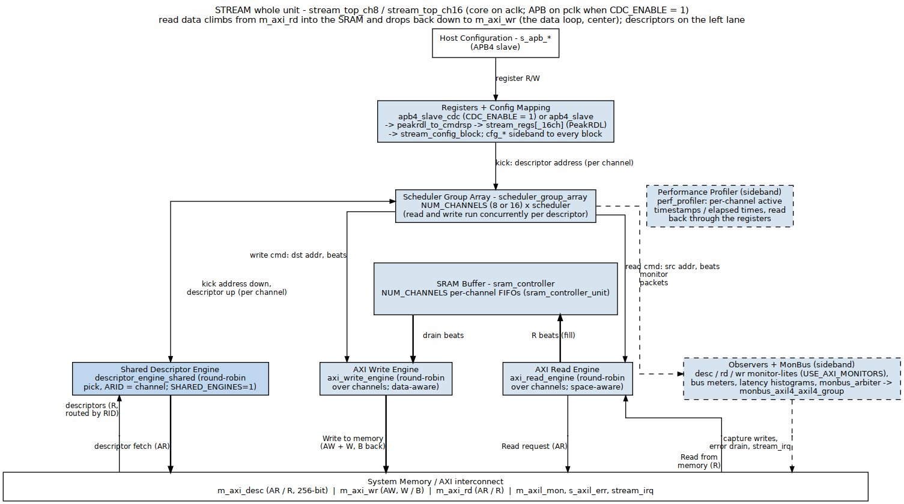

<!-- RTL Design Sherpa Documentation Header -->
<table>
<tr>
<td width="80">
  
</td>
<td>
  <strong>RTL Design Sherpa</strong> · <em>Learning Hardware Design Through Practice</em> 
  
    <a href="https://github.com/sean-galloway/RTLDesignSherpa">GitHub</a> ·
    <a href="https://github.com/sean-galloway/RTLDesignSherpa/blob/main/docs/DOCUMENTATION_INDEX.md">Documentation Index</a> ·
    <a href="https://github.com/sean-galloway/RTLDesignSherpa/blob/main/LICENSE">MIT License</a>
  
</td>
</tr>
</table>

---

<!-- End Header -->

# Block Diagram

## Top-Level Architecture

### Figure 3.1.1: STREAM Whole Unit

**Source:** [ch03_whole_unit.dot](../assets/graphviz/ch03_whole_unit.dot)

---

## Functional Block Summary

| Block | Function | Key Interfaces |
|-------|----------|----------------|
| **APB Config Slave + Registers** | `apb4_slave_cdc` (or `apb4_slave`), `stream_regs` (`stream_regs_16ch` in the 16-channel top), `stream_config_block` | APB slave, kick-off signals |
| **Descriptor Engine** | Fetch and parse descriptors. One shared engine serves every channel by default (`SHARED_ENGINES = 1`) | AXI read, per-channel descriptor output |
| **Scheduler** | Coordinate transfer phases | Control signals to all blocks |
| **Descriptor AR Arbiter** | `SHARED_ENGINES = 0` only: round-robin over the per-channel descriptor engines (no priority). The shared engine makes the same pick internally | Grant signals |
| **AXI Read Engine** | Read source data to SRAM | AXI read master |
| **SRAM Buffer** | Temporary data storage | Read/write ports |
| **AXI Write Engine** | Write SRAM data to destination | AXI write master |
| **Monitors + MonBus group** | Monitor-lites, `monbus_arbiter`, `monbus_axil4_axil4_group` (USE_AXI_MONITORS = 1) | `m_axil_mon`, `s_axil_err`, `stream_irq` |
| **Performance Profiler** | Per-channel activity timestamps or elapsed times | Register read-back |

---

## Block Interactions

### Control Flow

APB Write -> APB Config -> Descriptor Engine -> Scheduler -> Data Path, with AXI Desc Master fetching descriptors.

### Data Flow

Memory -> AXI Read Engine -> SRAM Buffer -> AXI Write Engine -> Memory

### Monitoring Flow

Scheduler groups and monitor-lites -> `monbus_arbiter` -> `monbus_axil4_axil4_group` -> error FIFO (`s_axil_err`, `stream_irq`) and capture writes (`m_axil_mon`)

---

## Parameterization

| Parameter | Description | Default | Range |
|-----------|-------------|---------|-------|
| `NUM_CHANNELS` | Number of DMA channels | 8 (`stream_top_ch8`), 16 (`stream_top_ch16`) | 1-16 (8-channel register map up to 8) |
| `SHARED_ENGINES` | One shared descriptor engine (1) or one per channel (0) | 1 | 0, 1 |
| `DATA_WIDTH` | AXI data bus width | 512 | 128, 256, 512 |
| `ADDR_WIDTH` | Address width | 64 | 32, 64 |
| `SRAM_DEPTH` | Buffer depth in entries, per channel | 4096 | 256-8192 |
| `DESC_FIFO_DEPTH` | Descriptor FIFO depth | 4 | 2-8 |

---

**Last Updated:** 2026-10-17
