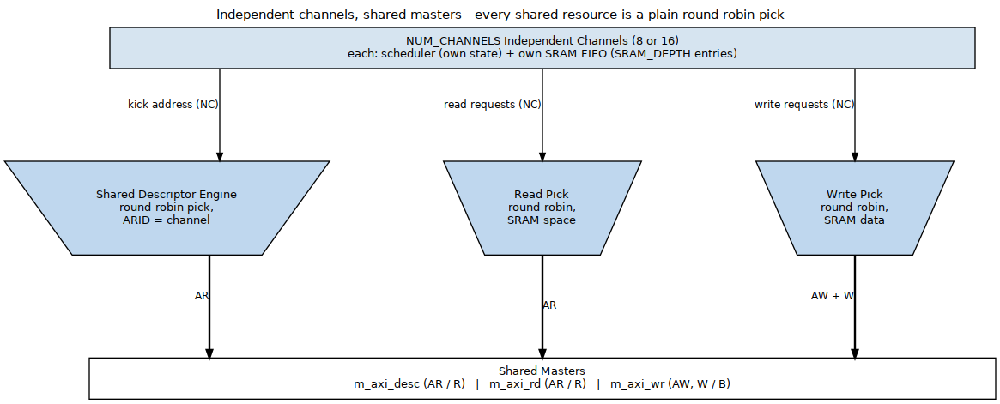
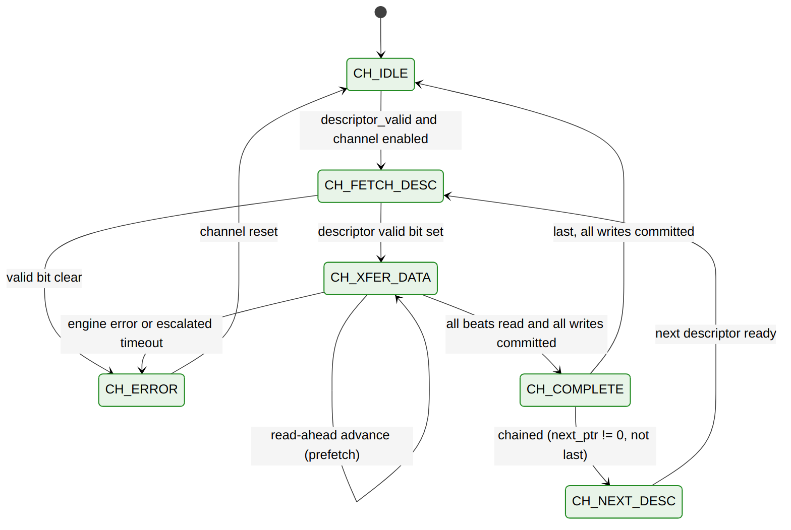

<!-- RTL Design Sherpa Documentation Header -->
<table>
<tr>
<td width="80">
  
</td>
<td>
  <strong>RTL Design Sherpa</strong> · <em>Learning Hardware Design Through Practice</em> 
  
    <a href="https://github.com/sean-galloway/RTLDesignSherpa">GitHub</a> ·
    <a href="https://github.com/sean-galloway/RTLDesignSherpa/blob/main/docs/DOCUMENTATION_INDEX.md">Documentation Index</a> ·
    <a href="https://github.com/sean-galloway/RTLDesignSherpa/blob/main/LICENSE">MIT License</a>
  
</td>
</tr>
</table>

---

<!-- End Header -->

# Multi-Channel Architecture

## Channel Organization

STREAM supports 8 or 16 independent DMA channels (`stream_top_ch8` / `stream_top_ch16`), each processing its own descriptor chain:

### Figure 3.3.1: Channel Architecture

**Source:** [ch03_channel_architecture.dot](../assets/graphviz/ch03_channel_architecture.dot)

---

## Per-Channel Resources

Each channel maintains independent state:

| Resource | Description | Size |
|----------|-------------|------|
| **FSM State** | Current operation phase | 4 bits |
| **Descriptor Pointer** | Current/next descriptor address | 64 bits |
| **Transfer Counter** | Beats remaining in current transfer | 32 bits |
| **Error Status** | Error flags and codes | 8 bits |
| **Priority** | Current descriptor priority | 8 bits |

---

## Shared Resources

All channels share the following resources:

| Resource | Arbitration | Capacity |
|----------|-------------|----------|
| **Descriptor AXI Master** | Round-robin pick in the shared descriptor engine | One fetch in flight per channel; fetches from different channels overlap (ARID = channel) |
| **Data Read AXI Master** | Round-robin over channels with SRAM space | Configurable outstanding |
| **Data Write AXI Master** | Round-robin over channels with SRAM data | Configurable outstanding |
| **SRAM Buffer** | None: one FIFO per channel | SRAM_DEPTH entries per channel |
| **MonBus** | Round-robin (`monbus_arbiter`) | One packet per grant |

---

## Arbitration Scheme

### Round-Robin Arbitration

Every shared master is behind a plain round-robin pick (`arbiter_round_robin`
in acknowledge mode): the grant moves to the next requesting channel after
the last winner. There is no priority logic. The descriptor's 8-bit priority
field (`[207:200]`) is carried but not used for arbitration, and there is no
anti-starvation timer or preemption; round-robin itself bounds every
channel's wait to one turn of the other channels. The read and write engines
mask a channel out of their pick until its SRAM FIFO has room (read) or data
(write) for a burst.

### Arbitration Points

Arbitration occurs at:

1. **Descriptor Fetch:** When a channel has a descriptor address to fetch. In the default build (`SHARED_ENGINES = 1`) the pick is inside the one shared descriptor engine; with `SHARED_ENGINES = 0` each channel has its own engine and an arbiter merges their AR requests
2. **Read Phase Start:** When channel ready to read source data
3. **Write Phase Start:** When channel ready to write destination

---

## Channel States

Each channel FSM traverses these states:

### Figure 3.3.2: Channel FSM State Diagram

**Source:** [05_channel_fsm.mmd](../assets/mermaid/05_channel_fsm.mmd)

| State | Description | Transitions |
|-------|-------------|-------------|
| **CH_IDLE** | No active transfer | Descriptor ready and channel enabled -> CH_FETCH_DESC |
| **CH_FETCH_DESC** | Latch and check the descriptor (one cycle) | Valid bit set -> CH_XFER_DATA; clear -> CH_ERROR |
| **CH_XFER_DATA** | Read (source to SRAM) and write (SRAM to destination) run concurrently | All beats read and all writes committed -> CH_COMPLETE |
| **CH_COMPLETE** | Descriptor done; check for a chain | Chained -> CH_NEXT_DESC; last, once every write has committed -> CH_IDLE |
| **CH_NEXT_DESC** | Wait for the next chained descriptor | Descriptor ready -> CH_FETCH_DESC |
| **CH_ERROR** | Sticky fault (engine error, invalid descriptor, escalated timeout) | Channel reset -> CH_IDLE |

: Channel FSM States

A disabled channel does not take a descriptor in CH_IDLE. A descriptor already
fetched for it waits in the engine's FIFO until the channel is enabled.

-------|-------------|-------------|
| **IDLE** | No active transfer | Kick-off -> FETCH |
| **FETCH** | Fetching descriptor | Complete -> PARSE |
| **PARSE** | Validating descriptor | Valid -> ARB_READ, Invalid -> ERROR |
| **ARB_READ** | Awaiting read grant | Grant -> READ |
| **READ** | Reading source data | Complete -> ARB_WRITE |
| **ARB_WRITE** | Awaiting write grant | Grant -> WRITE |
| **WRITE** | Writing destination | Complete -> CHAIN |
| **CHAIN** | Checking for next | Next -> FETCH, Last -> COMPLETE |
| **COMPLETE** | Transfer done | IRQ sent -> IDLE |
| **ERROR** | Error condition | SW clear -> IDLE |

---

## SRAM Buffering

Each channel has its own SRAM FIFO (one `sram_controller_unit` per channel),
`SRAM_DEPTH` entries deep. The top-level parameter is a per-channel depth, not
a pool divided among the channels, and it is fixed at build time. An idle
channel's FIFO is not lent to a busy one.

| Build | FIFOs | Entries per channel | Total entries |
|-------|-------|---------------------|---------------|
| `stream_top_ch8` | 8 | `SRAM_DEPTH` | 8 x `SRAM_DEPTH` |
| `stream_top_ch16` | 16 | `SRAM_DEPTH` | 16 x `SRAM_DEPTH` |

: SRAM Buffering by Build

The read engine issues a burst for a channel only when that channel's FIFO
has room for it. The write engine issues only when the FIFO holds the data.
One channel's full or empty FIFO therefore never stalls another channel.

---

## Error Isolation

Errors are isolated to the affected channel:

- Error in Channel N does not affect the other channels (0..NUM_CHANNELS-1)
- Shared resource errors logged but don't block other channels
- Software must clear error and re-kick to resume

---

**Last Updated:** 2026-10-17
