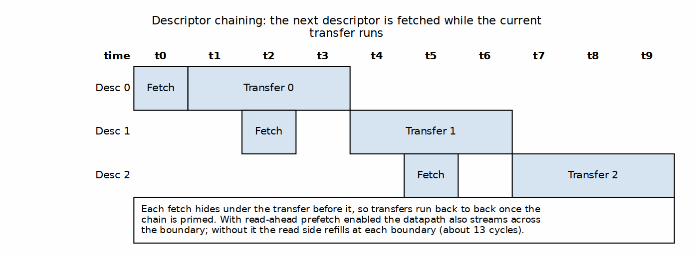

<!-- RTL Design Sherpa Documentation Header -->
<table>
<tr>
<td width="80">
  
</td>
<td>
  <strong>RTL Design Sherpa</strong> · <em>Learning Hardware Design Through Practice</em> 
  
    <a href="https://github.com/sean-galloway/RTLDesignSherpa">GitHub</a> ·
    <a href="https://github.com/sean-galloway/RTLDesignSherpa/blob/main/docs/DOCUMENTATION_INDEX.md">Documentation Index</a> ·
    <a href="https://github.com/sean-galloway/RTLDesignSherpa/blob/main/LICENSE">MIT License</a>
  
</td>
</tr>
</table>

---

<!-- End Header -->

# Throughput Targets

## Theoretical Maximum

### Per-Interface Bandwidth

| Interface | Data Width | Frequency | Bandwidth |
|-----------|------------|-----------|-----------|
| Descriptor Fetch | 256 bits | 200 MHz | 6.4 GB/s |
| Data Read | 512 bits | 200 MHz | 12.8 GB/s |
| Data Write | 512 bits | 200 MHz | 12.8 GB/s |

### Aggregate Bandwidth

- **Bidirectional:** 25.6 GB/s (simultaneous read + write)
- **Descriptor Overhead:** ~0.1% for large transfers

---

## Practical Throughput

### Single-Channel Performance

| Scenario | Expected Efficiency | Effective Bandwidth |
|----------|---------------------|---------------------|
| Large sequential (>1MB) | >95% | >12.0 GB/s |
| Medium sequential (64KB-1MB) | 85-95% | 10.8-12.0 GB/s |
| Small sequential (4KB-64KB) | 70-85% | 9.0-10.8 GB/s |
| Very small (<4KB) | 40-70% | 5.0-9.0 GB/s |

### Multi-Channel Performance

| Active Channels | Per-Channel BW | Aggregate BW |
|-----------------|----------------|--------------|
| 1 | 12.8 GB/s | 12.8 GB/s |
| 2 | 6.4 GB/s | 12.8 GB/s |
| 4 | 3.2 GB/s | 12.8 GB/s |
| 8 | 1.6 GB/s | 12.8 GB/s |

**Note:** Aggregate limited by shared AXI masters. Individual channel throughput scales inversely with active channel count.

### Measured on the Genesys 2: Shared and Per-Channel Descriptor Engines

Source: the two bitstreams of the Resource Estimates chapter, `stream_perf_genesys2_8ch_pce.bit` (`SHARED_ENGINES = 0`) and `stream_perf_genesys2_8ch.bit` (`SHARED_ENGINES = 1`): 8 channels, 128-bit data, 100 MHz. Both ran back to back on 2026-10-17 on the same board under the same host sweep (`host_characterize.py`): 1, 2, 4, 8 and 16 descriptors per channel, 1 to 8 active channels, 1 MiB per channel, and no added memory latency. That is 40 configurations. The records are `projects/fpga-systems/Genesys2/dma-ip/stream/reports/perf/json/stream_sweep_20261017_shared_engines0.json` and `..._shared_engines1.json`.

| Measure | Per-channel engines | Shared engine |
|---------|---------------------|---------------|
| Configurations passed | 40 of 40 | 40 of 40 |
| Data rate, first read to last read and first write to last write | 1525.9 MiB/s | 1525.9 MiB/s |
| Theoretical peak, 16 bytes x 100 MHz | 1525.9 MiB/s (1600 MB/s) | 1525.9 MiB/s (1600 MB/s) |
| Lowest end-to-end rate, kick to done | 1524.8 MiB/s | 1524.8 MiB/s |
| Total cycles, shared minus per-channel | | -1 in every configuration |

: Genesys 2 Board Results, SHARED_ENGINES 0 and 1

Both builds move one beat per cycle from the first beat to the last on both AXI masters, which is the line rate. The data-phase cycle counts are identical in all 40 configurations. The only difference is that every run with the shared engine finishes exactly one cycle sooner, a fixed start-up difference in the descriptor path. Sharing the descriptor engine costs no throughput.

---

## Throughput Limiting Factors

### Memory System Factors

| Factor | Impact | Mitigation |
|--------|--------|------------|
| Memory latency | Reduces efficiency for small transfers | Use deeper outstanding |
| Memory bandwidth | Hard limit | Match STREAM to memory capability |
| Interconnect contention | Variable impact | Priority configuration |

### STREAM Internal Factors

| Factor | Impact | Mitigation |
|--------|--------|------------|
| Descriptor fetch overhead | Fixed per descriptor | Use longer transfers |
| Per-descriptor boundary bubble | ~13 cyc/descriptor (chains) | Read-ahead prefetch (default on) — eliminates it |
| SRAM depth | Limits outstanding | Configure adequate depth |
| Arbitration overhead | Multi-channel penalty | Reduce active channels |
| Burst splitting | 4KB boundary crossings | Align transfers |

---

## Performance Targets

### Design Targets

| Metric | Target | Condition |
|--------|--------|-----------|
| **Peak throughput** | 12.8 GB/s | Single direction, ideal |
| **Sustained throughput** | >11.0 GB/s | Large transfers, single channel |
| **Multi-channel aggregate** | >10.0 GB/s | 8 channels active |
| **Small transfer efficiency** | >50% | 4KB transfers |

### Verification Criteria

| Scenario | Pass Criteria |
|----------|---------------|
| 1MB sequential read | >95% efficiency |
| 1MB sequential write | >95% efficiency |
| 64KB scatter (4x16KB) | >80% efficiency |
| 4KB × 100 descriptors | >60% efficiency |

---

## Descriptor Chain Efficiency

### Descriptor Overhead

| Transfer Size | Descriptor Fetches | Overhead |
|---------------|-------------------|----------|
| 64 KB | 1 | 0.05% |
| 256 KB | 1 | 0.01% |
| 1 MB | 1 | <0.01% |
| 4 KB (100 chained) | 100 | 0.5% |

### Chaining Efficiency

For chained descriptors, next descriptor fetch can overlap with current transfer:

### Figure 5.1.1: Descriptor Chain Fetch Overlap

This pipelining minimizes chaining overhead for continuous transfers.

### Read-Ahead Descriptor Prefetch (Cross-Descriptor Streaming)

Descriptor fetch overlaps the current transfer (above), but the datapath itself
must also stream across the boundary. Without prefetch the read side stalls at
each descriptor boundary while the scheduler FSM advances and the read pipeline
(AR -> R) refills — a per-descriptor **bubble** of ~13 cycles that dominates on
short-descriptor chains. Read-ahead descriptor prefetch (runtime
`SCHED_CONFIG.RD_PREFETCH_EN`, default **on**; see MAS Section 2.4) advances the
read side to descriptor N+1 while the write side still drains N, so the read
stream never goes cold. The per-descriptor bubble drops to **zero** — chain
throughput becomes independent of descriptor count, with only a one-time
fill/drain of overhead.

**Measured on silicon (Nexys A7, 100 MHz, one bitstream, prefetch on vs off):**

| Descriptor size | Prefetch OFF (lockstep) | Prefetch ON |
|-----------------|-------------------------|-------------|
| 64 beats (16-desc chain) | 76.1% datapath util | 95.3% |
| >= 4096 beats | ~99% | 99-100% |

Applies to chained **legacy** descriptors. EXT (row/col-major) descriptors run
lockstep, but a single row-major descriptor is internally bubble-free (its
contiguous runs stream through the address-generator base FIFO — measured 99.7%
util). Transpose access patterns (col-major on either side) are single-beat and
latency-bound by the memory system, not by a scheduler bubble.

---

**Last Updated:** 2026-01-03
