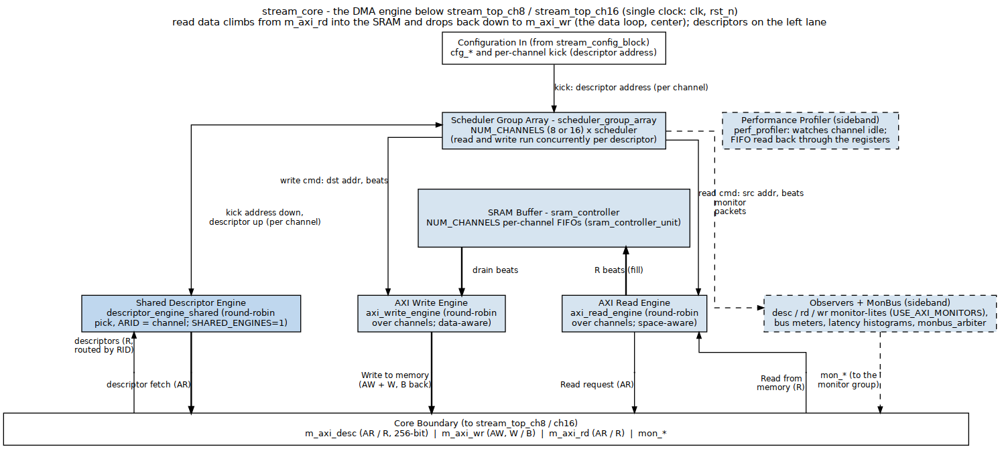
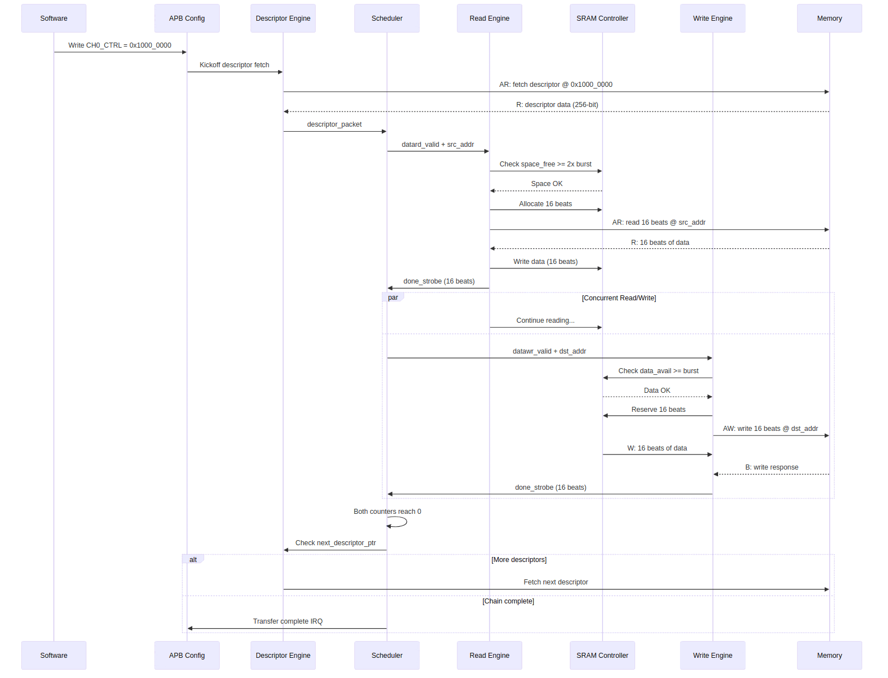
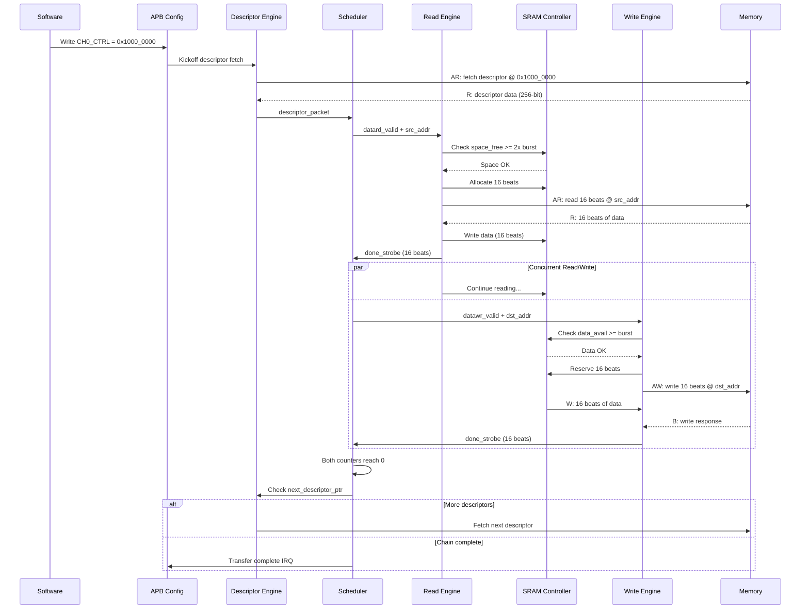

<!-- RTL Design Sherpa Documentation Header -->
<table>
<tr>
<td width="80">
  <a href="https://github.com/sean-galloway/RTLDesignSherpa">
    
  </a>
</td>
<td>
  <strong>RTL Design Sherpa</strong> · <em>Learning Hardware Design Through Practice</em><br>
  <sub>
    <a href="https://github.com/sean-galloway/RTLDesignSherpa">GitHub</a> ·
    <a href="https://github.com/sean-galloway/RTLDesignSherpa/blob/main/docs/DOCUMENTATION_INDEX.md">Documentation Index</a> ·
    <a href="https://github.com/sean-galloway/RTLDesignSherpa/blob/main/LICENSE">MIT License</a>
  </sub>
</td>
</tr>
</table>

---

<!-- End Header -->

# STREAM Architecture Overview

**Component:** STREAM (Scatter-gather Transfer Rapid Engine for AXI Memory)
**Version:** 0.90
**Status:** Pre-release

---

## Introduction

STREAM is a high-performance, multi-channel descriptor-based DMA engine designed for memory-to-memory scatter-gather transfers. It provides an educational yet production-capable architecture demonstrating key DMA concepts while maintaining professional design practices.

### Design Philosophy

1. **Tutorial Focus** - Intentional simplifications for learning
2. **Production Quality** - Industry-standard interfaces and verification
3. **Scalability** - 8 or 16 independent channels (`stream_top_ch8` / `stream_top_ch16`) with shared resource arbitration and, by default, one shared descriptor engine
4. **Modularity** - Clear separation of concerns across functional blocks

---

## System Architecture

### High-Level Block Diagram

### Figure 1.1.1: STREAM Architecture Overview



**Source:** [01_stream_core.dot](../assets/graphviz/01_stream_core.dot)

---

## Key Architectural Concepts

### 1. Multi-Channel Design

**8 Independent Channels:**
- Each channel operates autonomously
- Separate descriptor chains per channel
- Independent FSM state per channel
- Concurrent transfers across all channels

**Resource Sharing:**
- Descriptor AXI master (shared via round-robin arbiter)
- Data read AXI master (shared via round-robin, space-aware)
- Data write AXI master (shared via round-robin, data-aware)
- SRAM buffer (per-channel FIFOs, no arbitration)

### 2. Descriptor-Based Operation

**Descriptor Format (256-bit):**
```
[255:192] Reserved
[191:160] Next Descriptor Pointer
[159:128] Length (in beats)
[127:64]  Destination Address
[63:0]    Source Address
```

**Descriptor Chain:**
- Single APB write kicks off chain
- Automatic chaining via next_descriptor_ptr
- Explicit termination (ptr = 0 or last flag)

### 3. Concurrent Read/Write

**CRITICAL Design Pattern:**

STREAM uses concurrent read and write operations to handle transfers larger than the SRAM buffer:

```
Example: 100MB transfer with 64KB SRAM buffer

Sequential (WRONG):
  Read 100MB → DEADLOCK at 64KB (SRAM full)

Concurrent (CORRECT):
  Read fills SRAM → SRAM full → Read pauses
  Write drains SRAM → SRAM space freed → Read resumes
  Both continue until 100MB complete
```

**Implementation:**
- Scheduler runs read and write FSMs concurrently in XFER_DATA state
- Independent beat counters for read vs write
- Transfer completes when BOTH counters reach zero

### 4. Space-Aware Flow Control

**Allocation Controller (Read Path):**
- Reserves SRAM space BEFORE issuing AXI AR
- Prevents overflow due to AR/R latency gap
- 2x space margin (accounts for in-flight allocations)

**Drain Controller (Write Path):**
- Reserves SRAM data BEFORE issuing AXI AW
- Prevents underflow due to AW/W latency gap
- Includes latency bridge occupancy in count

### 5. Round-Robin Arbitration

**Descriptor Fetch:**
- Round-robin arbitration (fair access)

**Data Read/Write:**
- Round-robin arbitration inside each engine (`arbiter_round_robin`)
- A channel joins the read pick only with SRAM space for a burst, and the
  write pick only with SRAM data for a burst
- No priority logic: the descriptor priority field is carried but not used
  for arbitration, and there is no anti-starvation timer

---

## Data Flow Example

### Single Channel Transfer

### Figure 1.1.2: Single Channel Transfer Sequence



<!--
Original Mermaid diagram (for editing):



-->

---

## Component Hierarchy

### Top-Level Integration (stream_top_ch8.sv / stream_top_ch16.sv)

`stream_top_ch16.sv` is `stream_top_ch8.sv` with `NUM_CHANNELS = 16`, generated
by `bin/gen_stream_regs_16ch.py`. The two differ only in the register block
they instantiate (`stream_regs` or `stream_regs_16ch`), chosen by the filelist
through the `regsel_{8,16}ch` include directory.

```
stream_top_ch8 / stream_top_ch16 (Top-Level Wrapper)
├── APB Interface Path
│   ├── apb4_slave_cdc        (CDC_ENABLE=1: APB clock domain crossing)
│   └── peakrdl_to_cmdrsp     (CMD/RSP → PeakRDL passthrough; ALL accesses.
│       │                     No router: the kick is register state at
│       │                     0x000-0x03F plus 0x128 KICK_ENABLE)
│       └── stream_regs       (PeakRDL-generated register file;
│                             stream_regs_16ch in the 16-channel top)
├── stream_config_block      (Register → config signal mapping)
├── stream_core              (Main DMA engine - see below)
└── monbus_axil_group        (USE_AXI_MONITORS=1: MonBus → AXI-Lite)
    ├── Error FIFO (s_axil_err_* slave read)
    └── Master Writer (m_axil_mon_* master write)
```

### Core DMA Engine (stream_core.sv)

### Figure 1.1.3: Core DMA Engine Hierarchy

```
stream_core
├── scheduler_group_array         (SHARED_ENGINES = 1, the default)
│   ├── scheduler [0..NUM_CHANNELS-1]
│   ├── descriptor_engine_shared  (one fetch engine for every channel)
│   ├── axi4_master_rd_monlite    (descriptor port monitor)
│   └── monbus_arbiter            (NUM_CHANNELS + 2 sources)
│   -- or, SHARED_ENGINES = 0 --
│   ├── scheduler_group [0..NUM_CHANNELS-1]
│   │   ├── descriptor_engine
│   │   ├── scheduler
│   │   └── monbus_arbiter
│   ├── arbiter_round_robin       (descriptor AR, NUM_CHANNELS:1)
│   ├── axi4_master_rd_monlite    (descriptor port monitor)
│   └── monbus_arbiter            (NUM_CHANNELS + 1 sources)
├── monbus_arbiter                (core MonBus merge)
├── axi_read_engine
│   └── arbiter_round_robin       (space-aware channel pick)
├── axi_write_engine
│   ├── arbiter_round_robin       (data-aware channel pick)
│   └── gaxi_fifo_sync            (W-phase queue, per-channel B-phase queues)
├── sram_controller
│   └── sram_controller_unit [0..NUM_CHANNELS-1]
│       ├── stream_alloc_ctrl
│       ├── gaxi_fifo_sync
│       ├── stream_drain_ctrl
│       └── stream_latency_bridge
├── perf_profiler
├── axi4_master_rd_monlite / axi4_master_wr_monlite  (data masters; monitor
│                                                     logic on only when
│                                                     USE_AXI_MONITORS = 1)
├── axi_bus_meter x 2             (always built)
└── axi_perf_latency_hist x 2     (USE_AXI_MONITORS = 1 only)
```

---

## Interface Summary

### External Interfaces (stream_top_ch8.sv / stream_top_ch16.sv)

| Interface | Type | Width | Purpose |
|-----------|------|-------|---------|
| APB | Slave | 32-bit | Configuration, control, status (with optional CDC) |
| Descriptor AXI | Master | 256-bit | Fetch descriptors from memory |
| Data Read AXI | Master | 512-bit | Read source data |
| Data Write AXI | Master | 512-bit | Write destination data |
| Error FIFO AXIL | Slave | 32-bit | Read monitor error/interrupt FIFO |
| Monitor Write AXIL | Master | 32-bit | Write monitor data to memory |
| IRQ | Output | 1-bit | Interrupt (error FIFO not empty) |

: STREAM External Interfaces

### Internal MonBus Interface (stream_core.sv)

| Interface | Type | Width | Purpose |
|-----------|------|-------|---------|
| MonBus | Output | 64-bit | Debug/trace event stream to monbus_axil_group |

: STREAM Internal MonBus Interface

### Configuration Registers (APB)

**APB Address Map:**
```
0x000-0x03F: Channel 0-7 descriptor addresses (staged); 0x128: KICK_ENABLE (launch)
0x040-0x07F: Channel 8-15 descriptor addresses (16-channel map; reserved in the 8-channel map)
0x080-0x0FF: Reserved
0x100-0x3FF: PeakRDL configuration registers
```

The 16-channel map is derived from the 8-channel one and differs only where a
channel count shows: per-channel fields widen from `[7:0]` to `[15:0]`, and
`CH_STATE` moves from 0x150 to 0x180. See the
[Register Map](../ch04_registers/register_map.md) for the full list.

**Key Register Groups:**
- 0x100: Global Control (enable, reset, version)
- 0x120: Per-Channel Control (enable, reset)
- 0x140: Per-Channel Status (idle, state, completion)
- 0x180: Monitor FIFO Status
- 0x200: Scheduler Configuration
- 0x220: Descriptor Engine Configuration
- 0x10C0-0x111F: AXI Monitor Configuration (DAXMON, RDMON, WRMON) -- in the
  separate `stream_mon_regs` regfile at 0x1000+, not the base regfile
- 0x2A0: AXI Transfer Configuration
- 0x2B0: Performance Profiler Configuration
- 0x2D0-0x2D8: Performance Profiler Data and Status (capture FIFO readback)

**See:** [Register Map](../ch04_registers/register_map.md) for complete documentation.

---

## Resource Utilization

### Measured Area (stream_core)

Out-of-context Vivado synthesis of `stream_core` at 256-bit data, with
monitors off and a 100 MHz clock:

| Build | LUTs | Flops | Worst slack |
|-------|-----:|------:|------------:|
| 8 channels, per-channel descriptor engines (`SHARED_ENGINES = 0`) | 25.8k | 14.9k | +3.24 ns |
| 8 channels, shared descriptor engine (default) | 20.7k | 11.7k | +2.50 ns |
| 16 channels, shared descriptor engine | 36.8k | 19.4k | +1.79 ns |

: STREAM Core Measured Area

The shared engine saves about 20% of the 8-channel core's LUTs. The
per-channel structures that remain are the schedulers, the SRAM controller
units and the descriptor FIFOs.

**Notes:**
- SRAM depth configurable (typical: 512 entries × 512 bits × 8 channels = 512KB)
- Logic utilization scales with NUM_CHANNELS
- Memory utilization scales with SRAM_DEPTH

---

## Performance Characteristics

### Throughput

**Theoretical Maximum (512-bit @ 250MHz):**
- Single channel: 16 GB/s (512 bits × 250 MHz)
- 8 or 16 channels concurrent: Limited by memory bandwidth, not DMA

**Practical Performance:**
- Dependent on:
  - Memory controller latency
  - Burst sizes (larger = better efficiency)
  - Transfer alignment
  - Channel contention

**Typical Real-World:**
- 8-12 GB/s sustained (single channel)
- 50-75% of theoretical maximum

### Latency

**Descriptor Fetch Latency:**
- AR issue to R data: ~10-50 cycles (memory dependent)
- Descriptor parsing: 1 cycle
- **Total:** ~11-51 cycles per descriptor

**Transfer Initiation:**
- APB write to first AR: ~5-10 cycles
- AR to first R data: ~10-50 cycles
- **Total:** ~15-60 cycles from kickoff to first data

**Transfer Completion:**
- Last W beat to B response: ~5-20 cycles
- B response to IRQ: 1 cycle
- **Total:** ~6-21 cycles from last data to interrupt

---

## Design Decisions

### Why These Simplifications?

1. **Aligned Addresses Only:**
   - Eliminates complex alignment fixup logic
   - Clear data path with no byte shifting
   - Focus: Core DMA operation, not edge cases

2. **Length in Beats:**
   - Direct mapping to AXI burst length
   - No unit conversion overhead
   - Focus: AXI protocol understanding

3. **No Credit Management:**
   - Simpler resource arbitration
   - Transaction limits via configuration
   - Focus: Arbitration basics, not complex flow control

4. **No Circular Buffers:**
   - Explicit chain termination
   - Clear end-of-transfer detection
   - Focus: Descriptor chaining, not circular logic

### Production Enhancements (Future)

If extending STREAM for production use, consider:
- [ ] Alignment fixup (byte-level granularity)
- [ ] Length in bytes/chunks
- [ ] Credit-based flow control
- [ ] Circular buffer support
- [ ] Advanced error recovery
- [ ] Power management
- [ ] Multiple SRAM segments

---

## Testing Strategy

### Verification Layers

**1. Unit Tests (FUB Level):**
- Descriptor engine: Fetch, parse, chain
- Scheduler: FSM states, concurrent read/write
- AXI engines: AR/R and AW/W/B channels
- SRAM controller: Allocation, drain, FIFO
- Individual tests per module

**2. Integration Tests (Multi-Block):**
- Scheduler + engines: Data flow
- Descriptor + scheduler: Descriptor chaining
- Full path: APB → Descriptor → Transfer → IRQ

**3. System Tests (Full Core):**
- Single channel end-to-end
- Multi-channel concurrent
- Error injection and recovery
- Performance validation
- Long-duration stress tests

### Coverage Targets

- **Code Coverage:** >95%
- **Functional Coverage:** >90%
- **Corner Cases:** 100% tested
- **Error Paths:** 100% tested

---

## Related Documentation

**Chapter 2 - Block Specifications:**
- [Scheduler](../ch02_blocks/04_scheduler.md) - Core FSM controller
- [Descriptor Engine](../ch02_blocks/05_descriptor_engine.md) - Descriptor fetch/parse
- [AXI Read Engine](../ch02_blocks/06_axi_read_engine.md) - Source data read
- [AXI Write Engine](../ch02_blocks/12_axi_write_engine.md) - Destination data write
- [SRAM Controller](../ch02_blocks/08_sram_controller.md) - Buffering and flow control
- [Scheduler Group](../ch02_blocks/03_scheduler_group.md) - Per-channel wrapper
- [Scheduler Group Array](../ch02_blocks/02_scheduler_group_array.md) - Channel array and descriptor fetch (shared or per channel)


---

**Last Updated:** 2026-10-17
**Document Version:** 0.92
---

## Revision History

| Version | Date | Author | Description |
|---------|------|--------|-------------|
| 0.90 | 2025-11-22 | seang | Initial block specification |
| 0.91 | 2026-01-02 | seang | Added table captions and figure numbers |
| 0.92 | 2026-10-17 | seang | 16-channel top and register map; shared descriptor engine in the hierarchy; measured area replaces the estimate |

: STREAM Architecture Overview Revision History

---

**Last Updated:** 2026-10-17
