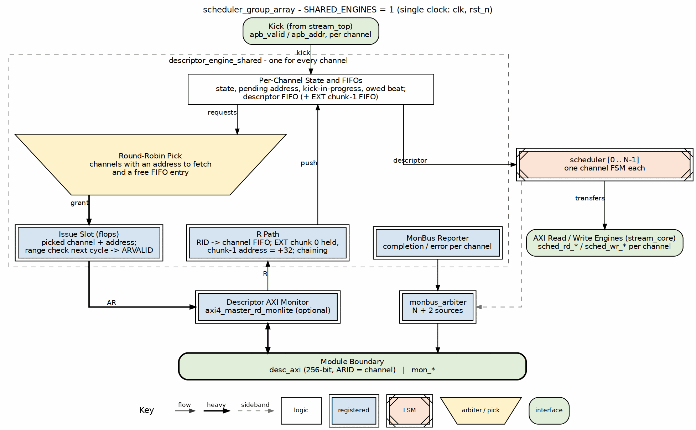

<!-- RTL Design Sherpa Documentation Header -->
<table>
<tr>
<td width="80">
  <a href="https://github.com/sean-galloway/RTLDesignSherpa">
    
  </a>
</td>
<td>
  <strong>RTL Design Sherpa</strong> · <em>Learning Hardware Design Through Practice</em><br>
  <sub>
    <a href="https://github.com/sean-galloway/RTLDesignSherpa">GitHub</a> ·
    <a href="https://github.com/sean-galloway/RTLDesignSherpa/blob/main/docs/DOCUMENTATION_INDEX.md">Documentation Index</a> ·
    <a href="https://github.com/sean-galloway/RTLDesignSherpa/blob/main/LICENSE">MIT License</a>
  </sub>
</td>
</tr>
</table>

---

<!-- End Header -->

# Scheduler Group Array

**Module:** `scheduler_group_array.sv`
**Location:** `projects/components/dma-ip/stream/rtl/macro/`
**Category:** MACRO (Top-level Integration)
**Parent:** `stream_core.sv`
**Status:** Implemented
**Last Updated:** 2026-10-17

---

## Overview

The `scheduler_group_array` is the scheduler layer of the STREAM engine: one
scheduler per channel, the descriptor fetch that feeds them, and the MonBus
aggregation for the layer. `SHARED_ENGINES` selects how descriptor fetch is
built:

- **`SHARED_ENGINES = 1` (default):** one `descriptor_engine_shared` serves
  every channel. It picks among the schedulers round-robin and owns the
  descriptor AXI master outright.
- **`SHARED_ENGINES = 0`:** one `scheduler_group` per channel, each with its
  own `descriptor_engine`, and a round-robin arbiter merging their AR
  requests onto the descriptor AXI master (the original structure).

Both structures present the same ports, so `stream_core` and everything above
it are unchanged. A build has 8 channels (`stream_top_ch8`) or 16
(`stream_top_ch16`).

### Key Features

- **Independent channels:** each channel has its own scheduler FSM.
- **Descriptor fetch:** one shared engine, or one engine per channel behind a
  round-robin arbiter. Either way, the channel number is the AXI ID, so
  responses route back by RID.
- **Per-channel data interfaces:** passed straight to the AXI engines, with no
  arbitration at this level.
- **Unified MonBus aggregation:** `NUM_CHANNELS + 2` sources with shared
  engines (one per scheduler, the shared engine, the descriptor AXI monitor),
  `NUM_CHANNELS + 1` with per-channel engines (one per scheduler group, the
  monitor).

### Simplified from RAPIDS

This module is intentionally simplified from RAPIDS for tutorial focus:
- No control read/write engines
- No program engine
- No network interfaces (EOS completion)
- No alignment bus
- Direct data path interfaces (beats-based, no chunks)

---

## Architecture

### Component Hierarchy

```
scheduler_group_array  (SHARED_ENGINES = 1, default)
   scheduler[0..NUM_CHANNELS-1]   # Channel FSMs
   descriptor_engine_shared       # One fetch engine for every channel
   axi4_master_rd_monlite         # Descriptor AXI monitor (USE_DESC_AXI_MONITOR)
   monbus_arbiter                 # NUM_CHANNELS + 2 sources

scheduler_group_array  (SHARED_ENGINES = 0)
   scheduler_group[0..NUM_CHANNELS-1]
      scheduler                  # Channel FSM
      descriptor_engine          # Descriptor fetch, per channel
   arbiter_round_robin            # AR channel arbitration
   axi4_master_rd_monlite         # Descriptor AXI monitor
   monbus_arbiter                 # NUM_CHANNELS + 1 sources
```

### Figure 2.2.1: Scheduler Group Array, Shared Engine



**Source:** [02_scheduler_group_array.dot](../assets/graphviz/02_scheduler_group_array.dot)

### Shared Descriptor Engine

With `SHARED_ENGINES = 1`, one `descriptor_engine_shared` replaces the
per-channel engines. Each scheduler sees exactly the per-channel engine's
behaviour: the same kick policy, refusal of a kicked address outside both
ranges, the EXT second-chunk fetch, the prefetch throttle, autonomous
chaining, the error pulse, channel reset, and the completion and error MonBus
packets.

| Shared by every channel | Kept per channel |
|-------------------------|------------------|
| The AR issuer, picked round-robin among channels with an address to fetch | A state code and one pending fetch address |
| The address-range comparators | The kick-in-progress flag and the owed-beat flag |
| The R path: each beat routed by RID straight into its channel's FIFO | The descriptor FIFO (and the EXT chunk-1 FIFO) |
| The MonBus reporter | |

: Shared Descriptor Engine

- **One fetch in flight per channel,** in order. Different channels' fetches
  overlap on the bus because each carries its own ARID.
- **Issue slot:** the pick and the address mux end at a register, and the range
  check runs on the registered address in the next cycle, so the 16-way pick
  and the 64-bit compares are not one path. The second chunk's +32 is applied
  on the R side when chunk 0 arrives (one beat per cycle, one shared adder).
- **A beat for a channel that is not waiting** (one reset mid-fetch) is taken
  and dropped rather than left on the shared R channel; the channel takes no
  new kick until that owed beat has drained.

Measured out-of-context, `stream_core` at 256 bits with monitors off and a
100 MHz clock:

| Build | LUTs | Flops | Worst slack |
|-------|-----:|------:|------------:|
| 8 channels, per-channel engines | 25.8k | 14.9k | +3.24 ns |
| 8 channels, shared engine | 20.7k | 11.7k | +2.50 ns |
| 16 channels, shared engine | 36.8k | 19.4k | +1.79 ns |

: Area and Timing by Structure

On the Genesys 2 board build (8 channels, 128 bits, `GEN_MON = 0`, placed and routed) the eight per-channel engines take 4,974 LUTs and 4,120 flip-flops, and the shared engine 3,825 LUTs and 1,725 flip-flops, of which 1,840 LUTs are the per-channel FIFOs in distributed RAM. The saving there is smaller than the out-of-context figure because `GEN_MON = 0` removes the per-channel MonBus reporters from both builds. The full before-and-after is in the HAS Resource Estimates chapter.

### Descriptor AXI Arbitration (`SHARED_ENGINES = 0`)

**AR Channel Flow:**
```
Channel 0..N-1 AR Requests -> Round-Robin Arbiter -> Single AR to External AXI
                        |
              Embed channel_id in AXI ID lower bits
```

**R Channel Demux:**
```
External R Response -> Extract channel_id from RID[CHAN_WIDTH-1:0] -> Route to correct channel
```

**Critical:** Channel ID is embedded in the lower bits of the AXI ID field, in
both structures:
```systemverilog
// In AR mux
desc_axi_int_arid = {{(AXI_ID_WIDTH-CHAN_WIDTH){1'b0}}, ch[CHAN_WIDTH-1:0]};

// In R demux
desc_r_channel_id = desc_axi_int_rid[CHAN_WIDTH-1:0];
```

### Data Path Interfaces

**IMPORTANT:** Data read and write interfaces are NOT arbitrated at this level!

- `sched_rd_*` - Per-channel arrays passed directly to `axi_read_engine`
- `sched_wr_*` - Per-channel arrays passed directly to `axi_write_engine`

The AXI engines themselves handle channel arbitration internally.

---

## Parameters

| Parameter | Type | Default | Description |
|-----------|------|---------|-------------|
| `NUM_CHANNELS` | int | 8 | Number of DMA channels (8 or 16 in the shipped tops) |
| `CHAN_WIDTH` | int | $clog2(NUM_CHANNELS) | Channel ID width (3 bits for 8 channels, 4 for 16) |
| `SHARED_ENGINES` | int | 1 | 1: one shared descriptor engine; 0: one per channel |
| `ADDR_WIDTH` | int | 64 | Address bus width |
| `DATA_WIDTH` | int | 512 | Data bus width |
| `AXI_ID_WIDTH` | int | 8 | AXI transaction ID width |

: Parameters

### Monitor Bus Agent IDs

| Parameter | Default | Description |
|-----------|---------|-------------|
| `DESC_MON_BASE_AGENT_ID` | 16 (0x10) | Descriptor engine base (agent = base + channel, both structures) |
| `SCHED_MON_BASE_AGENT_ID` | 48 (0x30) | Scheduler base (agent = base + channel) |
| `DESC_AXI_MON_AGENT_ID` | 8 (0x08) | Descriptor AXI monitor |
| `MON_UNIT_ID` | 1 | Unit ID for all STREAM events |
| `MON_MAX_TRANSACTIONS` | 16 | Max outstanding transactions for monitor |

: Monitor Bus Agent IDs

---

## Port List

### Clock and Reset

| Signal | Direction | Width | Description |
|--------|-----------|-------|-------------|
| `clk` | input | 1 | System clock |
| `rst_n` | input | 1 | Active-low asynchronous reset |

: Clock and Reset

### APB Programming Interface (Per-Channel)

| Signal | Direction | Width | Description |
|--------|-----------|-------|-------------|
| `apb_valid[ch]` | input | NUM_CHANNELS | Descriptor address valid |
| `apb_ready[ch]` | output | NUM_CHANNELS | Ready to accept descriptor |
| `apb_addr[ch]` | input | NUM_CHANNELS x ADDR_WIDTH | Descriptor address |

: APB Programming Interface

### Configuration Interface (Per-Channel)

| Signal | Direction | Width | Description |
|--------|-----------|-------|-------------|
| `cfg_channel_enable[ch]` | input | NUM_CHANNELS | Enable channel |
| `cfg_channel_reset[ch]` | input | NUM_CHANNELS | Soft reset channel |

: Configuration Interface

### Global Scheduler Configuration

| Signal | Direction | Width | Description |
|--------|-----------|-------|-------------|
| `cfg_sched_enable` | input | 1 | Master scheduler enable |
| `cfg_sched_timeout_cycles` | input | 16 | Timeout threshold |
| `cfg_sched_timeout_enable` | input | 1 | Enable timeout detection |
| `cfg_sched_err_enable` | input | 1 | Enable error reporting |
| `cfg_sched_compl_enable` | input | 1 | Enable completion reporting |
| `cfg_sched_perf_enable` | input | 1 | Enable performance monitoring |

: Global Scheduler Configuration

### Descriptor Engine Configuration

| Signal | Direction | Width | Description |
|--------|-----------|-------|-------------|
| `cfg_desceng_enable` | input | 1 | Enable descriptor engine |
| `cfg_desceng_prefetch` | input | 1 | Enable descriptor prefetch |
| `cfg_desceng_fifo_thresh` | input | 4 | FIFO threshold for prefetch |
| `cfg_desceng_addr0_base` | input | ADDR_WIDTH | Address range 0 base |
| `cfg_desceng_addr0_limit` | input | ADDR_WIDTH | Address range 0 limit |
| `cfg_desceng_addr1_base` | input | ADDR_WIDTH | Address range 1 base |
| `cfg_desceng_addr1_limit` | input | ADDR_WIDTH | Address range 1 limit |

: Descriptor Engine Configuration

### Status Interface (Per-Channel)

| Signal | Direction | Width | Description |
|--------|-----------|-------|-------------|
| `descriptor_engine_idle[ch]` | output | NUM_CHANNELS | Descriptor engine idle |
| `scheduler_idle[ch]` | output | NUM_CHANNELS | Scheduler idle |
| `scheduler_state[ch]` | output | NUM_CHANNELS x 7 | Scheduler FSM state (ONE-HOT) |
| `sched_error[ch]` | output | NUM_CHANNELS | Scheduler error (sticky) |

: Status Interface

### Shared Descriptor AXI4 Master Read Interface

**AR Channel:**

| Signal | Direction | Width | Description |
|--------|-----------|-------|-------------|
| `desc_axi_arvalid` | output | 1 | Address valid |
| `desc_axi_arready` | input | 1 | Address ready |
| `desc_axi_araddr` | output | ADDR_WIDTH | Address |
| `desc_axi_arlen` | output | 8 | Burst length - 1 |
| `desc_axi_arsize` | output | 3 | Burst size (log2 bytes) |
| `desc_axi_arburst` | output | 2 | Burst type (INCR) |
| `desc_axi_arid` | output | AXI_ID_WIDTH | Transaction ID |
| `desc_axi_arlock` | output | 1 | Lock type |
| `desc_axi_arcache` | output | 4 | Cache attributes |
| `desc_axi_arprot` | output | 3 | Protection attributes |
| `desc_axi_arqos` | output | 4 | QoS value |
| `desc_axi_arregion` | output | 4 | Region identifier |

: Shared Descriptor AXI4 Master Read Interface

**R Channel (FIXED 256-bit):**

| Signal | Direction | Width | Description |
|--------|-----------|-------|-------------|
| `desc_axi_rvalid` | input | 1 | Read data valid |
| `desc_axi_rready` | output | 1 | Read data ready |
| `desc_axi_rdata` | input | 256 | Read data (FIXED 256-bit descriptor) |
| `desc_axi_rresp` | input | 2 | Response |
| `desc_axi_rlast` | input | 1 | Last beat of burst |
| `desc_axi_rid` | input | AXI_ID_WIDTH | Transaction ID |

: Shared Descriptor AXI4 Master Read Interface

### Shared Data Read Interface (Per-Channel Arrays)

| Signal | Direction | Width | Description |
|--------|-----------|-------|-------------|
| `sched_rd_valid[ch]` | output | NUM_CHANNELS | Read request valid |
| `sched_rd_addr[ch]` | output | NUM_CHANNELS x ADDR_WIDTH | Source address |
| `sched_rd_beats[ch]` | output | NUM_CHANNELS x 32 | Beats to read |
| `sched_rd_done_strobe[ch]` | input | NUM_CHANNELS | Read completion strobe |
| `sched_rd_beats_done[ch]` | input | NUM_CHANNELS x 32 | Beats completed |
| `sched_rd_error[ch]` | input | NUM_CHANNELS | Read error |

: Shared Data Read Interface

### Shared Data Write Interface (Per-Channel Arrays)

| Signal | Direction | Width | Description |
|--------|-----------|-------|-------------|
| `sched_wr_valid[ch]` | output | NUM_CHANNELS | Write request valid |
| `sched_wr_ready[ch]` | input | NUM_CHANNELS | Write ready |
| `sched_wr_addr[ch]` | output | NUM_CHANNELS x ADDR_WIDTH | Destination address |
| `sched_wr_beats[ch]` | output | NUM_CHANNELS x 32 | Beats to write |
| `sched_wr_done_strobe[ch]` | input | NUM_CHANNELS | Write completion strobe |
| `sched_wr_beats_done[ch]` | input | NUM_CHANNELS x 32 | Beats completed |
| `sched_wr_error[ch]` | input | NUM_CHANNELS | Write error |

: Shared Data Write Interface

### Unified Monitor Bus Interface

| Signal | Direction | Width | Description |
|--------|-----------|-------|-------------|
| `mon_valid` | output | 1 | Monitor packet valid |
| `mon_ready` | input | 1 | Monitor packet ready |
| `mon_packet` | output | 64 | Monitor packet data |

: Unified Monitor Bus Interface

---

## Operation

### Descriptor Fetch Arbitration

1. **Request Phase:** Channels assert `desc_ar_valid[ch]` when needing descriptor fetch
2. **Grant Phase:** Round-robin arbiter selects one channel
3. **AR Issue:** Granted channel's AR signals muxed to external interface
4. **ID Embedding:** Channel ID placed in lower bits of `arid`
5. **Grant ACK:** Arbiter acknowledged when `arready` received
6. **R Routing:** Response routed to correct channel based on `rid[CHAN_WIDTH-1:0]`

### Data Path Flow

Data interfaces pass directly through without arbitration:
```
scheduler_group[ch].sched_rd_* -> sched_rd_*[ch] -> axi_read_engine (handles arbitration)
scheduler_group[ch].sched_wr_* -> sched_wr_*[ch] -> axi_write_engine (handles arbitration)
```

### MonBus Aggregation

9 sources aggregated via `monbus_arbiter`:
- Sources 0-7: Per-channel `mon_*` from scheduler_groups
- Source 8: Descriptor AXI master monitor

---

## Integration Example

```systemverilog
scheduler_group_array #(
    .NUM_CHANNELS           (8),
    .ADDR_WIDTH             (64),
    .DATA_WIDTH             (512),
    .AXI_ID_WIDTH           (8)
) u_scheduler_group_array (
    .clk                    (clk),
    .rst_n                  (rst_n),

    // APB kick-off
    .apb_valid              (apb_valid),
    .apb_ready              (apb_ready),
    .apb_addr               (apb_addr),

    // Configuration
    .cfg_channel_enable     (cfg_channel_enable),
    .cfg_channel_reset      (cfg_channel_reset),
    .cfg_sched_enable       (cfg_sched_enable),
    // ... other config

    // Descriptor AXI master
    .desc_axi_arvalid       (desc_axi_arvalid),
    .desc_axi_arready       (desc_axi_arready),
    // ... full AR/R interface

    // Data read interface (to axi_read_engine)
    .sched_rd_valid         (sched_rd_valid),
    .sched_rd_addr          (sched_rd_addr),
    .sched_rd_beats         (sched_rd_beats),
    .sched_rd_done_strobe   (rd_done_strobe),
    .sched_rd_beats_done    (rd_beats_done),

    // Data write interface (to axi_write_engine)
    .sched_wr_valid         (sched_wr_valid),
    .sched_wr_ready         (sched_wr_ready),
    .sched_wr_addr          (sched_wr_addr),
    .sched_wr_beats         (sched_wr_beats),
    .sched_wr_done_strobe   (wr_done_strobe),
    .sched_wr_beats_done    (wr_beats_done),

    // Monitor bus
    .mon_valid              (sga_mon_valid),
    .mon_ready              (sga_mon_ready),
    .mon_packet             (sga_mon_packet)
);
```

---

## Related Documentation

- **Parent:** `01_stream_core.md` - Top-level integration
- **Child:** `03_scheduler_group.md` - Single channel scheduler + descriptor engine
- **Scheduler:** `04_scheduler.md` - Channel state machine
- **Descriptor Engine:** `05_descriptor_engine.md` - Descriptor fetch and parsing
- **AXI Read Engine:** `06_axi_read_engine.md` - Read datapath (receives sched_rd_*)
- **AXI Write Engine:** `12_axi_write_engine.md` - Write datapath (receives sched_wr_*)
- **MonBus Arbiter:** `16_monbus_axil_group.md` - Monitor bus aggregation
---

## Revision History

| Version | Date | Author | Description |
|---------|------|--------|-------------|
| 0.90 | 2025-11-22 | seang | Initial block specification |
| 0.91 | 2026-01-02 | seang | Added table captions and figure numbers |

: Scheduler Group Array Revision History

---

**Last Updated:** 2026-01-02
