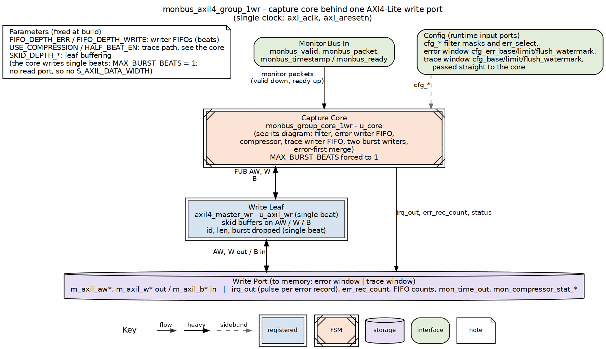

<!-- RTL Design Sherpa Documentation Header -->
<table>
<tr>
<td width="80">
  <a href="https://github.com/sean-galloway/RTLDesignSherpa">
    
  </a>
</td>
<td>
  <strong>RTL Design Sherpa</strong> · <em>Learning Hardware Design Through Practice</em><br>
  <sub>
    <a href="https://github.com/sean-galloway/RTLDesignSherpa">GitHub</a> ·
    <a href="https://github.com/sean-galloway/RTLDesignSherpa/blob/main/docs/DOCUMENTATION_INDEX.md">Documentation Index</a> ·
    <a href="https://github.com/sean-galloway/RTLDesignSherpa/blob/main/LICENSE">MIT License</a>
  </sub>
</td>
</tr>
</table>

---

<!-- End Header -->

# MonBus AXI-Lite Group

**Module:** `monbus_axil4_group_1wr.sv` (documented here under its historical STREAM name `monbus_axil_group`)
**Location:** `rtl/amba/ocelus/` (shared AMBA monitor block; STREAM instantiates it unmodified)
**Category:** MACRO (Integration)
**Parent:** `stream_top_ch8.sv` / `stream_top_ch16.sv`
**Status:** Implemented
**Last Updated:** 2026-10-25

---

## Overview

`monbus_axil4_group_1wr` is the monitor-bus egress of STREAM. It takes the
single merged MonBus stream from `monbus_arbiter`, filters it per protocol, and
writes everything it keeps to memory over ONE AXI4-Lite write master
(`m_axil_mon_*`, 64-bit data). It has no slave port. Packets whose type is
selected by `ERR_SELECT` are written as raw 3-beat records into an ERROR window
(`MON_GROUP_ERR_BASE_ADDR` .. `MON_GROUP_ERR_LIMIT_ADDR`), one `stream_irq`
pulse and one `MON_ERR_REC_COUNT` step per record landed; every other packet is
written to the TRACE window (`MON_GROUP_BASE_ADDR` .. `MON_GROUP_LIMIT_ADDR`),
raw or compressed. The host reads error records out of the error window.

Until 2026-10-25 (stream TASK-019) STREAM carried the two-port
`monbus_axil4_axil4_group`, whose error packets sat in an on-chip FIFO the CPU
drained one beat at a time over an AXI-Lite slave read port (`s_axil_err_*`).
The read port, its FIFO drain and the level interrupt are gone; the error path
is now a second memory window on the same write master, so the host sees error
records in memory exactly as it sees trace records.

### Key Features

- **128-bit Monitor Packets + 64-bit Timestamps:** each record is three 64-bit
  beats, TS, HI, LO: `{tag[3:0], source_ts[59:0]}`, `packet[127:64]`,
  `packet[63:0]` (24 bytes)
- **Per-Protocol Filtering:** drop masks, event masks and the error select per
  AXI / AXIS / CORE protocol slot
- **Two memory windows, one master:**
  - Error window: `ERR_SELECT`-routed packets, raw records only, never
    compressed; `irq_out` pulses once per whole record landed; `err_rec_count`
    counts them
  - Trace window: everything else, raw 3-beat records or compressor slots
    (`USE_COMPRESSION`)
- **Ring windows:** each window is `[base, limit]`, written strictly inside the
  range; the burst writer rewinds to `base` when the next record would cross
  `limit`, so a record is never split across the wrap
- **Shared Building Block:** source of truth `rtl/amba/ocelus/monbus_axil4_group_1wr.sv`
  over `monbus_group_core_1wr`; STREAM instantiates it with zero modifications

### Simplified from RAPIDS

RAPIDS has source + sink data paths requiring TWO monitor buses. STREAM has
memory-to-memory only, so this module has ONE monitor bus input (no arbitration
inside the group). RAPIDS carries the same `monbus_axil4_group_1wr` (rapids
TASK-039).

---

## Architecture

### Block Diagram

### Figure 2.16.1: MonBus AXI-Lite Group Block Diagram



**Source:** [16_monbus_axil4_group_1wr.dot](../assets/graphviz/16_monbus_axil4_group_1wr.dot)

### Filter Decision Tree

```
For each incoming packet:
1. Extract: pkt_type, pkt_protocol, pkt_event_code
2. Check the protocol slot's masks:
   - pkt_mask:   drop if bit[pkt_type] = 1
   - event mask: drop if bit[pkt_event_code] = 1 (per packet type)
   - err_select: error path if bit[pkt_type] = 1
3. Route:
   - Dropped packets: consumed silently
   - Error-selected:  error writer FIFO -> error window (raw record, irq pulse)
   - Remaining:       trace writer FIFO -> trace window (raw or compressed)
```

---

## Parameters

| Parameter | Type | Default | STREAM | Description |
|-----------|------|---------|--------|-------------|
| `FIFO_DEPTH_ERR` | int | 192 | 192 | Error writer FIFO depth in beats (three per record) |
| `FIFO_DEPTH_WRITE` | int | 96 | 96 | Trace writer FIFO depth in beats |
| `ADDR_WIDTH` | int | 32 | 32 | Address width of the write port and both windows |
| `FLUSH_TIMEOUT_CYCLES` | int | 1024 | 1024 | Trace writer: cycles since the last W before a forced flush |
| `ERR_FLUSH_TIMEOUT_CYCLES` | int | 64 | 64 | Error writer: the same, shorter |
| `NUM_PROTOCOLS` | int | 3 | 3 | AXI, AXIS, CORE |
| `USE_COMPRESSION` | int | 0 | `USE_COMPRESSION` | Trace path: 1 builds the compressor and CAM; the runtime `COMPRESS_EN` bit is inert at 0 |
| `HALF_BEAT_EN` | int | 0 | `USE_HALFBEAT` | Trace path: pack two 30-bit slots per 64-bit beat (needs `USE_COMPRESSION=1`) |
| `SKID_DEPTH_AW/W/B` | int | 2 | 2 | Write-leaf skid depths |

: Parameters

There is no `MAX_BURST_BEATS` (the AXI-Lite leaf is single-beat, so it is
forced to 1 and every record is three AW/W pairs at 8-byte stride) and no
`S_AXIL_DATA_WIDTH` (there is no read port). The write data is 64 bits.

### Compression

With `USE_COMPRESSION=0` the group emits RAW records: three 64-bit beats per
128-bit packet (`{tag, timestamp}`, `packet[127:64]`, `packet[63:0]`). With it
built and `COMPRESS_EN` set, it emits variable compressor slots with the tag in
bits [63:60] instead.

The two encodings are not interchangeable. A tally reassembles RAW records with
a mod-3 beat counter and has no slot decoder, so compressed traffic aimed at a
tally silently yields nothing; compressed traffic belongs in a capture memory
that the host reads back and decodes. A capture measuring exactly 3.00 slots per
packet is uncompressed, whatever the enable bits report.

**Measured (cosim, 2026-09-08).** With the compressor built and half-beat packing
on, a monitors-on DMA workload captured 36 slots for 32 decoded packets: **1.12
slots per packet, 62.5% smaller** than the raw 3-beat encoding. The same workload
with the compressor compiled out produced 96 slots for the same 32 packets --
exactly 3.00, the raw ratio. Both decoded identically, so the difference is
encoding alone.

The encoder, slot format and half-beat packing are specified globally and are
not restated here:

- `docs/markdown/rtl-amba/monitor/monbus_compressor.md`
- `docs/markdown/rtl-amba/monitor/monbus_halfbeat_packer.md`
- `docs/markdown/rtl-amba/monitor/monbus_group_core.md` (beat layouts for both modes)

---

## Port List

### Clock and Reset

| Signal | Direction | Width | Description |
|--------|-----------|-------|-------------|
| `axi_aclk` | input | 1 | AXI clock |
| `axi_aresetn` | input | 1 | AXI active-low reset |
| `cam_clear` | input | 1 | Synchronous compressor CAM and statistics clear |

: Clock and Reset

### Monitor Bus Input

| Signal | Direction | Width | Description |
|--------|-----------|-------|-------------|
| `monbus_valid` | input | 1 | Packet valid |
| `monbus_ready` | output | 1 | Ready to accept |
| `monbus_packet` | input | 128 | 128-bit monitor packet (protocol-independent structure) |
| `monbus_timestamp` | input | 64 | 64-bit side-band timestamp (cycle count at packet capture) |
| `mon_time_out` | output | 64 | Free-running timestamp, driven to every monitor's `i_mon_time` |

: Monitor Bus Input

### AXI-Lite Master Write Interface (`m_axil_mon_*` at the STREAM top)

| Signal | Direction | Width | Description |
|--------|-----------|-------|-------------|
| `m_axil_awvalid` | output | 1 | Write address valid |
| `m_axil_awready` | input | 1 | Write address ready |
| `m_axil_awaddr` | output | ADDR_WIDTH | Write address (inside the error or the trace window) |
| `m_axil_awprot` | output | 3 | Protection bits (0) |
| `m_axil_wvalid` | output | 1 | Write data valid |
| `m_axil_wready` | input | 1 | Write data ready |
| `m_axil_wdata` | output | 64 | One record beat |
| `m_axil_wstrb` | output | 8 | Write strobes (all ones) |
| `m_axil_bvalid` | input | 1 | Write response valid |
| `m_axil_bready` | output | 1 | Write response ready |
| `m_axil_bresp` | input | 2 | Write response |

: AXI-Lite Master Write Interface

### Interrupt and Error Count

| Signal | Direction | Width | Description |
|--------|-----------|-------|-------------|
| `irq_out` | output | 1 | One-cycle pulse per whole error record landed in memory (`stream_irq`) |
| `err_rec_count` | output | 16 | Whole error records landed, free-running (`MON_ERR_REC_COUNT`) |

: Interrupt and Error Count

### Window Configuration

| Signal | Direction | Width | STREAM register | Description |
|--------|-----------|-------|-----------------|-------------|
| `cfg_base_addr` | input | ADDR_WIDTH | `MON_GROUP_BASE_ADDR` | Trace window base |
| `cfg_limit_addr` | input | ADDR_WIDTH | `MON_GROUP_LIMIT_ADDR` | Trace window limit (inclusive) |
| `cfg_flush_watermark` | input | 16 | `MON_GROUP_FLUSH_WATERMARK` | Trace writer flush threshold, beats (0 = every complete record) |
| `cfg_err_base_addr` | input | ADDR_WIDTH | `MON_GROUP_ERR_BASE_ADDR` | Error window base |
| `cfg_err_limit_addr` | input | ADDR_WIDTH | `MON_GROUP_ERR_LIMIT_ADDR` | Error window limit (inclusive) |
| `cfg_err_flush_watermark` | input | 16 | `MON_GROUP_ERR_FLUSH_WATERMARK` | Error writer flush threshold, beats (3 = every record) |
| `cfg_compress_en` | input | 1 | `WRMON_ENABLE.COMPRESS_EN` | Trace path compression (built with `USE_COMPRESSION=1`) |

: Window Configuration

The two windows must not overlap, and both must be memory the write master
can reach. The register reset values are sim addresses; a system programs both
windows before enabling any monitor.

### Protocol Configuration (per protocol)

| Signal | Direction | Width | Description |
|--------|-----------|-------|-------------|
| `cfg_axi_pkt_mask`, `cfg_axis_pkt_mask`, `cfg_core_pkt_mask` | input | 16 | Drop mask for packet types |
| `cfg_axi_err_select`, `cfg_axis_err_select`, `cfg_core_err_select` | input | 16 | Error-window select per packet type |
| `cfg_axi_*_mask`, `cfg_axis_*_mask`, `cfg_core_*_mask` | input | 16 | Per-event-type drop masks |

: Protocol Configuration

**How STREAM drives these slots (2026-09-28, stream BUG-017).** The group
filters by the packet's PROTOCOL field, and every in-core monitor (DAXMON,
RDMON, WRMON) tags its packets `PROTOCOL_AXI`, so only the AXI slot ever acts
on in-core traffic. `stream_top_ch8` drives that slot from all three monitors'
register sets at once: the drop masks (`PKT_MASK`, `ERR_MASK`, `MASK1..3`) are
ANDed, so a type or event is dropped at the group only if all three monitors
drop it, and `ERR_SELECT` is ORed. Each monitor still applies its own mask
inside itself; the group is not a second per-monitor filter. The AXIS and CORE
slots are tied to drop-nothing because nothing in-core emits those protocols.
Until this change the AXI slot was wired from DAXMON's registers alone, with
RDMON's and WRMON's parked on the unused AXIS and CORE slots, so a program
that switched DAXMON off (a drop-all `DAXMON_PKT_MASK`) lost every RDMON and
WRMON packet at the group -- the order-dependent ADDR_RANGE loss of amba
BUG-036.

### Debug/Status

| Signal | Direction | Width | STREAM register | Description |
|--------|-----------|-------|-----------------|-------------|
| `err_fifo_full` | output | 1 | `MON_FIFO_STATUS.MON_FIFO_FULL` | Error writer FIFO full |
| `write_fifo_full` | output | 1 | - | Trace writer FIFO full |
| `err_fifo_count` | output | 16 | `MON_FIFO_COUNT`, `MON_FIFO_STATUS.MON_FIFO_EMPTY` | Error writer FIFO occupancy, beats |
| `write_fifo_count` | output | 16 | - | Trace writer FIFO occupancy, beats |
| `mon_compressor_stat_*` | output | 32 each | `WRMON_COMP_STAT_*` | Compressor statistics |

: Debug/Status

---

## Operation

### Record Format and Windows

Every record is 24 bytes, three 64-bit beats written at 8-byte stride in TS,
HI, LO order:

| Offset | Beat | Contents |
|--------|------|----------|
| +0x00 | 0 | `{tag[3:0], source_ts[59:0]}` (tag 0 = raw record) |
| +0x08 | 1 | `packet[127:64]` |
| +0x10 | 2 | `packet[63:0]` |

: Record layout

The error writer and the trace writer each own a `[base, limit]` ring. A writer
advances by whole records and rewinds to `base` when the next record would cross
`limit`; a stub shorter than one record at the end of a window is stepped over,
never split. The error path is always raw; the trace path emits compressor slots
instead when the compressor is built and enabled (see Compression above).

### Error Records and the Interrupt

`irq_out` is a one-cycle pulse per whole error record that has LANDED (its
third beat accepted by the memory). It is not a level: the system latches it
(STREAM exports it as `stream_irq`; a host-side W1C status bit holds it). The
host then reads `MON_ERR_REC_COUNT` to learn how many records have landed in
total and reads the new ones out of the error window:

```
landed   = MON_ERR_REC_COUNT.COUNT                 (16-bit, free-running)
capacity = (ERR_LIMIT + 1 - ERR_BASE) / 24         (whole records per ring)
new      = landed - last_seen                      (mod 2^16)
slot(n)  = ERR_BASE + (n mod capacity) * 24        (record n's address)
```

If `new` exceeds `capacity` the ring has wrapped and the oldest records are
gone: size the error window for the worst-case burst between services, or
leave `ERR_SELECT` at 0 and read everything from the trace window instead.

### Trace Window

Packets not selected for the error path are written to the trace window,
flushed at `MON_GROUP_FLUSH_WATERMARK` beats or after
`FLUSH_TIMEOUT_CYCLES` idle cycles, whichever comes first. Watermark 0 flushes
every complete record. The trace window is a ring as well; the host reads it
back as a whole and parses the non-zero records (`parse_stream`, ts_mode=1).

---

## Integration

`stream_top_ch8` instantiates the group once, inside `USE_AXI_MONITORS`:

| Group port | STREAM connection |
|------------|-------------------|
| `monbus_*` | `monbus_arbiter` output (scheduler groups + the three monitor-lites) |
| `m_axil_*` | `m_axil_mon_*` top-level master |
| `irq_out` | `stream_irq` |
| `err_rec_count` | `MON_ERR_REC_COUNT.COUNT` (read-only, hardware-written) |
| `cfg_base_addr`, `cfg_limit_addr`, `cfg_flush_watermark` | `MON_GROUP_BASE_ADDR`, `MON_GROUP_LIMIT_ADDR`, `MON_GROUP_FLUSH_WATERMARK` |
| `cfg_err_base_addr`, `cfg_err_limit_addr`, `cfg_err_flush_watermark` | `MON_GROUP_ERR_BASE_ADDR`, `MON_GROUP_ERR_LIMIT_ADDR`, `MON_GROUP_ERR_FLUSH_WATERMARK` |
| `cfg_axi_*` | the three monitors' masks ANDed / `ERR_SELECT` ORed (see above) |
| `cfg_axis_*`, `cfg_core_*` | drop nothing, select nothing |
| `err_fifo_full`, `err_fifo_count` | `MON_FIFO_STATUS`, `MON_FIFO_COUNT` |

: STREAM integration

With `USE_AXI_MONITORS = 0` the group is not built: `m_axil_mon_*` is
write-inactive, `stream_irq` is 0, `MON_ERR_REC_COUNT` reads 0 and
`MON_FIFO_STATUS` reads EMPTY.

---

## Common Issues

### Issue 1: Missing Monitor Packets

**Symptom:** Expected events appear in neither window.

**Root Causes:**
1. Packet type dropped by a `PKT_MASK` (the RDL reset drops every type)
2. Event dropped by an event mask
3. Monitor not enabled for that packet type
4. A window pointed at memory the write master cannot reach (writes fail with
   SLVERR / DECERR and the writer stalls)

**Solution:** Check the mask and enable registers, then the window addresses
against the system address map.

### Issue 2: Writes Stall, MonBus Backpressures

**Symptom:** `MON_FIFO_COUNT` climbs to `FIFO_DEPTH_ERR`, `monbus_ready` drops,
monitors stall.

**Root Causes:**
1. The memory behind the master is not responding
2. Error records selected at a rate the write path cannot sustain

**Solution:** Fix the memory path; route high-rate types to the trace window
instead of the error window.

### Issue 3: Interrupt Counted, Record Missing

**Symptom:** `MON_ERR_REC_COUNT` advanced but the slot reads stale or zero.

**Root Cause:** The ring wrapped between services (`new > capacity`), or the
host computed the slot with a window size that is not a multiple of 24 and
ignored the step-over stub.

**Solution:** Compute `capacity` with integer division as above; enlarge the
window or service more often.

---

## Related Documentation

- **Parent:** `01_stream_core.md` - provides monitor bus packets
- **Module reference:** `docs/markdown/rtl-amba/monitor/monbus_axil4_group_1wr.md` and `monbus_group_core_1wr.md`
- **Packet Format:** `docs/markdown/rtl-amba/includes/ocelus_package_spec.md`
- **Configuration:** `14_apb_config.md` - register mapping

---

## Revision History

| Version | Date | Author | Description |
|---------|------|--------|-------------|
| 0.90 | 2025-11-22 | seang | Initial block specification |
| 0.91 | 2026-01-02 | seang | Added table captions and figure numbers |
| 0.92 | 2026-10-25 | seang | Retargeted to `monbus_axil4_group_1wr` (stream TASK-019): the AXI-Lite error-FIFO read port is gone; error records are written to the `MON_GROUP_ERR_*` window, `stream_irq` pulses per record, `MON_ERR_REC_COUNT` counts them |

: MonBus AXI-Lite Group Revision History

---

**Last Updated:** 2026-10-25
