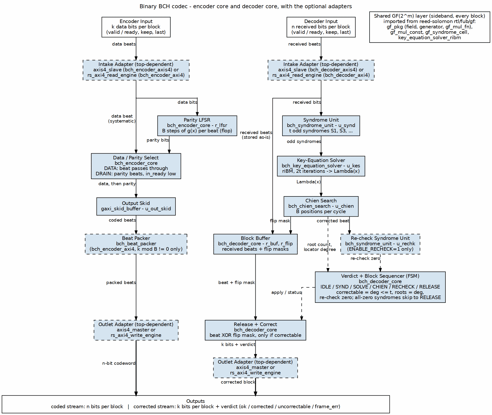

<!-- RTL Design Sherpa Documentation Header -->
<table>
<tr>
<td width="80">
  
</td>
<td>
  <strong>RTL Design Sherpa</strong> · <em>Learning Hardware Design Through Practice</em> 
  
    <a href="https://github.com/sean-galloway/RTLDesignSherpa">GitHub</a> ·
    <a href="https://github.com/sean-galloway/RTLDesignSherpa/blob/main/docs/DOCUMENTATION_INDEX.md">Documentation Index</a> ·
    <a href="https://github.com/sean-galloway/RTLDesignSherpa/blob/main/LICENSE">MIT License</a>
  
</td>
</tr>
</table>

---

<!-- End Header -->

# Block Diagram

### Figure 3.1: Codec block diagram

The two cores, the shared GF layer imported from the reed-solomon component,
and the optional adapters that wrap a core for standalone use.

## The encoder core

Three blocks in a straight line, all inside `bch_encoder_core`. The parity
LFSR (`r_lfsr`) is a deg(g)-stage shift register over GF(2^m) with the
generator polynomial's coefficients on its taps; its next-state logic chains
B steps of the generator so a whole beat of data bits enters in one cycle,
and the keep count picks how many of those steps apply. The data / parity
select passes each data beat straight through (the code is systematic), and
once `in_last` arrives it drains the parity from the top LFSR lanes with
`in_ready` held low, raising `last` on the final parity beat. The LFSR is
all-zero again when the drain ends, so the next block needs no clear. A
`gaxi_skid_buffer` on the output decouples the core from its consumer. There
is no separate unpack or pack stage: the core works on B-bit beats end to
end.

## The decoder core

The received block is written into the block buffer and, in the same
cycles, into `bch_syndrome_unit`, whose t cells each accumulate one odd
syndrome by Horner's rule as the bits arrive. An all-zero syndrome set
skips the solver and releases the buffer unchanged. Otherwise the odd
syndromes go to `bch_key_equation_solver` (riBM, the only `KES_ALGO`
implemented), which produces the error-locator polynomial in 2t iterations
and flags a degree above t. `bch_chien_search` then walks the n bit
positions, B per cycle; each beat's flip mask is stored beside the buffered
beat, and the corrected beat feeds a second syndrome unit
(`ENABLE_RECHECK=1`, the default) that re-checks the corrected stream.

The verdict is formed only after the walk and the re-check finish:
correctable means degree <= t, root count equal to the degree, and a zero
re-check. The block sequencer (IDLE, SYND, SOLVE, CHIEN, RECHECK, RELEASE)
then releases the buffer, applying the stored flip masks only when the
verdict is correctable; an uncorrectable or mis-framed block leaves
bit-for-bit unchanged. The status outputs (ok / corrected count /
uncorrectable / frame_err) are held through the released block.

Because the code is binary there is no Forney evaluator: the error value is
always 1.

## The GF layer

The GF layer is imported from `projects/components/ecc-ip/reed-solomon/rtl/fub/gf/`.
`gf_pkg` holds the field arithmetic (primitive-polynomial checks, alpha
powers and the `gf_mul_fn` multiply function); the BCH-specific generator
polynomial and syndrome roots are computed in `bch_pkg` from the profile
parameters. The cores build on it with `gf_mul_const` (a constant multiply,
an XOR network) in the Chien search, `gf_syndrome_cell` in the syndrome
units, and the imported riBM array `key_equation_solver_ribm` in the
key-equation solver; the LFSR and the Chien lane sums use `gf_mul_fn`
directly. The block counts are in chapter 5.3.

## The adapters

The adapters come from the top that wraps the core. `bch_encoder_axis4` and
`bch_decoder_axis4` put the house `axis4_slave` (intake) and `axis4_master`
(outlet) timing wrappers around the core, with TLAST as the block boundary
and the per-bit keep on tstrb or the low tuser bits. `bch_encoder_axi4` and
`bch_decoder_axi4` are memory-to-memory job engines: `rs_axi4_read_engine`
feeds the core and `rs_axi4_write_engine` drains it, sequenced by a job port
(`cfg_start`, source and destination address, block count, `cfg_done`).
`bch_encoder_axi4` adds `bch_beat_packer` when k is not a multiple of B, so
the written codeword has its only partial beat last. Chapter 4 specifies
each.

## Hierarchy

The cores live in `rtl/macro/` (`bch_encoder_core`, `bch_decoder_core`), the
fubs in `rtl/fub/` (`bch_syndrome_unit`, `bch_key_equation_solver`,
`bch_chien_search`, `bch_beat_packer`, `bch_pkg`) and the four integration
tops in `rtl/top/`. The MAS describes each block.
