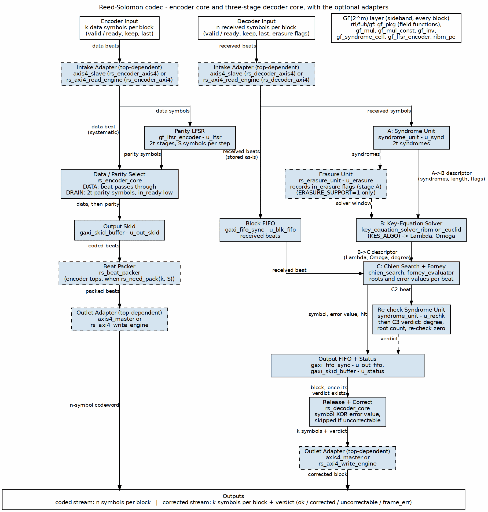

<!-- RTL Design Sherpa Documentation Header -->
<table>
<tr>
<td width="80">
  
</td>
<td>
  <strong>RTL Design Sherpa</strong> · <em>Learning Hardware Design Through Practice</em> 
  
    <a href="https://github.com/sean-galloway/RTLDesignSherpa">GitHub</a> ·
    <a href="https://github.com/sean-galloway/RTLDesignSherpa/blob/main/docs/DOCUMENTATION_INDEX.md">Documentation Index</a> ·
    <a href="https://github.com/sean-galloway/RTLDesignSherpa/blob/main/LICENSE">MIT License</a>
  
</td>
</tr>
</table>

---

<!-- End Header -->

# Block Diagram

### Figure 3.1: Codec block diagram

The two cores, the shared GF layer, and the optional adapters that wrap a
core for standalone use.

## The encoder core

Three blocks in a straight line, all inside `rs_encoder_core`. The parity
generator is `gf_lfsr_encoder` (`u_lfsr`): a 2t-stage shift register over
GF(2^m) with the generator polynomial's coefficients as constant multipliers
on its taps. Each accepted beat steps it by the beat's symbol count (the S
single steps are unrolled), so a whole beat enters in one cycle. The data /
parity select passes each data beat straight through, and once `in_last`
arrives it drains the 2t parity symbols S at a time with `in_ready` held
low, raising `last` on the final one; the drain leaves the LFSR all-zero,
so there is no clear. A `gaxi_skid_buffer` on the output decouples the
consumer. There is no separate unpack or pack stage inside the core; the
encoder tops add `rs_beat_packer` when k is not a multiple of S, so the
codeword's only partial beat is its last.

## The decoder core

`rs_decoder_core` is three stages joined by descriptor skids, so one block
is received while the previous one is solved and the one before that is
corrected. Stage A writes every received beat into the block FIFO
(`gaxi_fifo_sync`) and steps `syndrome_unit`, whose 2t cells each
accumulate one syndrome by Horner's rule; on the last symbol a descriptor
(length, frame error, all-zero flag, syndromes) goes to stage B. Stage B
runs the key-equation solver -- the riBM array by default, the modified
Euclidean array when `KES_ALGO` selects it -- to produce the error-locator
and error-evaluator polynomials; a clean or mis-framed block bypasses it.
With `ERASURE_SUPPORT=1`, `rs_erasure_unit` records the erasure flags in
stage A and transforms and combines the polynomials in stage B. Stage C
loads `chien_search` and `forney_evaluator`, then walks the block one beat
per cycle against the block FIFO; the walked beat is registered, fed to a
second syndrome unit (the re-check) and pushed into the output FIFO as
{received symbol, error value, hit}. One cycle after the last beat the
verdict (degree, root count, zero derivative, re-check) goes to the status
skid. A block leaves only when both its data and its verdict are present,
and the error values are applied on the way out only when the block is not
uncorrectable, so an uncorrectable block leaves exactly as it arrived.

## The GF layer

`gf_pkg` holds the field arithmetic as constant functions of (m, primitive
polynomial): alpha powers, the multiply function and the elaboration
checks. Each module builds its own tables from it; there is no generator.
The primitives built on it are `gf_mul_const` (a constant multiply, an XOR
network), `gf_mul` (full multiply), `gf_inv` (inverse), plus the composite
cells `gf_syndrome_cell`, `gf_lfsr_encoder` and `ribm_pe`. The block counts
are in chapter 5.3.

## The adapters

The adapters come from the top that wraps the core. `rs_encoder_axis4` and
`rs_decoder_axis4` put the house `axis4_slave` and `axis4_master` wrappers
around the core, with TLAST as the block boundary and the decoder's
erasure flags on the intake. `rs_encoder_axi4` and `rs_decoder_axi4` are
memory-to-memory job engines: `rs_axi4_read_engine` feeds the core and
`rs_axi4_write_engine` drains it, sequenced by a job port (`cfg_start`,
source and destination address, block count, `cfg_done`). Chapter 4
specifies each.

## Hierarchy

The complete bottom-up hierarchy -- every block, what it does and every
component it instantiates with counts -- is `docs/rs_fub_catalog.md`. This
chapter names the blocks; the catalog is the authority on their contents.
