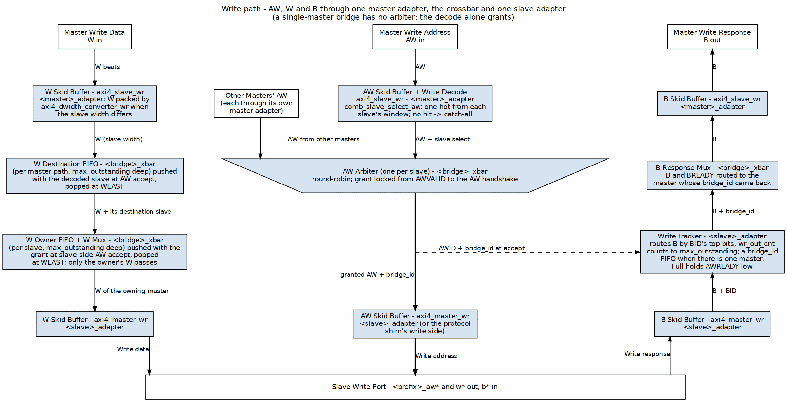
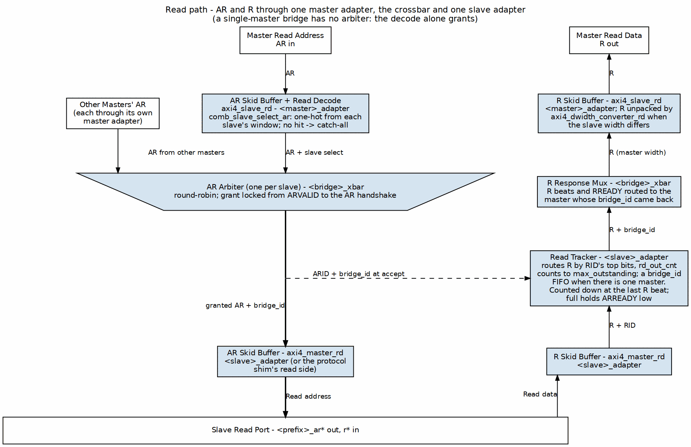

<!-- RTL Design Sherpa Documentation Header -->
<table>
<tr>
<td width="80">
  
</td>
<td>
  <strong>RTL Design Sherpa</strong> · <em>Learning Hardware Design Through Practice</em> 
  
    <a href="https://github.com/sean-galloway/RTLDesignSherpa">GitHub</a> ·
    <a href="https://github.com/sean-galloway/RTLDesignSherpa/blob/main/docs/DOCUMENTATION_INDEX.md">Documentation Index</a> ·
    <a href="https://github.com/sean-galloway/RTLDesignSherpa/blob/main/LICENSE">MIT License</a>
  
</td>
</tr>
</table>

---

<!-- End Header -->

# Block Diagram

## Bridge Architecture Overview

### Figure 3.1: Bridge Block Diagram

One master's path through the generated bridge to one slave; every master and every slave repeats it. Write data drops down the left lane, requests take the center through the per-slave arbiter (the trapezium, where every master's AW / AR contend), and B / R responses climb the right lane back to the master named by the returned `bridge_id`. The response tracker in the slave adapter is written at AW / AR accept (dashed) and read when the response returns.

## Functional Blocks

### Master Adapter

One per master (`<master>_adapter`), receives transactions from the upstream master:

- **Skid buffers** - `axi4_slave_wr` / `axi4_slave_rd` register every channel at the port
- **Address decode** - a one-hot slave select from each slave's `base_addr` / `addr_range`; no hit selects the catch-all
- **Width conversion** - `axi4_dwidth_converter_wr` / `_rd`, one path per distinct slave width, only where the widths differ
- **Fabric ID** - the AXI ID is prefixed with the master's `BRIDGE_ID` (`{BRIDGE_ID, id}`), so a slave port's ID is wider than a master port's
- **Clock crossing** - `axi4_cdc_wr` / `_rd` ahead of the skid buffers when the master port is `cdc = true` (GitHub #119 L2)

### Crossbar Core

Central switching fabric (`<bridge>_xbar`):

- **5-channel routing** - Independent AW, W, B, AR, R paths
- **Arbitration** - one AW and one AR arbiter per slave, round-robin (or `arbitration = "qos"`), grant held until the address handshake
- **W steering** - a W destination FIFO per master path and a W owner FIFO per slave keep each W burst with its AW
- **Response muxes** - B and R return to the master named by the `bridge_id` the slave adapter hands back

### Slave Adapter

One per slave (`<slave>_adapter`), delivers transactions to the downstream slave:

- **Response tracking** - by ID when several masters share the slave (the returned ID's prefix bits name the master; a counter bounds the outstanding count), or an in-order `bridge_id` FIFO when one master does; counted or written at AW / AR accept, read at B / last R
- **Skid buffers or protocol conversion** - `axi4_master_wr` / `_rd`, or `axi4_to_apb4_shim`, `axi4_to_axil4_*` / `axi4_to_axil5_*`, `axi4_to_wb4`
- **Clock crossing** - `axi4_cdc_wr` / `_rd` when the slave port is `cdc = true`

## Data Flow

### Figure 3.2: Write Path

### Figure 3.3: Read Path

## Scalability

### Topology Parameters

| Parameter | Range | Impact |
|-----------|-------|--------|
| NUM_MASTERS | 1-32 | Linear MUX growth |
| NUM_SLAVES | 1-256 | Linear decoder growth |
| DATA_WIDTH | 32-512 | Linear data path growth |
| ID_WIDTH | 1-16 | Scales the ID wires (slave side carries {BRIDGE_ID, id}) and the master-index prefix routed back on B / R |

: Topology Parameter Scaling

### Resource Scaling

- **Logic:** O(M x N) for crossbar core
- **Routing:** O(M + N) for address/response paths
- **Memory:** O(M x outstanding) for ID tracking

## References

* Dally & Towles, *Principles and Practices of Interconnection Networks*, Morgan Kaufmann 2004 — per-slave arbiters on AW and AR as the degenerate case of a separable allocator (ch18 §19.3), and skid buffers as buffered flow control (ch12). ([Reference archive](../../../references/README.md))
* Roy, *Advanced Digital System Design*, Springer 2023 — AXI permits W to trail AW independently; the W-owner FIFO records the AW grant so the data path follows the address decision (§18.2.3). ([Reference archive](../../../references/README.md))
* Duato/Yalamanchili/Lionel, *Interconnection Networks*, Morgan Kaufmann 2003 — deterministic routing preserves order only along a single path; safe out-of-order completion requires explicit ID-keyed tracking, which Bridge gets from the master-index prefix on every fabric ID (ch3/4). ([Reference archive](../../../references/README.md))
