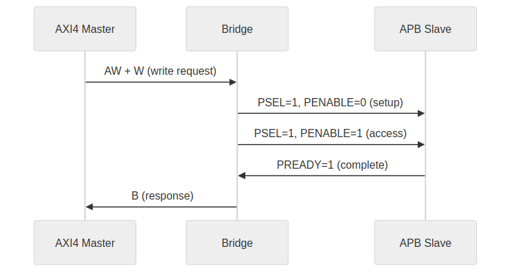
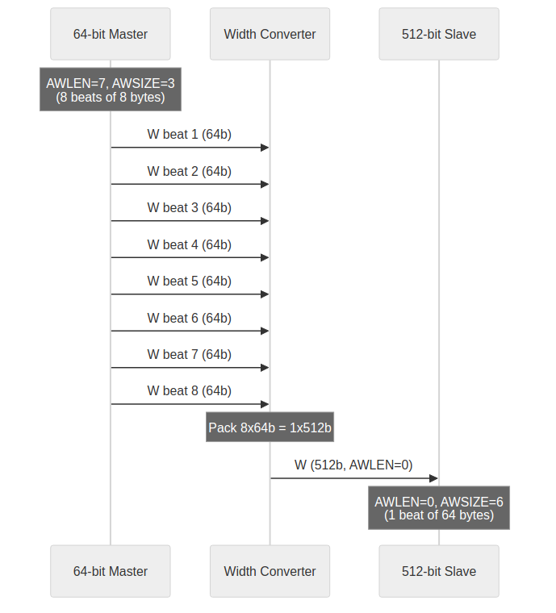
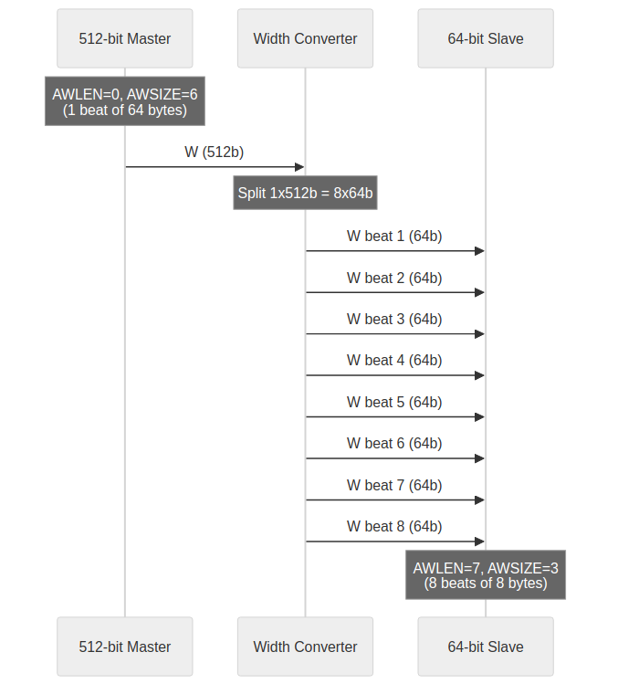

<!-- RTL Design Sherpa Documentation Header -->
<table>
<tr>
<td width="80">
  
</td>
<td>
  <strong>RTL Design Sherpa</strong> · <em>Learning Hardware Design Through Practice</em> 
  
    <a href="https://github.com/sean-galloway/RTLDesignSherpa">GitHub</a> ·
    <a href="https://github.com/sean-galloway/RTLDesignSherpa/blob/main/docs/DOCUMENTATION_INDEX.md">Documentation Index</a> ·
    <a href="https://github.com/sean-galloway/RTLDesignSherpa/blob/main/LICENSE">MIT License</a>
  
</td>
</tr>
</table>

---

<!-- End Header -->

# Protocol Support

## Supported Protocols

### AXI4 Full

Complete AMBA AXI4 protocol support:

- **5 channels:** AW, W, B, AR, R
- **Burst transactions:** FIXED, INCR, WRAP
- **Transaction IDs:** Configurable width
- **Out-of-order:** across IDs at burst granularity for a by-ID slave (multi-master AXI3/AXI4/AXI5, or `enable_ooo`); FIFO-tracked slaves return in request order (bridge BUG-008, was BRIDGE-010). R beats of different IDs may interleave (HAS 4.1)
- **Data widths:** 32, 64, 128, 256, 512 bits

### AXI4-Lite

Simplified AXI4 for register access:

- **5 channels:** Same as AXI4
- **Single-beat only:** AWLEN/ARLEN = 0
- **No IDs:** Transaction ordering by channel
- **Fixed width:** Typically 32 or 64 bits

### AXI3

Legacy AMBA AXI3 protocol support, added as a boundary conversion so the
internal crossbar remains AXI4:

- **5 channels:** AW, W, B, AR, R, with `WID` present on write data
- **Burst length:** 1–16 beats on the boundary; longer AXI4 bursts are chopped
  by the boundary converter
- **Per-port data width:** Same width as the paired AXI4 side; width adaptation
  happens inside the bridge behind the converter when necessary
- **Lock mapping and interleaving constraints:** set by the converter, not the
  crossbar — see HAS 6.5 AXI3 Integration

### APB (Advanced Peripheral Bus)

Low-power peripheral protocol:

- **Single channel:** Combined address and data
- **Simple handshake:** PSEL, PENABLE, PREADY
- **No bursts:** Single transfer per transaction
- **Low overhead:** Minimal logic for slow peripherals

## Protocol Conversion Matrix

| Master | Slave | Conversion Type | Notes |
|--------|-------|-----------------|-------|
| AXI4 | AXI4 | Direct | Width conversion if needed |
| AXI4 | AXI4-Lite | Downgrade | Burst split to single beats |
| AXI4 | APB | Full convert | Channel and timing conversion |
| AXI4-Lite | AXI4 | Upgrade | Single-beat pass-through |
| AXI4-Lite | AXI4-Lite | Direct | Width conversion if needed |
| AXI4-Lite | APB | Convert | Simplified conversion |
| AXI5-Lite | any | Upgrade | As AXI4-Lite plus the AXI5-Lite ID; `user` rides the fabric, TRACE/POISON terminate at the boundary (no LOCK/LOOP/MPAM/MECID/NSAID on AXI5-Lite, IHI 0022L B2.1.5) |
| APB / APB5 | any | Full convert | `apb{4,5}_to_axi4` front end, then as AXI4-Lite |
| any | Wishbone B4 | Full convert | `axi4_to_wb4`: one transfer per beat, in-order termination |
| Wishbone B4 | any | Full convert | `wb4_to_axi4` front end, then as AXI4-Lite |
| AXI4 | AXI3 | Protocol convert | `axi4_to_axi3` slave boundary; same data width only |
| AXI3 | AXI4 | Protocol convert | `axi3_to_axi4` master boundary; same data width only |

: Protocol Conversion Matrix

## Automatic Conversion Shims at Slave Boundary

When a slave port's TOML entry names a protocol other than native AXI4 (e.g.,
`protocol = "axi3"`, `protocol = "axil"` or `protocol = "apb"`), the generator
emits the conversion shims between the crossbar core and that slave port. This happens once, at
generation time; there is nothing to configure at runtime.

**Supported Slave Protocols** -- these are the exact TOML values the generator
accepts (`config_validator.valid_protocols`); anything else is a generation
error, so spelling matters:

| `protocol` | Meaning | Shim emitted at the slave boundary |
| --- | --- | --- |
| `axi4` | Native AXI4 | none |
| `axi3` | AMBA AXI3 | `axi4_to_axi3` |
| `axi5` | AXI5, interop mode | `axi5_master_{wr,rd}` boundary wrappers |
| `axil` | AXI4-Lite | `axi4_to_axil4_{rd,wr}` |
| `axil5` | AXI5-Lite | `axi4_to_axil5_{rd,wr}` |
| `apb` | APB3/APB4 | `axi4_to_apb4_shim` |
| `apb5` | APB5 | `axi4_to_apb5_shim` |
| `wb4` | Wishbone B4 (pipelined) | `axi4_to_wb4` |

: Slave-port protocol values

Note the spelling: it is `axil`, not `axi4lite`. Earlier revisions of this
page used the latter, which the generator rejects.

The shim modules live in `projects/components/utility-ip/converters/rtl/`; the generator instantiates them into each generated top-level module. The slave port still presents the configured protocol (AXIL or APB) to the outside; inside, the crossbar core is uniformly AXI4.

## Automatic Conversion at the Master Boundary

The same `protocol` values are legal on a master port (bridge TASK-004, was BRIDGE-014). The
bridge presents the requester's own protocol on the boundary -- the AXI4-Lite
signal set, the AXI5-Lite set with its sideband, or the APB completer set --
and the master adapter converts to the AXI4 the crossbar speaks:

| `protocol` | Boundary presents | Conversion in the master adapter |
| --- | --- | --- |
| `axi4` | AXI4 | none (timing wrapper only) |
| `axi3` | AXI3 | `axi3_to_axi4`, then the AXI4 timing wrapper |
| `axi5` | AXI5 (minus REGION, plus enabled features) | `axi5_slave_{wr,rd}` boundary wrappers |
| `axil` | AXI4-Lite | AXI4 extras tied (`AxLEN=0`, INCR, `WLAST=1`, ID = placeholder); the wide-slave aligner toward wider slaves |
| `axil5` | AXI5-Lite: ID + optional signals | as `axil`, but `awid`/`arid` -> the AXI4 ID and `bid`/`rid` back; `user` -> the 1-bit USER fields; TRACE/POISON terminated at the top |
| `apb` | APB4 completer | `apb4_to_axi4`, then the AXI4 timing wrapper |
| `apb5` | APB5 completer (+ `PAUSER/PWUSER/PWAKEUP` in -- all requester-driven, IHI 0024E 3.7.2 -- `PRUSER/PBUSER` out) | `apb5_to_axi4` (`PAUSER[0]`/`PWUSER[0]` -> USER), then the AXI4 timing wrapper |
| `wb4` | Wishbone B4 completer (pipelined) | `wb4_to_axi4`, then the AXI4 timing wrapper; SLVERR/DECERR terminate ERR |

: Master-port protocol values

Rules the validator enforces on these ports: AXI4-Lite masters have `id_width = 0`
(no ID pins exist; the fabric ID is the master index, bridge TASK-005 (was BRIDGE-016)),
AXI5-Lite masters `id_width >= 1` (AWID/ARID are required on an AXI5-Lite
Subordinate, IHI 0022L B2.1.5, GitHub #102 item 3), APB and
Wishbone masters have `addr_width = 32` (the requester addresses the whole fabric --
an APB *slave* port's `PADDR` is a window offset, a master's is not), and
`axi5_features` on an `axil5` port may name only `user`, the one group with
an AXI4 destination (`exclusive`, `loop`, `mpam`, `mecid` and `nsaid` are
rejected as not existing on AXI5-Lite).

## AXI4 to APB Conversion

### Conversion Process

### Figure 3.4: AXI4 to APB Conversion Sequence

### Burst Handling

- AXI4 bursts split into individual APB transfers
- WSTRB converted to per-byte enables
- B response generated after all beats complete

### Timing Considerations

- APB is inherently slower (minimum 2 cycles per transfer)
- Pipeline stalls during APB access
- Consider separate APB crossbar for multiple slow peripherals

## Width Conversion

### Upsize (Narrow to Wide)

### Figure 3.5: Width Upsize Conversion

### Downsize (Wide to Narrow)

### Figure 3.6: Width Downsize Conversion

## Channel-Specific Protocol

### Write-Only Masters

Only AW, W, B channels active:

- AR permanently deasserted
- R channel ignored (no routing logic)
- Reduced signal count and logic

### Read-Only Masters

Only AR, R channels active:

- AW, W, B channels ignored
- No write arbitration for this master
- Reduced signal count and logic

## ACE and Coherency — Explicitly Out of Scope

The bridge implements AMBA 5 **AXI5** interop and sideband features, but it is
**not a coherence interconnect**: there are no ACE snoop channels (AC/CR/CD),
no `ACVALID/ACREADY/CRVALID/CRREADY/CDVALID/CDREADY` signals anywhere in the
generated RTL, and cache-coherent masters are not supported. Coherent systems
belong to the cache-ip domain (see the amber/jet/onxy work). This mirrors
`PRD.md`: "No ACE protocol extensions (cache coherency)."

## References

* Eschemann, *The FPGA Programming Handbook*, Packt 2023 — educational secondary source for AXI4 full and AXI4-Lite channel structure and handshake rules (ch8 §8.3). ([Reference archive](../../../references/README.md))
* Roy, *Advanced Digital System Design*, Springer 2023 — secondary source for AXI channel structure and headline protocol features (§18.2.2, §18.2.2.1). ([Reference archive](../../../references/README.md))
* Maaref, *Architecting and Building High-Speed SoCs*, Packt 2022 — AMBA-suite context and the evolution of AXI4 features such as QoS/Region (ch3 §4.2). ([Reference archive](../../../references/README.md))
* ARM, *AMBA AXI and ACE Protocol Specification*, ARM IHI 0022E — the authoritative AXI4 protocol definition. ([Reference archive](../../../references/README.md))
* ARM, *AMBA 3 AXI Protocol Specification*, ARM IHI 0022 — the AXI3 protocol authority; 4-bit `AxLEN`, 2-bit `AxLOCK`, write-data `WID`, absence of `QoS`/`REGION`. ([Reference archive](../../../references/README.md))
