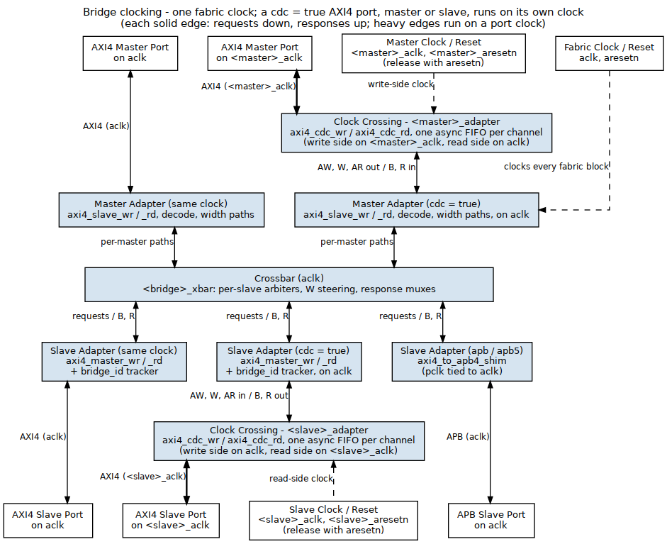
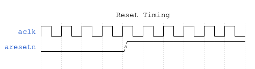
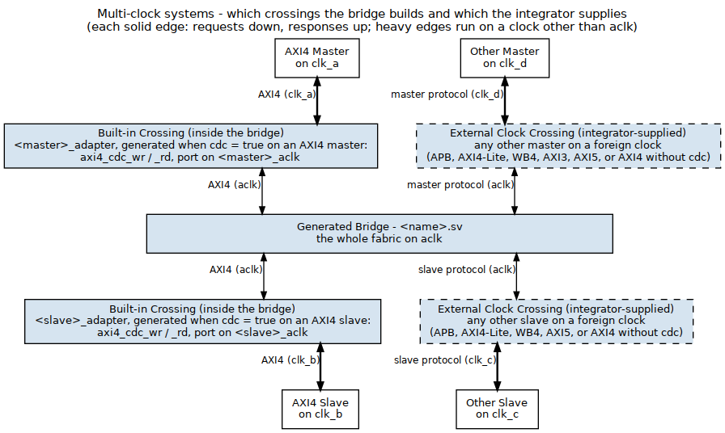

<!-- RTL Design Sherpa Documentation Header -->
<table>
<tr>
<td width="80">
  <a href="https://github.com/sean-galloway/RTLDesignSherpa">
    
  </a>
</td>
<td>
  <strong>RTL Design Sherpa</strong> · <em>Learning Hardware Design Through Practice</em><br>
  <sub>
    <a href="https://github.com/sean-galloway/RTLDesignSherpa">GitHub</a> ·
    <a href="https://github.com/sean-galloway/RTLDesignSherpa/blob/main/docs/DOCUMENTATION_INDEX.md">Documentation Index</a> ·
    <a href="https://github.com/sean-galloway/RTLDesignSherpa/blob/main/LICENSE">MIT License</a>
  </sub>
</td>
</tr>
</table>

---

<!-- End Header -->

# Clock and Reset

## Overview

One clock, one reset. The AXI fabric runs in a single synchronous domain — the exception is an AXI4 port, master or slave, declared `cdc = true`, which runs on its own clock and gets its own discussion below — and the reset is asynchronous, active-low. This page covers what that means for your clock tree, your reset strategy, and your constraint file.

## Ports

### Clock

| Signal | Description | Requirements |
|--------|-------------|--------------|
| aclk | System clock | All interfaces synchronous |
| Frequency | Operating frequency | Design-dependent |
| Duty cycle | Clock duty cycle | 40-60% typical |

: Clock Requirements

### Reset

| Signal | Description | Polarity |
|--------|-------------|----------|
| aresetn | Async reset | Active-low |

: Reset Signal

## Functional Description

### One Fabric Clock

#### Figure 4.3: Clock Distribution



The fabric itself runs on `aclk`. An AXI4 master or slave port may run on
its own clock when declared `cdc = true` (next sections); every other port
shares `aclk`.

### Clock Domain Crossing: CDC Slave Ports

The FABRIC is one clock domain (`aclk`). Since bridge TASK-006 (was BRIDGE-017) a slave port can
live in another: `cdc = true` on an AXI4 slave adds `<slave>_aclk` /
`<slave>_aresetn` to the bridge top, and the slave adapter carries AW, W and
AR to the port and B, R back through `axi4_cdc_{wr,rd}` -- one Gray-pointer
async FIFO per channel (`rtl/amba/axi4/axi4_cdc.md`) -- downstream of its
timing wrapper, which stays on `aclk` with its monitor and the bridge-id
tracking. Everything upstream of the crossing is unchanged; the port itself
runs entirely on its own clock, at one beat per cycle of the slower domain.

| Signal | Direction | Description |
|---|---|---|
| `<slave>_aclk` | Input | the CDC slave port's clock |
| `<slave>_aresetn` | Input | its active-low reset; release together with `aresetn` (a one-sided reset is not safe on the async FIFOs -- handbook `design/cdc.md`) |

: CDC slave port clock pins (`cdc = true`)

Limits: `protocol = "axi4"` (the crossing carries the AXI4 signal set; AXI5
sideband and the APB/AXIL/WB4 shims have no crossing yet -- the validator
rejects those), and the port keeps `latency = "cut_all"`. Measured on `bridge_2x2_rw_cdc`
(`test_bridge_2x2_rw_cdc_ratio`) with the slave clock at 3, 10 and 23 ns
against a 10 ns fabric: every burst from both masters completes, the port's
beats appear on the slave clock, the sustained rate is set by the slower
clock (>= 0.85 beat per cycle of it), and the same-clock port beside it is
unaffected.

### Clock Domain Crossing: CDC Master Ports

The same crossing works on the request side (GitHub #119 L2): `cdc = true` on
an AXI4 master adds `<master>_aclk` / `<master>_aresetn` to the bridge top,
and the master adapter carries AW, W and AR from the port and B, R back to it
through `axi4_cdc_{wr,rd}` AHEAD of its timing wrapper. The crossing's write
side runs on the port clock, its read side on `aclk`; the timing wrapper, its
monitor, the address decode, the per-ID target tracking and the width paths
all stay on `aclk` and see an ordinary same-clock master. A `wr` or `rd` port
builds only the crossing for its direction. A transaction from a CDC master
to a CDC slave crosses twice each way, once at each adapter.

| Signal | Direction | Description |
|---|---|---|
| `<master>_aclk` | Input | the CDC master port's clock |
| `<master>_aresetn` | Input | its active-low reset; release together with `aresetn` |

: CDC master port clock pins (`cdc = true`)

The limits are the slave port's: `protocol = "axi4"` and `latency =
"cut_all"`. An APB, AXI4-Lite, WB4, AXI3 or AXI5 requester on a foreign clock
still needs a crossing outside the bridge. Measured on `bridge_3x2_rw_mcdc`
(`test_bridge_3x2_rw_mcdc_ratio`: CDC masters `cpu`, rw, and `lfsr`, rd only,
beside the same-clock `dma`, against the CDC slave `ddr` and the same-clock
`sram`) with `cpu_aclk` at 3, 10 and 23 ns and `lfsr_aclk` 2 ns slower,
against a 10 ns fabric:

- every burst completes and every word lands and reads back, including
  `cpu` into `ddr`, which crosses twice each way;
- the ports' beats appear on their own clocks;
- the rate is set by the slower clock, not the crossing. `cpu` alone into
  `sram` moves 1.000 W beat per `aclk` cycle when it is the faster side and
  0.906 per `cpu_aclk` cycle when it is the slower; `lfsr` reads at 1.000 per
  `lfsr_aclk` cycle when slower and 0.501 per 5 ns cycle (the 10 ns fabric)
  when faster. 0.906 is the requester BFM's own gap between bursts, the same
  figure a same-clock master gives; behind the async FIFO the fabric takes
  1.000;
- the same-clock `dma` into `sram` runs at 0.906 alone and 0.906 with `cpu`'s
  two-crossing traffic running beside it.

An `apb`/`apb5` slave's `axi4_to_apb4_shim` core is built around two async
FIFOs and has its own `pclk`/`presetn` pins, but the generator ties them to
`aclk`/`aresetn` (`periph_adapter.sv` in `bridge_2x3_apb_req`), and the bridge
top has no APB clock port. A generated APB slave port therefore runs on
`aclk`. For every port that is not `cdc = true`:

- All inputs sampled on aclk rising edge
- All outputs generated on aclk rising edge
- External CDC required if a non-AXI4 port uses a different clock

### Reset Behavior

#### Figure 4.4: Reset Timing



Reset is active-low: the bridge is in reset whenever `aresetn = 0`.

### Reset Effects

During reset (aresetn = 0):

| Component | State |
|-----------|-------|
| Arbiters | Cleared (no grants) |
| bridge_id FIFOs | Pointers cleared (no outstanding) |
| FIFOs | Emptied |
| Outputs | Deasserted (VALID = 0) |

: Reset Effects

### Outstanding Transactions

**Warning:** reset discards transactions in flight:

- Master may see timeout (no response)
- Slave may receive partial transaction
- System must ensure quiescence before reset

### Reset Release

After reset release (aresetn = 1):

1. Bridge accepts new transactions after 1 cycle
2. All state machines start in IDLE
3. No residual grants or locks

## Timing

### Setup and Hold

All inputs must meet setup/hold relative to aclk:

| Constraint | Typical Value |
|------------|---------------|
| Setup time | Process-dependent |
| Hold time | Process-dependent |

: Timing Constraints

### Clock-to-Output

All outputs appear after aclk rising edge:

| Path | Typical Delay |
|------|---------------|
| aclk to VALID | 1 cycle (registered) |
| aclk to READY | 1 cycle (registered) |
| aclk to DATA | 1 cycle (registered) |

: Clock-to-Output Delays

READY is registered like the rest, which an earlier revision of this table gave
as "Combinational". Every external port terminates in a `gaxi_skid_buffer`
inside its boundary wrapper -- a master port's `awready` is
`axi4_slave_wr.s_axi_awready`, wired straight to the skid's `wr_ready`, and
that is assigned in an `ALWAYS_FF_RST` block. A master budgeting a
combinational ready path against this bridge would be wrong by a register
stage.

## Usage Example

### Recommended Constraints

```tcl
# Example SDC constraints
create_clock -period 10 [get_ports aclk]  ;# 100 MHz

# Reset is async - synchronize externally
set_false_path -from [get_ports aresetn]
```

## Design Notes

### External CDC Required

For ports that are not `cdc = true` AXI4 ports, in systems with multiple
clock domains:

#### Figure 4.5: Multi-Clock CDC



### CDC Recommendations

- Use AXI4 async FIFO bridges
- Consider AXI4 clock converter IP
- Ensure proper gray-coding for pointers
