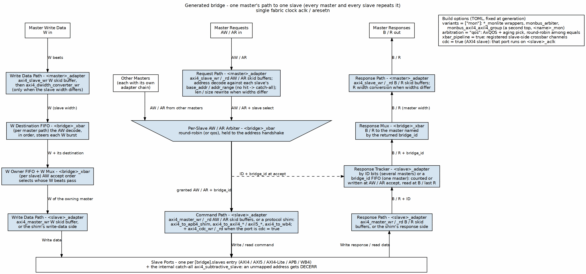

<!-- RTL Design Sherpa Documentation Header -->
<table>
<tr>
<td width="80">
  <a href="https://github.com/sean-galloway/RTLDesignSherpa">
    
  </a>
</td>
<td>
  <strong>RTL Design Sherpa</strong> · <em>Learning Hardware Design Through Practice</em><br>
  <sub>
    <a href="https://github.com/sean-galloway/RTLDesignSherpa">GitHub</a> ·
    <a href="https://github.com/sean-galloway/RTLDesignSherpa/blob/main/docs/DOCUMENTATION_INDEX.md">Documentation Index</a> ·
    <a href="https://github.com/sean-galloway/RTLDesignSherpa/blob/main/LICENSE">MIT License</a>
  </sub>
</td>
</tr>
</table>

---

<!-- End Header -->

# Overview

## Overview

### Bridge Micro-Architecture

Bridge is a multi-protocol AXI4 crossbar generator: it turns CSV/TOML configuration files into parameterized SystemVerilog RTL. This document describes what that RTL looks like on the inside.

### Multi-Protocol Support

Bridge supports three AMBA protocols:

| Protocol | Use Case | Conversion |
|---|---|---|
| AXI4 Full | High-bandwidth memory | Direct or width convert |
| AXI4-Lite | Register access | Protocol downgrade |
| APB | Low-speed peripherals | Full conversion |

: Supported Protocols

### Channel-Specific Masters

Masters that only read or only write don't pay for the channels they never use:

| Type | Channels | Signals | Use Case |
|---|---|---|---|
| Full (rw) | AW, W, B, AR, R | 100% | CPU, config master |
| Write-only (wr) | AW, W, B | ~60% | DMA write engine |
| Read-only (rd) | AR, R | ~40% | DMA read engine |

: Channel-Specific Master Types

### Automatic Converters

Bridge inserts converters automatically:

- **Width converters** - Handle data width mismatches
- **Protocol converters** - AXI4 to APB conversion
- **Per-path optimization** - Only where needed

You never instantiate these by hand; the generator looks at each master/slave pairing and drops in exactly the conversion that path needs.

## Functional Description

### Block Organization

```
Bridge NxM
├── Master Adapters (M instances)
│   ├── Skid buffers, address decode, width paths
│   └── fabric ID = {BRIDGE_ID, id}; bridge_id sideband
├── Crossbar Core
│   ├── Address decode
│   ├── Per-slave arbiters
│   └── Channel muxes
├── Slave Adapters (N instances)
│   ├── Protocol shims (axi4_to_apb4_shim / axi4_to_axil4_*)
│   └── Response tracker: by ID bits (multi-master), or bridge_id FIFO
├── Subtractive slave (always present, internal)
│   └── Answers unmapped addresses: DECERR + 0xDEADBEEF + sticky status
└── Response Routing
    ├── the tracker's bridge_id selects the master
    └── Master response mux (the master's own id bits returned)
```

### Signal Flow

### Figure 1.1: Bridge Signal Flow



One master's path to one slave; every master and every slave repeats it. Write data takes the left lane, AW / AR the center through the per-slave arbiter, and B / R climb the right lane back to the master named by the returned `bridge_id`.

## References

### Related Documentation

- **Bridge HAS** - High-level architecture and integration
- **PRD.md** - Product requirements
- **Generator source** - `bin/bridge_generator.py` (with `bin/bridge_pkg/`)

## Navigation

### Document Organization

| Chapter | Content |
|---|---|
| Ch 2 | Block Descriptions |
| Ch 3 | FSM Design |
| Ch 4 | ID Management |
| Ch 5 | Converters |
| Ch 6 | Generated RTL |
| Ch 7 | Verification |

: Document Organization
