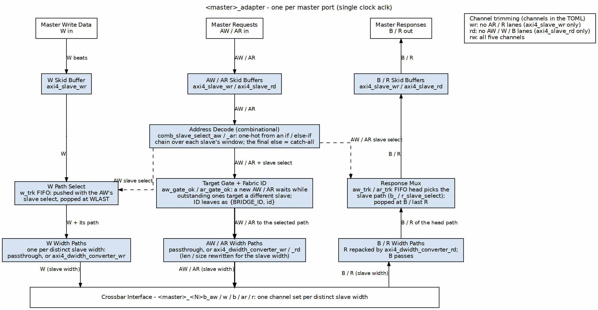

<!-- RTL Design Sherpa Documentation Header -->
<table>
<tr>
<td width="80">
  <a href="https://github.com/sean-galloway/RTLDesignSherpa">
    
  </a>
</td>
<td>
  <strong>RTL Design Sherpa</strong> · <em>Learning Hardware Design Through Practice</em><br>
  <sub>
    <a href="https://github.com/sean-galloway/RTLDesignSherpa">GitHub</a> ·
    <a href="https://github.com/sean-galloway/RTLDesignSherpa/blob/main/docs/DOCUMENTATION_INDEX.md">Documentation Index</a> ·
    <a href="https://github.com/sean-galloway/RTLDesignSherpa/blob/main/LICENSE">MIT License</a>
  </sub>
</td>
</tr>
</table>

---

<!-- End Header -->

# 2.1 Master Adapter

## Overview

Every master port in the bridge gets its own Master Adapter. The adapter sits between the master and the crossbar core, and it exists to make the crossbar's life simple: timing is isolated at the boundary, channels are specialized to what the master actually uses, and every transaction carries a Bridge ID before it enters the fabric.

### Purpose and Function

Concretely, the adapter does five things:

1. **Timing Isolation**: Inserts pipeline registers (skid buffers) to break combinatorial paths from master to crossbar
2. **Channel Specialization**: Separates read-only, write-only, and read-write masters for optimal resource utilization
3. **Fabric ID**: Widens the AXI ID to `{BRIDGE_ID, id}` so IDs are unique across masters
4. **Address Decode and Width Paths**: Selects the target slave and converts width on paths that need it (`axi4_dwidth_converter_wr` / `_rd`)
5. **Per-ID Target Gate and Response Steering**: lets a master keep requests in flight at several slaves (same-ID requests stay on one slave), and arbitrates B / R across its width paths

### Figure 2.1: Master Adapter Architecture



The figure follows the generated `<master>_adapter`: skid buffers at the port, the combinational address decode, the per-ID target gate that also widens the ID to `{BRIDGE_ID, id}`, and one width path per distinct slave width. W follows its AW through the `w_trk` FIFO, and B / R climb back through a response mux whose path arbiter picks among the width paths.

## Parameters

Everything here comes straight out of the TOML/CSV configuration — the generator does the arithmetic, you just declare the ports.

### Per-Master Parameters (from TOML/CSV)

```toml
[[bridge.masters]]
name = "cpu"
channels = "rw"              # "rd", "wr", or "rw"
arid_width = 4               # External ID width
awid_width = 4               # Can differ from ARID
addr_width = 32              # Address bus width
data_width = 64              # Data bus width
# pipeline_depth: NOT A KEY. Skid depth is set per channel by the generator;
# the contract is 2..8 inclusive, so 1 is rejected.
```

### Global Parameters (affect all adapters)

```toml
[bridge]
# internal_data_width: NOT A KEY -- there is no fixed internal crossbar width.
# Width conversion and the ID prefix width are derived, not configured:
# converters are emitted wherever a master and slave width differ, and
# ID_PREFIX_WIDTH = $clog2(num_masters) lands in <bridge>_pkg.sv.
```

## Ports

Two interfaces per adapter: one facing the master, one facing the fabric. Note the ID widths change across that boundary — wider on the inside.

### External Master Interface (per master)
```
Input Channels (from master):
- ARVALID, ARREADY, ARADDR, ARBURST, ARCACHE, ARID, ARLEN, 
  ARLOCK, ARPROT, ARQOS, ARSIZE

- AWVALID, AWREADY, AWADDR, AWBURST, AWCACHE, AWID, AWLEN,
  AWLOCK, AWPROT, AWQOS, AWSIZE

- WVALID, WREADY, WDATA, WSTRB, WLAST

Output Channels (to master):
- RVALID, RREADY, RDATA, RID, RLAST, RRESP

- BVALID, BREADY, BID, BRESP
```

### Internal Crossbar Interface (per master)
```
Output Channels (to crossbar):
- AR* signals + Internal ARID (wider)
- AW* signals + Internal AWID (wider)  
- W* signals (unchanged)

Input Channels (from crossbar):
- R* signals + Internal RID (wider)
- B* signals + Internal BID (wider)
```

## Functional Description

### Channel Specialization

The Bridge generator emits one adapter per master, named after the port: `<name>_adapter.sv` in the bridge's `rtl/generated/<bridge>/` directory (for example `cpu_adapter.sv` in `bridge_2x2_rw`, `cpu_rd_adapter.sv` in `bridge_1x2_rd`, where the port itself is called `cpu_rd`). There is no separate file per channel type; the `channels` key decides which channel logic the one module contains:

#### Read-Only Masters
**Channels**: AR (Address Read), R (Read Data)

```
Configuration: channels = "rd"
RTL Generated: <name>_adapter.sv  (module <name>_adapter)

Optimizations:
- No write address channel logic
- No write data channel logic
- No write response channel logic
- Reduced arbitration participation (read path only)
```

#### Write-Only Masters
**Channels**: AW (Address Write), W (Write Data), B (Write Response)

```
Configuration: channels = "wr"
RTL Generated: <name>_adapter.sv  (module <name>_adapter)

Optimizations:
- No read address channel logic
- No read data channel logic
- Reduced arbitration participation (write path only)
```

#### Read-Write Masters
**Channels**: AR, R, AW, W, B (Full AXI4 interface)

```
Configuration: channels = "rw"
RTL Generated: <name>_adapter.sv  (module <name>_adapter)

Full Functionality:
- All five AXI4 channels implemented
- Participates in both read and write arbitration
- Maximum flexibility but larger resource footprint
```

### Per-Port Monitor Wrappers (when `use_monitor = true`)

When the bridge TOML configuration sets `use_monitor = true` for a master port, the generator instantiates per-direction monitor wrappers immediately downstream of the master adapter:

- **`axi4_master_rd_mon`**: Wraps the AR/R channels, emits packets with `UNIT_ID=1`
- **`axi4_master_wr_mon`**: Wraps the AW/W/B channels, emits packets with `UNIT_ID=1`

Each wrapper:
- Samples all channel signals and timestamp at handshake points
- Emits 128-bit monitor packets on internal monbus
- Passes signals through transparently in the common case, but it CAN stall:
  `axi4_master_rd_mon` gates the address channel on the monitor's back-pressure,
  `assign w_gated_arvalid = fub_axi_arvalid & (w_block_ready | ~cfg_monitor_enable);`
  so a saturated transaction table holds off new addresses until it drains.
  With `cfg_monitor_enable` low the gate is bypassed and the path really is
  transparent.
- Is instantiated only when requested (generator-time configuration)

The generated per-port monbus streams are later aggregated by a tree of `monbus_arbiter` instances at the bridge top.

### Skid Buffer Architecture

Each AXI4 channel passes through a skid buffer for timing isolation. The skid buffer implements:

#### Registered Forward Path
```systemverilog
// Simplified skid buffer concept
always_ff @(posedge clk) begin
    if (!rst_n) begin
        valid_reg <= 1'b0;
    end else if (!valid_reg || ready_out) begin
        valid_reg <= valid_in;
        data_reg  <= data_in;
    end
end
```

#### Single-Cycle Backpressure Response
- When downstream is not ready, accepts one additional beat into holding register
- Signals ready_in = 0 in same cycle to upstream
- No combinatorial paths between upstream and downstream

#### Pipeline Depth
- Default: 2 (the `gaxi_skid_buffer` minimum)
- Range: **2..8 inclusive, any integer**. The value is the skid buffer's
  `DEPTH`, and its elaboration guard rejects anything outside that:
  `if (DEPTH < 2 || DEPTH > 8) $error(...)`. A depth of 1 does not elaborate,
  so the "default 1" this line used to claim was never buildable.
- Trade-off: Latency vs. timing closure

**Performance Impact**:
- Adds 1 cycle latency per channel
- Enables higher clock frequencies
- Prevents critical paths through crossbar

### Bridge ID Management

With more than one master, the adapter widens every request ID to a
fabric ID `{BRIDGE_ID, id}` so two masters can never alias an ID at a slave
(bridge TASK-005). The generated assignment in `cpu_adapter.sv`
(`bridge_2x2_rw`) is:

```systemverilog
assign xbar_axi_awid = {BRIDGE_ID_WIDTH'(BRIDGE_ID), MASTER_ID_WIDTH'(fub_axi_awid)};
assign xbar_axi_arid = {BRIDGE_ID_WIDTH'(BRIDGE_ID), MASTER_ID_WIDTH'(fub_axi_arid)};
```

`BRIDGE_ID` is a per-instance parameter (the master's index). The widths
come from `<bridge>_pkg.sv`:

| Package constant | Meaning | `bridge_2x2_rw` |
|---|---|---|
| `MASTER_ID_WIDTH` | widest master-side ID | 4 |
| `ID_PREFIX_WIDTH` | master-index bits prepended, `$clog2(NUM_MASTERS)` | 1 |
| `XBAR_ID_WIDTH` | fabric and slave-port ID width | 5 |

: Bridge ID Management

A single-master bridge prepends nothing (`ID_PREFIX_WIDTH = 0`;
`bridge_1x2_rd` is 4 bits on both sides). A slave's declared `id_width`
must be at least `XBAR_ID_WIDTH`, or the config validator rejects the
bridge.

#### ID Width Examples
```
ID_PREFIX_WIDTH = $clog2(num_masters)   (0 for one master)

- 2 masters  -> 1 prefix bit
- 4 masters  -> 2 prefix bits
- 8 masters  -> 3 prefix bits
```

**Example**: 4-master system, 4-bit master IDs (6-bit fabric IDs)
```
Master 0: BRIDGE_ID = 2'b00, ID = 4'h3 -> fabric ID = 6'b00_0011
Master 1: BRIDGE_ID = 2'b01, ID = 4'h3 -> fabric ID = 6'b01_0011
Master 2: BRIDGE_ID = 2'b10, ID = 4'h5 -> fabric ID = 6'b10_0101
Master 3: BRIDGE_ID = 2'b11, ID = 4'hA -> fabric ID = 6'b11_1010
```

#### ID Stripping (Response Path)

On B and R the adapter returns only the low `MASTER_ID_WIDTH` bits to the
master (`fub_axi_bid = cpu_32b_b.id[3:0]` in `bridge_2x2_rw`), so the master
sees its original ID.

Routing a response back to the right master does not decode those prefix
bits. Each slave adapter also receives the originating master's index as
a sideband (`xbar_bridge_id_aw` / `_ar`) and stores it on the address
handshake; the crossbar steers B/R by the `bid_bridge_id` / `rid_bridge_id`
it returns. For an AXI4/AXI5 slave of a multi-master bridge that store is a
`bridge_cam` looked up by the returned BID/RID; single-master bridges and
shim/subtractive slaves use an in-order FIFO. See Section 2.5 and ch04.

### Protocol Normalization

The Master Adapter enforces several protocol requirements:

#### Valid Address Ranges
- Checks addresses against slave address maps
- Flags out-of-range accesses for error handling
- Prevents deadlocks from illegal addresses

#### Burst Constraints
- Validates ARLEN/AWLEN vs. 4KB boundary rules
- Ensures burst types are supported (FIXED, INCR, WRAP)
- Checks SIZE vs. DATA_WIDTH compatibility

#### Signal Defaults
- Provides default values for unused signals
- Ensures ARCACHE/AWCACHE have legal values
- Sets ARPROT/AWPROT based on configuration

### Response Path Slave Selection Tracking

#### Problem: Stale Slave Select Decode

Here's the part that bites people. The master adapter decodes the incoming address combinationally to pick a target slave. When the wrapper's skid buffer pops and `fub_axi_awaddr`/`fub_axi_araddr` reverts, the decode changes even though the converter is still in flight pushing the request to the crossbar. This causes the response MUX to route read/write responses from the wrong slave.

#### Solution: Per-Channel Response-Tracking FIFOs

Added separate FIFOs for AR and AW channels that capture the slave index (`comb_slave_select_ar/aw`) at the moment of the FUB-level handshake:

```systemverilog
// At request time (when fub_axi_arvalid && fub_axi_arready)
ar_trk_push <= comb_slave_select_ar;  // Capture decoded slave index

// At response time (when m_axi_rvalid && m_axi_rready && m_axi_rlast)
r_slave_select <= ar_trk_pop;  // Stable slave index for response MUX
```

**Benefits**:
- R/B responses route correctly even after address reverts
- Supports multi-slave masters spanning different widths
- Stable path for both data width and target slave

**Implementation**:
- One FIFO per (master, AW/AR channel)
- Width: `clog2(NUM_SLAVES)` bits (4 bits typical for 16-slave systems)
- Depth: Matches maximum outstanding transactions (8-16 typical)

The FIFOs above steer responses ONLY on ports that carry a read-return atomic
(`rr_atomic`) or a trace echo. Those ports hang per-request state on the FIFO
entry, and they still hold one target slave at a time. Every other port uses
the scheme below.

### Several Targets in Flight (limitation fixed: GitHub #119 L1)

A master used to be held to one target slave at a time, because B / R were
replayed in issue order from the tracking FIFO. Now the adapter keeps only
the ordering AXI requires:

- **Per-ID table** (`aw_idt_cnt[]` / `aw_idt_tgt[]`, same for AR):
  `2**id_track_bits` entries (TOML `[bridge].id_track_bits`, default 4, and
  never more bits than the port's ID), indexed by the ID's low bits. Each entry
  holds an in-flight count and that ID's target slave. The address handshake
  increments the count; a B, or an R with RLAST, decrements it by the returned
  ID. IDs that share the index bits are treated as one ID: safe, at worst a
  needless stall.
- **Gates**: `ar_gate_ok = ar_id_ok && !ar_trk_full`, and
  `aw_gate_ok = aw_id_ok && !aw_trk_full && (w_trk empty || w_slave_select == target)`.
  Here `*_id_ok` means the ID is idle, or already in flight to the SAME
  slave. The W term exists because W has no ID and follows AW order. Two
  masters each owing W to two slaves would otherwise wait on each other at
  the slaves' W ports.
- **Outstanding limit**: `aw_out_cnt` / `ar_out_cnt` cap the port at 16 in
  flight (bridge BUG-009's not-full rule), so no count wraps.
- **Path arbiter**: with more than one width path, `b_pgnt` / `r_pgnt` pick a
  path round robin. A grant holds while offered and not taken; an R grant
  holds through RLAST. The selection feeds `b_slave_select` / `r_slave_select`
  as a representative slave of the path, so the response mux and the path
  readies are unchanged. One width path needs no arbiter. Among the slaves
  on one path, the crossbar's response arbiter has already chosen (MAS 2.3).

## Timing

### Latency

**Request Path** (Master → Crossbar): 1 cycle -- one registered skid stage.

**Response Path** (Crossbar → Master): 1 cycle -- one registered skid stage.

**Total**: 2 cycles each way through the bridge (one skid in the master
adapter, one in the slave adapter). Measured, not derived: see HAS Table 5.7
and `test_bridge_2x2_rw_latency`, which asserts 2 exactly.

> **Depth is not latency.** This block read "with 4-stage pipeline: 4 cycles"
> and a round trip of "2-8 cycles depending on pipeline depth". A
> `gaxi_skid_buffer` presents its output one cycle after the write regardless
> of DEPTH; the depth sets how many beats it can ABSORB under backpressure,
> not how long a beat takes to cross it. The ID prefix and strip are pure
> wiring (a concatenation and a bit-select) and add no cycles.

### Throughput

- **Maximum**: 1 transaction per cycle per channel (fully pipelined)
- **Backpressure**: Propagates with 1-cycle latency
- **Burst Performance**: No degradation; bursts flow continuously when ready

### Critical Paths

Typical critical paths (if skid buffers not used):
- Master ARVALID → Crossbar arbitration logic
- Crossbar grant → Master ARREADY
- Slave RDATA → Master RDATA

**Solution**: Skid buffers break all these paths at the cost of 1-cycle latency.

## Design Notes

### Resource Utilization

#### Per-Master Adapter Resources (Typical)

**Read-Write Master (64-bit data, 32-bit addr, 4-bit ID)**:
```
Logic Elements:  ~200-400 (depending on ID width and features)
Registers:       ~150-250 (pipeline stages + control)
Block RAM:       0 (the master adapter holds no CAM; `bridge_cam` lives in the slave adapters)

Breakdown:
- Skid buffers (5 channels × ~30 regs each): ~150 regs
- ID manipulation logic: ~50 LEs
- Control FSMs: ~100 LEs
- Routing logic: ~50 LEs
```

**Read-Only Master**: ~60% of read-write resources  
**Write-Only Master**: ~65% of read-write resources

#### Scaling Considerations

Resource usage scales with:
- Number of masters (linear scaling, one adapter per master)
- ID width (logarithmic: +BID_WIDTH bits per transaction)
- Pipeline depth (linear: deeper pipelines = more registers)
- Data width (linear: wider data = wider skid buffers)

### Future Enhancements

#### Planned Features
- **Dynamic Pipeline Depth**: Adjust depth based on operating frequency
- **FIFO Mode**: Deeper buffering (16-256 entries) for burst-intensive masters
- **QoS Support**: Priority-based arbitration hints
- **Performance Counters**: Transaction counts, stall cycles, utilization metrics

#### Under Consideration
- **Clock Domain Crossing**: Per-master clock domains with async FIFOs
- **Width Conversion at Adapter**: Move width logic to adapters for distributed conversion
- **Outstanding Transaction Tracking**: Windowing for improved OOO performance

## Related Modules

- Section 2.3: Crossbar Core (interconnect architecture)
- Section 2.4: Arbitration (how adapters compete for slaves)
- Section 2.5: ID Management (fabric ID widening, sideband bridge_id, CAM/FIFO tracking)
- HAS ch04_interfaces/01_axi4_interface.md (port signals)

## Testing

### Debug and Observability

#### Recommended Debug Signals

For ILA or waveform capture:
```
- Master adapter input valid/ready (all channels)
- Master adapter output valid/ready (all channels)
- Bridge ID assignments per transaction
- Pipeline stage occupancy
- Backpressure events (ready = 0 while valid = 1)
```

#### Common Issues and Debug

**Symptom**: Master hangs waiting for READY  
**Check**: 
- Is adapter receiving grants from arbiters?
- Is slave responding to requests?
- Is response path clear?

**Symptom**: Incorrect data returned to master  
**Check**:
- Bridge ID extraction logic
- ID width mismatches
- Response routing in crossbar

**Symptom**: Timing violations  
**Check**:
- Increase pipeline_depth parameter
- Verify clock frequency vs. design complexity
- Check for combinatorial loops
