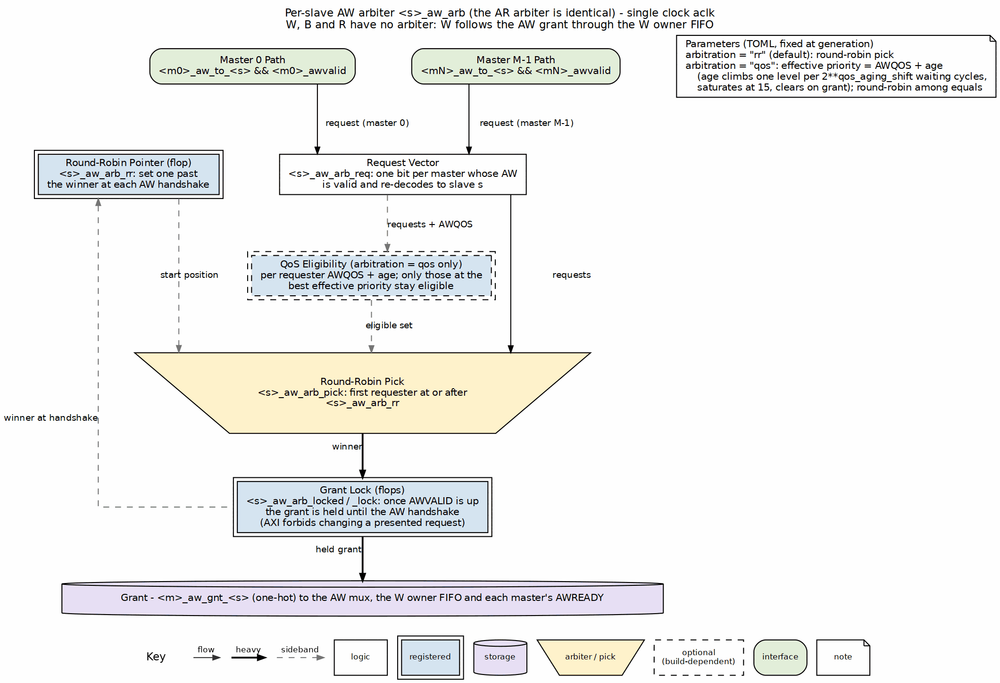

<!-- RTL Design Sherpa Documentation Header -->
<table>
<tr>
<td width="80">
  <a href="https://github.com/sean-galloway/RTLDesignSherpa">
    
  </a>
</td>
<td>
  <strong>RTL Design Sherpa</strong> · <em>Learning Hardware Design Through Practice</em><br>
  <sub>
    <a href="https://github.com/sean-galloway/RTLDesignSherpa">GitHub</a> ·
    <a href="https://github.com/sean-galloway/RTLDesignSherpa/blob/main/docs/DOCUMENTATION_INDEX.md">Documentation Index</a> ·
    <a href="https://github.com/sean-galloway/RTLDesignSherpa/blob/main/LICENSE">MIT License</a>
  </sub>
</td>
</tr>
</table>

---

<!-- End Header -->

# 2.4 Arbitration

When several masters ask for the same slave in the same cycle, something has to pick a winner — that's the arbiter. Each slave gets dedicated arbiters for its read and write channels, so the pick is fair and nothing queues behind the wrong channel.

## Overview

The arbiter does five things:

1. **Conflict Resolution**: Selects one master when multiple masters request same slave
2. **Fairness**: Ensures all masters eventually get access (starvation-free)
3. **Throughput Optimization**: Minimizes idle cycles and maximizes utilization
4. **Grant Management**: Maintains grants for burst transactions
5. **Priority Enforcement**: Supports priority-based access policies (optional)

## Parameters

Arbiter configuration from the TOML — though here the comments carry the real story, since two of the three policies documented later in this chapter exist nowhere in the generated RTL:

```toml
[bridge]
# arbiter_type: NOT A KEY. The policy key is `arbitration`: "rr" (default,
# round-robin), "qos" (AWQOS / ARQOS + age, round-robin among equals; the
# age step is 2**qos_aging_shift cycles) or "matrix" (least recently served,
# bridge TASK-015). All three lock until the address handshake;
# fixed_priority and weighted exist nowhere in bin/bridge_pkg/ or
# rtl/generated/.

[bridge.arbitration]
pipeline_stages = 1              # 1-3 (more = better timing, higher latency)
# enable_priority_aging: NOT A KEY -- aging comes with arbitration = "qos".
aging_threshold = 1000           # Cycles before priority boost

# Weighted arbitration does not exist.
[[bridge.arbitration.weights]]
master = "cpu"
weight = 4                       # Relative weight (1-255)

[[bridge.arbitration.weights]]
master = "dma"
weight = 2

[[bridge.arbitration.weights]]
master = "periph"
weight = 1
```

## Functional Description

### Per-Slave, Per-Channel Arbiters

Each slave has **two independent arbiters**:

```
Slave 0:
  - AR Arbiter (Read Address Channel)
    * Inputs: M0_ARVALID, M1_ARVALID, M2_ARVALID, M3_ARVALID
    * Output: Grant[1:0] → Selects one master
    
  - AW Arbiter (Write Address Channel)
    * Inputs: M0_AWVALID, M1_AWVALID, M2_AWVALID, M3_AWVALID
    * Output: Grant[1:0] → Selects one master
    * Coordinates with W channel data flow
```

**Independence**: AR and AW arbiters operate independently, allowing simultaneous read and write to same slave (if slave supports full-duplex operation).

### Block Diagram

### Figure 2.4: Per-Slave Address Arbiter



One AW arbiter as generated in `<bridge>_xbar` (the AR arbiter is identical). The request vector holds one bit per master whose request slot for this slave holds an AW (see "Where the Pick Is Made" below). The round-robin pick starts one past the last winner, and the grant is locked from AWVALID until the AW handshake, not until the burst's last beat. With `arbitration = "qos"` a QoS-eligibility stage (dashed) narrows the pick to the requesters at the best AWQOS-plus-age priority.

### Where the Pick Is Made: Request Slots at the Slave Pins

On a slave that two or more masters reach, each master's AW and AR request
first enters its own 2-deep registered slot for that slave
(`<master>_<w>b_aw_slot_<slave>`, a `gaxi_skid_buffer`), and the arbiter
picks among the slots straight onto the slave-side nets. Nothing queues
past the pick: the slave adapter's AW/AR timing stage is cut to depth 0 on
these slaves (AXI3, AXI4 and AXI5 slaves), and so is the registered
crossbar's AW/AR stage. The slot is the channel's register instead, so the
address path still crosses two registers (master adapter, slot) and its
latency is unchanged.

An APB, AXI4-Lite or WB4 shim slave takes slots too (bridge W14). It used to
be picked from the masters' live requests, so one master's request gate ran
through the grant into another master's accept: master A's write-tracking
gate, the APB slave's pick, then master B's AWREADY and its width
converter's B-fold write, the worst path in `bridge_mix_e` (-0.106 ns at
10 ns). The shim holds a request of its own, so the slot adds one cycle of
address latency on these slow slaves. Their W owner takes no bypass: a shim
does not accept W ahead of its AW, and the bypass (W to the AW being
presented, before its handshake) deadlocked `bridge_2x2_wb4`'s concurrent
test with two masters writing the WB4 slave.

Why it matters: the pick has to be made where the slave is served. The
arbiter used to pick from the raw requests and feed a 2-deep stage behind
it. While the slave held its ready low, that stage filled with requests
already granted, and a master with few transactions in flight queued
behind the others' -- its share followed its outstanding count instead of
the round-robin. Measured on `bridge_2x2_rw` against a slave that accepts
two transactions at a time, the dma master with 2 in flight against the
cpu's 8:

| | dma share, writes | dma share, reads |
|---|---:|---:|
| arbiter ahead of the stage | 0.340 | 0.337 |
| arbiter at the slave pins | 0.502 | 0.500 |

: Shared-slave share, 8 vs 2 in flight, slave accepting 2 at a time (bridge_2x2_rw, GATE)

The slave's ready reaching the arbiter is now a combinational input to the
pick (it was a registered stage's not-full); the master-facing ready is
still a register, the slot's.

**The write ordering rule.** AXI4 W carries no ID, so a slave's W beats
follow its AW pick order (the W owner FIFO), and a master's W stream follows
its own AW issue order. If a master could leave AWs waiting at two slaves at
once, two masters could have their picks land in opposite orders at two
slaves, each slave then waiting for W the other master can only send after
its earlier burst -- a deadlock. So a master's AW enters a slot only while
none of its other slots holds an AW of its own: each master's AWs are picked
in the order it issued them. The master adapter already holds a new AW to
another slave until every earlier W burst has left it, which gives the same
order wherever no W can wait between the adapter and the crossbar; the
crossbar's hold makes it true at the pick regardless of what a width
converter buffers. Removing the crossbar hold alone does not fail the
`wr_order` perf case on `bridge_2x2_rw` or `bridge_4x4_rw` -- the adapter
rule covers those paths -- so the case guards the two together. Reads have
no such constraint (R returns by ID through the slave adapter's tracker).

What is left to the slave: a slave that accepts many transactions holds its
own queue, and the share inside that queue follows the outstanding count
whatever the fabric does (with the slave accepting 8, the 2-deep master gets
0.21).

### Round-Robin Arbitration

#### Algorithm

The **Round-Robin (RR)** arbiter cycles through masters in order, giving each master one opportunity to access the slave:

```
Priority Order (rotates after each grant):
  Cycle 0: M0 > M1 > M2 > M3
  Cycle 1: M1 > M2 > M3 > M0  (M0 was granted, now lowest priority)
  Cycle 2: M2 > M3 > M0 > M1  (M1 was granted)
  Cycle 3: M3 > M0 > M1 > M2  (M2 was granted)
  Cycle 4: M0 > M1 > M2 > M3  (M3 was granted, cycle repeats)
```

#### Implementation

```systemverilog
// Simplified Round-Robin arbiter (4 masters)
logic [1:0] last_grant;      // Which master was granted last
logic [3:0] request;         // Current requests (VALID signals)
logic [1:0] grant;           // Grant decision

always_ff @(posedge clk) begin
    if (!rst_n) begin
        last_grant <= 2'b00;
    end else if (|request && slave_ready) begin
        // Update last_grant when transaction completes
        if (grant_accepted) begin
            last_grant <= grant;
        end
    end
end

always_comb begin
    // Default: No grant
    grant = 2'b00;
    
    // Priority encode starting after last grant
    case (last_grant)
        2'b00: begin  // Last grant to M0, try M1, M2, M3, M0
            if (request[1])      grant = 2'b01;
            else if (request[2]) grant = 2'b10;
            else if (request[3]) grant = 2'b11;
            else if (request[0]) grant = 2'b00;
        end
        2'b01: begin  // Last grant to M1, try M2, M3, M0, M1
            if (request[2])      grant = 2'b10;
            else if (request[3]) grant = 2'b11;
            else if (request[0]) grant = 2'b00;
            else if (request[1]) grant = 2'b01;
        end
        // ... similar for M2, M3
    endcase
end
```

#### Characteristics

**Fairness**: Excellent - Each master gets equal access over time  
**Latency**: Bounded - Maximum wait = (N-1) × transaction_time  
**Throughput**: Optimal - No idle cycles when requests pending  
**Starvation**: None - Every master eventually gets grant  

**Best Use Cases**:
- Peers with similar priority
- General-purpose interconnects
- Default choice for most bridges

### Matrix Arbitration (`arbitration = "matrix"`, bridge TASK-015)

#### Algorithm

The matrix arbiter (Dally & Towles, ch. 18.5) keeps one bit per ordered
master pair: `m[i][j] = 1` means *i outranks j*. The generator stores the
upper triangle, `n(n-1)/2` flops per arbiter, and reads the lower triangle as
its complement. Among the requesters, the one that outranks every other
requester wins; the matrix is a total order, so exactly one does. At the
slave-side handshake the winner drops below everyone -- its row clears, its
column sets -- so the least recently served requester always wins the next
contended slot. Reset ranks the masters by index, lowest first.

```
4 masters, m[i][j] (i outranks j), row i, column j:

  start           M2 granted         M0 granted
  . 1 1 1         . 1 1 1            . 0 0 0
  0 . 1 1   -->   0 . 1 1     -->    1 . 1 1
  0 0 . 1         0 0 . 0            1 0 . 0
  0 0 0 .         1 1 1 .            1 1 1 .
  M0>M1>M2>M3     M0>M1>M3>M2        M1>M3>M2>M0
```

#### Implementation

As generated for a 3-way arbiter (`bridge_4x4_rw_matrix_xbar`, the
`periph_slave` AW arbiter; the lock-until-handshake wrapper is the one the
round-robin uses):

```systemverilog
logic periph_slave_aw_arb_m_0_1, periph_slave_aw_arb_m_0_2, periph_slave_aw_arb_m_1_2;
wire periph_slave_aw_arb_win_0 = req[0] && (!req[1] ||  m_0_1) && (!req[2] ||  m_0_2);
wire periph_slave_aw_arb_win_1 = req[1] && (!req[0] || !m_0_1) && (!req[2] ||  m_1_2);
wire periph_slave_aw_arb_win_2 = req[2] && (!req[0] || !m_0_2) && (!req[1] || !m_1_2);
wire [1:0] periph_slave_aw_arb_pick = (win_1 ? 2'd1 : 2'd0) | (win_2 ? 2'd2 : 2'd0);
// at the handshake: if (gnt == i) m_i_j <= 0; else if (gnt == j) m_i_j <= 1;
```

The pick is two gate levels for any small `n` (an AND of `n-1` two-input
ORs per master, then a one-hot encode); the round-robin's pick is a
priority chain of depth `n` selected by the pointer, a mux chain of depth
`n` again. Nothing rotates and there is no pointer.

#### Characteristics

**Fairness**: Strong -- least recently served; with `n` persistent requesters no master waits more than `n-1` foreign grants between two of its own (measured: 1 of 1 at 2x2, 2 of 2 at 4x4 three-way, `test_bridge_{2x2,4x4}_rw_matrix_arb.py`)
**Latency**: Bounded -- the same `(N-1) x transaction_time` as round-robin
**Throughput**: Optimal -- the port never idles while a request is pending (1.000 W beats per cycle measured at 2x2)
**State**: `n(n-1)/2` flops per arbiter against the round-robin's `clog2(n)` -- 1 against 1 at two masters, 6 against 2 at four
**Timing / area**: see "Critical Paths" below -- on ASAP7 the 4x4 crossbar's worst path is 11 percent shorter with the matrix arbiter, for 2 percent more cells; at 2x2 the two are within mapper noise

**Best Use Cases**:
- Four or more masters at one slave port, where the round-robin's rotation mux is on the critical path
- An ASIC target: the matrix pick maps to two levels of standard cells

Not applied to the response arbiters (per master, re-arbitrated every beat) or
to the slave-domain arbiter of a shared CDC slave (`bridge_cdc_slave_arb.sv`,
which already instantiates `arbiter_matrix`).

### Fixed-Priority Arbitration

#### Algorithm

The **Fixed-Priority** arbiter always grants to the highest-priority requesting master:

```
Priority Order (never changes):
  M0 > M1 > M2 > M3  (M0 always highest priority)

Grant Decision:
  if (M0_VALID) → Grant = M0
  else if (M1_VALID) → Grant = M1
  else if (M2_VALID) → Grant = M2
  else if (M3_VALID) → Grant = M3
```

#### Implementation

```systemverilog
// Fixed-priority arbiter (4 masters)
logic [3:0] request;
logic [1:0] grant;

always_comb begin
    // Priority encoder: M0 highest, M3 lowest
    if (request[0])      grant = 2'b00;  // M0 highest priority
    else if (request[1]) grant = 2'b01;
    else if (request[2]) grant = 2'b10;
    else if (request[3]) grant = 2'b11;  // M3 lowest priority
    else                 grant = 2'b00;  // Default (no requests)
end
```

#### Characteristics

**Fairness**: Poor - Low-priority masters can starve  
**Latency**: Variable - High-priority: minimal, Low-priority: unbounded  
**Throughput**: Optimal - No idle cycles when requests pending  
**Starvation**: Possible for low-priority masters  

**Best Use Cases**:
- Real-time systems with priority requirements
- CPU (high) vs. DMA (low) scenarios
- Time-critical masters need guaranteed access

#### Starvation Prevention

Optional enhancement: **Priority aging**
```
- Track cycles since last grant per master
- Temporarily boost priority of starved masters
- Reset age counter after grant

Example:
  M0 age = 100 cycles → Boost M0 above normal priority
  M1 age = 5 cycles   → Normal priority
```

### Weighted Arbitration

#### Algorithm

The **Weighted** arbiter assigns different access rates to masters based on weights:

```
Configuration:
  M0 weight = 4  (50% of bandwidth)
  M1 weight = 2  (25% of bandwidth)
  M2 weight = 1  (12.5% of bandwidth)
  M3 weight = 1  (12.5% of bandwidth)

Grant Sequence (repeating pattern):
  M0, M0, M0, M0, M1, M1, M2, M3  (8 cycles total)
  M0 gets 4/8, M1 gets 2/8, M2 gets 1/8, M3 gets 1/8
```

#### Implementation

```systemverilog
// Weighted arbiter using credit counter
logic [7:0] credits [0:3];  // Credit counters per master
logic [1:0] grant;

always_ff @(posedge clk) begin
    if (!rst_n) begin
        credits[0] <= 8'd4;  // M0 weight
        credits[1] <= 8'd2;  // M1 weight
        credits[2] <= 8'd1;  // M2 weight
        credits[3] <= 8'd1;  // M3 weight
    end else if (grant_accepted) begin
        // Decrement granted master's credits
        credits[grant] <= credits[grant] - 1;
        
        // Reload when all credits exhausted
        if (all_credits_zero) begin
            credits[0] <= 8'd4;
            credits[1] <= 8'd2;
            credits[2] <= 8'd1;
            credits[3] <= 8'd1;
        end
    end
end

always_comb begin
    // Grant to master with highest credits and active request
    grant = select_highest_credit_with_request(credits, request);
end
```

#### Characteristics

**Fairness**: Configurable - Proportional to weights  
**Latency**: Bounded - Depends on weight ratio  
**Throughput**: Near-optimal - Small overhead for credit tracking  
**Starvation**: None - All masters get share per weight  

**Best Use Cases**:
- QoS requirements (guaranteed bandwidth)
- Mixed workload (video + CPU + DMA)
- Service-level agreements

### Burst Handling

#### Grant Locking

Once granted, a master **holds the grant** until its burst completes:

```
AR Channel Burst:
  1. Master asserts ARVALID with ARLEN = 7 (8-beat burst)
  2. Arbiter grants to this master
  3. Grant held until slave returns RLAST
  4. Other masters blocked during this time

AW/W Channel Burst:
  1. Master asserts AWVALID with AWLEN = 15 (16-beat burst)
  2. Arbiter grants to this master
  3. Grant held until master asserts WLAST
  4. Other masters blocked during W data transfer
```

#### Implementation

```systemverilog
// Burst grant locking
logic grant_locked;
logic [1:0] locked_master;

always_ff @(posedge clk) begin
    if (!rst_n) begin
        grant_locked <= 1'b0;
    end else begin
        if (grant_accepted && !last_beat) begin
            // Lock grant for burst
            grant_locked <= 1'b1;
            locked_master <= grant;
        end else if (last_beat) begin
            // Release grant when burst completes
            grant_locked <= 1'b0;
        end
    end
end

assign grant = grant_locked ? locked_master : arbiter_decision;
```

#### Fairness Considerations

Long bursts can block other masters:
- Maximum AXI burst: 256 beats
- At 1 cycle/beat: Up to 256 cycles blocked
- Impacts latency for other masters

**Mitigation**:
- Limit burst lengths in master configuration
- Use burst interleaving (complex, not implemented in Phase 1)
- Monitor arbiter stall counters

## Timing

### Arbitration Latency

**Single-Cycle Arbitration** (default):
```
Request → Grant Decision: 1 cycle
Grant Decision → MUX Output: 0 cycles (combinatorial)
Total: 1 cycle
```

**Multi-Cycle Arbitration** (high frequency):
```
Request → Grant Decision: 2-3 cycles (pipelined)
Improves timing at cost of latency
```

### Critical Paths

Typical critical paths in the arbiter:
1. **Request collection**: All master VALID signals → Arbiter input
2. **Priority encode**: Compare all requests → Grant decision
3. **Grant propagate**: Grant → MUX select → Slave interface

**Path Depth**:
- 4 masters: ~6-8 logic levels
- 8 masters: ~8-12 logic levels
- 16 masters: ~12-16 logic levels

**Measured, ASAP7 (bridge TASK-015, 2026-10-24).** The whole crossbar
module synthesized flat with Yosys + ABC against the ASAP7 RVT TT library
and timed with OpenSTA register to register
(`projects/asic-trials/timing_characterization/work/synth_module.py`); the
two netlists of a pair differ only in the arbiter (the generator's `rr`
output is byte-identical before and after the `matrix` policy was added), so
the difference in the worst path is the arbiter's:

| Crossbar (`<bridge>_xbar`, flattened) | Policy | Cells | Flops | Area (um^2) | ABC delay (ps) / levels | STA worst reg-to-reg (ps) |
|---|---|---:|---:|---:|---:|---:|
| `bridge_2x2_rw` | rr | 19,295 | 1,883 | 2,063 | 369 / 17 | 454 |
| `bridge_2x2_rw_matrix` | matrix | 19,228 | 1,883 | 2,081 | 401 / 18 | 479 |
| `bridge_2x2_rw_qos` | qos | 20,334 | 1,979 | 2,280 | 748 / 28 | 821 |
| `bridge_4x4_rw` | rr | 60,685 | 5,311 | 6,389 | 543 / 22 | 610 |
| `bridge_4x4_rw_matrix` | matrix | 62,103 | 5,321 | 6,532 | 471 / 20 | 542 |

: ASAP7 RVT TT, Yosys 0.62 + ABC at a 1000 ps target, OpenSTA on the mapped netlist (2026-10-24)

| Crossbar | Policy | Cells | Area (um^2) | ABC delay (ps) / levels | STA worst reg-to-reg (ps) |
|---|---|---:|---:|---:|---:|
| `bridge_2x2_rw` | rr | 19,279 | 2,061 | 385 / 16 | 461 |
| `bridge_2x2_rw_matrix` | matrix | 19,336 | 2,088 | 364 / 18 | 445 |
| `bridge_2x2_rw_qos` | qos | 20,849 | 2,318 | 609 / 24 | 690 |
| `bridge_4x4_rw` | rr | 62,362 | 6,479 | 458 / 19 | 540 |
| `bridge_4x4_rw_matrix` | matrix | 60,828 | 6,443 | 437 / 19 | 513 |

: The same, mapped at a 400 ps target (the mapper under pressure)

At 4x4 the matrix arbiter shortens the crossbar's worst register-to-register
path by 68 ps (11 percent) at the 1000 ps target and 27 ps (5 percent) with
the mapper pressed at 400 ps, for +2.3 / -2.5 percent cells -- the arbiter's
rotation chain was the critical path. At 2x2 the arbiter is one bit either
way and the two land within 5 percent of each other in both directions, which
is mapper noise, not a difference. QoS-with-aging is the expensive one: its
effective-priority compare puts 28 levels on the path.

## Design Notes

### Resource Utilization

**Round-Robin (4 masters)**:
```
Logic Elements:  ~150 LEs
Registers:       ~40 regs

Breakdown:
- Priority encoder:        ~80 LEs
- Last grant tracking:     ~10 regs
- Request capture:         ~20 regs
- Grant FSM:               ~40 LEs, ~10 regs
```

**Fixed-Priority (4 masters)**:
```
Logic Elements:  ~80 LEs
Registers:       ~20 regs

Simpler than RR (no rotation logic)
```

**Weighted (4 masters)**:
```
Logic Elements:  ~200 LEs
Registers:       ~60 regs

Additional credit counters and comparison logic
```

**Scaling with Master Count** — resource usage grows approximately **O(N²)** where N = master count:

```
2 masters:  ~50 LEs
4 masters:  ~150 LEs
8 masters:  ~400 LEs
16 masters: ~1200 LEs
```

The N² scaling comes from:
- Priority encoder: Compares all pairs of masters
- Grant MUX: N-to-1 multiplexing increases with N

### Performance Impact

**Round-Robin**:
- **Pros**: Fair, starvation-free, predictable latency
- **Cons**: Cannot prioritize time-critical masters
- **Use**: General-purpose, peer masters

**Fixed-Priority**:
- **Pros**: Guaranteed low latency for high-priority masters
- **Cons**: Low-priority can starve, unpredictable for low-priority
- **Use**: Real-time, priority-sensitive systems

**Weighted**:
- **Pros**: Configurable bandwidth allocation, QoS support
- **Cons**: More complex, small overhead
- **Use**: Mixed workload, SLA requirements

**Arbiter Efficiency** — assuming all masters request the same slave continuously:

```
Best Case: 100% efficiency (one master)
  - No arbitration conflicts
  - Zero idle cycles

Typical Case: 25-50% per-master efficiency (4 masters, round-robin)
  - Each master gets ~25% of time grants
  - Load balancing to other slaves improves

Worst Case: Heavy contention
  - 4 masters to 1 slave: 25% efficiency per master
  - Solution: Add slaves or use more slaves in parallel
```

### Debug and Observability

Recommended debug signals and counters:

```
Per Arbiter:
- Request vector (all masters requesting)
- Grant decision (which master granted)
- Grant locked status (burst in progress)
- Last grant (for RR rotation tracking)

Performance Counters:
- Grants per master (utilization)
- Denied requests per master (contention)
- Average grant latency per master
- Arbiter conflict cycles (multiple requests, one grant)
```

### Common Issues

**Symptom**: Master never gets grant (starvation)  
**Check**:
- Arbiter type (fixed-priority can starve low-priority masters)
- Other masters continuously requesting?
- Enable priority aging if using fixed-priority

**Symptom**: Unfair access (one master dominates)  
**Check**:
- Arbiter type (should be round-robin for fairness)
- Burst lengths (long bursts block others)
- Request patterns (one master requesting more frequently)

**Symptom**: Low throughput despite requests  
**Check**:
- Arbiter conflicts (too many masters to one slave)
- Pipeline depth (excessive arbitration latency)
- Burst efficiency (short bursts waste cycles)

### Future Enhancements

**Planned Features**:
- **Dynamic Weight Adjustment**: Runtime-configurable weights via registers
- **QoS Classes**: Multiple priority levels with configurable policies
- **Deadline-Based Arbitration**: Grant based on transaction deadlines
- **Predictive Arbitration**: Speculative grants to reduce latency

**Under Consideration**:
- **Multi-Level Arbitration**: Hierarchical for >16 masters
- **Token Bucket**: Rate limiting per master
- **History-Based**: Learn access patterns and optimize grants
- **ECC Protection**: For arbitration state (safety-critical systems)

## Related Modules

- Section 2.3: Crossbar Core (arbiter integration)
- Section 2.1: Master Adapter (request sources)
- Section 2.5: ID Management (transaction tracking during grants)
- Chapter 6: Performance (arbiter impact on throughput)

## Testing

### Test Scenarios

1. **Fair Access Test** (Round-Robin):
```
- All masters continuously request same slave
- Verify each master gets equal grants over 1000 cycles
- Expected: Each of 4 masters gets ~250 grants
```

2. **Priority Test** (Fixed-Priority):
```
- High-priority master requests intermittently
- Low-priority masters request continuously
- Verify high-priority always wins when requesting
```

3. **Burst Locking Test**:
```
- Master issues 16-beat burst
- Other masters request during burst
- Verify grant held until LAST
- Verify other masters blocked during burst
```

4. **Weighted Bandwidth Test**:
```
- Configure M0=4, M1=2, M2=1, M3=1
- All masters request continuously for 10000 cycles
- Verify grants proportional: M0≈50%, M1≈25%, M2≈12.5%, M3≈12.5%
```

### Corner Cases

```
- Single master requesting (trivial grant)
- All masters requesting simultaneously (worst-case arbitration)
- Grant released and new grant same cycle (back-to-back)
- Master drops request after arbiter latency (stale grant)
- Maximum length burst (256 beats blocking)
```
