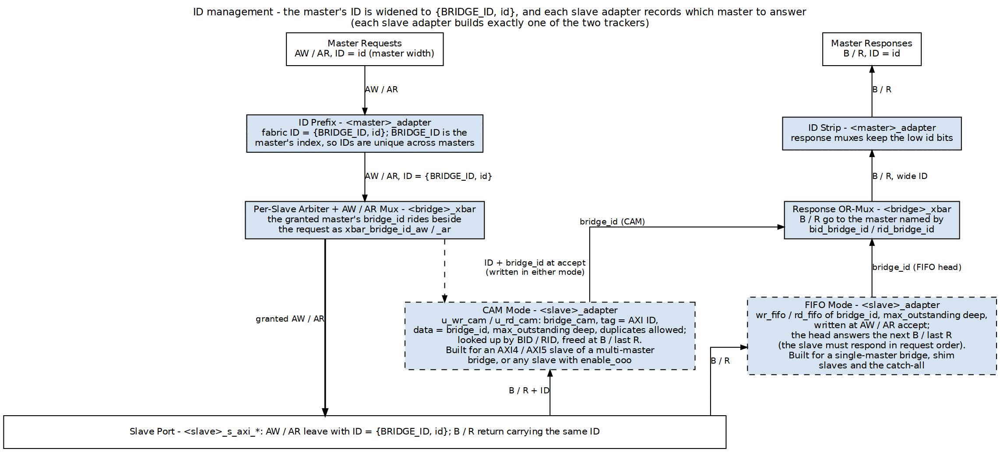

<!-- RTL Design Sherpa Documentation Header -->
<table>
<tr>
<td width="80">
  <a href="https://github.com/sean-galloway/RTLDesignSherpa">
    
  </a>
</td>
<td>
  <strong>RTL Design Sherpa</strong> · <em>Learning Hardware Design Through Practice</em><br>
  <sub>
    <a href="https://github.com/sean-galloway/RTLDesignSherpa">GitHub</a> ·
    <a href="https://github.com/sean-galloway/RTLDesignSherpa/blob/main/docs/DOCUMENTATION_INDEX.md">Documentation Index</a> ·
    <a href="https://github.com/sean-galloway/RTLDesignSherpa/blob/main/LICENSE">MIT License</a>
  </sub>
</td>
</tr>
</table>

---

<!-- End Header -->

# 2.5 ID Management

ID Management is how the bridge remembers which master sent each outstanding transaction, so the response can find its way back.

## Overview

Before anything else in this chapter, read this — it colors everything below:

> **What the generated bridge actually does** (measured against
> `rtl/generated/`). Two mechanisms, both in Figure 2.5:
>
> * **The ID is widened.** The master adapter sends `{BRIDGE_ID, id}` into the
>   fabric (bridge TASK-005), so IDs are unique across masters: in
>   `bridge_2x2_rw`, `cpu_m_axi_awid` is 4 bits and `ddr_s_axi_awid` is 5. The
>   response muxes return the low bits to the master.
> * **Each slave adapter tracks the originating master.** The granted
>   master's index rides beside the request as `xbar_bridge_id_aw` /
>   `xbar_bridge_id_ar` and is written into the slave adapter's tracker at the
>   address handshake. An AXI4 / AXI5 slave of a multi-master bridge (or any
>   slave with `enable_ooo`) gets `bridge_cam` (`u_wr_cam` / `u_rd_cam`), keyed
>   by the AXI ID and looked up with the returned BID / RID, so the slave may
>   complete different IDs in any order. A single-master bridge, the protocol
>   shims and the catch-all keep an in-order `bridge_id` FIFO, which requires
>   the slave to answer in request order (bridge BUG-008's simulation-only
>   check flags a violation).
>
> Either tracker is fixed-depth (16), so the address handshake is gated on it
> being not full (bridge BUG-009).
>
> An earlier revision of this chapter said there was no CAM, that IDs
> passed through at equal width, and that everything below described a
> design that was never built. The prefix and the CAM are both built; the
> sections below say, per item, what the generated RTL does and what was
> only ever proposed.

The ID management system does four things:

1. **Transaction Tracking**: each slave adapter records which master issued each outstanding request
2. **Response Routing**: the crossbar steers B / R by the recorded master index (`bid_bridge_id` / `rid_bridge_id`)
3. **Out-of-Order Support**: a CAM-tracked slave may return different IDs in any order
4. **ID Space Isolation**: the `{BRIDGE_ID, id}` prefix keeps two masters' IDs distinct at every slave

### Figure 2.5: ID Management Architecture



The request takes the center column, widened to `{BRIDGE_ID, id}` in the master adapter and granted with its `bridge_id` in the crossbar. The response climbs the right side: the slave adapter's tracker (CAM or FIFO, dashed because each slave builds exactly one) names the master, and the crossbar and master adapter return B / R with the master's own id bits.

## Parameters

There is no `[bridge.id_management]` table and no `enable_cam`, `cam_type`,
`cam_depth` or `max_outstanding_*` key; `config_validator` rejects unknown
keys. What decides ID handling:

```toml
[[bridge.masters]]
name = "cpu"
id_width = 4                    # master-side ID width

[[bridge.slaves]]
name = "ddr"
id_width = 5                    # must be >= widest master id_width + $clog2(num_masters)
enable_ooo = false              # true forces bridge_cam on this slave even with one master
```

Derived, not configured (emitted into `<bridge>_pkg.sv`):

| Constant | Value | `bridge_2x2_rw` |
|---|---|---|
| `BRIDGE_ID_WIDTH` | `$clog2(NUM_MASTERS)`, minimum 1 | 1 |
| `MASTER_ID_WIDTH` | widest master `id_width` | 4 |
| `ID_PREFIX_WIDTH` | `$clog2(NUM_MASTERS)`, 0 for one master | 1 |
| `XBAR_ID_WIDTH` | `MASTER_ID_WIDTH + ID_PREFIX_WIDTH` | 5 |

: Parameters

The tracker choice is fixed by the generator (`SlaveAdapterGenerator.use_cam`):
`bridge_cam` when the slave sets `enable_ooo`, or when the bridge has more
than one master and the slave is a real `axi4` / `axi5` port; an in-order
FIFO otherwise (single master, apb/axil/wb shim slaves, the internal
subtractive slave).

## Functional Description

### Bridge ID Concept

**Problem** -- two masters may use the same AXI ID:

```
Master 0: ARID = 4'h5
Master 1: ARID = 4'h5
A slave returning RID = 4'h5 cannot say which master it answers.
```

**Solution (built)** -- the master adapter prepends its index:

```
fabric ID = {BRIDGE_ID, master ID}

Master 0, ARID = 4'h5 -> 5'b0_0101
Master 1, ARID = 4'h5 -> 5'b1_0101     (bridge_2x2_rw)
```

### ID Width Calculation

```
ID_PREFIX_WIDTH = $clog2(NUM_MASTERS)   (0 for a single master)

2 masters:  1 bit      3-4 masters: 2 bits
5-8 masters: 3 bits    9-16 masters: 4 bits

4 masters, 4-bit master IDs: slave ports see 6-bit IDs, masters see 4.
```

### Multi-Master OR-Merge Gating

Every slave-side address, ID and `bridge_id` field is an OR of per-master
terms, each gated by that master's AW / AR arbiter grant for the slave, so
an idle master with a stale address contributes nothing:

```systemverilog
// bridge_2x2_rw_xbar.sv
assign ddr_axi_bridge_id_aw = (cpu_32b_aw_gnt_ddr ? cpu_bridge_id_aw : '0) |
                              (dma_32b_aw_gnt_ddr ? dma_bridge_id_aw : '0);
```

The grant already implies the master is valid and decoded to this slave.
An ungated OR let an idle master's zero `bridge_id` corrupt the routing
tag and send a B to the wrong master.

### ID Injection (Request Path, built)

```systemverilog
// <master>_adapter.sv
assign xbar_axi_awid = {BRIDGE_ID_WIDTH'(BRIDGE_ID), MASTER_ID_WIDTH'(fub_axi_awid)};
assign xbar_axi_arid = {BRIDGE_ID_WIDTH'(BRIDGE_ID), MASTER_ID_WIDTH'(fub_axi_arid)};
```

`BRIDGE_ID` is the per-instance master index. The concatenation is wiring
and adds no cycle. There is no "registered injection" option. A
single-master bridge prepends nothing.

### ID Stripping and Response Routing (built)

The response is NOT routed by decoding the prefix bits of BID / RID. The
slave adapter returns the originating master's index on a sideband
(`bid_bridge_id` / `rid_bridge_id`, with `bid_valid` / `rid_valid`), and
the crossbar's B / R muxes select on it:

```systemverilog
// bridge_2x2_rw_xbar.sv (B toward cpu, master index 0)
((ddr_axi_bid_bridge_id == 0) && ddr_axi_bid_valid ? ddr_axi_bid : '0) | ...
```

The master adapter then returns the low `MASTER_ID_WIDTH` bits
(`fub_axi_bid = cpu_32b_b.id[3:0]`), so the master sees its own ID.

### Content Addressable Memory: `bridge_cam` (built)

`rtl/bridge_cam.sv` is hand-written and instantiated twice (`u_wr_cam`,
`u_rd_cam`) in each CAM-tracked slave adapter:

| Parameter | Value in the slave adapter |
|---|---|
| `TAG_WIDTH` | `ID_WIDTH` (fabric ID width, 5 in `bridge_2x2_rw`) |
| `DATA_WIDTH` | `BRIDGE_ID_WIDTH` |
| `DEPTH` | 16 |
| `ALLOW_DUPLICATES` | 1 (same ID may be outstanding more than once; oldest freed first) |
| `PIPELINE_EVICT` | 0 (lookup result in the same cycle) |

: Content Addressable Memory: bridge_cam

Operation:

```
Allocate:   on the AW / AR handshake from the crossbar
            tag = awid / arid, data = xbar_bridge_id_aw / _ar
Deallocate: write on B handshake; read on the R handshake with RLAST
            tag = bid / rid -> deallocate_data = bid_bridge_id / rid_bridge_id
Full:       tags_full gates the crossbar-side AWREADY / ARREADY (bridge BUG-009)
```

An entry holds only the tag, the master index and the duplicate-ordering
count. There is no timestamp, transaction-type field or timeout, and only
the parallel, distributed-RAM form exists; the sequential-search and
BRAM-based CAM variants this chapter once compared were never built.

### In-Order FIFO Tracker (built)

Slaves that do not get the CAM keep a `max_outstanding`-entry (default 16) FIFO of `bridge_id`,
pushed on the address handshake and popped on B / RLAST. Routing uses the
FIFO head, so such a slave must complete in request order; a
simulation-only check flags a returned ID that does not match the head
(bridge BUG-008). The same not-full gate applies.

### Outstanding Transaction Limits

The limit per slave is the tracker depth: 16 writes and 16 reads
outstanding at each slave adapter, CAM or FIFO. When the tracker is full
the slave's AWREADY / ARREADY toward the crossbar drops until a response
frees an entry. There is no per-master outstanding limit key.

## Timing

- **ID injection / stripping**: 0 cycles (concatenation and bit-select).
- **CAM lookup**: 0 added cycles (`PIPELINE_EVICT = 0`; the deallocate
  data is combinational in the response cycle).
- **FIFO head**: 0 added cycles.

The measured end-to-end latency (2 cycles each way in `bridge_2x2_rw`,
HAS Table 5.7) includes whichever tracker the slave uses.

## Design Notes

### Resource Utilization

The per-master prefix is wiring. Each CAM-tracked slave adapter carries
two `bridge_cam` instances (16 entries at the default `max_outstanding`) built in distributed RAM and flops (no
block RAM); the FIFO tracker is two 16-entry FIFOs of `BRIDGE_ID_WIDTH`
bits. Measured totals for the fixtures are in HAS 5.3.

### Debug and Observability

```
Request:  fub_axi_awid / arid  vs  xbar_axi_awid / arid (prefix added)
Slave:    xbar_bridge_id_aw / _ar at the address handshake
CAM:      u_wr_cam / u_rd_cam tags_count, tags_full, deallocate_valid
Response: bid_bridge_id / rid_bridge_id with bid_valid / rid_valid
```

### Common Issues

**Response goes to the wrong master**
- FIFO-tracked slave completing out of order (look for the BUG-008 check message)
- Slave truncating the ID: its `id_width` must be at least `XBAR_ID_WIDTH`
  (the validator enforces this for axi3/axi4/axi5 slaves)

**Address channel stalls**
- Tracker full: 16 outstanding at that slave with no B / RLAST returning
- A hung slave stalls its path indefinitely; there is no timeout in the bridge

**`deallocate_valid` low on a response**
- The slave returned an ID it was never sent

## Related Modules

- Section 2.1: Master Adapter (prefix injection and stripping)
- Section 2.3: Crossbar Core (grant-gated OR-merge, B / R muxes)
- Section 2.8: Response Routing
- HAS ch04_interfaces/01_axi4_interface.md (port ID widths)

## Testing

1. **Multi-master ID isolation**: two masters issue the same ID to one
   slave; each response returns to its own master with the original ID.
2. **Out-of-order at a CAM slave**: the slave answers IDs out of request
   order; each response still reaches its master (the mix_b / mix_d
   arbitration tests exercise this).
3. **Tracker capacity**: 16 outstanding at one slave holds off the 17th
   address until a response frees an entry (bridge BUG-009 tests).
4. **Timeout**: not testable -- there is no timeout in the bridge. The
   system-level answer is a watchdog outside it.
