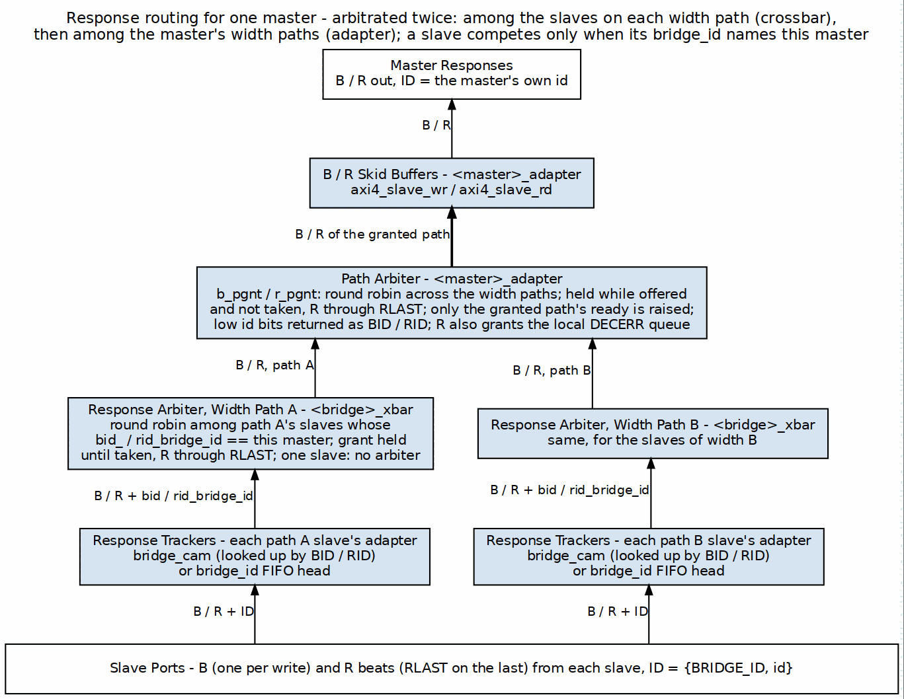

<!-- RTL Design Sherpa Documentation Header -->
<table>
<tr>
<td width="80">
  <a href="https://github.com/sean-galloway/RTLDesignSherpa">
    
  </a>
</td>
<td>
  <strong>RTL Design Sherpa</strong> · <em>Learning Hardware Design Through Practice</em><br>
  <sub>
    <a href="https://github.com/sean-galloway/RTLDesignSherpa">GitHub</a> ·
    <a href="https://github.com/sean-galloway/RTLDesignSherpa/blob/main/docs/DOCUMENTATION_INDEX.md">Documentation Index</a> ·
    <a href="https://github.com/sean-galloway/RTLDesignSherpa/blob/main/LICENSE">MIT License</a>
  </sub>
</td>
</tr>
</table>

---

<!-- End Header -->

# 2.8 Response Routing

Requests are easy to route — the address says where they go. Responses are harder: read data and write acknowledgments have to find their way back to whichever master asked, and by then the address that launched the transaction is ancient history. Response routing does that with Bridge IDs, demultiplexing logic, and optional CAM structures.

## 2.8.1 Purpose and Function

Response routing does five things:

1. **Response Direction**: Routes R and B channel responses to correct master
2. **Tracked Routing**: each slave adapter names the master to answer -- `bridge_cam` looked up with the returned BID/RID on a multi-master AXI4/AXI5 slave, an in-order `bridge_id` FIFO elsewhere
3. **Multi-Slave Merging**: Combines responses from multiple slaves to single master
4. **Flow Control**: Manages backpressure from master on response channels
5. **Error Propagation**: Ensures error responses reach originating master

## 2.8.2 Block Diagram

### Figure 2.9: Response Routing Architecture



Responses for one master climb from the slaves. Each slave adapter's tracker supplies the `bridge_id` of the master to answer; the crossbar presents that slave's B / R on this master's width path only when the `bridge_id` matches; and the master adapter takes the path at the head of its `aw_trk` / `ar_trk` FIFO. Nothing here arbitrates, so there is no trapezium.

## 2.8.3 Stable Response Routing via FIFO-Tracked Slave Select

### Architecture: FIFO-Tracked Master Routing

> **Retired (GitHub #119 L1 and L1b, 2026-10-15).** No port steers B/R with
> this FIFO any more: every master adapter has per-ID tracking and a path
> arbiter (MAS 2.1, and Response Arbitration below). The section is kept as
> the history of why the decode is captured at the handshake.

For multi-slave masters, responses are routed based on a **stable slave-select value** captured at request time, not the current address decode:

```systemverilog
// At AW/AR time: Capture slave index
assign aw_slave_select = address_decode(fub_axi_awaddr);
always_ff @(posedge aclk) begin
    if (fub_axi_awvalid && fub_axi_awready) begin
        aw_trk_fifo <= aw_slave_select;  // Capture now
    end
end

// At B time: Use captured slave from FIFO (not current decode)
assign b_slave_select = aw_trk_fifo_out;  // Stable value
logic [NUM_MASTERS-1:0] master_bvalid;
always_comb begin
    master_bvalid = '0;
    master_bvalid[extracted_bid] = slave_bvalid && (b_slave_select == current_slave);
end
```

**Benefits**:
- B-responses route to correct master even after address reverts
- Handles multi-slave masters spanning different widths
- Prevents response loss due to stale address decodes

### BID Extraction

The master is not chosen by decoding the prefix bits of the returned ID.
With more than one master the slave-side ID is `{BRIDGE_ID, id}` (bridge
TASK-005), but the crossbar steers B / R by the master index the slave
adapter's tracker returns beside the response (`bid_bridge_id` /
`rid_bridge_id`). For a CAM-tracked slave that index is looked up BY the
returned BID/RID; for a FIFO-tracked slave it is the FIFO head. The master
adapter then strips the prefix:

```systemverilog
// bridge_2x2_rw_xbar.sv: B toward cpu (master index 0)
((ddr_axi_bid_bridge_id == 0) && ddr_axi_bid_valid ? ddr_axi_bid : '0) | ...

// cpu_adapter.sv: return the master's own ID bits
fub_axi_bid = cpu_32b_b.id[3:0];
```

### CAM-Based Extraction

> **Built (bridge BUG-012 (was BRIDGE-015)/016, 2026-09-10).** Every real AXI slave of a
> multi-master bridge, and any slave declared `enable_ooo = true`, gets
> `bridge_cam` for both channels and routes responses by ID; single-master
> bridges, shim slaves and the subtractive slave keep the in-order per-slave
> FIFO. Per-ID tracking is sound across masters because fabric IDs are
> `{master index, master id}`; the FIFO would require the slave to complete
> in request order across ALL IDs, which a compliant AXI slave need not do.
> Fixture `bridge_2x2_ooo` exercises reordering slaves with two masters
> sharing IDs; `test_bridge_cam.py` covers the CAM alone. The mode had been
> unbuildable since c64660f47. See ch04 `02_id_tracking.md`.

For complex configurations with OOO or ID reordering:

```systemverilog
// CAM lookup for response routing
logic [TOTAL_RID_WIDTH-1:0] response_id;
logic [BID_WIDTH-1:0] master_index;
logic cam_hit;

// Search CAM for matching transaction
assign {cam_hit, master_index} = cam_lookup(response_id);

// Route response to found master
if (cam_hit) begin
    master_rvalid[master_index] = slave_rvalid;
end else begin
    // Error: No matching transaction (protocol violation)
    error_response();
end
```

## 2.8.4 Response Demultiplexing

### Per-Master Response Paths

Each master has dedicated response channels from the demultiplexer:

```
Master 0 Response:
  - M0_RVALID, M0_RREADY, M0_RDATA, M0_RID, M0_RRESP, M0_RLAST
  - M0_BVALID, M0_BREADY, M0_BID, M0_BRESP

Source: Responses from any slave with BID=0
```

### Demux Implementation

```systemverilog
// Response demultiplexer (4 masters, 3 slaves)
// Combines responses from all slaves, routes to correct master

// Slave responses (multiple sources)
logic s0_rvalid, s1_rvalid, s2_rvalid;
logic [63:0] s0_rdata, s1_rdata, s2_rdata;
logic [5:0] s0_rid, s1_rid, s2_rid;  // Includes BID

// Master responses (multiple destinations)
logic m0_rvalid, m1_rvalid, m2_rvalid, m3_rvalid;
logic [63:0] m0_rdata, m1_rdata, m2_rdata, m3_rdata;
logic [3:0] m0_rid, m1_rid, m2_rid, m3_rid;  // BID stripped

// Demux logic per slave
for (genvar s = 0; s < 3; s++) begin
    logic [1:0] bid;
    assign bid = slave_rid[s][5:4];  // Extract BID
    
    always_comb begin
        case (bid)
            2'b00: begin
                if (slave_rvalid[s] && !m0_busy) begin
                    m0_rvalid = 1'b1;
                    m0_rdata = slave_rdata[s];
                    m0_rid = slave_rid[s][3:0];  // Strip BID
                end
            end
            2'b01: /* Route to M1 */
            2'b10: /* Route to M2 */
            2'b11: /* Route to M3 */
        endcase
    end
end
```

## 2.8.5 Multi-Slave Response Merging

### Problem Statement

When multiple slaves can respond to the same master in the same cycle:

```
Scenario:
  Master 0 has outstanding transactions to Slave 0 and Slave 1
  Both slaves return R responses in same cycle
  
Problem: Master 0 can only accept one R response per cycle
Solution: Arbitrate between slave responses
```

### Response Arbitration

Built 2026-10-15, fixing the one-target-per-master limitation (GitHub #119 L1). Responses are arbitrated at two
levels:

1. **Crossbar, per master width path** (`<master>_<W>b_{b,r}_rarb_*`): the
   slaves on that path whose tracker names this master request. Round robin
   grants one. A grant offered and not taken holds, and an R grant holds
   through RLAST. The mux toward the master and the slave's BREADY / RREADY
   both follow the grant (`_rgnt_<slave>`). A path with one slave keeps the
   plain ownership gate. Excerpt in MAS 2.3.
2. **Master adapter, across width paths** (`b_pgnt` / `r_pgnt`): the same
   rules over the master's width paths. Only the granted path's ready is
   raised (MAS 2.1).

There are no response FIFOs. A response that loses arbitration waits in the
slave's (or the slave adapter's skid buffer's) valid/ready hold.

### Response Buffering

Not built. The option would add FIFOs to buffer pending responses:

```
Purpose:
  - Prevent response loss during arbitration conflicts
  - Allow slaves to return responses even if master busy
  - Smooth out bursty response patterns

Configuration:
  per_master_response_fifo_depth = 4-16 entries

Trade-off:
  + No response loss
  + Better throughput
  - Additional resources (~200 LEs per FIFO)
  - +1-2 cycle latency
```

## 2.8.6 Independent Write-Tracker FIFO (W-Channel Deadlock Fix)

Prior to commit `d24bd617`, the AW and W ready signals shared a single multiplexer at the write-address arbiter output. Under interleaved master traffic patterns, this could cause deadlock: a master's W channel could back up waiting for a non-granted write-address slot, preventing the arbiter from servicing other masters' AW transactions.

The corrected design (current) uses an **independent W-tracker FIFO** alongside the AW tracker:

```systemverilog
// AW tracker FIFO (per master)
always_ff @(posedge aclk) begin
    if (master_awvalid && master_awready) begin
        aw_trk_fifo <= address_decode(master_awaddr);  // Capture slave
    end
end

// Independent W tracker and ready MUX
logic aw_ready_mux, w_ready_mux;  // Separate paths (prior: shared)

assign master_awready = aw_ready_mux;   // AW gets its own ready
assign master_wready = w_ready_mux;      // W gets independent ready

// W-tracker: Gate W valid against tracked slave select
always_comb begin
    w_ready_mux = (aw_trk_fifo != 0) && slave_wready;  // W independent
end
```

**Result**: AW and W channels can assert independently without blocking each other, preventing deadlock during interleaved multi-master write bursts.

## 2.8.7 Backpressure Management

### Ready Signal Routing

The master's RREADY/BREADY has to find its way back to the correct slave:

```systemverilog
// Route master ready back to slaves
logic m0_rready;  // From master
logic [2:0] slave_rready;  // To slaves

// Only selected slave sees master's ready
for (genvar s = 0; s < 3; s++) begin
    assign slave_rready[s] = (selected_slave == s) ? m0_rready : 1'b0;
end

// Non-selected slaves see ready = 0 (backpressure)
```

### Stall Conditions

Response path can stall when:

```
1. Master not ready (M_RREADY = 0)
   → Selected slave stalls (S_RREADY = 0)
   → Other slaves buffer or stall

2. Arbitration conflict (multiple slaves ready)
   → Non-selected slaves stalled
   → Selected slave proceeds

3. bridge_id tracking FIFO full -- the address handshake is gated on it (bridge BUG-009, was BRIDGE-011); there is no response DATA FIFO
   → Slave stalled until space available
```

## 2.8.8 Response Path Latency

### End-to-End R Channel

```
Slave R response → Bridge → Master R channel

Components:
1. Slave response valid
2. FIFO head read (0 cycles, combinatorial) -- no BID extraction
3. Demux routing (0-1 cycles)
4. No response arbitration: B and R follow the address-phase selection
5. Optional FIFO (0-1 cycles)
6. Master adapter (1 cycle, skid buffer)

Total: 2-4 cycles typical
```

### End-to-End B Channel

```
Similar to R channel:
  Slave B → Extraction → Demux → Arbitration → Master B
  Total: 2-4 cycles
```

## 2.8.9 Error Response Routing

### Slave Error Responses

When slave returns error:

```
RRESP = 2'b10 (SLVERR) or 2'b11 (DECERR)
BRESP = 2'b10 (SLVERR) or 2'b11 (DECERR)

Routing:
  - Extract BID normally
  - Route to originating master
  - Preserve error code
  - Master sees error response
```

### Out-of-Range Error Responses

When router generates error for OOR address:

```
Process:
1. Router captures OOR request
2. Generates internal error response
   - Uses cached request ID (with BID)
   - Sets RRESP/BRESP = DECERR
3. Injects into response path
4. Routes to master using BID
```

## 2.8.10 Resource Utilization

### Response Router Resources

**4 masters, 3 slaves (64-bit data)**:

```
Logic Elements:  ~1500-2000 LEs
Registers:       ~400-600 regs
Block RAM:       0 (unless FIFOs enabled)

Breakdown:
- BID extraction (3 slaves):     ~150 LEs
- Demux logic (4 masters):        ~600 LEs, ~150 regs
- Response arbitration:           ~300 LEs, ~100 regs
- Backpressure routing:           ~200 LEs, ~50 regs
- Control FSMs:                   ~250 LEs, ~100 regs

Optional FIFOs (4 × 8 entries):  +800 LEs, +2KB BRAM
```

### Scaling

```
Resource usage scales with:
- Number of masters: Linear (one demux path per master)
- Number of slaves: Linear (one extraction per slave)
- Data width: Linear (wider data = wider demux)
- FIFO depth: Linear (deeper = more BRAM)
```

## 2.8.11 Configuration Parameters

### Response Routing Configuration (TOML)

```toml
[bridge]
num_masters = 4
num_slaves = 3

[bridge.response_routing]
enable_response_fifos = false       # Buffer responses per master
fifo_depth = 8                      # Entries per FIFO
response_arbiter_type = "round_robin"  # "round_robin", "fixed_priority"
registered_demux = false            # Register demux output (+1 cycle)

# Per-master response credits (optional)
[[bridge.masters]]
name = "cpu"
max_response_credits = 16           # Outstanding responses allowed
```

## 2.8.12 Debug and Observability

### Recommended Debug Signals

```
BID Extraction:
- Slave RID/BID (from each slave)
- Extracted BID (master index)
- External RID/BID (to master, BID stripped)

Response Demux:
- Demux select signals (which master per slave)
- Response valid per master
- Response valid per slave

Arbitration:
- Conflict detection (multiple responses for same master)
- Arbiter grant (which slave wins)
- Stall counters

FIFOs (if enabled):
- FIFO occupancy per master
- FIFO full/empty flags
- FIFO overflow errors
```

### Performance Counters

```
- Responses routed per master
- Arbitration conflicts (cycles with multiple responses to same master)
- Response stall cycles (master not ready)
- Average response latency per master
- FIFO overflow counts
- bridge_id FIFO push/pop counts
```

## 2.8.13 Common Issues and Debug

**Symptom**: Response not reaching master  
**Check**:
- BID extraction (correct bit slicing?)
- Master index (BID → master mapping)
- Demux select logic
- Backpressure (is master READY?)

**Symptom**: Response goes to wrong master  
**Check**:
- BID values (verify each master has unique BID)
- BID width calculation (clog2 correct?)
- bridge_id FIFO contents (wr_fifo/rd_fifo)
- ID corruption in transit

**Symptom**: Response ordering incorrect  
**Check**:
- FIFO head (routing is by position, so order IS the mechanism)
- Arbitration fairness (round-robin working?)
- Multiple outstanding transactions per master

**Symptom**: Response loss  
**Check**:
- FIFO overflows (enable FIFOs if needed)
- Dropped responses during arbitration conflicts
- Protocol violations (slave not following AXI rules)

## 2.8.14 Verification Considerations

### Test Scenarios

1. **Single Master, Single Slave**:
```
- Basic routing test
- Verify BID extraction and stripping
- Check response reaches correct master
```

2. **Multiple Masters, Single Slave**:
```
- Interleaved responses
- Verify each response routes to correct master
- Check BID uniqueness prevents collisions
```

3. **Single Master, Multiple Slaves**:
```
- Simultaneous responses from multiple slaves
- Verify arbitration fairness
- Check no response loss
```

4. **All Masters, All Slaves**:
```
- Maximum stress test
- All masters issuing to all slaves
- Responses returning in various orders
- Verify correct routing under heavy load
```

5. **OOO Responses**:
```
- Issue transactions: ID=1, ID=2, ID=3
- Return responses: ID=3, ID=1, ID=2
- Verify the FIFO head routes each
- Check response order at master
```

6. **Backpressure Test**:
```
- Master asserts RREADY=0
- Verify slave stalls (RREADY=0 propagated)
- Master asserts RREADY=1
- Verify responses flow
```

## 2.8.15 Performance Optimization

### Techniques

**1. Registered Demux**:
```
Trade-off: +1 cycle latency for timing closure
Best for: High-frequency designs, many masters
```

**2. Response FIFOs**:
```
Trade-off: +2KB BRAM, +1-2 cycle latency
Benefit: Prevent response loss, smooth conflicts
Best for: High-throughput systems
```

**3. Distributed Arbitration**:
```
Implementation: Per-master arbiters instead of global
Benefit: Reduced logic depth, better timing
Best for: >8 masters
```

**4. Priority Response Routing**:
```
Implementation: High-priority masters get preference in conflicts
Benefit: Guaranteed low latency for critical masters
Best for: Real-time systems
```

## 2.8.16 Advanced Features

### Response Reordering (Future)

> **Built (bridge BUG-012 (was BRIDGE-015)/016, 2026-09-10).** Every real AXI slave of a
> multi-master bridge, and any slave declared `enable_ooo = true`, gets
> `bridge_cam` for both channels and routes responses by ID; single-master
> bridges, shim slaves and the subtractive slave keep the in-order per-slave
> FIFO. Per-ID tracking is sound across masters because fabric IDs are
> `{master index, master id}`; the FIFO would require the slave to complete
> in request order across ALL IDs, which a compliant AXI slave need not do.
> Fixture `bridge_2x2_ooo` exercises reordering slaves with two masters
> sharing IDs; `test_bridge_cam.py` covers the CAM alone. The mode had been
> unbuildable since c64660f47. See ch04 `02_id_tracking.md`.

Allow bridge to reorder responses for efficiency:

```
Scenario:
  Master issues: Req A (slow slave), Req B (fast slave)
  Fast slave responds first
  Bridge can deliver B before A (if IDs different)

Benefit: Reduced latency for fast responses
Requirement: CAM to track outstanding in-order constraints
```

### Response Coalescing (Future)

Combine multiple responses into fewer beats:

```
Scenario:
  Multiple single-beat reads to narrow slave
  Bridge coaleses into fewer wide beats
  
Benefit: Reduced overhead
Complexity: High (requires buffering and alignment)
```

### Response QoS (Future)

Prioritize responses based on master QoS:

```
Feature: High-QoS masters get response priority
Implementation: Weighted arbitration in response path
Use case: RT masters need bounded response latency
```

## 2.8.17 Timing Considerations

### Critical Paths

Common critical paths in response routing:

```
1. BID extraction → Demux select → Master RDATA
   Depth: ~8-12 logic levels
   
2. Slave RVALID → Arbitration → Master RVALID
   Depth: ~6-10 logic levels
   
3. Master RREADY → Backpressure → Slave RREADY
   Depth: ~5-8 logic levels
```

### Optimization Strategies

```
- Register demux outputs (+1 cycle, breaks path)
- Pipeline arbitration (+1-2 cycles, multi-stage)
- Complex ID scenarios are unsupported: routing is positional, not ID-keyed
- Limit response buffering depth (less MUX levels)
```

## 2.8.18 Future Enhancements

### Planned Features
- **Dynamic Response Buffering**: Adjust FIFO depth based on utilization
- **Response Ordering Hints**: Masters specify ordering requirements
- **Multi-Cycle Arbitration**: Pipelined for >16 masters
- **Response Compression**: Pack narrow responses into wide beats

### Under Consideration
- **Response Speculation**: Predictive routing before full ID available
- **Virtual Response Channels**: Separate paths for different QoS classes
- **Response Mirroring**: Duplicate responses for redundancy
- **Cross-Clock Response**: Async response paths with CDC

---

**Related Sections**:
- Section 2.3: Crossbar Core (response path architecture)
- Section 2.5: ID Management (BID extraction details)
- Section 2.4: Arbitration (response arbitration algorithms)
- HAS ch04_interfaces/01_axi4_interface.md (response channel signals)
