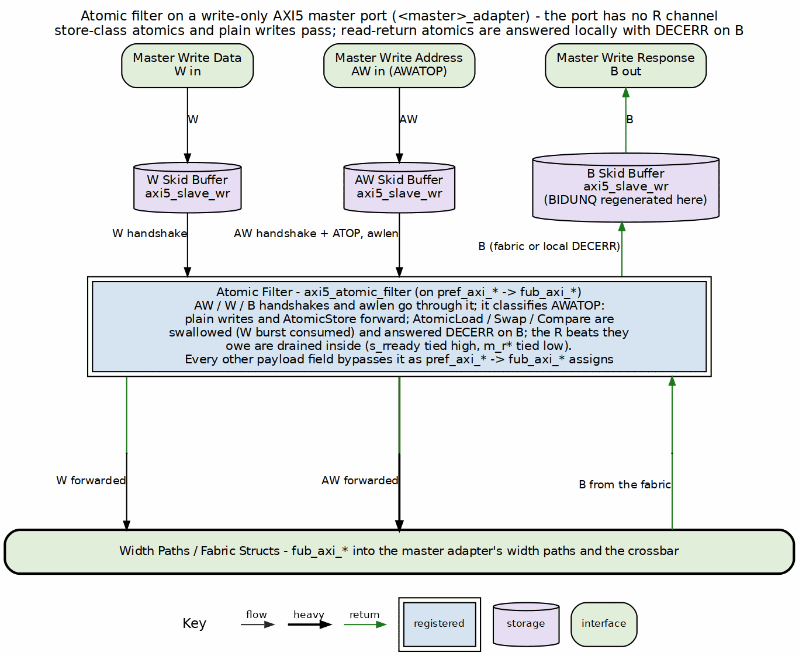
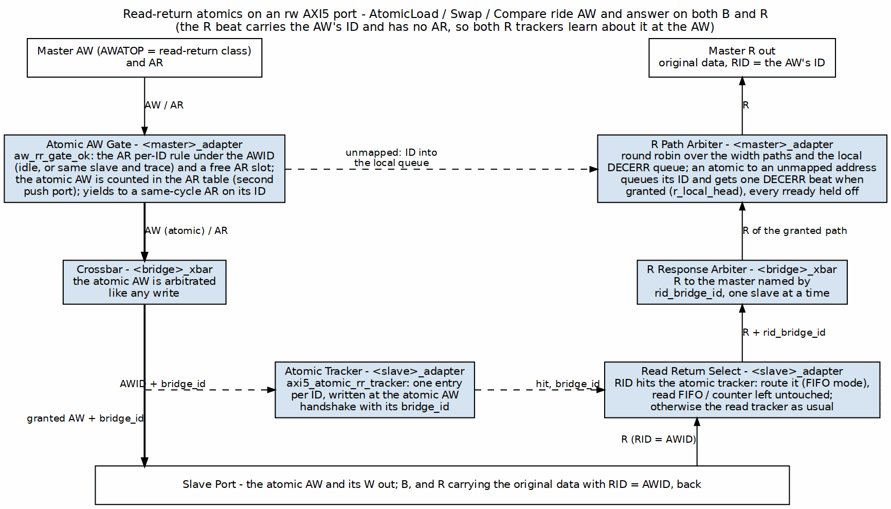

<!-- RTL Design Sherpa Documentation Header -->
<table>
<tr>
<td width="80">
  
</td>
<td>
  <strong>RTL Design Sherpa</strong> · <em>Learning Hardware Design Through Practice</em> 
  
    <a href="https://github.com/sean-galloway/RTLDesignSherpa">GitHub</a> ·
    <a href="https://github.com/sean-galloway/RTLDesignSherpa/blob/main/docs/DOCUMENTATION_INDEX.md">Documentation Index</a> ·
    <a href="https://github.com/sean-galloway/RTLDesignSherpa/blob/main/LICENSE">MIT License</a>
  
</td>
</tr>
</table>

---

<!-- End Header -->

# AMBA5 Boundary and Native Sideband

How AXI5/APB5 ports ride the AXI4 fabric (bridge TASK-002 (was BRIDGE-002) phases A5-1 through
A5-3). One spec table drives every generator:
`bin/bridge_pkg/sideband.py::SIDEBAND_FIELDS` maps each feature to its
per-channel struct fields, widths, and wrapper port bases — package,
adapter, crossbar, and slave-adapter emission all iterate it in the same
order, so struct layout and wiring cannot drift apart.

## Boundary Wrappers

- AXI5 **master** port → `axi5_slave_{wr,rd}[_mon]` at the master adapter
  (the bridge is a slave to the external master).
- AXI5 **slave** port → `axi5_master_{wr,rd}[_mon]` at the slave adapter.
- Both families carry every feature signal through their skid path,
  gated by `ENABLE_<FEATURE>` parameters; the generator binds every pin
  (enabled features connect through, the rest tie/open).

## Native Sideband Through the Structs (A5-2)

The per-bridge `_pkg` channel structs gain feature fields as the **union**
of features on any AXI5 port. Pure-AXI4 bridges emit no fields, so their
RTL stays byte-identical — the zero-drift invariant.

- **Master adapter:** packs its own enabled fields from the wrapper's
  `fub_axi_*` sideband on the **direct (width-matched) arm only**;
  converter arms pack `'0` — per-beat and per-transaction sideband cannot
  traverse the dwidth-converter IP. Because non-qualifying sources are
  guaranteed `'0`, the crossbar forwards request fields unconditionally.
- **Crossbar:** explodes struct fields into discrete
  `<slave>_axi_<sig>` nets for feature-enabled AXI5 slaves; response
  fields (`b.trace`, `r.trace`, `r.poison`) mux from qualifying slaves
  and default `'0` (they must be driven for every master since union
  fields exist in every struct).
- **Slave adapter:** rides `xbar_<slave>_axi_<sig>` nets into the
  wrapper via the component's `native_sideband` flag, which stops
  terminating enabled features' fub ports (fall-through to the
  connector prefix).

The struct field for AWIDUNQ/ARIDUNQ is named `idunq` (IHI 0022L A5.2; the
library called the indicator `awunique`/`arunique` until GitHub #102 item 5,
but AWUNIQUE is an unrelated ACE signal). `BIDUNQ`/`RIDUNQ` are deliberately
**not** struct fields: the master adapter regenerates them from a per-ID bit
table (`r_awidunq_by_id` / `r_aridunq_by_id`, written at the AW/AR handshake
on the wrapper's fub face, and for a read-return atomic at its AW), read by
`BID`/`RID` (`AdapterGenerator._idunq_echo_lines`). A5.2 makes the response
indicator a function of the request and forbids mixing indicators among
outstanding same-ID transactions, so the table is exact under any response
order, and it is right on every path the request indicator was dropped on.
The slave adapter leaves the slave's `BIDUNQ`/`RIDUNQ` unconnected.

### AWAKEUP (A14.1.1)

`wakeup` is a port feature but not struct sideband. Both boundary wrappers
of a port carry an `awakeup` pin (one signal covers both request channels).
On a master port both `axi5_slave_{wr,rd}` take the top-level `AWAKEUP`; their
fub-side copies (the input OR'd with requests held in that wrapper's skid
buffers) are OR'd into the adapter output `wakeup_req`. The top ORs the
`wakeup_req` of every connected wake-capable master into each wake-capable
slave adapter's `wakeup_req` input (`1'b0` when none), which feeds both
`axi5_master_{wr,rd}` fub `awakeup` pins; each wrapper ORs in its own held
requests and the slave adapter ORs the two `m_axi_awakeup` copies onto the
port. Every term is a flop or a top-level input, so the tree is glitch-free.
The bridge never waits for a master's `AWAKEUP`.

### Data-scaled fields: Memory Tagging and chunking (bridge TASK-007, was BRIDGE-018)

The last two wrapper features, `mte` and `chunking`, joined the table on
2026-09-13 and closed the native-AXI5 gap. Their fields are the only ones
whose width follows the data bus: a tag bus is 4 bits per 16 bytes
(`wtag`, `rtag`; IHI 0022L A12.2 has no `AWTAG` or `BTAG`, and the library's
`awtag`/`btag`/`rtagmatch` went with GitHub #102 item 5), `wtagupdate` and
`rchunkstrb` one bit per 16 bytes /
128-bit chunk. `sideband.py` carries them as symbolic widths
(`WIDTH_TAGS`, `WIDTH_NTAGS`, `WIDTH_CHUNKSTRB`) and resolves them with
`field_width(width, data_width)`:

- the per-width `w`/`r` structs size them for their own width;
- the width-independent `aw`/`ar`/`b` structs size them for the **widest
  port in the bridge**, and the adapters and crossbar fit a narrower
  port's value with an explicit zero-extension or slice (`fit_expr`) --
  widths decided in Python, so the emitted RTL carries no casts;
- slave ports and adapter pins are sized for that port's own width.

The fabric carries these fields and never interprets them: tags are
payload routed with their beat, the 2-bit `btagmatch` (Table A12.14) returns
through the B mux by bridge id like `bresp`, and a chunked burst's R beats are routed by ID and
released on `RLAST` whatever order the completer sends the chunks in. Both
features require a port of 128 bits or more (`validate_axi5_wide_features`).

## Connectivity Gating (poison, atomic, mte) and Droppable Chunking

`AXI5_CONNECTIVITY_GATED_FEATURES` in the validator: these features are
legal only when **every** connected path is AXI5-both-ends,
feature-enabled, and width-matched — otherwise a config error naming the
offending pair. `mte` is in the set because a dropped tag operation
changes what the write means. Droppable sideband that terminates mid-path
is legal but prints a generation-time warning per (master, slave,
feature); `chunking` is droppable because `ARCHUNKEN` is permission, not
demand -- a slave that cannot chunk answers with ordered data and `RCHUNKV`
low, which every chunking requester must accept.

## Atomic Filter (A5-3a, write-only masters)

A **write-only** atomic-enabled master's wr path inserts `axi5_atomic_filter`
between the boundary wrapper and the fabric:

### Figure 2.11: Atomic Filter on a Write-Only Port

Handshakes (AW/W/B) and the B payload (`bid`/`bresp`) go **through** the
filter, and `awlen` is connected so the filter can count the read data it
owes; all other payload gets `pref → fub` pass-through assigns. Store-
class ATOP and plain writes forward; read-return classes are swallowed
(W burst consumed) and answered with a local DECERR B.

Since GitHub #102 item 2 the filter also returns the read data transfers a
swallowed atomic owes (IHI 0022L A6.4.8: AWLEN+1 for Load/Swap, half that
for Compare, each DECERR, RLAST on the last), merged into its `s_r*` output
with downstream priority and no burst interleave. On the bridge's write-only
port there is no R channel upstream to merge into and no downstream R, so the
generator ties the filter's `s_rready` high and leaves `s_rvalid/s_rid/
s_rresp/s_rlast` open (the beats are accepted and discarded), and ties
`m_rvalid`/`m_rid`/`m_rresp`/`m_rlast` low. Draining matters: an undrained
read-return queue fills after `2**DEPTH_LG2` (8) swallowed atomics and then
stalls AW for good. The atomic completes with DECERR on B only; HAS 4.4
states the resulting rule -- managers must not issue load-class atomics on a
write-only port. When the port has `unique`, `BIDUNQ` is regenerated on the
`pref` side, so the local DECERR carries its own `AWIDUNQ`. See the module doc:
`docs/markdown/rtl-amba/axi5/axi5_atomic_filter.md`. The filter exists
because a port with no read path has nowhere to deliver the R beat those
classes answer with. A port that has one gets the next section instead.

## Read-Return Atomics (A5-3b, rw masters)

An **rw** atomic-enabled master has no filter. AtomicLoad (`10xxxx`),
AtomicSwap and AtomicCompare (`11000x`) ride the AW path to the slave like
any write; the slave performs the operation and answers on **both** B and
R, the R beat carrying the location's original data under the **AW's ID**.
Two things in this fabric had to learn about that beat, because every
R-return tracker in it is fed by AR handshakes:

### Figure 2.12: Read-Return Atomics

**Master adapter.** The AR per-ID table (MAS 2.1) counts the atomic AW too,
under its AWID, because its R returns with that ID: a second push port
(`ar_idt_push_aw`) beside the AR's own. The AW's gate (`aw_rr_gate_ok`) is
the read side's per-ID rule -- that ID idle, or in flight to the same slave
with the same trace -- plus a free AR slot counting an AR that pushes this
cycle, and it yields to an AR pushing the same ID index in the same cycle.
The B/W paths are unchanged. The table's trace bit is written from AWTRACE,
so the R beat echoes the AW's trace (bridge BUG-010, was BRIDGE-012). Until
GitHub #119 L1b (2026-10-15) an AR->R slot FIFO did this job and held the
port to one target at a time.

**Out of range.** A read-return atomic that decodes to the subtractive
slave would otherwise wedge the port: that slave answers DECERR on B and
knows nothing about R, while the master adapter is counting an R for the
beat. The atomic's ID therefore goes into a local-DECERR queue (`lr_*`),
which joins the R path arbiter as one more source; when it is granted
(`r_local_head`) the R mux presents a single DECERR beat with that ID
itself, holding every slave's `rready` off (`r_path_active && !r_local_head`)
for that cycle. B and R both report
DECERR, and the port keeps working. This is bridge BUG-007 (was BRIDGE-009)'s rule applied to
the atomic path.

**The invariant underneath.** Nothing here depends on one target at a
time any more. The crossbar's response mux is a grant-driven mux behind a
per-path response arbiter (GitHub #119 L1), and the master adapter steers by
ID (L1b), so an atomic at one slave and reads at another are in flight
together -- `test_bridge_1x2_rw_axi5a_multitarget` measures exactly that,
and fails on the pre-L1b RTL.

**Slave adapter.** `axi5_atomic_rr_tracker` (module doc:
`docs/markdown/rtl-amba/axi5/axi5_atomic_rr_tracker.md`) records
(AWID -> requester index) at every AW handshake with `AWATOP[5]` set, and
answers combinationally from `RID`. An R beat it claims is routed by its
tag and does **not** pop the in-order read FIFO; every other beat routes by
FIFO position as before. The atomic AW's `awready` is held while the
tracker is full. The bridge BUG-008 (was BRIDGE-010) in-order check skips tracked beats and
reports, in simulation, an R beat that matches both a tracked atomic and
the FIFO head: that is two requesters aliasing one ID at this slave, which
this fabric does not disambiguate.

**Validator.** An rw atomic master's connected atomic slaves must be `rw`
(a write-only slave cannot return read data). The return tracker sits
beside whichever read tracker the slave uses, the in-order FIFO or the
by-ID counter (bridge BUG-012 (was BRIDGE-015) repaired that mode). Under by-ID routing an
atomic's R carries its AW's ID and routes like any other; the tracker only
keeps it out of the read count. A write-only atomic
master is not subject to the rule; it keeps the filter.

**Filelist.** `axi5_atomic_filter.f` is pulled only when a write-only
atomic master exists; `axi5_atomic_rr_tracker.f` only when an rw atomic
slave exists. Pure-AXI4 bridges and the A5-3a fixture are byte-identical
to before this change.

## APB5 Slaves (A5-3c)

`protocol = "apb5"` reuses the entire APB4 path with two deltas: the
slave adapter instantiates `axi4_to_apb5_shim` (a sideband wrapper over
the APB4 shim — see the converters MAS), and the external surface adds
`PAUSER/PWUSER` out (driven `'0`), `PWAKEUP` out and `PRUSER/PBUSER` in
(terminated). `PWAKEUP` is a requester output (IHI 0024E 3.7.2; it was an
input until GitHub #102 item 7): the shim drives it from a flop of `PSEL`, so it
is glitch-free and held through the PREADY cycle. The generated TB drives the
port with the APB5 BFM, which observes `PWAKEUP`: APB5 keeps the APB4
transfer protocol.

## Lite and APB Requesters (bridge TASK-004, was BRIDGE-014)

Every protocol value is legal on a master port. Two of them needed work
beyond the AXI4-Lite master path that already existed:

- **`axil5` master.** The AXI4-Lite promotion (AXI4 extras tied at the
  top, `axi4_slave_*` wrappers, the wide-slave aligner toward wider slaves)
  plus the AXI5-Lite ID and optional signals on the boundary, directions
  flipped for a requester. The ID (`awid`/`bid`/`arid`/`rid`) and `user`
  -- the one optional group with an AXI4 destination -- join the Lite
  surface and reach the adapter's AXI4 face; TRACE and POISON are
  terminated at the top. AXI5-Lite has no LOCK, LOOP, MPAM, MECID or NSAID
  (IHI 0022L B2.1.5, GitHub #102 item 3). `validate_axil5_features` applies to
  masters and slaves alike, so a config cannot name a group the design
  drops.
- **`apb` / `apb5` master.** The bridge is the APB completer.
  `apb4_to_axi4` / `apb5_to_axi4` (converters: `apb{4,5}_slave` +
  `apb_cmdrsp_to_axi4`) sit inside the master adapter in front of the
  ordinary timing wrapper, so monitoring, decode, width adaptation and the
  response mux are untouched. One transfer -> one single-beat AXI4
  transaction; SLVERR and DECERR fold to PSLVERR; `PAUSER[0]`/`PWUSER[0]`
  ride the fabric USER bit (visible at an `axil5` slave with `user`).
  `PWAKEUP` is requester-driven and terminated.

Validator rules: AXI4-Lite masters `id_width = 0`, AXI5-Lite masters
`id_width >= 1`; APB masters `addr_width = 32`
(a requester addresses the whole fabric, unlike an APB slave port's window
offset). The generated TB drives `axil5` masters with the AXIL5 BFMs and
`apb`/`apb5` masters with `APBMaster`/`APB5Master`; `master_read`/
`master_write` unwrap the APB transaction and turn `PSLVERR` into
`AxiResponseError(resp=2)` -- APB cannot tell SLVERR from DECERR, so 2 is
the honest code.

## Verification Anchors

- Generator unit tests: `bin/tests/test_generator_pkg.py` (feature
  gating, poison/atomic connectivity rules, generation smoke).
- Sideband **values** end-to-end, driven per transaction by the AXI5
  master BFM: `dv/tests/test_bridge_1x2_{rd,wr}_axi5n_sideband.py`
  (native path and drop path; the AXI5 slave BFM echoes trace on B/R).
- Sideband **through the arbiter**: `dv/tests/test_bridge_2x2_axi5_sideband_arb.py`
  -- two AXI5 masters with distinct NSAIDs contend for the AXI5 slave; every
  slave-side AW/AR NSAID must belong to its issuing master and the counts
  must match.
- Sideband **across a width converter**: `dv/tests/test_bridge_1x2_rd_axi5w_sideband.py`
  -- 32b AXI5 master into a 64b AXI4 slave; data round-trips, trace returns 0.
- Atomics, filtered: `dv/tests/test_bridge_1x2_wr_axi5a_atomics.py` (store
  forwards; load, swap AND compare answered DECERR by the filter, via
  `atomic_operation`; a burst of 12 load-class atomics -- more than the
  filter's 8-deep read-return queue -- all complete and the port stays
  usable; BIDUNQ follows AWIDUNQ on the local DECERRs) and
  `val/amba/test_axi5_atomic_filter.py`.
- Unique-ID indicators: `test_bridge_2x2_axi5_sideband_arb.py`,
  `test_bridge_1x2_rd_axi5{n,w}_sideband.py`, `test_bridge_1x2_rd_axi5_bfm5.py`
  (BIDUNQ/RIDUNQ follow the request on native, AXI4, converter paths) and
  `test_bridge_1x2_rw_axi5a_atomics.py` (an atomic's RIDUNQ and BIDUNQ).
- AWAKEUP: `dv/tests/test_bridge_2x2_axi5_wakeup.py` (forwarding ahead of
  any request, held on every request cycle including traffic from a master
  without AWAKEUP, low when idle).
- Atomics, read-return: `dv/tests/test_bridge_1x2_rw_axi5a_atomics.py` --
  load ADD/SET/UMAX, swap, compare (match and mismatch) on both slaves,
  each checked three ways (R data is the pre-op value, memory holds the
  post-op value, a plain read agrees), then reads and atomics in flight
  together across and within slaves. The slave BFM performs the operation;
  the AXI5 checker treats a read-return atomic as an outstanding read and
  flags any R beat nobody requested. `val/amba/test_axi5_atomic_rr_tracker.py`
  covers the tracker alone. Mutation-checked: with the tracker's `hit`
  removed from `rid_valid`, the R beat is never routed and the test fails
  on a read-return timeout.
- Lite requesters: `dv/tests/test_bridge_2x2_lite_req_sideband.py` on
  `bridge_2x2_lite_req` (AXI4-Lite + AXI5-Lite masters, 64b AXI4 + AXI5-Lite
  slaves) -- `user`/`lock` from the AXI5-Lite master seen at the AXI5-Lite
  slave and absent from the AXI4-Lite master's traffic, terminated groups
  reading 0, both halves of a 64-bit row from both Lite masters (the
  aligner), and both ID-less masters in flight at one slave.
- APB requesters: `dv/tests/test_bridge_2x3_apb_req_paths.py` on
  `bridge_2x3_apb_req` (APB4 + APB5 masters, AXI4 + AXI5-Lite + APB4
  slaves) -- PSLVERR for unmapped addresses with the port working after,
  PPROT at the AXI4 slave, the APB5 USER bit at the AXI5-Lite slave and 0
  from the APB4 master, APB in / APB out through the fabric from both
  requesters interleaved. The converters alone:
  `projects/components/utility-ip/converters/dv/tests/test_apb{4,5}_to_axi4.py`.
- AXI5 compliance at the boundary: every generated TB arms an
  `AXI5ComplianceChecker` on each AXI5 master port and every generated test
  asserts zero violations before PASSED; `dv/tests/test_bridge_1x2_rd_axi5_bfm5.py`
  is the read-side sign-off.
