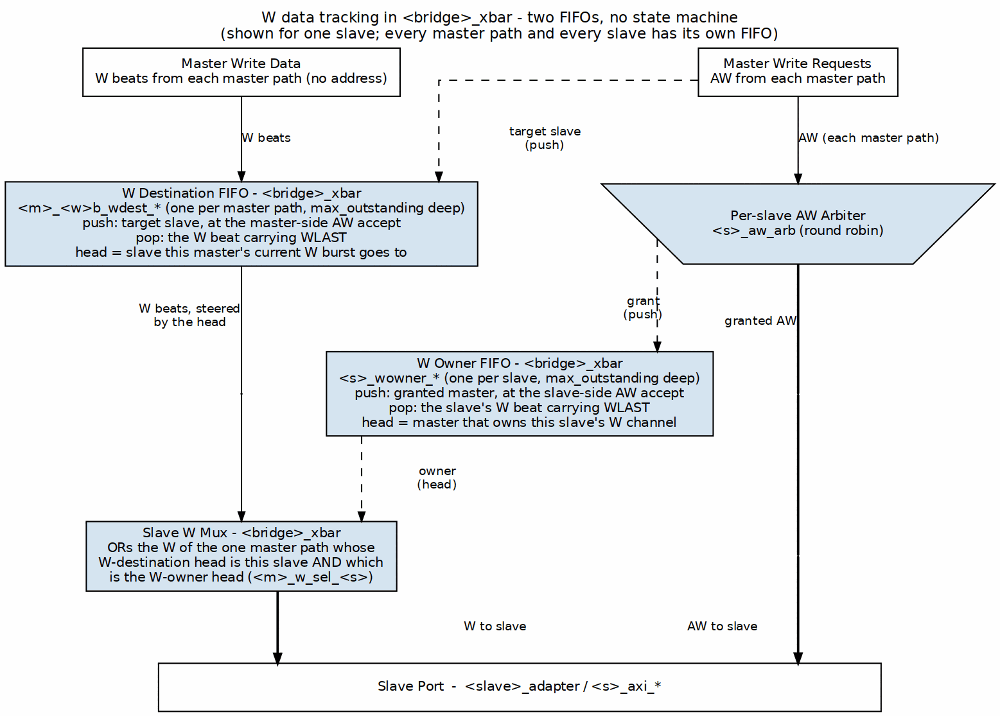

<!-- RTL Design Sherpa Documentation Header -->
<table>
<tr>
<td width="80">
  <a href="https://github.com/sean-galloway/RTLDesignSherpa">
    
  </a>
</td>
<td>
  <strong>RTL Design Sherpa</strong> · <em>Learning Hardware Design Through Practice</em><br>
  <sub>
    <a href="https://github.com/sean-galloway/RTLDesignSherpa">GitHub</a> ·
    <a href="https://github.com/sean-galloway/RTLDesignSherpa/blob/main/docs/DOCUMENTATION_INDEX.md">Documentation Index</a> ·
    <a href="https://github.com/sean-galloway/RTLDesignSherpa/blob/main/LICENSE">MIT License</a>
  </sub>
</td>
</tr>
</table>

---

<!-- End Header -->

# Transaction Tracking FSMs

## Overview

Despite the chapter title, the generated bridge tracks outstanding transactions with FIFOs and a CAM, not state machines: the W destination and W owner FIFOs in the crossbar, the `aw_trk` / `ar_trk` / `w_trk` slave-select FIFOs in each master adapter, and the per-slave `bridge_id` tracker (`bridge_cam` for multi-master AXI4/AXI5 slaves, an in-order FIFO otherwise). The FSM designs this chapter used to show are kept below only where they are marked as not built.

## Write Data Tracking (FIFO, not an FSM)

### Purpose

The W channel carries no address of its own, so the bridge remembers which
slave each AW selected and steers the data beats to match.

### Implementation

There is no IDLE/WRITING state machine. Each master width-path has a
`max_outstanding`-entry W destination FIFO in the crossbar (`<master>_<w>b_wdest_*`),
and each master adapter has a matching `w_trk` FIFO of slave selects:

```systemverilog
// bridge_2x2_rw_xbar.sv
wire cpu_32b_wdest_push = cpu_32b_awvalid && cpu_32b_awready;          // record target at AW
wire cpu_32b_wdest_pop  = cpu_32b_wvalid && cpu_32b_wready && cpu_32b_w.last;  // retire at WLAST
assign cpu_32b_w_to_ddr = cpu_32b_wdest_valid && (cpu_32b_wdest_head == 2'd0);
```

Because every accepted AW is queued, a master may issue further AWs before
the first burst's W beats finish; each W burst follows its own AW in order.

### Figure 3.3: W Data Tracking FIFOs



W beats run down the left: each master path's W destination FIFO names the
slave its current burst goes to, and the slave's W mux takes the beats of the
master that is also at the head of that slave's W owner FIFO. The AW
requests run down the center through the per-slave arbiter. The dashed
pushes come from the AW side: the master-side AW accept pushes the target
slave, and the slave-side AW accept pushes the granted master. Both FIFOs pop
on the W beat carrying WLAST, and several bursts can be queued at once.

## Response Pending Counter

> **Not built.** There is no per-master outstanding-transaction counter and no
> flow control derived from one. Outstanding depth is bounded by the per-slave
> bridge_id tracker (CAM or FIFO, `max_outstanding` deep, default 16), whose fullness gates the address handshake (bridge BUG-009, was BRIDGE-011).
> Searching the generated RTL for a response-pending counter returns nothing.

### Purpose

Track number of outstanding transactions per master for flow control.

### Implementation

```systemverilog
logic [7:0] r_outstanding [NUM_MASTERS];

// Increment on AR/AW acceptance
always_ff @(posedge clk or negedge rst_n) begin
    if (!rst_n) begin
        for (int i = 0; i < NUM_MASTERS; i++)
            r_outstanding[i] <= '0;
    end else begin
        for (int m = 0; m < NUM_MASTERS; m++) begin
            logic inc = (ar_accepted[m] || aw_accepted[m]);
            logic dec = (r_delivered[m] || b_delivered[m]);

            case ({inc, dec})
                2'b10: r_outstanding[m] <= r_outstanding[m] + 1;
                2'b01: r_outstanding[m] <= r_outstanding[m] - 1;
                default: r_outstanding[m] <= r_outstanding[m];
            endcase
        end
    end
end

// Backpressure when outstanding limit reached
assign accept_ar[m] = (r_outstanding[m] < MAX_OUTSTANDING);
assign accept_aw[m] = (r_outstanding[m] < MAX_OUTSTANDING);
```

## Burst Counter FSM

> **Not built.** No generated file contains a burst-beat counter; the read
> tracker frees its entry on the R beat with RLAST, so no count is needed.

### Purpose

Track burst beat count for responses spanning multiple cycles.

### States

| State | Description |
|---|---|
| IDLE | No burst in progress |
| COUNTING | Tracking burst beats |

: Transaction tracking states

### Implementation

```systemverilog
logic [7:0] r_burst_count;
logic r_burst_active;

always_ff @(posedge clk or negedge rst_n) begin
    if (!rst_n) begin
        r_burst_count <= '0;
        r_burst_active <= 1'b0;
    end else begin
        if (!r_burst_active && rvalid && rready) begin
            // Start new burst
            r_burst_active <= !rlast;
            r_burst_count <= rlast ? '0 : 8'd1;
        end else if (r_burst_active && rvalid && rready) begin
            // Continue burst
            r_burst_count <= r_burst_count + 1;
            r_burst_active <= !rlast;
        end
    end
end
```

## Related Documentation

- [Arbiter FSMs](01_arbiter_fsms.md) - Address channel arbitration
- [ID Management](../ch04_id_management/02_id_tracking.md) - the per-slave response tracker (`bridge_cam` or in-order FIFO)
