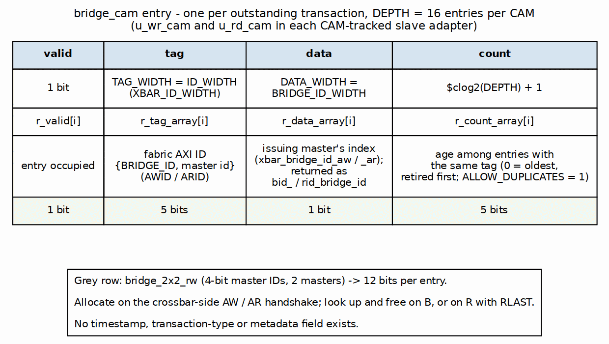
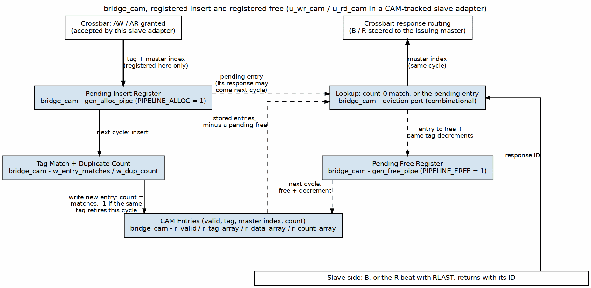

<!-- RTL Design Sherpa Documentation Header -->
<table>
<tr>
<td width="80">
  <a href="https://github.com/sean-galloway/RTLDesignSherpa">
    
  </a>
</td>
<td>
  <strong>RTL Design Sherpa</strong> · <em>Learning Hardware Design Through Practice</em><br>
  <sub>
    <a href="https://github.com/sean-galloway/RTLDesignSherpa">GitHub</a> ·
    <a href="https://github.com/sean-galloway/RTLDesignSherpa/blob/main/docs/DOCUMENTATION_INDEX.md">Documentation Index</a> ·
    <a href="https://github.com/sean-galloway/RTLDesignSherpa/blob/main/LICENSE">MIT License</a>
  </sub>
</td>
</tr>
</table>

---

<!-- End Header -->

# CAM Architecture

## Overview

`bridge_cam` (`rtl/bridge_cam.sv`, hand-written) is the response tracker in
every slave adapter that has to route by ID: an AXI4/AXI5 slave of a bridge
with more than one master, or any slave with `enable_ooo = true`
(`SlaveAdapterGenerator.use_cam`). Each such adapter instantiates two,
`u_wr_cam` and `u_rd_cam`. Single-master bridges, protocol-shim slaves and
the internal subtractive slave use an in-order FIFO instead (see
[ID Tracking](02_id_tracking.md)).

> An earlier revision of this chapter said the CAM was never built, that it
> was instantiated in zero bridges, and that IDs passed through at equal
> width. Since bridge TASK-005 the master adapter widens IDs to
> `{BRIDGE_ID, id}` (`cpu_m_axi_awid` 4 bits, `ddr_s_axi_awid` 5 bits in
> `bridge_2x2_rw`) and multi-master AXI4/AXI5 slaves are tracked here. The
> sizing formula and the block-RAM sequential search below were never built
> and are marked as such.

## Functional Description

### What the CAM Does

**Transaction tracking.** Each entry stores:

- the fabric transaction ID `{BRIDGE_ID, id}` (tag, `TAG_WIDTH = ID_WIDTH`)
- the originating master index (`DATA_WIDTH = BRIDGE_ID_WIDTH`)
- an ordering count, so one ID may be outstanding more than once

**Response routing.** When a response arrives:

1. The returned BID / RID is the deallocate tag
2. `deallocate_data` returns the originating master index, in the same cycle
3. The crossbar steers the B / R beat by that index (`bid_bridge_id` / `rid_bridge_id`)

The slave may therefore complete different IDs in any order.

### Figure 4.1: CAM Entry Format



### CAM Sizing

As generated, every CAM is the slave's `max_outstanding` entries deep (default
16, power of two 2..64, bridge GitHub #119 L5) regardless of master count:

```
bridge_cam #(.TAG_WIDTH(ID_WIDTH),          // XBAR_ID_WIDTH, 5 in bridge_2x2_rw
             .DATA_WIDTH(BRIDGE_ID_WIDTH),  // 1 in bridge_2x2_rw
             .DEPTH(16),                    // the slave's max_outstanding
             .ALLOW_DUPLICATES(1),
             .PIPELINE_EVICT(0),
             .PIPELINE_ALLOC(1),            // registered insert (below)
             .PIPELINE_FREE(1))             // registered free (below)
```

The formula once proposed here (`DEPTH = MAX_OUTSTANDING x NUM_MASTERS`,
with a metadata field in each entry) was never built. Depth is the slave's
own `max_outstanding` (GitHub #119 L5), whatever the master count, and no
entry carries a metadata field.

### Insertion (AW / AR Acceptance)

On the crossbar-side address handshake the slave adapter allocates the
fabric ID against the granted master's index (from the generated
`ddr_adapter.sv`):

```systemverilog
.allocate     (xbar_ddr_axi_awvalid && xbar_ddr_axi_awready),
.allocate_tag (xbar_ddr_axi_awid),     // {BRIDGE_ID, id}
.allocate_data(xbar_bridge_id_aw),     // master index sideband
```

**The insert is registered (`PIPELINE_ALLOC = 1`, GitHub #119).** The
handshake only captures the tag and master index into a pending-insert
register. The tag match against every entry, the duplicate popcount and the
entry write run the next cycle, from that register. Before this, the
crossbar's arbitrated ID drove the whole match and count in the handshake
cycle. On the Genesys 2 fabric benchmark that made a 15-level path: master
AW gate, crossbar grant, then the DDR slave's CAM count. Out of context at
4 ns, the registered insert moved WNS from -2.753 to -2.056 ns.

AXI allows a response one cycle after its request, before the pending entry
reaches the table, so the eviction port also checks the pending register. A
response whose tag has no stored entry takes the pending one, which is then
never written. A stored entry with the same tag is older, so it retires
first. `tags_full` and `tags_count` include a pending insert, so an
allocate cannot claim the slot it is about to use.

### Lookup and Deletion (B / last R)

Lookup and deletion are one operation: the response handshake deallocates
by the returned ID and returns the stored master index combinationally
(`PIPELINE_EVICT = 0`):

```systemverilog
// write side: every B; read side: the R beat with RLAST
.deallocate     (xbar_ddr_axi_bvalid && xbar_ddr_axi_bready),
.deallocate_tag (xbar_ddr_axi_bid),
.deallocate_valid(bid_valid),          // tag found
.deallocate_data(bid_bridge_id),       // routes B in the crossbar
```

A response whose ID is not in the CAM leaves `deallocate_valid` low and
routes nowhere; it means the slave returned an ID it was never sent.

**The free is registered (`PIPELINE_FREE = 1`, GitHub #119).** The lookup
above stays combinational, because it routes the response in its own cycle.
What a deallocate changes in storage is applied the next cycle: the
count-0 entry is cleared and the same-tag survivors step down. Until then,
every lookup and insert sees the post-free state. The freed entry no longer
matches, and the pending decrements are already reflected in the counts
used by the count-0 search and by the new entry's count. Occupancy drops a
cycle later, so `tags_full` is conservative for that one cycle. This moved
the fabric benchmark's WNS at 4 ns from -2.056 to -1.599 ns (about 148 to
179 MHz for the two changes together).

### Figure 4.2: CAM Insert and Free Pipeline



### Duplicate IDs: the Ordering Counter (Mode 2)

`bridge_cam` with `ALLOW_DUPLICATES = 1` accepts several outstanding
transactions under one ID and retires them in order. Every entry carries a
small ordering counter, and the entries holding one tag always carry the
counts `0..k-1`: the oldest is 0, a newcomer takes `k`, and when the oldest
retires the survivors step down by one. Two consequences shape the logic:

- The count a newcomer needs is `k`, which is simply how many entries match
  its tag: a popcount of the match vector, a few LUT levels. It is not a
  search for the largest existing count. That scan (`DEPTH` chained
  comparators, hanging off the crossbar's arbitrated ARID) was the bridge's
  critical path when first synthesized: 40 LUT levels and a 32 ns data path
  on an Artix-7 -1 (HAS 6.4), fixed 2026-09-11 by counting instead.
- The entry to retire is the one match with count 0, which is one-hot by
  construction, so its index and its stored master come out of OR
  reductions rather than a priority chain.

An allocate and a same-tag retire in one cycle take `k - 1`, because the
survivors step down in that same cycle (MAS 2.3).

### Implementation

Only one form exists: a parallel comparator array in distributed RAM and
flops (no block RAM), every entry compared at once:

```systemverilog
// bridge_cam.sv (simplified): one match vector per lookup port.
// w_valid_eff hides an entry whose free is pending (PIPELINE_FREE);
// w_ins_tag is the pending insert's tag (PIPELINE_ALLOC).
w_evict_matches[i] = w_valid_eff[i] && (r_tag_array[i] == deallocate_tag);
w_entry_matches[i] = w_valid_eff[i] && (r_tag_array[i] == w_ins_tag);
```

The block-RAM sequential-search variant that an earlier revision proposed
for deeper tables was never built.

### CAM Full

The CAM never overflows; it backpressures first. Its `tags_full` masks the
slave adapter's ready toward the crossbar (bridge BUG-009, was BRIDGE-011):

```systemverilog
assign xbar_ddr_axi_awready = w_sub_awready && !wr_trk_full;  // wr_trk_full = u_wr_cam.tags_full
```

The address phase waits until a B or last R frees an entry. Nothing is
dropped and no error response is generated. With the registered insert and
free, a pending insert counts as occupied and a pending free does not yet
release its slot, so the flag can only be early, never late.

The four combinations of `PIPELINE_ALLOC` and `PIPELINE_FREE` are each
verified by `dv/tests/test_bridge_cam.py`. The random test checks a per-tag
FIFO model, with full and empty one cycle late under a registered free.
A directed test covers a response arriving the cycle after its request,
both alone and behind an older entry with the same tag.

## Related Modules

- [ID Tracking](02_id_tracking.md) - which slaves use the CAM and which use the in-order FIFO
- [Response Routing](../ch02_blocks/08_response_routing.md) - how the crossbar uses the returned master index
