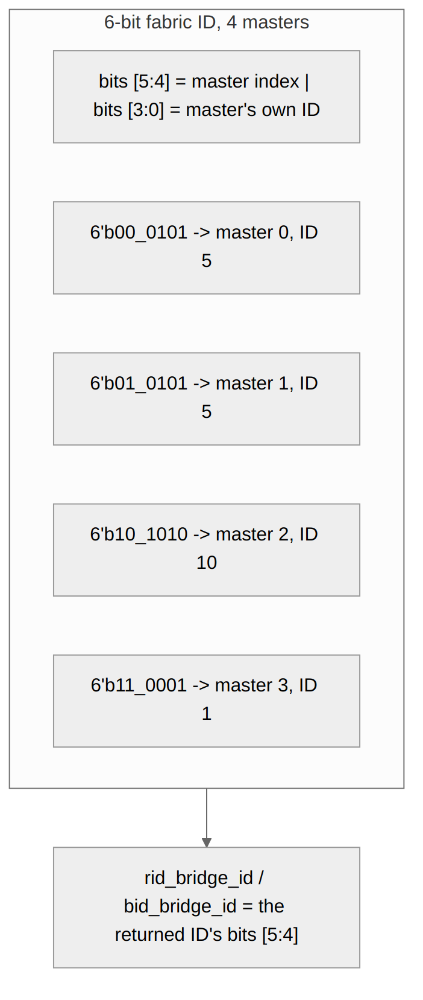

<!-- RTL Design Sherpa Documentation Header -->
<table>
<tr>
<td width="80">
  <a href="https://github.com/sean-galloway/RTLDesignSherpa">
    
  </a>
</td>
<td>
  <strong>RTL Design Sherpa</strong> · <em>Learning Hardware Design Through Practice</em><br>
  <sub>
    <a href="https://github.com/sean-galloway/RTLDesignSherpa">GitHub</a> ·
    <a href="https://github.com/sean-galloway/RTLDesignSherpa/blob/main/docs/DOCUMENTATION_INDEX.md">Documentation Index</a> ·
    <a href="https://github.com/sean-galloway/RTLDesignSherpa/blob/main/LICENSE">MIT License</a>
  </sub>
</td>
</tr>
</table>

---

<!-- End Header -->

# Response Tracking

## Overview

A multi-master fabric has to know which master a response belongs to. The
bridge does two things:

1. **Widens the ID.** With more than one master, each master adapter sends
   `{BRIDGE_ID, id}` into the fabric (bridge TASK-005), so IDs are unique
   across masters at every slave. In `bridge_2x2_rw` the 4-bit
   `cpu_m_axi_awid` becomes the 5-bit `ddr_s_axi_awid`. On B / R the master
   adapter returns the low bits, so the master sees its own ID.
2. **Names the issuing master on every response.** A by-ID slave adapter
   reads the master index off the top bits of the returned BID / RID; a
   FIFO-tracked one stores the granted master's index (`xbar_bridge_id_aw` /
   `_ar`) at the address handshake and returns its head. Either way the
   crossbar steers B / R by `bid_bridge_id` / `rid_bridge_id`.

The tracker comes in two forms, chosen at generation:

| Slave | Tracker | Completion order allowed |
|---|---|---|
| AXI3 / AXI4 / AXI5 slave, more than one master | by ID: master index from the ID bits, outstanding counter ([By-ID Response Routing](01_cam_architecture.md)) | any order across IDs |
| any slave with `enable_ooo = true` | by ID | any order across IDs |
| single-master bridge, apb / axil / wb shim slave, subtractive slave | in-order `bridge_id` FIFO | request order across all IDs |

: Slave response tracker selection

```systemverilog
// FIFO form
wr_fifo[wr_ptr[...]] <= xbar_bridge_id_aw;      // push on AW accept
assign bid_bridge_id  = wr_fifo[rd_ptr[...]];   // route by the HEAD
```

A FIFO-tracked slave must return B/R in request order across ALL IDs; the
slaves that get the FIFO are in order by construction or have one master.
Every FIFO-tracked adapter carries a SIMULATION-ONLY check that compares
the returned BID/RID against the head and $error()s on a mismatch (bridge
BUG-008, was BRIDGE-010); it cannot fire in silicon.

---

## Functional Description

### Figure 4.1: Fabric ID Layout



The figure shows the 6-bit fabric ID of a 4-master bridge: 2 master-index
bits over a 4-bit master ID. A by-ID slave adapter routes on the two top
bits. (Until 2026-10-18 a per-ID CAM stored each ID beside its master
index; the ID already carries that index.)

### Sizing

Every tracker holds the slave's `max_outstanding` (default 16; configurable
since bridge GitHub #119 L5) per direction per slave adapter:

```
by ID: a $clog2(16)+1-bit outstanding counter (wr_out_cnt / rd_out_cnt)
FIFO:  BRIDGE_ID_WIDTH bits x 16 (WR_FIFO_DEPTH / RD_FIFO_DEPTH)
```

When it is full the slave adapter drops its AWREADY / ARREADY toward the
crossbar (bridge BUG-009).

### ID Extension (Master Adapter)

```systemverilog
// <master>_adapter.sv
assign xbar_axi_awid = {BRIDGE_ID_WIDTH'(BRIDGE_ID), MASTER_ID_WIDTH'(fub_axi_awid)};
assign xbar_axi_arid = {BRIDGE_ID_WIDTH'(BRIDGE_ID), MASTER_ID_WIDTH'(fub_axi_arid)};

// Example, 4 masters: master 2, ID 4'hA -> fabric ID 6'b10_1010
```

The slave port is declared at `XBAR_ID_WIDTH`; the config validator rejects
an AXI3/AXI4/AXI5 slave whose `id_width` is narrower. A single-master
bridge prepends nothing.

### ID Stripping and Routing

On a by-ID slave the prefix bits ARE the routing: the slave adapter hands
them to the crossbar as `bid_bridge_id` / `rid_bridge_id`. On a
FIFO-tracked slave the FIFO head is used instead. The master adapter only
narrows the ID:

```systemverilog
fub_axi_bid = cpu_32b_b.id[3:0];   // bridge_2x2_rw: drop the 1-bit prefix
```

### Tracker Operations

| Event | By-ID form | FIFO form |
|---|---|---|
| AW / AR accepted from crossbar | count up | push `bridge_id` |
| B handshake | count down; master index = BID's top bits | pop head |
| R handshake with RLAST | count down; master index = RID's top bits | pop head |
| full | counter at `max_outstanding` holds AWREADY / ARREADY low | not-full gate holds AWREADY / ARREADY low |

: Tracker operations by event

### Multi-ID Considerations

#### Same Master ID, Different Masters

```
Master 0 issues ID=5 -> fabric ID 00_0101
Master 1 issues ID=5 -> fabric ID 01_0101
Master 2 issues ID=5 -> fabric ID 10_0101
```

All three can be outstanding at one slave at once; the prefix keeps them
distinct, and a by-ID slave may answer them in any order.

#### Same Fabric ID Twice

One master may reuse an ID while an earlier transaction with it is still
outstanding (AXI allows this; same-ID responses come back in order). Every
one of them carries the same master index, so routing by ID needs no
ordering state.

## Design Notes

### Resource Utilization

Per by-ID slave adapter: two 5-bit counters at the default depth (the
per-ID CAMs these replaced cost 1,800-2,100 LUTs on the two bridges measured, MAS 4.1). Per
FIFO-tracked slave adapter:
two 16-entry FIFOs of `BRIDGE_ID_WIDTH` bits. Measured totals per fixture
are in HAS 5.3.

## Related Modules

- [By-ID Response Routing](01_cam_architecture.md) - routing from the ID bits, the outstanding counter
- [Response Routing](../ch02_blocks/08_response_routing.md) - the crossbar's B / R muxes
