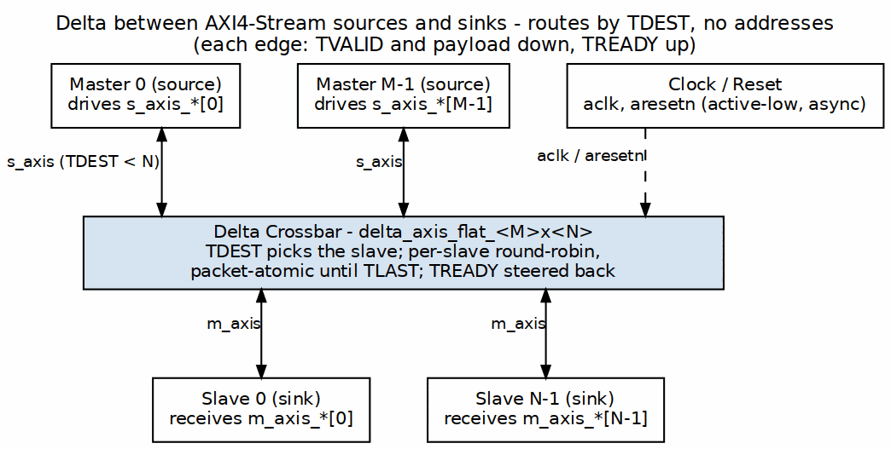

<!-- RTL Design Sherpa Documentation Header -->
<table>
<tr>
<td width="80">
  
</td>
<td>
  <strong>RTL Design Sherpa</strong> · <em>Learning Hardware Design Through Practice</em> 
  
    <a href="https://github.com/sean-galloway/RTLDesignSherpa">GitHub</a> ·
    <a href="https://github.com/sean-galloway/RTLDesignSherpa/blob/main/docs/DOCUMENTATION_INDEX.md">Documentation Index</a> ·
    <a href="https://github.com/sean-galloway/RTLDesignSherpa/blob/main/LICENSE">MIT License</a>
  
</td>
</tr>
</table>

---

<!-- End Header -->

# System Context

## Where Delta Fits

Delta sits between upstream AXI4-Stream masters and downstream AXI4-Stream slaves. It does not interpret addresses, bursts, or memory attributes; it only routes streams based on `TDEST`.

A typical Delta deployment looks like:

### Figure 2.1: Delta System Context

Multiple masters and multiple slaves attach in parallel. Each master drives one index of the `s_axis_*` arrays; each slave receives one index of the `m_axis_*` arrays.

## Upstream Requirements

- Masters must drive valid AXI4-Stream signals.
- `s_axis_tdest[m]` must be a valid slave index (`0` to `NUM_SLAVES-1`) when `s_axis_tvalid[m]` is asserted.
- Masters must respect `s_axis_tready[m]` backpressure.

## Downstream Requirements

- Slaves must accept valid AXI4-Stream signals.
- Slaves drive `m_axis_tready[s]` to throttle traffic.

## Clocking and Reset

Delta uses a single clock (`aclk`) and an active-low asynchronous reset (`aresetn`). All registered state is reset; combinational decode and mux logic is not registered.

## Relationship to Other Components

| Component | Role | When to Use |
|-----------|------|-------------|
| Delta | AXI4-Stream crossbar generator | Streaming fabrics, DSP arrays, sensors |
| Bridge | Multi-protocol crossbar generator | Memory-mapped AXI4/AXI4-Lite/APB systems |
| APB Crossbar | APB-only crossbar | Low-bandwidth register-mapped peripherals |
| RAPIDS | DMA subsystem | Descriptor-based memory transfers |

: Delta Component Context

Delta is intentionally narrow in scope: it does one thing (streaming crossbars) and does it without protocol conversion.

## Mesh-Mode Context

Mesh mode extends the same `bin/delta_generator.py` with a `--topology mesh` option. Instead of a flat M×N crossbar it emits a 3-D grid of `delta_mesh_cell` instances with rapids DMA at the boundary and ocelus observers on the links. Cell contents (SERV, CGRA, observers) are outside delta's scope; delta only carries the AXI4-Stream traffic between them.

> **PLANNED** — Mesh mode RTL is not yet implemented; the design is per the delta mesh design spec dated 2026-10-13 (`docs/superpowers/specs/2026-10-13-delta-mesh-design.md`). The flat crossbar shown in Figure 2.1 is the current implementation.
