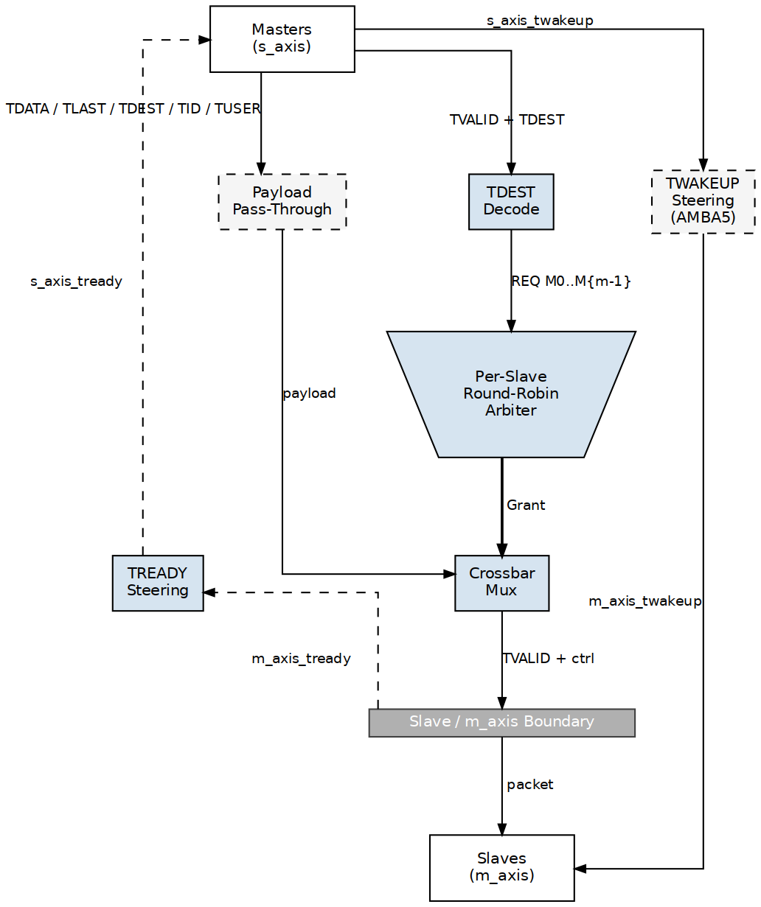

<!-- RTL Design Sherpa Documentation Header -->
<table>
<tr>
<td width="80">
  
</td>
<td>
  <strong>RTL Design Sherpa</strong> · <em>Learning Hardware Design Through Practice</em> 
  
    <a href="https://github.com/sean-galloway/RTLDesignSherpa">GitHub</a> ·
    <a href="https://github.com/sean-galloway/RTLDesignSherpa/blob/main/docs/DOCUMENTATION_INDEX.md">Documentation Index</a> ·
    <a href="https://github.com/sean-galloway/RTLDesignSherpa/blob/main/LICENSE">MIT License</a>
  
</td>
</tr>
</table>

---

<!-- End Header -->

# Block Diagram

## Delta Architecture Overview

### Figure 3.1: Delta High-Level Block Diagram

The diagram shows the three traceable flows of the Delta crossbar: the request/control flow down the center, the payload flow on the left, and the backpressure flow returning up the right/left side as a dashed sideband. The scheduler is the wide-edge-up trapezium (per-slave round-robin arbiter). The gray bar is the slave / `m_axis` boundary.

## Functional Blocks

### TDEST Decode

Receives `s_axis_tvalid` and `s_axis_tdest` from every master and produces the per-slave `request_matrix`. A request bit is set when a master has a valid transaction whose `TDEST` selects that slave.

### Per-Slave Round-Robin Arbiter

One arbiter per slave. When the slave is idle, it picks the next requesting master in round-robin order. Once a master is granted, the grant is held until `TLAST` is accepted. This block is the scheduler analog in the house style and is drawn as an inverted trapezium.

### Crossbar Mux

A bank of per-slave multiplexers. Each slave mux selects the payload and control signals from the master that currently holds the grant for that slave.

### TREADY Steering

Steers each slave's `m_axis_tready` back to the single master that currently owns the grant for that slave. Ungranted masters see `s_axis_tready == 0`.

### TWAKEUP Steering (AMBA5, Optional)

When `--amba5` is enabled, this block ORs each master's `s_axis_twakeup` to the slave indicated by `s_axis_tdest`. Because `TWAKEUP` is a hint, it does not depend on the grant and may assert before `TVALID`.

### Packet Counters (Optional)

32-bit counters per master and per slave that increment on every completed packet (`TVALID && TREADY && TLAST`). Removed from the build with `--no-counters`.

## Scalability

| Parameter | Typical Range | Impact |
|-----------|---------------|--------|
| NUM_MASTERS | 1-32 | Linear arbitration and mux growth |
| NUM_SLAVES | 1-256 | Linear decode and grant-matrix growth |
| DATA_WIDTH | 8-1024 | Linear data-path width |
| DEST_WIDTH | auto (`clog2(NUM_SLAVES)`) | Sets TDEST width |
| ID_WIDTH | auto (`clog2(NUM_MASTERS)`) | Sets TID width |

: Table 3.1: Topology Parameter Scaling

### Resource Scaling

- **Logic:** O(NUM_MASTERS × NUM_SLAVES) for the grant and request matrices.
- **Data path:** O(NUM_SLAVES × DATA_WIDTH) for the output muxes.
- **Memory:** No BRAM; all state is flip-flops.
