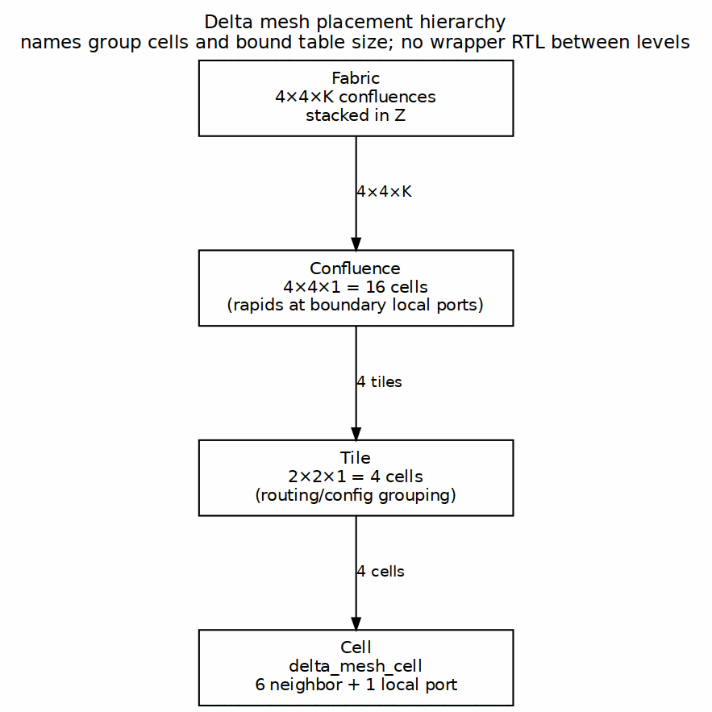

<!-- RTL Design Sherpa Documentation Header -->
<table>
<tr>
<td width="80">
  
</td>
<td>
  <strong>RTL Design Sherpa</strong> · <em>Learning Hardware Design Through Practice</em> 
  
    <a href="https://github.com/sean-galloway/RTLDesignSherpa">GitHub</a> ·
    <a href="https://github.com/sean-galloway/RTLDesignSherpa/blob/main/docs/DOCUMENTATION_INDEX.md">Documentation Index</a> ·
    <a href="https://github.com/sean-galloway/RTLDesignSherpa/blob/main/LICENSE">MIT License</a>
  
</td>
</tr>
</table>

---

<!-- End Header -->

# Mesh Hierarchy

> **IMPLEMENTED (2026-10-15 amendment)** — Mesh mode emits one module,
> `delta_mesh_cell`, and a fabric top. The owner re-named the hierarchy
> levels on 2026-10-15: **tetrad** = 2×2×1 cells, **tile** = 2×2×1 tetrads.
> For the datapath these are placement and naming; the tetrad/tile wrappers
> exist only to aggregate MonBus observation streams and live in the
> compute-engine tile IP, not in delta. The canonical tile definition is
> [`TILE_SPEC.md`](../../../../../compute-eng-ip/tile/docs/TILE_SPEC.md).
> This chapter's old name "confluence" is pre-2026-10-15 history.

## Placement Levels

Delta's mesh groups identical cells into named levels so that routing tables, config images, and rapids attachment points can be named without forcing a separate datapath wrapper at every level.

### Figure 7.1: Delta Mesh Placement Hierarchy

## Cell

A cell is `delta_mesh_cell`, the one RTL module the generator emits for mesh mode. It has nine ports: six axis neighbor ports (±X, ±Y, ±Z), two instances of the conceptual diagonal axis (P_DIA at the tetrad scale and P_DIA2 at the tile scale), and one local port. A cell forwards flits by looking up a destination coordinate in a RAM routing table and applying credit-based flow control per VC.

## Tetrad

A tetrad is `2×2×1` cells — four cells arranged in X and Y, one deep in Z. The four cells are fully connected as a K4 clique: perimeter edges over ±X/±Y plus both diagonals over P_DIA. The tetrad is a placement/config grouping and the first level of MonBus aggregation; an intra-tetrad hop is an ordinary cell hop.

## Tile

A tile is `2×2×1` tetrads — sixteen cells, or four tetrads. The four tetrads are themselves fully connected as a K4 at tetrad scale: shared ±X/±Y boundaries for edge-adjacent tetrads and P_DIA2 for diagonal-tetrad pairs. Rapids DMA attaches at the local ports of boundary cells. The tile wrapper (outside delta) is the second level of MonBus aggregation.

## Fabric

A fabric is `4×4×K` tiles stacked in Z. The recursion is planar: the Z dimension lives between tile layers. The generator produces a fabric top that instantiates the `cells-x × cells-y × cells-z` grid of `delta_mesh_cell`, parameterizes coordinate widths and per-dimension wrap links, and exposes boundary local ports as rapids attachment points.

## Why This Grouping

The grouping borrows the superswitch idea seen in ECLIPSE: clustering cells so a message can reach any cell in a local group cheaply. Delta keeps the naming and table-bounding benefit but does not promise single-cycle traversal across a tetrad or tile. That trade keeps the cell simple — one module, one set of tables, one set of allocators — while still letting software reason about locality.

## Observation Modules (2026-10-15 amendment)

Every cell emits exactly one MonBus observer stream. The tetrad and tile wrappers (compute-eng-ip tile IP, not delta) aggregate these streams up the hierarchy: four cell streams merge into one tetrad-level MonBus, and four tetrad streams merge into one tile-top-level MonBus. The datapath is unchanged; the wrappers are placement-only observation aggregation. MonBus aggregation is a parallel effort and is not part of this delta task.
