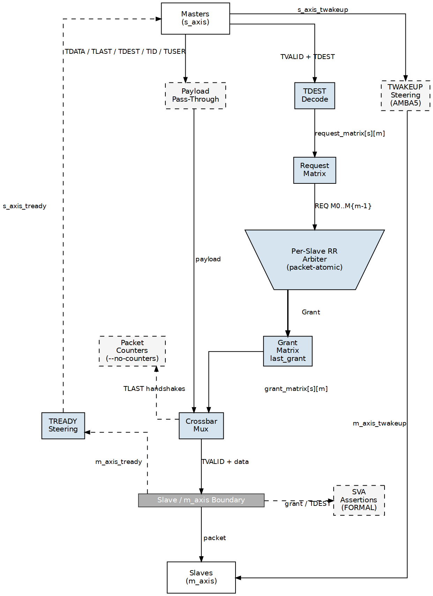

<!-- RTL Design Sherpa Documentation Header -->
<table>
<tr>
<td width="80">
  
</td>
<td>
  <strong>RTL Design Sherpa</strong> · <em>Learning Hardware Design Through Practice</em> 
  
    <a href="https://github.com/sean-galloway/RTLDesignSherpa/blob/main/docs/DOCUMENTATION_INDEX.md">Documentation Index</a> ·
    <a href="https://github.com/sean-galloway/RTLDesignSherpa/blob/main/LICENSE">MIT License</a>
  
</td>
</tr>
</table>

---

<!-- End Header -->

# Overview

## What This Document Describes

This Micro-Architecture Specification (MAS) describes the internals of the SystemVerilog module produced by `bin/delta_generator.py`. It is intended for readers who need to understand, debug, or modify the generated RTL.

## Generated Module Structure

The generator emits a single module named `delta_axis_flat_MxN` where `M` is `NUM_MASTERS` and `N` is `NUM_SLAVES`. The module contains:

1. **TDEST decode** — builds the per-slave request matrix.
2. **Per-slave round-robin arbiter** — packet-atomic grant logic.
3. **Crossbar mux** — combinational selection of payload and control.
4. **TREADY steering** — backpressure routing.
5. **TWAKEUP steering** — AMBA 5 wakeup hint routing (optional).
6. **Packet counters** — per-master and per-slave counters (optional).
7. **Assertions** — `ifdef FORMAL` checks.

## Key Micro-Architectural Decisions

| Decision | Rationale |
|----------|-----------|
| Registered grant, combinational mux | Two-cycle latency with a short critical path. |
| Per-slave arbiter | Independent scheduling; no head-of-line blocking across slaves. |
| TDEST direct decode | No address map; simpler and lower latency than address-range decode. |
| Packet-atomic grant | Preserves AXI4-Stream packet semantics; prevents interleaving. |
| Optional sidebands default off | Keeps base output byte-identical to earlier versions. |

: Table 1.1: Key Micro-Architectural Decisions

## Block Diagram

### Figure 1.1: Delta Micro-Architecture Block Diagram

The micro-architecture diagram shows the internal blocks of the generated RTL. The request/control flow descends through TDEST decode, the request matrix, the packet-atomic round-robin arbiter (inverted-trapezium scheduler), the grant matrix, and the crossbar mux to the slave boundary. The payload flow follows its own route on the left. The backpressure flow returns up through TREADY steering as a dashed sideband. Optional blocks (TWAKEUP steering, packet counters, and SVA assertions) are dashed.

## Reference RTL

The descriptions in this document are verified against:

- `rtl/delta_axis_flat_4x16.sv` (base flavor)
- `rtl_test/delta_axis_flat_2x4_strb_amba5.sv` (rich flavor)
