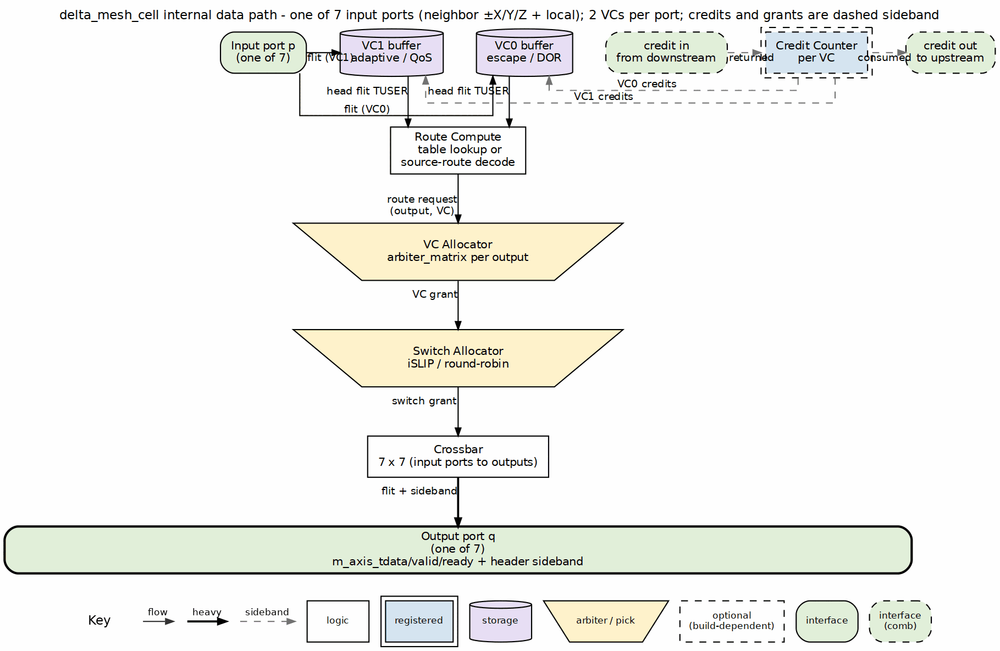

<!-- RTL Design Sherpa Documentation Header -->
<table>
<tr>
<td width="80">
  
</td>
<td>
  <strong>RTL Design Sherpa</strong> · <em>Learning Hardware Design Through Practice</em> 
  
    <a href="https://github.com/sean-galloway/RTLDesignSherpa">GitHub</a> ·
    <a href="https://github.com/sean-galloway/RTLDesignSherpa/blob/main/docs/DOCUMENTATION_INDEX.md">Documentation Index</a> ·
    <a href="https://github.com/sean-galloway/RTLDesignSherpa/blob/main/LICENSE">MIT License</a>
  
</td>
</tr>
</table>

---

<!-- End Header -->

# Pipeline Stages

> **IMPLEMENTED:** This chapter describes the `delta_mesh_cell` pipeline as built. The design is per the 2026-10-13 design spec (`docs/superpowers/specs/2026-10-13-delta-mesh-design.md`).

The cell pipeline is organized as five stages. Each stage is a valid/ready skid so a downstream stall does not corrupt state.

### Figure 6.1: `delta_mesh_cell` internal data path

### Figure 6.1: `delta_mesh_cell` internal data path

| Stage | Function | Cycle-critical notes |
|---|---|---|
| Buffer write | Demux arriving flit into VC0 or VC1 partition | Only head flit carries the route header |
| Route compute | Table lookup or source-route decode; produce (output port, VC) | Lookahead pre-computes the *next* hop's output port |
| VC allocation | Pick an available downstream VC for the chosen output | Separable per-output matrix arbiters |
| Switch allocation | Pick a crossbar input for each output port | iSLIP or round-robin; one-hot grant |
| Crossbar traversal | Mux the winning flit onto the output port | Combinational data path, registered valid |

: Cell pipeline stages

## Route Lookahead

The steady-state target is one cycle per hop. That only works if the route decision for hop `n+1` is computed while the flit is still traversing hop `n`. The head flit carries enough sideband in `TUSER` to let the next cell determine its own output port without an extra lookup cycle [P17]. Body flits follow the same path until `TLAST` releases the switch grant.

Measured latency on the ring and tetrad suites is 4 cycles/hop today (issue #120). The 1 cycle/hop steady-state target is deferred; the current pipeline pays the full table-lookup and grant latency per hop. Source-route mode can bypass the table lookup for fixed-latency systolic schedules.

## Speculative VC and Switch Allocation

The generator can enable speculative allocation: a head flit requests both a VC and a switch slot before the route is fully known, overlapping the allocators with the lookup. If the route guess is wrong, the grant is discarded and the flit retries the next cycle. The steady-state benefit is largest under light load; under saturation, mis-speculation wastes allocator cycles [P17]. The flag is per-build (`--speculation`), not dynamic.

## Handshake Discipline

A granted input holds its output until the packet's `TLAST` handshake completes, identical in spirit to the flat crossbar's packet-atomic arbitration. The switch allocator releases the crossbar input only after `TLAST && TVALID && TREADY`. Body beats advance on every ready cycle; if `TREADY` falls mid-burst, the beat waits in the output stage and the grant remains held.

## Failure Mode: TLAST Arrives Without a Matching Grant

That should never happen. If it does, the cell is in an inconsistent state: the flit has no output port and will be dropped. The verification suite includes a formal assertion that `TLAST` may only be asserted while a switch grant is active for the same input, mirroring the flat-mode packet-atomicity check.

## References

- Dally & Towles, *Principles and Practices of Interconnection Networks*, Morgan Kaufmann, 2004 — router speculation and lookahead [P17].
