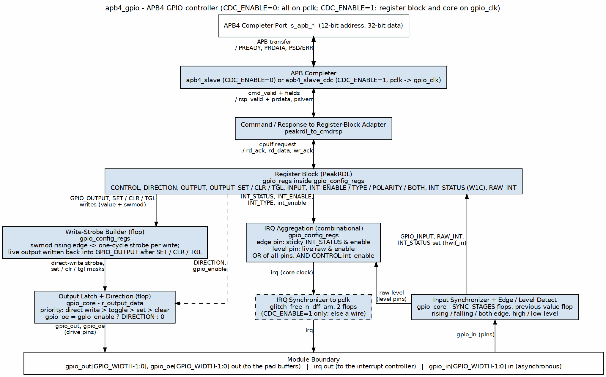
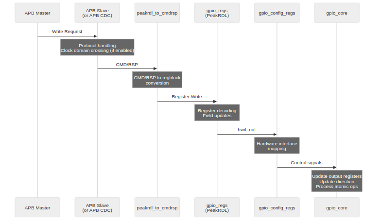
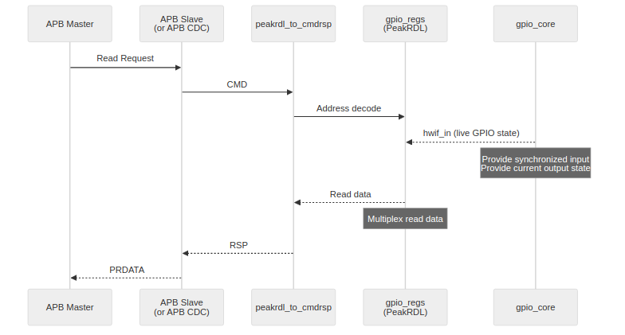
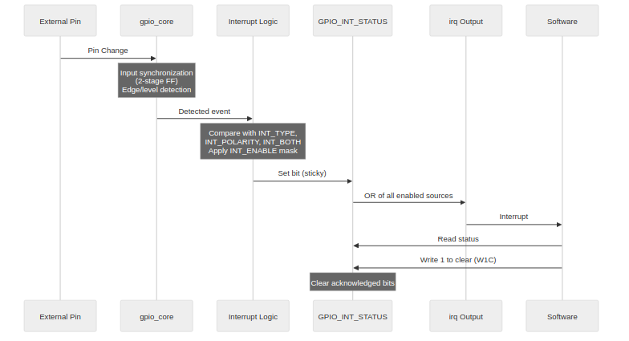
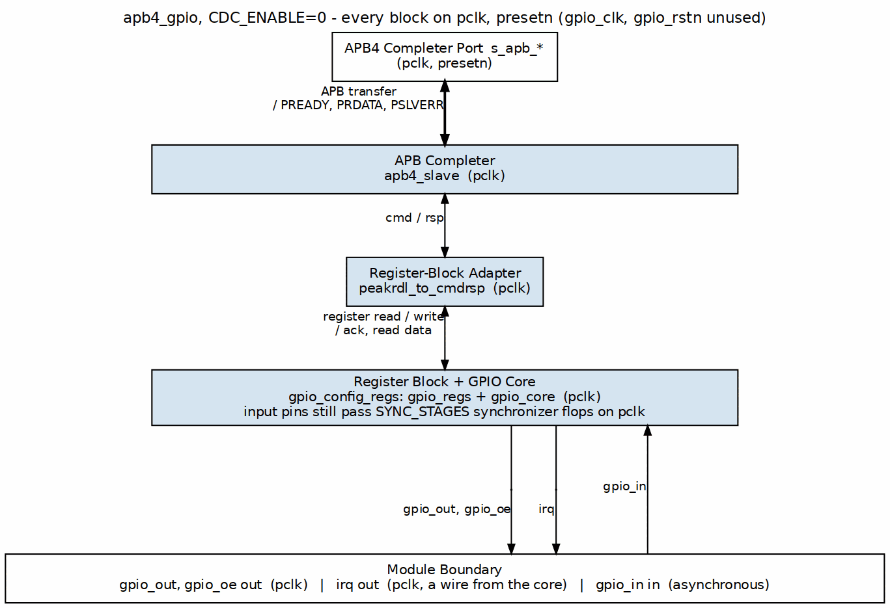
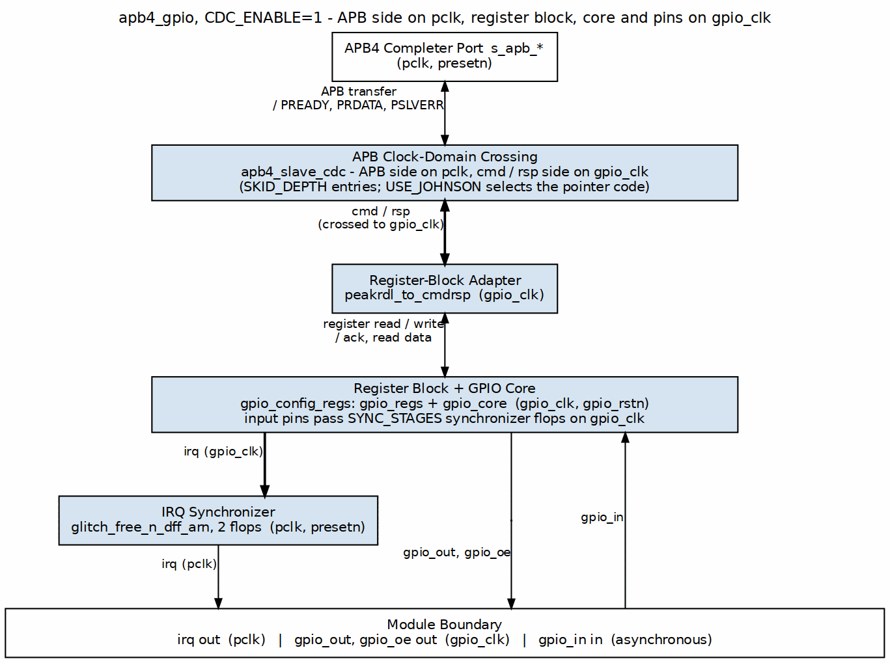

<!-- RTL Design Sherpa Documentation Header -->
<table>
<tr>
<td width="80">
  <a href="https://github.com/sean-galloway/RTLDesignSherpa">
    
  </a>
</td>
<td>
  <strong>RTL Design Sherpa</strong> · <em>Learning Hardware Design Through Practice</em><br>
  <sub>
    <a href="https://github.com/sean-galloway/RTLDesignSherpa">GitHub</a> ·
    <a href="https://github.com/sean-galloway/RTLDesignSherpa/blob/main/docs/DOCUMENTATION_INDEX.md">Documentation Index</a> ·
    <a href="https://github.com/sean-galloway/RTLDesignSherpa/blob/main/LICENSE">MIT License</a>
  </sub>
</td>
</tr>
</table>

---

<!-- End Header -->

# APB GPIO - Architecture

## Overview

Two views of the same design: the top-level block diagram, and the module hierarchy underneath it.

### Figure 1.2: APB GPIO Top-Level Architecture



### Figure 1.3: APB GPIO Module Hierarchy

```
apb4_gpio                      top level
├── apb4_slave                 APB completer (CDC_ENABLE=0)
│   or apb4_slave_cdc          APB completer + crossing (CDC_ENABLE=1)
├── peakrdl_to_cmdrsp          cmd/rsp to register-block adapter
├── gpio_config_regs           write strobes, W1C merge, irq
│   ├── gpio_regs              PeakRDL register block
│   └── gpio_core              sync, output latch, edge/level
└── glitch_free_n_dff_arn      irq sync to pclk (CDC_ENABLE=1)
```

## Functional Description

### Data Flow

Three flows matter: APB writes, APB reads, and interrupts.

#### Figure 1.4: Write Transaction Flow



#### Figure 1.5: Read Transaction Flow



#### Figure 1.6: Interrupt Flow



### Clock Domains

#### Figure 1.7: Synchronous Mode Clock Domains



With CDC_ENABLE = 0, everything runs on the APB clock (pclk). Input synchronization stays active on the external GPIO pins — metastability doesn't care that your bus fabric is synchronous.

#### Figure 1.8: Asynchronous Mode Clock Domains



With CDC_ENABLE = 1, the APB clock domain handles protocol conversion while the GPIO clock domain owns the registers and I/O. The crossing is the pair of asynchronous FIFOs inside `apb4_slave_cdc` (command in, response out), plus a 2-flop synchronizer that brings `irq` back to pclk.

## Parameters

| Parameter | Type | Default | Description |
|-----------|------|---------|-------------|
| `GPIO_WIDTH` | int | 32 | Number of GPIO pins |
| `SYNC_STAGES` | int | 2 | Input synchronizer stages |
| `CDC_ENABLE` | int | 0 | Enable clock domain crossing |
| `SKID_DEPTH` | int | 2 | CDC skid buffer depth |
| `USE_JOHNSON` | int | 0 | CDC counter encoding (forwarded to apb4_slave_cdc) |

: Table 1.1: GPIO Parameters

## Design Notes

### Resource Estimates

Rough synthesis numbers for planning purposes:

| Component | Flip-Flops | LUTs |
|-----------|-----------|------|
| gpio_core | ~200 | ~300 |
| gpio_regs | ~400 | ~200 |
| gpio_config_regs | ~50 | ~100 |
| apb4_slave (no CDC) | ~20 | ~50 |
| apb4_slave_cdc | ~100 | ~150 |
| **Total (no CDC)** | ~670 | ~650 |
| **Total (with CDC)** | ~750 | ~750 |

: Table 1.2: Resource Estimates

---

## Navigation

**Next:** [03_clocks_and_reset.md](03_clocks_and_reset.md) - Clock and reset behavior
