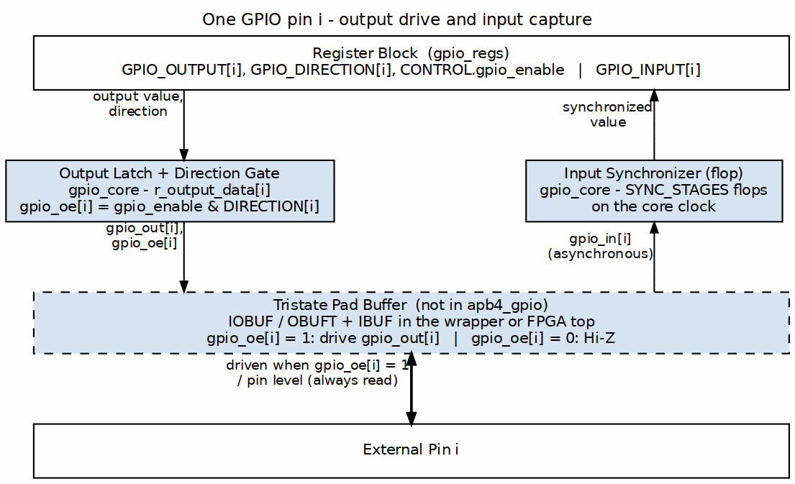
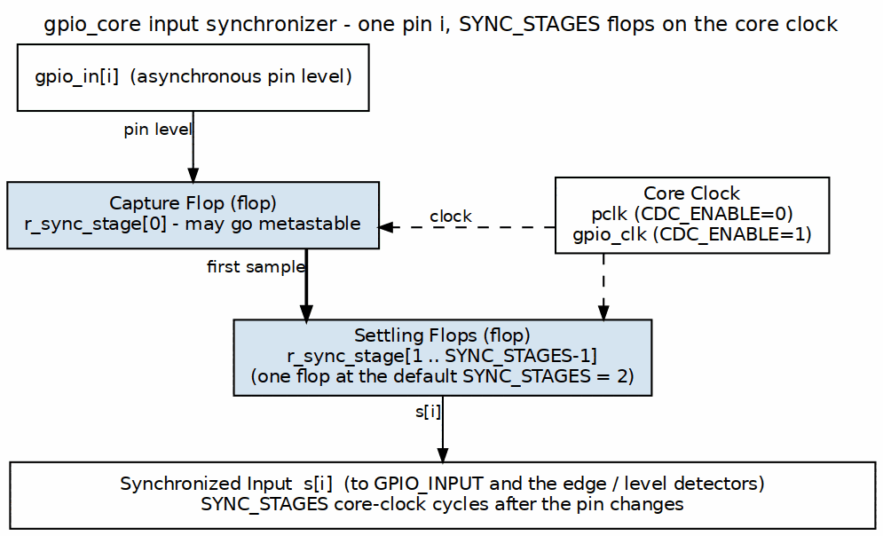

<!-- RTL Design Sherpa Documentation Header -->
<table>
<tr>
<td width="80">
  
</td>
<td>
  <strong>RTL Design Sherpa</strong> · <em>Learning Hardware Design Through Practice</em> 
  
    <a href="https://github.com/sean-galloway/RTLDesignSherpa">GitHub</a> ·
    <a href="https://github.com/sean-galloway/RTLDesignSherpa/blob/main/docs/DOCUMENTATION_INDEX.md">Documentation Index</a> ·
    <a href="https://github.com/sean-galloway/RTLDesignSherpa/blob/main/LICENSE">MIT License</a>
  
</td>
</tr>
</table>

---

<!-- End Header -->

# APB GPIO - GPIO Pin Interface

## Ports

### GPIO Signals

| Signal | Width | Direction | Description |
|--------|-------|-----------|-------------|
| gpio_out | 32 | Output | Output data values |
| gpio_oe | 32 | Output | Output enables |
| gpio_in | 32 | Input | Input data values |

## Functional Description

### Output Mode (direction[i] = 1)

- gpio_oe[i] = 1 (output enabled)
- gpio_out[i] = GPIO_OUTPUT register value
- Pin driven to output value

### Input Mode (direction[i] = 0)

The same path as the figure above with `gpio_oe[i] = 0`: the pad buffer is Hi-Z and only the input leg, through the synchronizer, is live.

- gpio_oe[i] = 0 (tri-state)
- gpio_out[i] = don't care
- External value captured via synchronizer

### Input Synchronization

All inputs pass through a dual flip-flop synchronizer:

- SYNC_STAGES parameter controls depth (default: 2)
- Prevents metastability from asynchronous inputs
- All 32 inputs synchronized in parallel

Input changes show up in the GPIO_INPUT register after:
- SYNC_STAGES cycles of gpio_clk (or pclk if CDC_ENABLE=0)
- Plus APB read latency

### Electrical Considerations

#### Output Characteristics

| Parameter | Description |
|-----------|-------------|
| Drive | Standard CMOS output |
| Slew | Defined by I/O cell |
| Protection | ESD per I/O cell design |

#### Input Characteristics

| Parameter | Description |
|-----------|-------------|
| Levels | CMOS compatible |
| Hysteresis | Optional per I/O cell |
| Pull-up/down | External to GPIO module |

## Timing

### Output Path

- gpio_out updates on clock edge
- gpio_oe updates on same clock edge
- No glitch-free guarantee during direction change

### Input Path

- Setup/hold relative to synchronizer clock
- Metastability resolved by synchronizer

---

## Navigation

**Next:** [03_interrupt.md](03_interrupt.md) - Interrupt Interface
