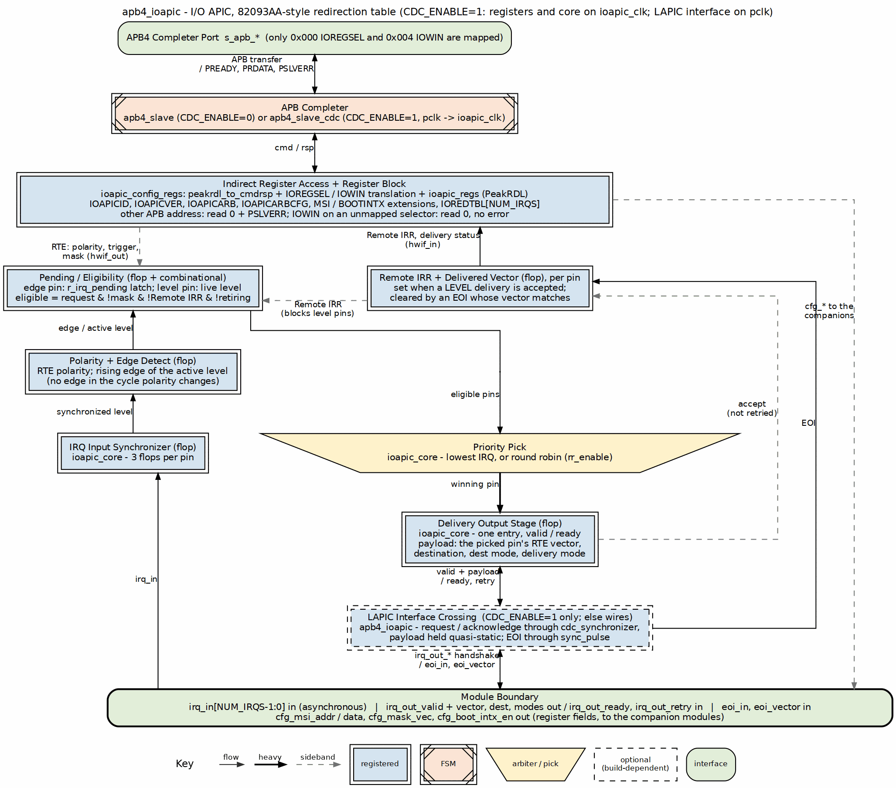
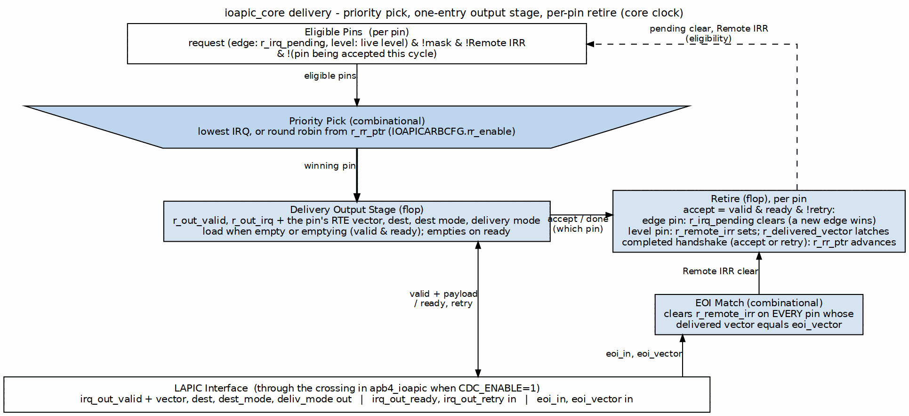
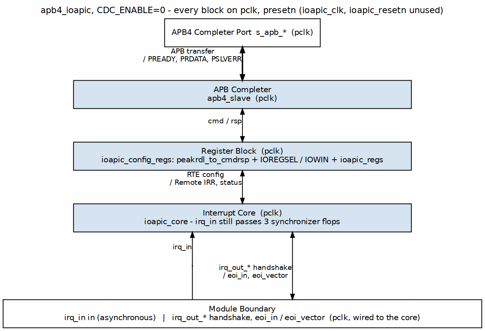
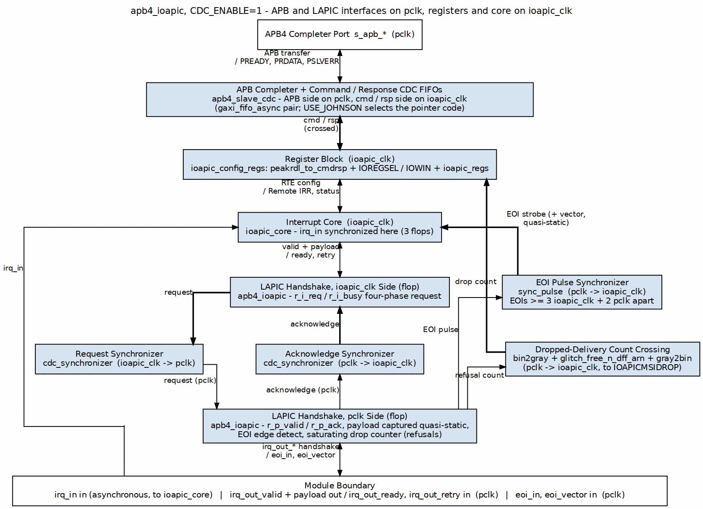

<!-- RTL Design Sherpa Documentation Header -->
<table>
<tr>
<td width="80">
  <a href="https://github.com/sean-galloway/RTLDesignSherpa">
    
  </a>
</td>
<td>
  <strong>RTL Design Sherpa</strong> · <em>Learning Hardware Design Through Practice</em><br>
  <sub>
    <a href="https://github.com/sean-galloway/RTLDesignSherpa">GitHub</a> ·
    <a href="https://github.com/sean-galloway/RTLDesignSherpa/blob/main/docs/DOCUMENTATION_INDEX.md">Documentation Index</a> ·
    <a href="https://github.com/sean-galloway/RTLDesignSherpa/blob/main/LICENSE">MIT License</a>
  </sub>
</td>
</tr>
</table>

---

<!-- End Header -->

# ioapic

## Overview

### High-Level Architecture

The APB IOAPIC is organized as a hierarchical design with three primary layers:

### Figure 1.1: APB IOAPIC Block Diagram



## Functional Description

### Block Hierarchy

The design follows RLB architecture standards with clear functional separation:

1. **apb4_ioapic.sv** (Top Level)
   - APB slave interface selection (CDC or non-CDC via parameter)
   - Clock domain routing based on CDC_ENABLE
   - Module instantiation and wiring
   - External interface connections
   - LAPIC interface crossing when CDC_ENABLE=1: the delivery handshake and
     the EOI strobe are presented in pclk and cross into ioapic_clk through
     matched-latency synchronizers (see Chapter 1.3)

2. **ioapic_config_regs.sv** (Register Interface)
   - PeakRDL adapter instantiation (peakrdl_to_cmdrsp)
   - Generated register block instantiation (ioapic_regs)
   - Special logic for indirect access (IOREGSEL/IOWIN): one selector
     copy (the regblock field), a decode that admits only APB 0x000 and
     0x004, and local acknowledge for every dropped access
   - Hardware interface signal mapping (hwif_in/hwif_out to core)
   - Redirection table array handling (24 entries)

3. **ioapic_core.sv** (Core Logic)
   - IRQ input synchronization (3-stage, metastability prevention)
   - Polarity inversion (active-high/active-low handling; the edge detector
     is held off for one cycle after a polarity bit changes, so the flip
     itself is never an edge)
   - Edge detection (rising edge of the polarity-adjusted signal only; there
     is no falling-edge mode and no filtering)
   - Level sensing (the live synchronized level is the request)
   - Priority arbitration (static: lowest IRQ wins; round robin behind
     IOAPICARBCFG.rr_enable)
   - One-entry valid/ready delivery stage (no state machine)
   - Remote IRR management (per-pin in-service tracking, EOI matched against
     the delivered vector)
   - Delivery status per IRQ

4. **ioapic_regs.sv** (Generated by PeakRDL)
   - Direct APB registers: IOREGSEL, IOWIN
   - Internal registers: IOAPICID, IOAPICVER, IOAPICARB
   - Redirection table: IOREDTBL[24] with LO/HI splits
   - Hardware interface structs (hwif_in, hwif_out)

### Data Flow

**Configuration Path (APB Write):**
Figure 1.1, down the center:

1. Software writes IOREGSEL, then IOWIN, through `apb4_slave[_cdc]`.
2. `peakrdl_to_cmdrsp` hands the access to the IOREGSEL / IOWIN translation in `ioapic_config_regs`.
3. `ioapic_regs` stores the field; `hwif_out` carries the RTE to `ioapic_core`.

**Status Readback Path (APB Read):**
The same edges carry the response back up:

1. `ioapic_core` reports Remote IRR and delivery status through `hwif_in`.
2. `ioapic_regs` returns the selected register through IOWIN.
3. `peakrdl_to_cmdrsp` and `apb4_slave[_cdc]` return it as PRDATA.

**Interrupt Delivery Path:**
Figure 1.1, up the left edge and down the center:

1. `irq_in` passes the 3-flop synchronizer and the RTE polarity.
2. An edge pin latches its pending bit; a level pin requests while the level is active.
3. Eligible pins (not masked, Remote IRR clear) meet at the priority pick.
4. The winner loads the one-entry output stage, which presents `irq_out_valid` with the vector and destination.
5. An accept (valid, ready, not retried) retires the pin: an edge pin's pending bit clears, a level pin's Remote IRR sets.

**EOI Return Path (Level Interrupts):**
Figure 1.1, up the right edge:

1. `eoi_in` and `eoi_vector` arrive (through `sync_pulse` when CDC_ENABLE=1).
2. Remote IRR clears on EVERY pin whose delivered vector matches.
3. Those pins request again if still asserted; no other pin was ever blocked.

### Indirect Access Method

The IOAPIC uses the two-step indirect register access:

**Step 1: Select Internal Register**
```
Write to IOREGSEL (APB address 0x00):
  Data = Internal register offset (0x00-0x3F)
```

**Step 2: Access Selected Register**
```
Read/Write IOWIN (APB address 0x04):
  Data = Selected register contents
```

**Example: Configure IRQ0 Redirection Entry**
```c
// Step 1: Select IOREDTBL[0]_LO (internal offset 0x10)
*IOREGSEL = 0x10;

// Step 2: Write configuration via IOWIN
*IOWIN = 0x00000020;  // Vector 0x20, edge-triggered, unmasked

// Step 3: Select IOREDTBL[0]_HI (internal offset 0x11)
*IOREGSEL = 0x11;

// Step 4: Write destination via IOWIN
*IOWIN = 0x01000000;  // Destination APIC ID = 1
```

This indirect access method:
- Reduces address space (only 2 APB registers instead of 50+)
- Matches the 82093AA specification for software compatibility
- Allows 256 internal registers with 8-bit offset
- The IOREGSEL/IOWIN routing is handwritten in ioapic_config_regs.sv
  (the regblock's IOREGSEL field is the one and only selector, a case remaps
  APB 0x004, and any address other than 0x000/0x004 is dropped with PSLVERR
  before the regblock); the PeakRDL block just decodes the translated
  address. An unmapped selector is stored and readable; IOWIN accesses made
  while it is unmapped are dropped (read 0, no error)

### Interrupt Flow State Machine

There is none. The IOAPIC core delivers through a one-entry valid/ready
output stage, and the only per-interrupt state is a Remote IRR bit per pin:

### Figure 1.2: IOAPIC Delivery Stage



**Edge-triggered path:** load → present → accept clears pending, exactly once per edge.
**Level-triggered path:** load → present → accept sets Remote IRR and frees the
stage; the pin stays out of arbitration until the EOI for the vector it was
delivered arrives, and re-delivers after that only if the level is still
asserted. Nothing about one pin's service state blocks another pin.

The old three-state engine (idle / deliver / wait-for-EOI) was retired with
issue #48 (fixed 2026-09-09): its wait state blocked the whole block on one
lost EOI, and its delayed pending-clear delivered every edge twice.

### Address Space Organization

**APB Address Space (12-bit: 0x000-0xFFF):**
- 0x000: IOREGSEL (software-visible)
- 0x004: IOWIN (software-visible)
- 0x008-0xFFF: not decoded - and that means the rest of the first 256 bytes
  as much as 0x100 and above. The access is dropped before the register
  block and answered locally with PSLVERR (writes ignored, reads return 0).
  There is no direct path to the internal register file: IOREGSEL/IOWIN is
  the only way in, and nothing aliases

**Internal Register Space (8-bit offset via IOREGSEL):**
- 0x00: IOAPICID
- 0x01: IOAPICVER
- 0x02: IOAPICARB
- 0x03: IOAPICARBCFG (round-robin enable; not an 82093AA register)
- 0x04-0x07: IOAPICMSIADDR, IOAPICMSIDATA, IOAPICMSIDROP, IOAPICBOOTINTX
  (extensions; reserved selectors on the real 82093AA)
- 0x08-0x0F: Reserved (unmapped; IOWIN access dropped)
- 0x10-0x3F: IOREDTBL[0-23] (LO/HI pairs)

**Memory Footprint:** 4KB APB window (matches other RLB modules)

## Timing

### Clock Domain Architecture

The IOAPIC supports two clock domain configurations via the CDC_ENABLE
parameter (a companion USE_JOHNSON parameter, default 0, selects the CDC
FIFO pointer encoding and is forwarded to apb4_slave_cdc):

**Single Clock Domain (CDC_ENABLE=0 - Default):**
### Figure 1.3: Single Clock Domain (CDC_ENABLE=0)


- Simplest configuration
- Lowest latency
- Single clock timing analysis
- Recommended for most use cases

**Dual Clock Domain (CDC_ENABLE=1):**
### Figure 1.4: Dual Clock Domain (CDC_ENABLE=1)


- Allows independent APB and IOAPIC clocks
- Useful for always-on interrupt capture
- ioapic_clk can run while pclk is gated: interrupts are captured (edges
  latched, levels tracked) and presented once pclk resumes, since the
  LAPIC-facing interface lives in pclk
- Adds 2-4 cycle latency for CDC handshake
- The CPU/LAPIC-facing interface (irq_out_valid/ready and payload,
  eoi_in/eoi_vector) stays in pclk; apb4_ioapic crosses it into ioapic_clk
  with a four-phase request for deliveries and pulse synchronizers for the
  accept and the EOI (details in Chapter 1.3)

**Clock Selection Logic:**
```systemverilog
// In apb4_ioapic.sv:
.clk ((CDC_ENABLE != 0) ? ioapic_clk : pclk)
```

config_regs and core always share one clock; the only crossings are the APB
slave's CMD/RSP FIFOs and the LAPIC interface synchronizers, both in
apb4_ioapic.

### Reset Architecture

The IOAPIC uses standard RLB reset methodology:

**Reset Signals:**
- `presetn` - APB domain reset (active-low, async)
- `ioapic_resetn` - IOAPIC domain reset (active-low, async)

**Reset Routing:**
```systemverilog
// In apb4_ioapic.sv:
.rst_n ((CDC_ENABLE != 0) ? ioapic_resetn : presetn)
```

**Reset Behavior:**
- All IRQs masked by default (mask bit = 1)
- No interrupts pending
- Output stage empty (irq_out_valid = 0)
- Remote IRR cleared for all IRQs
- IOAPIC ID = 0x0
- All redirection entries reset to safe defaults

## Usage Example

### Integration Guidelines

**Minimal Integration (Single CPU):**
```systemverilog
apb4_ioapic #(
    .NUM_IRQS    (24),  // must remain 24: the generated decode and
                        // IOAPICVER (MaxRedirEntry=0x17) are hardwired
    .CDC_ENABLE  (0)   // Single clock domain
) u_ioapic (
    .pclk              (sys_clk),
    .presetn           (sys_resetn),
    .ioapic_clk        (sys_clk),      // Same clock
    .ioapic_resetn     (sys_resetn),   // Same reset
    
    .s_apb_*           (/* APB signals */),
    .irq_in            (system_irqs),
    .irq_out_valid     (cpu_irq_valid),
    .irq_out_vector    (cpu_irq_vector),
    .irq_out_dest      (/* tie to CPU ID */),
    .irq_out_deliv_mode(/* unused in simple system */),
    .irq_out_ready     (cpu_irq_ack),
    .eoi_in            (cpu_eoi),
    .eoi_vector        (cpu_eoi_vector)
);
```

**Advanced Integration (Multi-CPU with CDC):**
```systemverilog
apb4_ioapic #(
    .NUM_IRQS    (24),
    .CDC_ENABLE  (1)   // Dual clock domain
) u_ioapic (
    .pclk              (apb_clk),        // APB bus clock
    .presetn           (apb_resetn),
    .ioapic_clk        (always_on_clk),  // Independent clock
    .ioapic_resetn     (por_resetn),
    
    .s_apb_*           (/* APB signals */),
    .irq_in            (system_irqs),
    .irq_out_*         (/* to LAPIC router */),
    .eoi_in            (eoi_from_lapic),
    .eoi_vector        (eoi_vector_from_lapic)
);
```

## Design Notes

### Design Trade-offs

**Indirect vs Direct Access:**
- **Chosen**: Indirect access (IOREGSEL/IOWIN)
- **Reason**: 82093AA compatibility, reduced address space
- **Cost**: Extra APB cycle per access, more complex logic
- **Benefit**: Software portability, scalable register space

**Static vs Dynamic Priority:**
- **Chosen**: both, selected by `IOAPICARBCFG.rr_enable`, static at reset
- **Reason**: static is the 82093AA scheme and what a driver written for the
  part expects; round robin is what a system needs when a low-numbered level
  pin that software EOIs promptly would otherwise starve everything above it
- **Cost**: a rotation pointer and a scan that starts at an offset
- **Benefit**: the 82093AA behaviour is the default, so nothing changes for
  software that does not ask for the other one

**Fixed vs Multiple Delivery Modes:**
- **Chosen**: Fixed mode only for MVP
- **Reason**: Covers 90%+ of use cases, simpler implementation
- **Cost**: Can't use LowestPri, SMI, NMI, etc. yet
- **Benefit**: Clean implementation, extensible design

## Navigation

---

**Next:** [Chapter 1.3 - Clocks and Reset](03_clocks_and_reset.md)
