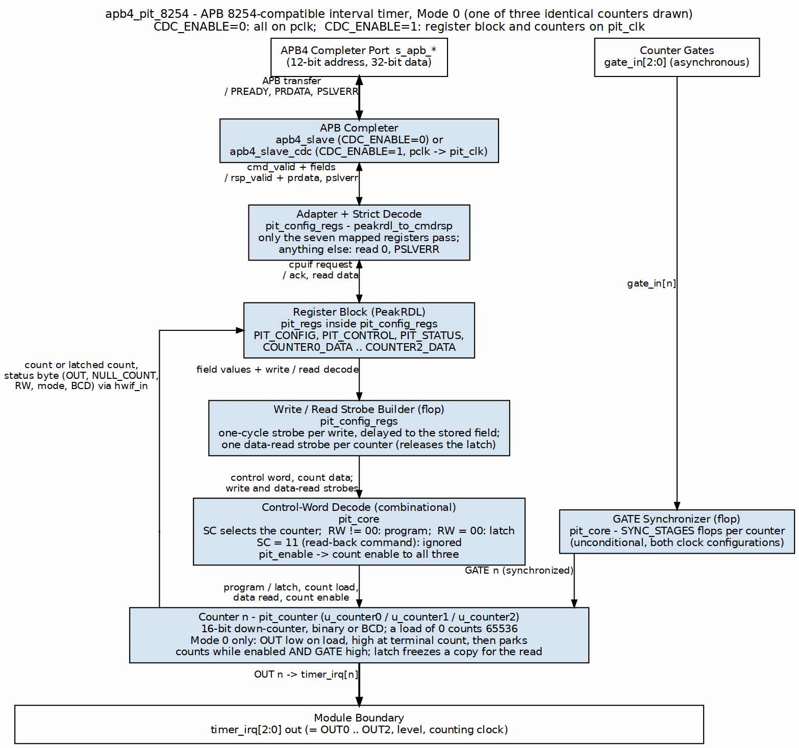
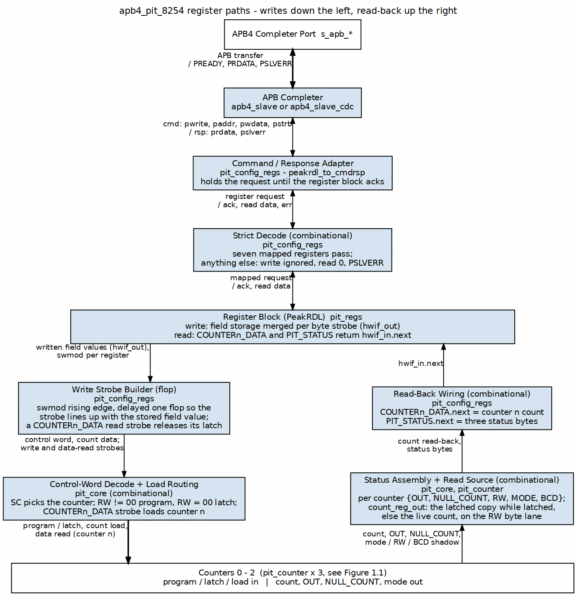
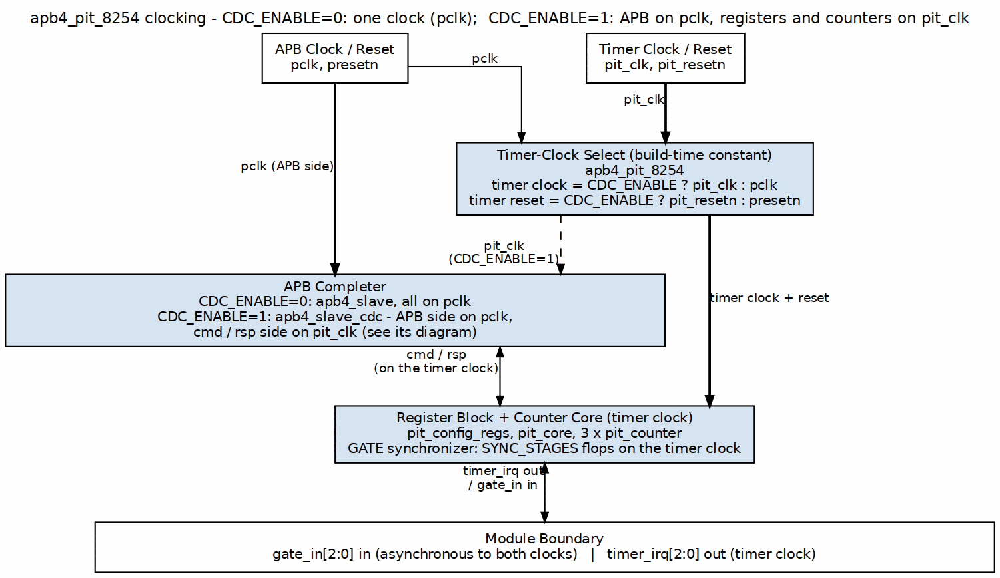

<!-- RTL Design Sherpa Documentation Header -->
<table>
<tr>
<td width="80">
  <a href="https://github.com/sean-galloway/RTLDesignSherpa">
    
  </a>
</td>
<td>
  <strong>RTL Design Sherpa</strong> · <em>Learning Hardware Design Through Practice</em><br>
  <sub>
    <a href="https://github.com/sean-galloway/RTLDesignSherpa">GitHub</a> ·
    <a href="https://github.com/sean-galloway/RTLDesignSherpa/blob/main/docs/DOCUMENTATION_INDEX.md">Documentation Index</a> ·
    <a href="https://github.com/sean-galloway/RTLDesignSherpa/blob/main/LICENSE">MIT License</a>
  </sub>
</td>
</tr>
</table>

---

<!-- End Header -->

# APB PIT 8254 - Architecture

## Overview

### Figure 1.2: APB PIT 8254 High-Level Block Diagram



### Module Hierarchy

```
apb4_pit_8254
├── apb4_slave (CDC_ENABLE=0) or apb4_slave_cdc (CDC_ENABLE=1)
│   └── Converts APB protocol to cmd/rsp interface
├── pit_config_regs
│   ├── peakrdl_to_cmdrsp (protocol adapter)
│   └── pit_regs (PeakRDL generated)
│       └── Register file with hwif interface
└── pit_core
    ├── pit_counter (Counter 0)
    ├── pit_counter (Counter 1)
    └── pit_counter (Counter 2)
```

### Three-Layer Architecture

Following the HPET design pattern, the PIT uses a clean three-layer architecture:

**Layer 1: APB Interface (apb4_pit_8254)**
- Protocol conversion (APB → cmd/rsp)
- Optional clock domain crossing
- Top-level integration
- Parameter configuration

**Layer 2: Configuration Registers (pit_config_regs)**
- Register file integration
- Strict address decode: only the seven mapped registers are visible, everything else in the 4 KB window is dropped with PSLVERR
- One-cycle command strobes, aligned to the stored field value so a load takes the byte-strobe-merged register contents
- Counter readback connection and data-read strobes for the latch
- Status feedback aggregation

**Layer 3: Core Logic (pit_core + pit_counter)**
- Control-word split: RW != 00 programs the selected counter, RW = 00 latches it
- Counter control and data routing
- Three independent pit_counter instances
- Mode 0 counting logic
- GATE synchronizer (SYNC_STAGES flops) and OUT signal management

## Functional Description

### Data Flow

A register write travels down the left of Figure 1.3: the PeakRDL field
stores the byte-strobe-merged value, the strobe builder fires one aligned
strobe, and pit_core routes it to the selected counter. A read climbs the
right: the counter's count (or its latched copy) and status byte are wired
into `hwif_in`, and the register block returns them on the APB response.

### Figure 1.3: APB PIT 8254 Register Write and Read Paths



### Counter Control State

There is no explicit state machine in `pit_counter`. Counter control is two
flags plus the count itself:

- **`r_null_count`** - set at reset and by every control-word program of
  this counter, cleared by a count load. It reads back as the NULL_COUNT
  status bit.
- **`r_counting`** - set by a count load, cleared when the decremented count
  reaches zero (terminal count, OUT goes high). Nothing else sets it: there
  is no re-arm path, so after terminal count the counter sits in one steady
  state (`r_counting=0`, count 0, OUT high) until the next load.

A cycle actually counts when `r_counting`, the PIT enable and the
synchronized GATE are all high -- that single condition is the whole GATE
story in Mode 0.

Behavior over a Mode 0 cycle:

1. Reset: `r_null_count=1`, `r_counting=0`, `OUT=0`.
2. Count load: count captured in one cycle (no intermediate value),
   `r_null_count` cleared, OUT driven low, `r_counting` set. The load is not
   gated by GATE or by the PIT enable -- only the decrement is.
3. Counting: decrement on each clock while the PIT is enabled and GATE is
   high. GATE low pauses the count where it stands; GATE high resumes it
   from that value with no reload.
4. Terminal count: detected on the decremented value, so a load of N counts
   N clocks and a load of 0 counts 65536 (10000 in BCD). OUT goes high and
   `r_counting` clears; the count parks at 0 and OUT stays high until the
   next load drives it low again.

### Control Flow

**Counter Programming Sequence:**
1. Write `PIT_CONTROL` with control word (counter select, mode, RW mode)
2. Control word decoded and routed to selected counter (RW != 00 programs
   it; RW = 00 is the latch command and leaves the programming alone)
3. Write `COUNTERx_DATA` with the count on the lane the RW mode selects
4. Counter loads the value and counts whenever GATE is high and the PIT is
   enabled
5. Counter decrements on each clock cycle
6. When count reaches 0, OUT goes high

**Status Readback:**
1. Read `PIT_STATUS` register
2. Returns 3 bytes (one per counter) with packed status fields
3. Status includes: OUT state, NULL_COUNT, RW mode, counter mode, BCD flag

## Timing

### Clock Domains

With `CDC_ENABLE=0` everything runs on `pclk`. With `CDC_ENABLE=1` the APB
side stays on `pclk`, `apb4_slave_cdc` carries the command/response stream
across, and the register block and the counters run on `pit_clk`.

### Figure 1.4: APB PIT 8254 Clock Configuration



`gate_in` is a pin and is asynchronous to the counting clock in both modes,
so it always passes a SYNC_STAGES-flop synchronizer (default 2) inside
`pit_core` before it reaches the counters: a GATE transition takes effect
SYNC_STAGES counting clocks after the pin moves, in either configuration.

## Design Notes

### Reset Behavior

**Power-On Reset:**
- All counters: NULL_COUNT=1, counting=0, OUT=0
- PIT disabled (PIT_CONFIG=0)
- All count values cleared

**Soft Reset (PIT disable):**
- Counting pauses (the clock enable is gated; the internal counting flag is
  NOT cleared, so counting resumes where it left off on re-enable)
- Count values preserved
- OUT signals remain in current state
- NULL_COUNT flags unchanged

---

**Version:** 1.1
**Last Updated:** 2026-09-09
