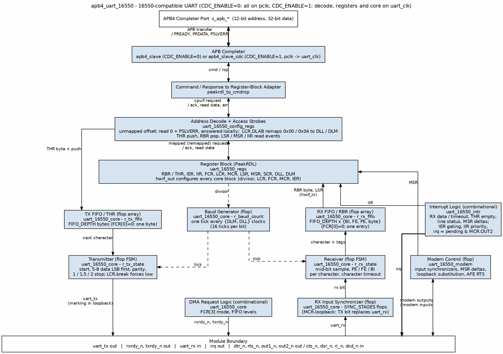
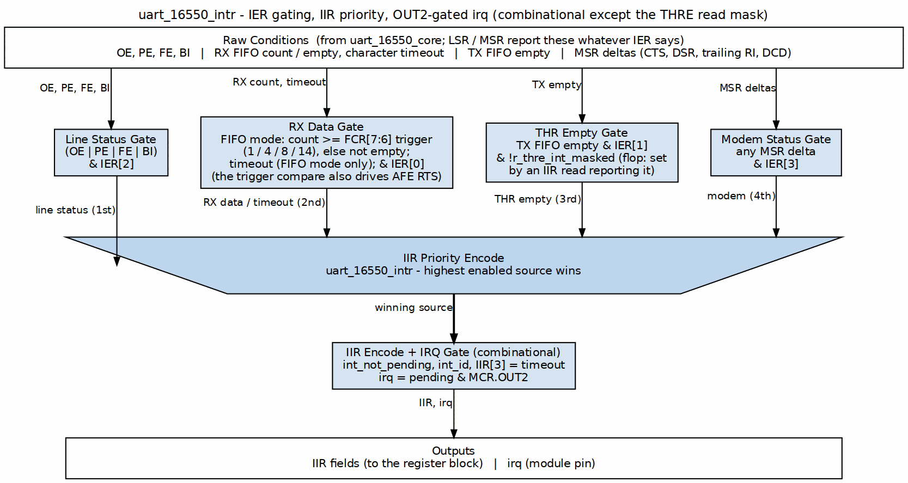
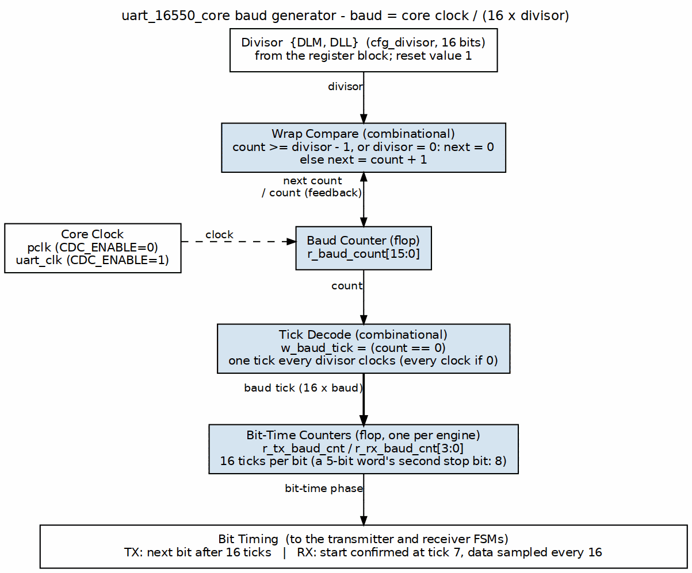

<!-- RTL Design Sherpa Documentation Header -->
<table>
<tr>
<td width="80">
  <a href="https://github.com/sean-galloway/RTLDesignSherpa">
    
  </a>
</td>
<td>
  <strong>RTL Design Sherpa</strong> · <em>Learning Hardware Design Through Practice</em><br>
  <sub>
    <a href="https://github.com/sean-galloway/RTLDesignSherpa">GitHub</a> ·
    <a href="https://github.com/sean-galloway/RTLDesignSherpa/blob/main/docs/DOCUMENTATION_INDEX.md">Documentation Index</a> ·
    <a href="https://github.com/sean-galloway/RTLDesignSherpa/blob/main/LICENSE">MIT License</a>
  </sub>
</td>
</tr>
</table>

---

<!-- End Header -->

# APB UART 16550 — Architecture

## Overview

This page takes the UART apart: the module hierarchy, the paths data and interrupts actually travel, and how the baud clock is derived. If you only read one page before integrating the block, make it this one.

## Functional Description

### Figure 1.2: UART Architecture



### Module Hierarchy

```
apb4_uart_16550 (Top Level)
+-- apb4_slave (CDC_ENABLE=0) or apb4_slave_cdc (CDC_ENABLE=1)
|   +-- APB protocol handling
|   +-- CMD/RSP interface conversion
|
+-- peakrdl_to_cmdrsp (CMD/RSP to register-block adapter)
|
+-- uart_16550_config_regs (Register Wrapper)
|   +-- uart_16550_regs (PeakRDL Generated)
|   |   +-- RBR/THR/DLL register
|   |   +-- IER/DLM register
|   |   +-- IIR/FCR registers
|   |   +-- LCR/MCR/LSR/MSR/SCR
|   |
|   +-- Strict address decode
|   |   +-- Eleven mapped offsets; anything else drops with PSLVERR
|   |
|   +-- Read/write strobes
|   |   +-- THR push (byte-enable qualified), RBR pop
|   |   +-- LSR and MSR read events (clear-on-read), IIR read event
|   |
|   +-- uart_16550_core
|       +-- Baud Rate Generator
|       |   +-- Divisor latch
|       |   +-- 16x clock generation
|       |
|       +-- TX Engine
|       |   +-- TX FIFO (FIFO_DEPTH bytes, or one in character mode)
|       |   +-- Serializer
|       |   +-- Start/Stop/Parity generation
|       |
|       +-- RX Engine
|       |   +-- RX FIFO (FIFO_DEPTH entries, 11 bits: byte + PE/FE/BI tags)
|       |   +-- Deserializer
|       |   +-- Start detection, break hold
|       |   +-- Error detection
|       |
|       +-- uart_16550_intr
|       |   +-- Interrupt conditions, IER gating
|       |   +-- IIR priority encode, THR-empty clear on IIR read
|       |   +-- OUT2 gating of the irq pin
|       |
|       +-- uart_16550_modem
|           +-- Input synchronizers
|           +-- Loopback substitution
|           +-- MSR delta detection
|           +-- Active-low outputs
```

### Data Flow

#### Transmit Path

Figure 1.2 traces it down the left column:

1. Software writes THR; the access strobes push the byte into the TX FIFO.
2. The transmitter takes the head byte when it leaves IDLE (with AFE set, only while CTS is asserted).
3. It sends a start bit (low), 5-8 data bits LSB first, the optional parity bit, and 1, 1.5 (5-bit words) or 2 stop bits (high), one bit every 16 baud ticks.
4. The bit leaves on `uart_tx` (held high in loopback, where it feeds the receiver instead).

#### Receive Path

Figure 1.2 traces it back up the right column:

1. `uart_rx` passes the SYNC_STAGES-flop synchronizer (the TX bit replaces it in loopback).
2. The receiver sees the line go low, confirms the start bit at mid-bit, then samples each data bit, the parity bit and the stop bit once per bit time.
3. Parity, framing (stop bit low) and break (all zeros with the stop bit low) are tagged on the character; a full FIFO is an overrun.
4. The character and its three tags enter the RX FIFO at the stop-bit sample.
5. Software reads RBR; LSR reports the tags of the character at the head.

#### Interrupt Flow



### Baud Rate Generation

#### Divisor Calculation

```
Divisor = Input Clock / (16 x Desired Baud Rate)

Examples (48 MHz input):
  9600 baud:   Divisor = 48000000 / (16 x 9600)   = 312.5  -> 312 or 313
  115200 baud: Divisor = 48000000 / (16 x 115200) = 26.04  -> 26
  3000000 baud: Divisor = 48000000 / (16 x 3000000) = 1    -> 1
```

#### Clock Generation



### FIFO Organization

#### TX FIFO

| Feature | Value |
|---------|-------|
| Depth | 16 bytes |
| Width | 8 bits |
| Write | THR writes |
| Read | TX serializer |
| Status | THRE, TEMT in LSR |

#### RX FIFO

| Feature | Value |
|---------|-------|
| Depth | 16 bytes |
| Width | 11 bits (8 data + 3 error) |
| Write | RX deserializer |
| Read | RBR reads |
| Trigger | 1, 4, 8, or 14 bytes |

## Design Notes

### Resource Estimates

| Component | Flip-Flops | LUTs |
|-----------|-----------|------|
| apb4_slave | ~20 | ~50 |
| uart_regs | ~150 | ~100 |
| baud_gen | ~20 | ~30 |
| tx_engine + FIFO | ~200 | ~150 |
| rx_engine + FIFO | ~250 | ~200 |
| **Total** | ~640 | ~530 |

---

## Navigation

**Next:** [03_clocks_and_reset.md](03_clocks_and_reset.md) - Clock and reset behavior
