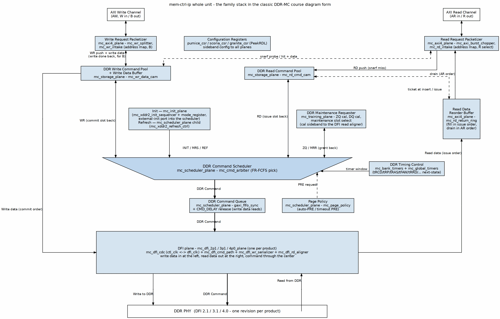

<!-- RTL Design Sherpa Documentation Header -->
<table>
<tr>
<td width="80">
  
</td>
<td>
  <strong>RTL Design Sherpa</strong> · <em>Learning Hardware Design Through Practice</em> 
  
    <a href="https://github.com/sean-galloway/RTLDesignSherpa">GitHub</a> ·
    <a href="https://github.com/sean-galloway/RTLDesignSherpa/blob/main/docs/DOCUMENTATION_INDEX.md">Documentation Index</a> ·
    <a href="https://github.com/sean-galloway/RTLDesignSherpa/blob/main/LICENSE">MIT License</a>
  
</td>
</tr>
</table>

---

<!-- End Header -->

# The Architecture: axi4 → storage → scheduler → (ras) → training → dfi

This chapter is the vision, written down. It was set out by the partner in
the Phase-2 campaign and it drives every block in common-ip. The planes
below are listed in command-flow order. The whole unit, drawn in the
family's diagram house style
([STYLE.md](../assets/graphviz/STYLE.md) — the classic DDR-MC course form the
owner fixed as the reference). It is drawn from the RTL as `pumice_core`
composes the planes. Scoria and andesite swap in the DFI 3.1 / 4.0 plane and
their own scheduler and training planes; granite replaces the storage plane
with the N=1 entry store (Ch 5.2):

How to read it:

- **Command** runs down the center. The packetizers (burst split / chop, then
  the intakes, which also apply the address map) push into the two CAMs of
  the storage plane. Each CAM's schedulable-entry view lands directly on the
  scheduler's wide edge, beside init/refresh and the training plane's
  maintenance requests; the winning command passes the command queue
  (`CMD_DELAY` release) into the DFI plane.
- **Write data** goes down the left. It is held in `mc_wr_data_cam` from
  insert until the scheduler commits the entry, then streams to the DFI plane
  in commit order. There is no separate merge or forward buffer.
- **Read data** climbs the right. The DFI plane returns it in issue order to
  `mc_rd_return_ring`, which drains it in AR order through `mc_rd_intake`'s R
  source select to the host. A read that hits a pending write is answered by
  the snarf (dashed): `mc_wr_data_cam` returns the data to the read intake,
  host side, and the read never enters the read CAM or the DFI plane.

## The plane contract

Each plane has exactly one job. The table is the binding statement; the
per-block microarchitecture is in
[common_mas](../../common_mas/common_mas_index.md) and is not restated here.

| Plane | Job | Owns | Does not own |
|---|---|---|---|
| `mc_axi4_plane` | Turn host AXI4 traffic into memory-command descriptors | AXI4 slave intakes, shallow FIFOs, burst chop/split, address mapping (`mc_addr_mapper` inside each intake), the B response; the read return ring and the R source select (DRAM or snarf) | Scheduling; the DRAM data path |
| `mc_storage_plane` | Hold the schedulable-entry pool | rd/wr CAMs (`mc_rd_cmd_cam`, `mc_wr_data_cam` with its write-data slots), the read-your-writes snarf, the write commit stream to the DFI plane | The pick itself; DRAM command encoding; address mapping |
| `mc_init_plane` | Bring the DRAM up and keep its mode-register shadow | The JEDEC init sequencer (`mc_xddr2_init_sequencer`), the per-rank mode-register shadow + live CL/CWL/BL decode (`mc_xddr2_mode_register`), the DFI PHY init handshake, init command injection into the scheduler plane's external-init port, `init_state_o` bring-up telemetry | Scheduling; refresh; the CSR/APB hot-update path for mode registers (future — `mr_seq_we` remains the only writer) |
| `mc_scheduler_plane` | Pick the next DRAM command | The schedulable-entry view contract, bank/global timers, command arbiter, refresh controller, page policy, the command queue, the maintenance port, the external-init command injection point (`HAS_INIT_SEQUENCER=0` mode) | Where entries are stored (that is the storage plane's job); PHY timing; init sequencing and the MR shadow (owned by `mc_init_plane` since 2026-10-15 — the scheduler plane keeps its internal-init generate only for legacy wrappers, and scoria's wrapper still uses that mode) |
| `mc_ras_plane` (optional) | Reliability transforms on the data path | ECC insert/check as a transform pair, scrub as a maintenance client | Anything when not instantiated — its absence is a true bypass, not a stub |
| `mc_training_plane` | The training control plane as a maintenance client | ZQ calibration control, DQ calibration (MRR), the maintenance slot select that carries them, the calibration sideband to the DFI read aligner | The training *search* (PHY responsibility, per doctrine — the family doc's boundary rule) |
| `mc_dfi_NpM_plane` | Deliver commands and data to the PHY at a DFI revision | Command formatter/pipeline, write serializer, read aligner, the aclk↔dfi_clk CDC — per generation: `dfi_2p1_plane`, `dfi_3p1_plane`, `dfi_4p0_plane` | Scheduling decisions; training searches |

## Why planes — the reason this shape exists

The point of the stack is **drop-in performance features on a stable
contract**. Because the storage plane presents the scheduler the same
descriptor view the AXI plane does, a feature that needs a different
entry-pool organization (bigger CAM, SRAM-backed pool, hashed bank
assignment) changes the storage plane only — the scheduler and everything
downstream do not move. A product that needs no reordering replaces the
storage plane with its lite configuration and keeps the same scheduler
(Ch 5.2). The seam is the architecture; the blocks are replaceable parts on
it.

This is also why the scheduler is defined against a **schedulable-entry
view** rather than against the CAMs directly: the pick machinery argmaxes
over schedulable-entry vectors, and *something* has to hold those entries —
that something is the storage plane in a full build, and the stripped AXI
plane serving N=1 in a lite build. "Storage off" can never be literally
zero hardware (the entry store cannot reach zero); it is the lite config,
not an omission.

## The three structural rules of the stack

1. **Command flow is one direction.** Descriptors flow axi4 → storage →
   scheduler → dfi. Nothing upstream is consulted after a pick commits; the
   seam's advisory snapshot is the boundary (Ch 2.2).
2. **Maintenance requests; it never preempts** (family doctrine 2, in force
   here unchanged). Refresh, ZQ, calibration are guests on the command bus
   with a request/grant contract into the scheduler's maintenance slots.
3. **Optional planes are param-selected, not compile-selected by absence.**
   The RAS plane exists or it does not; a build without it wires the storage
   and DFI planes together directly. What is *never* optional: the entry
   store, the write-data buffer (it cannot reach zero), and the CDC.

## What the rocks own

For the DDR2 / LPDDR2 rocks, the generation-specific scheduler children have
already been extracted: `mc_xddr2_init_sequencer` and `mc_xddr2_mode_register`
compose the `mc_init_plane` (2026-10-15 — extracted from the scheduler plane
so init is a first-class plane both rocks instantiate identically), and
`mc_xddr2_refresh_ctrl` and `mc_page_policy` remain scheduler-plane children;
all four live in common-ip. The common `mc_scheduler_plane` instantiates them
behind `HAS_*` parameters — pumice and granite set
`HAS_INIT_SEQUENCER=0/HAS_MODE_REGISTER=0` and feed the plane's external-init
port from `mc_init_plane` (the mode scoria's wrapper already used with its
own rock-side sequencer). Scoria and andesite still keep their generation's
blocks rock-side, by the two-customer rule: `scoria_scheduler_plane` and
`andesite_scheduler_plane` are rock wrappers that instantiate the rock's
children and map the rock's maintenance source into the generic maintenance
slot ([mc_scheduler_knobs.md](../../mc_scheduler_knobs.md) §6 documents the
union that made this possible). When a second customer appears for one of
those blocks — the refresh controller family is the leading candidate — the
extraction follows the same rule that produced this stack.
