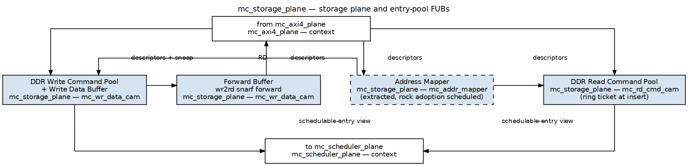

<!-- RTL Design Sherpa Documentation Header -->
<table>
<tr>
<td width="80">
  
</td>
<td>
  <strong>RTL Design Sherpa</strong> · <em>Learning Hardware Design Through Practice</em> 
  
    <a href="https://github.com/sean-galloway/RTLDesignSherpa">GitHub</a> ·
    <a href="https://github.com/sean-galloway/RTLDesignSherpa/blob/main/docs/DOCUMENTATION_INDEX.md">Documentation Index</a> ·
    <a href="https://github.com/sean-galloway/RTLDesignSherpa/blob/main/LICENSE">MIT License</a>
  
</td>
</tr>
</table>

---

<!-- End Header -->

# `mc_storage_plane` — Storage Plane and Entry-Pool FUBs

**Files:** `macro/mc_storage_plane.sv`, `fub/mc_wr_data_cam.sv`, `fub/mc_rd_cmd_cam.sv`, `fub/mc_addr_mapper.sv`

The storage plane holds the family’s schedulable-entry pools: the write-data CAM (write buffer + snarf source) and the read-command CAM (read scheduling window). It presents the scheduler-facing bank/row/col image and accepts the read-snoop probe from the upstream AXI4 plane. Within the eight-plane family stack it is the N=8 full provider of the descriptor seam; the stack architecture is documented in [common_has](../../common_has/common_has_index.md).

## `mc_storage_plane` parameters

| Parameter | Default | Description |
|---|---|---|
| `AXI_ID_WIDTH` | 8 | AXI ID width (`IW`) |
| `AXI_DATA_WIDTH` | 64 | AXI data width (`DW`) |
| `NUM_RANKS` | 1 | Rank count |
| `NUM_BANKS` | 8 | Bank count (`BKW = $clog2`) |
| `ROW_WIDTH` | 14 | Row field width |
| `COL_WIDTH` | 10 | Column field width |
| `AXI_BEATS_PER_BURST` | 4 | Beats per AXI burst |
| `NUM_ENTRIES` | 8 | CAM / scheduling-window depth (`PTRW = $clog2`) |
| `N_SRAM_SLOTS` | `NUM_ENTRIES` | Write-data SRAM slots |
| `N_SCHED_LU` | 4 | Parallel scheduler lookup ports |
| `AGE_WIDTH` | 16 | Free-running age width |
| `RD_RET_DEPTH` | 32 | Return-ring depth / ticket space; power of 2 |
| `IW` | `AXI_ID_WIDTH` | Derived alias |
| `DW` | `AXI_DATA_WIDTH` | Derived alias |
| `SW` | `AXI_DATA_WIDTH/8` | Derived strobe width |
| `BKW` | `$clog2(NUM_BANKS)` | Derived bank-index width |
| `PTRW` | `$clog2(NUM_ENTRIES)` | Derived pointer width |
| `RKW` | `(NUM_RANKS>1) ? ... : 1` | Derived rank-index width |

*Parameter block:* `macro/mc_storage_plane.sv:22-45`.

## `mc_storage_plane` ports

| Group | Signals | Direction | Width | Description |
|---|---|---|---|---|
| Clock/reset | `aclk`, `aresetn` | input | 1, 1 | Clock, active-low reset |
| WR intake cmd | `aw_push_valid_i`, `aw_push_ready_o` | in / out | 1, 1 | AW push handshake |
| WR intake cmd | `aw_push_bank_i`, `aw_push_row_i`, `aw_push_col_i`, `aw_push_id_i`, `aw_push_qos_i`, `aw_push_agg_i`, `aw_push_last_i` | input | `BKW`, `ROW_WIDTH`, `COL_WIDTH`, `IW`, 4, 1, 1 | Decoded key, ID, QoS, aggregate, last |
| WR intake data | `wd_valid_i`, `wd_ready_o`, `wd_data_i`, `wd_strb_i`, `wd_last_i` | in / out / in / in / in | 1, 1, `DW`, `SW`, 1 | W-data handshake, data, strobes, last |
| WR done | `wr_done_valid_o`, `wr_done_id_o` | output | 1, `IW` | Commit-done B response |
| RD snarf probe | `snarf_probe_valid_i`, `snarf_probe_bank_i`, `snarf_probe_row_i`, `snarf_probe_col_i`, `snarf_probe_id_i`, `snarf_probe_len_i`, `snarf_hit_o`, `snarf_accept_i` | in / in / in / in / in / in / out / in | 1, `BKW`, `ROW_WIDTH`, `COL_WIDTH`, `IW`, 8, 1, 1 | Read probe key/id/len, hit, accept |
| RD snarf stream | `snarf_rd_valid_o`, `snarf_rd_ready_i`, `snarf_rd_data_o`, `snarf_rd_last_o` | out / in / out / out | 1, 1, `DW`, 1 | Forwarded write-data stream |
| RD intake cmd | `ar_push_valid_i`, `ar_push_ready_o`, `ar_push_bank_i`, `ar_push_row_i`, `ar_push_col_i`, `ar_push_id_i`, `ar_push_qos_i` | in / out / in / in / in / in / in | 1, 1, `BKW`, `ROW_WIDTH`, `COL_WIDTH`, `IW`, 4 | AR push key/id/QoS |
| Return ring | `rt_alloc_ready_i`, `rt_alloc_ticket_i`, `rd_iss_ready_i`, `rd_iss_valid_o`, `rd_iss_ticket_o`, `rd_cam_ins_ready_o` | in / in / in / out / out / out | 1, `$clog2(RD_RET_DEPTH)`, 1, 1, `$clog2(RD_RET_DEPTH)`, 1 | Ticket allocation, issue notify, CAM ready |
| Scheduler ctrl | `sched_age_thresh_i` | input | 8 | Age threshold / 16 (0 = off) |
| Scheduler ctrl | `wr_commit_valid_i`, `wr_commit_ready_o`, `wr_commit_slot_i` | in / out / in | 1, 1, `PTRW` | Write commit |
| Scheduler ctrl | `rd_issue_valid_i`, `rd_issue_ready_o`, `rd_issue_slot_i` | in / out / in | 1, 1, `PTRW` | Read issue |
| WR sched vectors | `wr_sch_valid_o`, `wr_sch_bank_o`, `wr_sch_row_o`, `wr_sch_col_o`, `wr_sch_older_o`, `wr_sch_age_exceed_o`, `wr_sch_qos_o`, `wr_sch_head_rel_o` | output | `NUM_ENTRIES`, `NUM_ENTRIES*BKW`, `NUM_ENTRIES*ROW_WIDTH`, `NUM_ENTRIES*COL_WIDTH`, `NUM_ENTRIES*NUM_ENTRIES`, `NUM_ENTRIES`, `NUM_ENTRIES*4`, 16 | Per-entry WR scheduling image |
| RD sched vectors | `rd_sch_valid_o`, `rd_sch_bank_o`, `rd_sch_row_o`, `rd_sch_col_o`, `rd_sch_older_o`, `rd_sch_age_exceed_o`, `rd_sch_qos_o`, `rd_sch_head_rel_o` | output | (same as WR) | Per-entry RD scheduling image |
| WR commit data | `wr_cm_rd_valid_o`, `wr_cm_rd_ready_i`, `wr_cm_rd_data_o`, `wr_cm_rd_strb_o`, `wr_cm_rd_last_o` | out / in / out / out / out | 1, 1, `DW`, `SW`, 1 | Commit data stream |
| Status | `busy_o` | output | 1 | Plane busy |

*Port block:* `macro/mc_storage_plane.sv:46-159`.

## Internal wiring

`mc_storage_plane` instantiates `mc_wr_data_cam` at `macro/mc_storage_plane.sv:165` and `mc_rd_cmd_cam` at `macro/mc_storage_plane.sv:250`. The legacy `oldest_*` and `sched_lu_*` ports on both CAMs are tied off and pruned by synthesis (`macro/mc_storage_plane.sv:205-207` and `macro/mc_storage_plane.sv:269-284`). A read is admitted only when both the CAM and the return ring have room: `assign ar_push_ready_o = rd_cam_ins_ready_o && rt_alloc_ready_i;` (`macro/mc_storage_plane.sv:247`). The return ring hands out a ticket at insert (`macro/mc_storage_plane.sv:104-105`) that the CAM stores and forwards on issue (`macro/mc_storage_plane.sv:297-299`).

## `mc_wr_data_cam` — write-data CAM / write buffer

| Parameter | Default | Description |
|---|---|---|
| `NUM_ENTRIES` | 8 | CAM depth (`PTRW`) |
| `N_SCHED_LU` | 4 | Parallel scheduler lookups |
| `NUM_BANKS` | 8 | Bank count (`BKW`) |
| `ROW_WIDTH` | 14 | Row width |
| `COL_WIDTH` | 10 | Column width |
| `AXI_ID_WIDTH` | 8 | AXI ID width (`IW`) |
| `AXI_DATA_WIDTH` | 64 | Data width (`DW`) |
| `AXI_BEATS_PER_BURST` | 4 | Beats per burst |
| `AGE_WIDTH` | 16 | Age-counter width |
| `N_SRAM_SLOTS` | `NUM_ENTRIES` | SRAM data slots |
| `WR_DRAIN_AHEAD` | 2 | Bursts allowed in drain queue |
| `IW` / `DW` / `SW` / `BKW` / `PTRW` / `SPTRW` / `BCW` | derived | Width aliases |

*Parameter block:* `fub/mc_wr_data_cam.sv:24-45`.

| Signals | Direction | Width | Description |
|---|---|---|---|
| `aclk`, `aresetn` | input | 1, 1 | Clock, reset |
| `ins_valid_i`, `ins_ready_o` | in / out | 1, 1 | Insert handshake |
| `ins_bank_i`, `ins_row_i`, `ins_col_i`, `ins_id_i`, `ins_qos_i`, `ins_agg_i`, `ins_last_i` | input | `BKW`, `ROW_WIDTH`, `COL_WIDTH`, `IW`, 4, 1, 1 | Command key/id/QoS/aggregate/last |
| `wd_valid_i`, `wd_ready_o`, `wd_data_i`, `wd_strb_i`, `wd_last_i` | in / out / in / in / in | 1, 1, `DW`, `SW`, 1 | Fill data handshake and beat |
| `snarf_probe_valid_i`, `snarf_probe_bank_i`, `snarf_probe_row_i`, `snarf_probe_col_i`, `snarf_probe_id_i`, `snarf_probe_len_i` | input | 1, `BKW`, `ROW_WIDTH`, `COL_WIDTH`, `IW`, 8 | Read probe |
| `snarf_hit_o`, `snarf_accept_i` | out / in | 1, 1 | Hit / accepted |
| `snarf_rd_valid_o`, `snarf_rd_ready_i`, `snarf_rd_data_o`, `snarf_rd_last_o` | out / in / out / out | 1, 1, `DW`, 1 | Snarf data stream |
| `oldest_valid_o`, `oldest_bank_o`, `oldest_row_o`, `oldest_col_o`, `oldest_id_o`, `oldest_slot_o` | output | 1, `BKW`, `ROW_WIDTH`, `COL_WIDTH`, `IW`, `PTRW` | Oldest schedulable entry |
| `sched_lu_valid_i`, `sched_lu_bank_i`, `sched_lu_row_i` | input | `N_SCHED_LU`, `N_SCHED_LU*BKW`, `N_SCHED_LU*ROW_WIDTH` | Scheduler lookup requests |
| `sched_lu_hit_o`, `sched_lu_slot_o`, `sched_lu_col_o`, `sched_lu_id_o`, `sched_lu_age_o` | output | `N_SCHED_LU`, `N_SCHED_LU*PTRW`, `N_SCHED_LU*COL_WIDTH`, `N_SCHED_LU*IW`, `N_SCHED_LU*AGE_WIDTH` | Scheduler lookup results |
| `sch_valid_o`, `sch_bank_o`, `sch_row_o`, `sch_col_o`, `sch_older_o`, `age_thresh_i`, `sch_age_exceed_o`, `sch_qos_o`, `sch_head_rel_o` | out / out / out / out / out / in / out / out / out | `NUM_ENTRIES`, `NUM_ENTRIES*BKW`, `NUM_ENTRIES*ROW_WIDTH`, `NUM_ENTRIES*COL_WIDTH`, `NUM_ENTRIES*NUM_ENTRIES`, 8, `NUM_ENTRIES`, `NUM_ENTRIES*4`, `AGE_WIDTH` | Per-entry scheduling image |
| `commit_valid_i`, `commit_ready_o`, `commit_slot_i` | in / out / in | 1, 1, `PTRW` | Commit handshake |
| `cm_rd_valid_o`, `cm_rd_ready_i`, `cm_rd_data_o`, `cm_rd_strb_o`, `cm_rd_last_o` | out / in / out / out / out | 1, 1, `DW`, `SW`, 1 | Commit data stream |
| `commit_done_valid_o`, `commit_done_id_o` | output | 1, `IW` | B-response strobe |
| `busy_o` | output | 1 | CAM busy |

*Port block:* `fub/mc_wr_data_cam.sv:47-153`.

The per-entry state is `r_valid`, `r_bank`, `r_row`, `r_col`, `r_id`, `r_qos`, `r_age`, `r_ptr` (SRAM slot), `r_pv`, `r_fdone` (fill complete), `r_sched` (committed), `r_agg`, `r_last`, plus the age-order matrix `r_older` (`fub/mc_wr_data_cam.sv:158-189`). The burst data lives in one BRAM word per `(slot, beat)` holding `{strb, data}`, packed as `SRW = DW + SW` (`fub/mc_wr_data_cam.sv:212-225`). A single read port is shared by the snarf and commit streams; a 2-deep prefetch skid decouples fetch from consume (`fub/mc_wr_data_cam.sv:228-247`). Commit has priority, but snarf anti-starvation caps priority preemption at `SN_STARVE_LIMIT = 16` cycles (`fub/mc_wr_data_cam.sv:249-258`).

Read snooping against the un-coalesced write pool (the snarf path) is limited to the safe case documented in the RTL: a read may snarf a write only when (1) the write is not yet scheduled (`!r_sched`), (2) the AXI IDs match, and (3) the read burst length equals the write burst length, which reduces to `arlen == AXI_BEATS_PER_BURST - 1` because every admitted write is exactly `AXI_BEATS_PER_BURST` beats (`fub/mc_wr_data_cam.sv:314-325`). The match also requires `r_fdone`; among candidates the **youngest** match wins, computed from the age-order matrix rather than a 16-bit relative-age reduction (`fub/mc_wr_data_cam.sv:340-364`).

The scheduler lookup ports return the **oldest** `{bank, row}` match (`max rel`) among entries that are valid, fill-complete, and not yet scheduled (`fub/mc_wr_data_cam.sv:390-414`), and the per-entry scheduling vectors expose the same qualified state plus the age-order matrix (`fub/mc_wr_data_cam.sv:451-466`). The oldest-schedulable pick was replaced by the age-order matrix for timing: the RTL records that the previous 16-bit age-reduce path was the worst path in the design after the mode work, measuring 63.6 ns against a 15 ns period, 89 logic levels, 30 carry chains, and 17.8 ns of logic alone — pumice ISSUE-005 (was PUMICE-017) (`fub/mc_wr_data_cam.sv:416-426`).

Commit is rate-matched: `WR_DRAIN_AHEAD = 2` bounds how far the command stream can run ahead of the data drain. The RTL comments note that the old FIFO-room gate allowed a command to run ~20 aclk ahead and produced a measured 29373-cycle DFI hold (`fub/mc_wr_data_cam.sv:507-524`). Entry eviction happens at fetch-last so the slot frees before the DFI serialization wait (`fub/mc_wr_data_cam.sv:754-769`).

## `mc_rd_cmd_cam` — read-command scheduling window

| Parameter | Default | Description |
|---|---|---|
| `NUM_ENTRIES` | 8 | Scheduling-window depth (`PTRW`) |
| `N_SCHED_LU` | 4 | Parallel scheduler lookups |
| `NUM_BANKS` | 8 | Bank count (`BKW`) |
| `ROW_WIDTH` | 14 | Row width |
| `COL_WIDTH` | 10 | Column width |
| `AXI_ID_WIDTH` | 8 | AXI ID width (`IW`) |
| `AGE_WIDTH` | 16 | Age-counter width |
| `RD_RET_DEPTH` | 32 | Return-ring ticket space (`TW`) |
| `IW` / `BKW` / `PTRW` / `TW` | derived | Width aliases |

*Parameter block:* `fub/mc_rd_cmd_cam.sv:33-46`.

| Signals | Direction | Width | Description |
|---|---|---|---|
| `aclk`, `aresetn` | input | 1, 1 | Clock, reset |
| `ins_valid_i`, `ins_ready_o` | in / out | 1, 1 | Insert handshake |
| `ins_bank_i`, `ins_row_i`, `ins_col_i`, `ins_id_i`, `ins_qos_i`, `ins_ticket_i` | input | `BKW`, `ROW_WIDTH`, `COL_WIDTH`, `IW`, 4, `TW` | Read key/id/QoS + ring ticket |
| `sched_lu_valid_i`, `sched_lu_bank_i`, `sched_lu_row_i` | input | `N_SCHED_LU`, `N_SCHED_LU*BKW`, `N_SCHED_LU*ROW_WIDTH` | Scheduler lookup requests |
| `sched_lu_hit_o`, `sched_lu_slot_o`, `sched_lu_col_o`, `sched_lu_id_o`, `sched_lu_age_o` | output | `N_SCHED_LU`, `N_SCHED_LU*PTRW`, `N_SCHED_LU*COL_WIDTH`, `N_SCHED_LU*IW`, `N_SCHED_LU*AGE_WIDTH` | Scheduler lookup results |
| `sch_valid_o`, `sch_bank_o`, `sch_row_o`, `sch_col_o`, `sch_older_o`, `age_thresh_i`, `sch_age_exceed_o`, `sch_qos_o`, `sch_head_rel_o` | out / out / out / out / out / in / out / out / out | `NUM_ENTRIES`, `NUM_ENTRIES*BKW`, `NUM_ENTRIES*ROW_WIDTH`, `NUM_ENTRIES*COL_WIDTH`, `NUM_ENTRIES*NUM_ENTRIES`, 8, `NUM_ENTRIES`, `NUM_ENTRIES*4`, `AGE_WIDTH` | Per-entry scheduling image |
| `oldest_valid_o`, `oldest_bank_o`, `oldest_row_o`, `oldest_col_o`, `oldest_id_o`, `oldest_slot_o` | output | 1, `BKW`, `ROW_WIDTH`, `COL_WIDTH`, `IW`, `PTRW` | Oldest valid entry |
| `issue_valid_i`, `issue_ready_o`, `issue_slot_i` | in / out / in | 1, 1, `PTRW` | Issue notify |
| `iss_valid_o`, `iss_ready_i`, `iss_ticket_o` | out / in / out | 1, 1, `TW` | Issue ticket forward |
| `busy_o` | output | 1 | CAM busy |

*Port block:* `fub/mc_rd_cmd_cam.sv:48-121`.

`mc_rd_cmd_cam` is the mirror of the write CAM on the read issue side. It stores the read key, ID, QoS, and the ring ticket (`fub/mc_rd_cmd_cam.sv:126-133`). The entry lives from insert to issue only; the return ring owns the DRAM round trip (`fub/mc_rd_cmd_cam.sv:13-18`). Until 2026-09-08 this CAM also buffered returned data, which made `NUM_ENTRIES` the in-flight read limit and capped board read bandwidth at roughly 180 MB/s by Little’s law (`fub/mc_rd_cmd_cam.sv:20-23`). Free-slot allocation is priority-encoded from the high index down (`fub/mc_rd_cmd_cam.sv:148-159`). Scheduler lookups return the oldest `{bank, row}` match (`fub/mc_rd_cmd_cam.sv:190-212`), and the per-entry scheduling vectors plus age-order matrix follow the same idiom as the write CAM (`fub/mc_rd_cmd_cam.sv:214-255`). On issue the entry is freed and its ticket is forwarded to the return ring (`fub/mc_rd_cmd_cam.sv:165-170`).

## `mc_addr_mapper` — flat address to DRAM tuple

| Parameter | Default | Description |
|---|---|---|
| `AXI_ADDR_WIDTH` | 32 | Flat byte-address width |
| `NUM_RANKS` | 1 | 1, 2, or 4 |
| `NUM_BANKS` | 8 | 4 or 8 |
| `ROW_WIDTH` | 14 | Row width |
| `COL_WIDTH` | 10 | Column width |
| `BYTE_OFFSET_WIDTH` | 3 | `log2(beat byte size)` |
| `BG_WIDTH` | 1 | Bank-group width (DDR4) |
| `HAS_BG` | 0 | Enable bank-group field |

*Parameter block:* `fub/mc_addr_mapper.sv:57-67`.

| Signal | Direction | Width | Description |
|---|---|---|---|
| `axi_addr_i` | input | `AXI_ADDR_WIDTH` | Flat AXI byte address |
| `bank_lsb_i` | input | 5 | Bank-field LSB in word address |
| `hash_en_i` | input | 1 | Enable bank XOR-hash |
| `hash_seed_i` | input | 8 | XOR-hash seed |
| `rank_o` | output | `$clog2(max(NR,2))` | Decoded rank |
| `bank_o` | output | `$clog2(NUM_BANKS)` | Decoded bank |
| `bg_o` | output | `BG_WIDTH` | Bank group (`'0` when `!HAS_BG`) |
| `row_o` | output | `ROW_WIDTH` | Decoded row |
| `col_o` | output | `COL_WIDTH` | Decoded column |

*Port block:* `fub/mc_addr_mapper.sv:69-82`.

The mapper strips byte offsets to a 32-bit word address and slides a `BW`-bit bank field through the column region at `bank_lsb_i`; the column is split into `col_lo` below the bank and `col_hi` above it, while row and rank sit at invariant positions (`fub/mc_addr_mapper.sv:96-120`). `bank_lsb_i` is clamped to `[0, COL_WIDTH]` (`fub/mc_addr_mapper.sv:102-103`). `bank_lsb == COL_WIDTH` gives ROW_MAJOR placement, `bank_lsb == log2(DRAM_BL)` gives maximal bank interleaving, and intermediate values give partial interleave. The RTL comment notes that the safe lower bound was measured, not derived, and that two older formulas were wrong in opposite directions — pumice BUG-022 (`fub/mc_addr_mapper.sv:36-41`).

When `hash_en_i` is set, each bank bit is folded with row bits and the seed: `bank_hashed[i] = bank_raw[i] ^ row[i] ^ row[MID] ^ hash_seed[i]` where `MID` is clamped to `ROW_WIDTH-1` (`fub/mc_addr_mapper.sv:127-133`). `HAS_BG` adds the bank-group field above bank for generation-4 geometries while keeping generation-2/3 arithmetic bit-identical (`fub/mc_addr_mapper.sv:63-65`).

`mc_addr_mapper` was extracted on 2026-10-10 (`fub/mc_addr_mapper.sv:43`). A grep of `research-ip/*/rtl` for `mc_addr_mapper` instantiations found none as of this writing, so the research rocks still instantiate their local `addr_mapper` today.

## Open questions

- When will the research rocks switch from their local `addr_mapper` to the common `mc_addr_mapper`? No `mc_addr_mapper` instantiations were found in `research-ip/*/rtl`.
- The legacy `sched_lu_*` and `oldest_*` ports on both CAMs are tied off inside `mc_storage_plane`. Will they be removed or reconnected for a future scheduler variant?

## References

- Tomasulo, "An Efficient Algorithm for Exploiting Multiple Arithmetic Units," IBM JRD 1967. [PDF](../../../../references/MultipleArithmeticUnits__Tomasulo1967.pdf) (conceptual convergence: CAM scoreboard)
- Jacob, Ng, Wang, *Memory Systems: Cache, DRAM, Disk*, Morgan Kaufmann 2007. [Publisher page](https://www.elsevier.com/books/memory-systems/jacob/978-0-12-379751-3) (wr2rd snarf/forwarding; citation-only, book)
