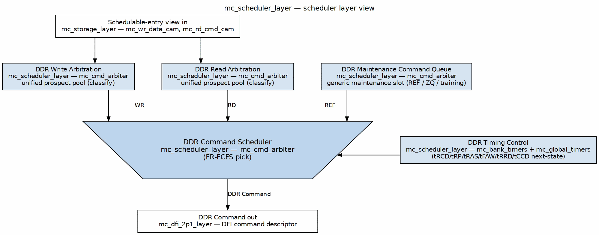

<!-- RTL Design Sherpa Documentation Header -->
<table>
<tr>
<td width="80">
  <a href="https://github.com/sean-galloway/RTLDesignSherpa">
    
  </a>
</td>
<td>
  <strong>RTL Design Sherpa</strong> · <em>Learning Hardware Design Through Practice</em><br>
  <sub>
    <a href="https://github.com/sean-galloway/RTLDesignSherpa">GitHub</a> ·
    <a href="https://github.com/sean-galloway/RTLDesignSherpa/blob/main/docs/DOCUMENTATION_INDEX.md">Documentation Index</a> ·
    <a href="https://github.com/sean-galloway/RTLDesignSherpa/blob/main/LICENSE">MIT License</a>
  </sub>
</td>
</tr>
</table>

---

<!-- End Header -->

# Chapter 4 — Scheduler Layer and Pick Machinery

This chapter documents the common `mc_scheduler_layer` and its pick core `mc_cmd_arbiter`. The surrounding layer-stack and descriptor-seam architecture are defined in the [Hardware Architecture Specification (HAS)](../../common_has/common_has_index.md); this chapter does not restate them.



## 1. Top-level parameters

All parameters are declared at `macro/mc_scheduler_layer.sv:27-56`.

| Parameter | Default | Notes |
|---|---|---|
| `NUM_RANKS` | 1 | Rank count; drives `RKW` and `NUM_CS`. |
| `CMD_HISTORY_EN` | 0 | Enables the wrapper's command-history checker child. |
| `HIST_T_RCD`, `HIST_T_RP`, `HIST_T_RAS`, `HIST_T_RFC`, `HIST_T_WTR`, `HIST_T_RRD`, `HIST_T_FAW`, `HIST_T_RTW` | varies | History-checker timing parameters. |
| `NUM_BANKS` | 8 | Banks per rank; drives `BKW`. |
| `NUM_BG` | 1 | Bank groups; `>1` enables DDR4 L/S windows and `cmd_bg_o`. |
| `ROW_WIDTH` | 14 | Row-address width. |
| `COL_WIDTH` | 10 | Column-address width. |
| `AXI_ID_WIDTH` | 8 | AXI ID width; drives `IW`. |
| `NUM_ENTRIES` | 8 | CAM entries per direction; drives `PTRW`. |
| `AGE_WIDTH` | 16 | Age-counter width. |
| `CMD_FIFO_DEPTH` | 16 | Scheduler-to-DFI command FIFO depth. |
| `CMD_DELAY` | 6 | Fixed token delay between FIFO push and `cmd_valid_o`. |
| `HAS_ZQ` | 1'b0 | Include ZQ calibration branch and tZQCS block. |
| `MAINT_EXTRA_WIDTH` | 1 | Width of `cmd_extra_o` / `maint_extra_i` (pumice=MRR, andesite=MPC[5:0]). |
| `N_LU` | `NUM_BANKS` | Lookup width hint for the wrapper's CAM bank match. |
| `RKW` | derived | `(NUM_RANKS>1) ? $clog2(NUM_RANKS) : 1`. |
| `NUM_CS` | `NUM_RANKS` | Chip-select count for wrapper-side tracking. |
| `CSW` | derived | `(NUM_CS>1) ? $clog2(NUM_CS) : 1`. |
| `BKW` | derived | `$clog2(NUM_BANKS)`. |
| `PTRW` | derived | `$clog2(NUM_ENTRIES)`. |
| `IW` | derived | `AXI_ID_WIDTH`. |
| `BGW_EFF` | derived | `(NUM_BG>1) ? $clog2(NUM_BG) : 1`. |

## 2. Top-level ports

Ports are declared at `macro/mc_scheduler_layer.sv:57-201`.

| Group | Signals | Direction | Width / type | Description |
|---|---|---|---|---|
| Clock/reset | `aclk`, `aresetn` | in | 1 | MC clock and active-low reset. |
| Config | `page_policy_i` | in | `page_policy_e` | OPEN / CLOSE / HAPPY_HYBRID selector. |
| Scheduler CSR | `sched_order_mode_i`, `sched_row_sel_i`, `sched_col_sel_i`, `sched_access_pref_i` | in | 2 each | ORDER mode, row/col select, class preference. |
| Scheduler CSR | `sched_wr_high_wm_i`, `sched_wr_batch_max_i`, `sched_wr_low_wm_i` | in | 8 each | Write-batch watermarks and max. |
| Scheduler CSR | `sched_prio_sub_i`, `sched_qos_en_i` | in | 2, 1 | Read-vs-write tie-break and QoS enable. |
| Page-policy CSR | `page_mode_i`, `page_tr_init_i` | in | 3, 8 | Forwarded to the wrapper's `page_policy` child. |
| Stall telemetry | `stall_bp_o`, `stall_refresh_o`, `stall_turnaround_o`, `stall_tccd_o`, `stall_actlimit_o`, `stall_banktimer_o`, `stall_noreq_o`, `stall_zq_o` | out | 32 each | Per-cause stall counters. |
| Page telemetry | `stat_page_hit_o`, `stat_row_hit_o`, `stat_page_miss_o`, `stat_page_empty_o`, `stat_act_o`, `stat_pre_o`, `stat_ref_o`, `stat_ref_busy_o` | out | 32 / `[NUM_BANKS][32]` | Page/policy telemetry. |
| Timing CSR | `memtype_i` | in | `memtype_e` | DRAM generation selector. |
| Timing CSR | `t_rcd_i`, `t_rp_i`, `t_ras_i`, `t_rc_i`, `t_wr_i`, `t_rtp_i`, `t_faw_i`, `t_rrd_i`, `t_wtr_i`, `t_rtw_i`, `t_ccd_i` | in | 8 each | Core JEDEC timing. |
| Timing CSR | `t_ccd_l_i`, `t_ccd_s_i`, `t_rrd_l_i`, `t_rrd_s_i` | in | 8 each | DDR4 long/short pair timing. |
| Refresh | `refresh_req_i`, `refresh_drain_i`, `refresh_kind_i`, `refresh_bank_i`, `refresh_grant_o`, `t_rfc_i`, `t_rfc_pb_i` | in/out | `BKW`/`16`/`8` | Refresh request/grant/recovery. |
| ZQ | `zq_req_i`, `zq_grant_o`, `t_zqcs_i` | in/out | 1/1/16 | ZQ calibration (present when `HAS_ZQ=1`). |
| Maintenance | `maint_req_i`, `maint_grant_o`, `maint_op_i`, `maint_bank_i`, `maint_row_i`, `maint_col_i`, `maint_extra_i`, `maint_busy_i` | in/out | varies | Generic maintenance/training slot. |
| Init passthrough | `init_done_i`, `init_cmd_valid_i`, `init_cmd_op_i`, `init_cmd_bank_i`, `init_cmd_row_i` | in | varies | Rock-specific init command stream. |
| Page-policy engine | `ap_mode_en_i`, `ap_close_i`, `timeout_pre_req_i`, `timeout_pre_bank_i` | in | 1/`[NUM_BANKS]`/1/`[BKW]` | Runtime AP and timeout-PRE controls. |
| Write CAM | `wr_sch_valid_i`, `wr_sch_bank_i`, `wr_sch_row_i`, `wr_sch_col_i`, `wr_sch_older_i`, `wr_sch_age_exceed_i`, `wr_sch_qos_i`, `wr_sch_head_rel_i`, `wr_commit_ready_i`, `wr_commit_valid_o`, `wr_commit_slot_o` | in/out | varies | Write schedulable-entry vectors and commit handshake. |
| Read CAM | `rd_sch_valid_i`, `rd_sch_bank_i`, `rd_sch_row_i`, `rd_sch_col_i`, `rd_sch_older_i`, `rd_sch_age_exceed_i`, `rd_sch_qos_i`, `rd_sch_head_rel_i`, `rd_issue_ready_i`, `rd_issue_valid_o`, `rd_issue_slot_o` | in/out | varies | Read schedulable-entry vectors and issue handshake. |
| Command output | `cmd_valid_o`, `cmd_ready_i`, `cmd_op_o`, `cmd_rank_o`, `cmd_bank_o`, `cmd_bg_o`, `cmd_row_o`, `cmd_col_o`, `cmd_ap_o`, `cmd_extra_o` | out/in | varies | DFI command descriptor. |
| Bank state | `bank_row_active_o`, `bank_open_row_o` | out | `[NUM_RANKS][NUM_BANKS]`, `[NUM_RANKS][NUM_BANKS][ROW_WIDTH-1:0]` | Registered bank-state image. |
| Status | `busy_o` | out | 1 | `!init_done_i \|\| refresh_req_i \|\| cmd_fifo_valid \|\| any_bank_active`. |
| Pre-FIFO accept | `cmd_accept_o`, `cmd_accept_op_o` | out | 1, `dram_op_e` | Same-cycle accept pulse and opcode. |

## 3. Internal structure

The layer instantiates the blocks at `macro/mc_scheduler_layer.sv:231-457`.

| Instance | Module | Key parameters | Role |
|---|---|---|---|
| `u_bank_timers` | `mc_bank_timers` | `NUM_RANKS`, `NUM_BANKS`, `ROW_WIDTH`, `BANK_LA=4` | Per-bank safe timers and open-row state. |
| `u_global_timers` | `mc_global_timers` | `NUM_BG`, `HAS_LS_PAIRS=(NUM_BG>1)` | Rank/global windows (tFAW, tRRD, tWTR, tRTW, tCCD, L/S pairs). |
| `u_arbiter` | `mc_cmd_arbiter` | `NUM_BG`, `HAS_ZQ`, `MAINT_EXTRA_WIDTH` | Single-issue pick core. |
| `u_cmd_fifo` | `gaxi_fifo_sync` | `DATA_WIDTH=CMD_W`, `DEPTH=CMD_FIFO_DEPTH` | Scheduler-to-DFI command FIFO. |

`busy_o` is `!init_done_i || refresh_req_i || w_cmd_rd_valid || (|w_bank_row_active[0])` (`macro/mc_scheduler_layer.sv:490-491`).

## 4. Schedulable-entry view and unified prospect pool

The arbiter folds the two CAMs into one `POOL = 2*NUM_ENTRIES` vector: upper half writes, lower half reads (`fub/mc_cmd_arbiter.sv:491-501`). Each entry carries `{valid, bank, row, col}` and is classified as column, activate, or precharge against the registered bank image (`fub/mc_cmd_arbiter.sv:537-589`). Column eligibility further requires row hit, per-bank `bank_rdwr_ready`, the forward tCCD guard, safe turnaround, sink-FIFO room, and clear in-flight guards. This unified-pool refactor (adopted from pumice Task 4.5) is bit-identical to the earlier split loops (`../../mc_scheduler_knobs.md` §4.1).

## 5. Generic maintenance slot

Rock-specific training/init/ZQ requesters collapse to a generic maintenance slot: `{maint_req_i, maint_grant_o, maint_op_i, maint_bank_i, maint_row_i, maint_col_i, maint_extra_i, maint_busy_i}` (`macro/mc_scheduler_layer.sv:130-138`). `maint_extra_i` is rock-defined (pumice=MRR, andesite=MPC[5:0]) (`fub/mc_cmd_arbiter.sv:45`; `../../mc_scheduler_knobs.md` §6.3). ZQ keeps its own `zq_req_i`/`zq_grant_o`/`t_zqcs_i` because the tZQCS window must block every other command (`fub/mc_cmd_arbiter.sv:96-101`).

## 6. Bank and global timer parameterization

`mc_bank_timers` stamps one `mc_bank_timer` per `(rank,bank)` with advisory lookahead `BANK_LA=4` (`fub/mc_bank_timers.sv:29-35`; `fub/mc_bank_timer.sv:41-44`). Each timer is FSM-free — preset/decrement counters plus a row-open register — so a just-issued command is reflected one cycle later (`fub/mc_bank_timer.sv:15-17`).

`mc_global_timers` exposes DDR4 L/S windows via `NUM_BG`, `BGW`, and `HAS_LS_PAIRS` (`fub/mc_global_timers.sv:33-44`). The layer derives `HAS_LS_PAIRS = (NUM_BG > 1)` and takes the fired command's bank group from the upper bits of `evt_bank` (`macro/mc_scheduler_layer.sv:272-274`). When `HAS_LS_PAIRS=0` the L/S readiness outputs tie to 1 (`fub/mc_global_timers.sv:341-346`).

## 7. Output command descriptor

The FIFO write data is packed `{ap, col, row, bg, bank, rank, extra, op}` (`macro/mc_scheduler_layer.sv:441-443`) and unpacked in the same order at the output (`macro/mc_scheduler_layer.sv:484-485`). The `extra` field carries the maintenance value for generic maintenance commands; otherwise it is zero. This is the scheduler-side seam; DFI-generation packing is described in [DFI Boundary Lineage](../../03_dfi_boundary_lineage.md).

## 8. Fire-stage authority

The output stage is the sole timing authority. A registered pick fires only when the live per-bank and global readiness agree:

```
ACT:  bank_act_ready_i && tfaw_ok_i && trrd_ok_i && w_trrd_ls_ok && !w_zq_busy && !maint_busy_i
RD/WR: bank_rdwr_ready_i && w_tccd_ls_ok && !w_zq_busy && !maint_busy_i
PRE:  bank_pre_ready_i && !w_zq_busy && !maint_busy_i
```

These terms are at `fub/mc_cmd_arbiter.sv:294-306`. Upstream classify and STAGE-1b masks are advisory.

A pick that fails the live check is normally **dropped**, not held, because CAM commit/issue are qualified by `w_fire_out` and the entry stays schedulable (`fub/mc_cmd_arbiter.sv:252-257`). The single exception is an ACT blocked **only** by the rank-global tFAW/tRRD windows: `w_out_hold` keeps that ACT in the output register (`fub/mc_cmd_arbiter.sv:307-311`). This exception is measured history:

- **pumice BUG-021**: dropping such an ACT regressed close-page throughput from the accepted 30.77% calibration to 18.57%; holding recovered to 30.14% (`fub/mc_cmd_arbiter.sv:259-265`; `../../mc_scheduler_knobs.md` §6.4).
- **scoria BUG-001**: 3/3 seeds failed with a global tRRD violation ("ACT only 1 cyc after another ACT"), leading to the `tfaw_ok_i`/`trrd_ok_i` fire-stage re-check (`fub/mc_cmd_arbiter.sv:267-268`; `../../mc_scheduler_knobs.md` §6.4).
- **ISSUE-002**: moving tFAW/tRRD to the classify mask drained the 3-stage pipeline and dropped close-page throughput from 30.77% to ~18% (`fub/mc_cmd_arbiter.sv:513-518`; `../../mc_scheduler_knobs.md` §6.4).

Other proven guard terms:

- **ONE-CYCLE BLIND SPOT**: turnaround history registers load the cycle after a fire, so a command picked in the same cycle another fires sees stale history. The fix adds an in-flight fire term to the live turnaround equations (`fub/mc_cmd_arbiter.sv:849-858`; `fub/mc_global_timers.sv:100-124`).
- **Parked-victim PRE guard**: a PRE leaves the registered row image stale for up to three cycles; a column picked against it lands on the closed row and wedges the AR-order drain. The column mask includes `!w_pre_col_guard` (`fub/mc_cmd_arbiter.sv:441-453`).
- **BUG-002 / tZQCS fire-stage block**: the tZQCS counter loads on accepted fire, so a classify-time check is one cycle early. Every demand-class fire gate includes `!w_zq_busy` (`fub/mc_cmd_arbiter.sv:278-284`). Refresh is placed above ZQ in the priority cone because inside tZQCS the refresh branch cannot run; `w_ref_safe` carries `!w_rfc_busy`, while refresh is kept out of the ZQ window by cone priority, and the code warns not to "tidy" this into symmetry (`fub/mc_cmd_arbiter.sv:1104-1116`, `1378-1386`).

## 9. Page-policy context

The auto-precharge decision is `w_ap = (page_policy_i == PAGE_POLICY_CLOSE)` unless the runtime engine is enabled, in which case it is per-bank via `ap_close_i[b]` (`fub/mc_cmd_arbiter.sv:197-202`). `PAGE_POLICY_HAPPY_HYBRID` was retired and maps to OPEN in the current build ([pumice scheduler MAS](../../../../research-ip/pumice-ddr2-lpddr2/docs/pumice_mas/ch02_blocks/07_scheduler.md), lines 200-201). The wrapper's `page_policy` child supplies `ap_mode_en_i`, `ap_close_i`, `timeout_pre_req_i`, and `timeout_pre_bank_i`.

## 10. P1 init accept/ack gating

For DDR4 P1 init the wrapper must ack the `init_sequencer` in the same cycle the arbiter accepts the command. Because the arbiter's registered pick re-arms every cycle, a held init request would be picked twice, producing MRS twins one cycle apart. The wrapper gates `init_cmd_valid_i` with a combinational accept pulse from `cmd_accept_o`/`cmd_accept_op_o` (`macro/mc_scheduler_layer.sv:199-200`; `../../../../research-ip/andesite-ddr4-lpddr4/rtl/macro/andesite_scheduler_layer.sv:255-269`; `../../mc_scheduler_knobs.md` §6.4).

## 11. Open questions

- The exact encodings of `page_mode_i` and `page_tr_init_i` are consumed by the wrapper's `page_policy` child, not by `mc_scheduler_layer`; this chapter treats them as opaque forwarded CSRs.
- Multi-rank arbitration is fixed at `RK0 = 0` in `mc_cmd_arbiter.sv:194`; whether the same fire-stage authority scales to `NUM_RANKS > 1` is not exercised by the present core.

## References

- Rixner, Dally, Kapasi, Mattson, Owens, "Memory Access Scheduling," ISCA 2000. [PDF](../../../../references/MemoryAccessScheduling__Rixner2000.pdf)
- Mutlu, Moscibroda, "Stall-Time Fair Memory Access Scheduling for Chip Multiprocessors," MICRO 2007. [PDF](../../../../references/StallTimeFairMemoryScheduling__Mutlu2007.pdf)
- Tomasulo, "An Efficient Algorithm for Exploiting Multiple Arithmetic Units," IBM JRD 1967. [PDF](../../../../references/MultipleArithmeticUnits__Tomasulo1967.pdf) (conceptual convergence: schedulable-entry view)
