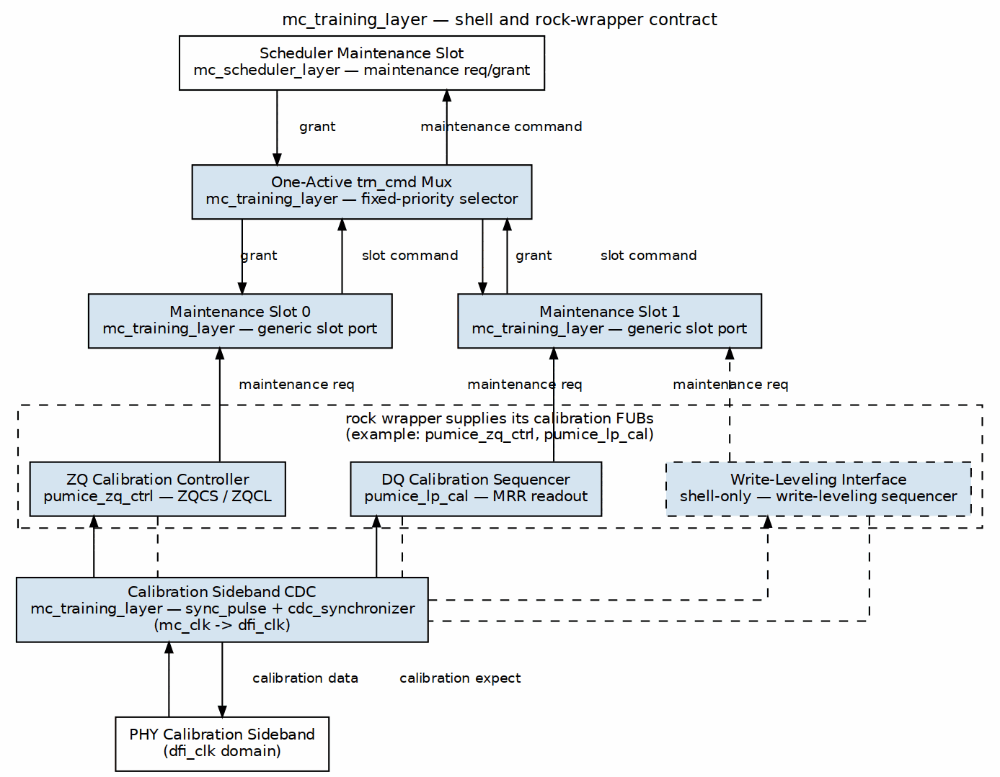

<!-- RTL Design Sherpa Documentation Header -->
<table>
<tr>
<td width="80">
  
</td>
<td>
  <strong>RTL Design Sherpa</strong> · <em>Learning Hardware Design Through Practice</em> 
  
    <a href="https://github.com/sean-galloway/RTLDesignSherpa">GitHub</a> ·
    <a href="https://github.com/sean-galloway/RTLDesignSherpa/blob/main/docs/DOCUMENTATION_INDEX.md">Documentation Index</a> ·
    <a href="https://github.com/sean-galloway/RTLDesignSherpa/blob/main/LICENSE">MIT License</a>
  
</td>
</tr>
</table>

---

<!-- End Header -->

# `mc_training_layer` — shell and rock-wrapper contract

**Module:** `mc_training_layer.sv`  
**Location:** `common-ip/rtl/macro/`  
**Category:** Layer-4 training shell (maintenance-traffic client)  
**Status:** implemented; exercised only by the pumice wrapper today

The layer-stack role of this block — where it sits between the scheduler and the PHY calibration sideband — is defined in the family architecture book ([common_has](../../common_has/common_has_index.md)). This chapter describes only the shell implementation and the contract it imposes on rock wrappers.

## What the shell provides

`mc_training_layer` is a dependency-inverted shell. It does not instantiate training algorithms; it exposes a fixed-priority maintenance-slot bus, a single generic `trn_cmd` output, and the `mc_clk`/`dfi_clk` clock crossings that calibration sideband data must use. The actual training children (ZQ controllers, DQ calibrators, future CA-train or write-leveling sequencers) are instantiated rock-side and wired into the slot ports (`macro/mc_training_layer.sv:8-13`).

### Maintenance-slot client interface

The shell presents `NUM_SLOTS` request/grant slots to the rock wrapper. The highest-priority requesting slot drives the generic `trn_cmd_*` output to the scheduler; lower-priority slots wait. Priority is fixed, not round-robin: slot 0 > slot 1 > ... > slot `NUM_SLOTS-1` (`macro/mc_training_layer.sv:67-77`). Grant is broadcast back only to the selected slot: `slot_grant_o[g] = slot_req_i[g] && trn_cmd_grant_i && (w_sel == g)` (`macro/mc_training_layer.sv:85-90`).

### One-active `trn_cmd` mux

Only one slot's payload reaches the scheduler at a time. The output command is assembled directly from the selected slot's `slot_op_i`, `slot_bank_i`, `slot_row_i`, and `slot_extra_i` (`macro/mc_training_layer.sv:79-83`). The shell never re-encodes the command; it is the rock wrapper's job to place the correct opcode, bank, row, and extra bit (for example an MRR flag) on each slot.

### `mc_clk`/`dfi_clk` CDC placement

All calibration-sideband crossing for the training layer lives inside the shell, using the repo's standard cells:

- `cal_expect_i` (mc_clk domain) crosses down to `cal_expect_o` (dfi_clk domain) through `sync_pulse` with three stages (`macro/mc_training_layer.sv:97-104`).
- `cal_data_i` (dfi_clk domain) crosses up to `cal_data_o` (mc_clk domain) through `cdc_synchronizer` with `WIDTH = CAL_DATA_WIDTH` and three flops (`macro/mc_training_layer.sv:106-111`).
- `cal_valid_i` (dfi_clk domain) crosses up to `cal_valid_o` (mc_clk domain) through `sync_pulse` with three stages (`macro/mc_training_layer.sv:113-120`).

This placement keeps every training child rock-side in a single clock domain; the wrapper only wires the `cal_expect`/`cal_data`/`cal_valid` signals through the shell.

## Boundary doctrine: training searches stay PHY-side

The common training layer owns the JEDEC maintenance-command sequencing and the calibration-control CSR plane. The actual delay-tap, bitslip, and phase-search mechanisms stay on the PHY side of the documented contract (`../../phy_cal_csr_contract.md`). In other words, the core issues ZQCS/ZQCL and MRR commands and captures returned beats; firmware plus the PHY walk the taps and compare patterns.

## Parameters

| Parameter | Type | Default | Description |
|-----------|------|---------|-------------|
| `NUM_SLOTS` | `int` | none | Number of fixed-priority maintenance slots. Set by the rock wrapper. (`macro/mc_training_layer.sv:30`) |
| `BKW` | `int` | 3 | Bank field width for `slot_bank_i` and `trn_cmd_bank_o`. (`macro/mc_training_layer.sv:31`) |
| `ROW_WIDTH` | `int` | 14 | Row field width for `slot_row_i` and `trn_cmd_row_o`. (`macro/mc_training_layer.sv:32`) |
| `EXTRA_WIDTH` | `int` | 1 | Side-band width per slot; the wrapper decides its meaning (pumice uses it as an MRR flag). (`macro/mc_training_layer.sv:33`) |
| `CAL_DATA_WIDTH` | `int` | 1 | Width of `cal_data_i`/`cal_data_o`; set to the DFI read-data width by the wrapper. (`macro/mc_training_layer.sv:34`) |

## Ports

### Clock and reset

| Signal | Direction | Width | Description |
|--------|-----------|-------|-------------|
| `mc_clk` | in | 1 | Controller clock. (`macro/mc_training_layer.sv:35`) |
| `mc_rst_n` | in | 1 | Active-low reset. (`macro/mc_training_layer.sv:36`) |

### Runtime enable / build guard

| Signal | Direction | Width | Description |
|--------|-----------|-------|-------------|
| `init_done_i` | in | 1 | Training FUBs run only after DRAM init completes. (`macro/mc_training_layer.sv:39`) |
| `memtype_i` | in | `memtype_e` | DRAM type (DDR2 / LPDDR2). (`macro/mc_training_layer.sv:40`) |

### CSR controls

| Signal | Direction | Width | Description |
|--------|-----------|-------|-------------|
| `zq_en_i` | in | 1 | Enable periodic LPDDR2 ZQ calibration. (`macro/mc_training_layer.sv:43`) |
| `zq_defer_en_i` | in | 1 | Enable demand-deferred ZQ placement. (`macro/mc_training_layer.sv:44`) |
| `zq_interval_i` | in | 32 | ZQCS interval in controller clocks. (`macro/mc_training_layer.sv:45`) |
| `t_zqcs_i` | in | 16 | ZQCS command post-grant hold time. (`macro/mc_training_layer.sv:46`) |
| `t_zqcl_i` | in | 16 | ZQCL command post-grant hold time. (`macro/mc_training_layer.sv:47`) |
| `zq_overdue_max_i` | in | 13 | Overdue-escalation threshold to ZQCL. (`macro/mc_training_layer.sv:48`) |
| `cal_start_i` | in | 1 | One-shot start for LPDDR2 DQ calibration. (`macro/mc_training_layer.sv:50`) |
| `cal_abort_i` | in | 1 | Abort in-flight DQ calibration. (`macro/mc_training_layer.sv:51`) |
| `t_mrr_i` | in | 16 | MRR command interval. (`macro/mc_training_layer.sv:52`) |
| `t_readout_i` | in | 16 | Readout capture window. (`macro/mc_training_layer.sv:53`) |

### Maintenance command channel to the scheduler

| Signal | Direction | Width | Description |
|--------|-----------|-------|-------------|
| `trn_cmd_req_o` | out | 1 | Aggregate maintenance request. (`macro/mc_training_layer.sv:56`) |
| `trn_cmd_grant_i` | in | 1 | Arbiter grant. (`macro/mc_training_layer.sv:57`) |
| `trn_cmd_op_o` | out | `dram_op_e` | Opcode of the selected slot. (`macro/mc_training_layer.sv:58`) |
| `trn_cmd_bank_o` | out | `BKW` | Bank of the selected slot. (`macro/mc_training_layer.sv:59`) |
| `trn_cmd_row_o` | out | `ROW_WIDTH` | Row of the selected slot. (`macro/mc_training_layer.sv:60`) |
| `trn_cmd_mrr_o` | out | 1 | MRR side-band flag to the scheduler. (`macro/mc_training_layer.sv:61`) |

### DFI-layer calibration sideband

| Signal | Direction | Width | Description |
|--------|-----------|-------|-------------|
| `dfi_clk` | in | 1 | DFI/PHY clock. (`macro/mc_training_layer.sv:64`) |
| `dfi_rstn` | in | 1 | Active-low DFI reset. (`macro/mc_training_layer.sv:65`) |
| `cal_expect_o` | out | 1 | dfi_clk-domain arm pulse to the PHY/read aligner. (`macro/mc_training_layer.sv:66`) |
| `cal_data_i` | in | `CAL_DATA_WIDTH` | dfi_clk-domain captured beat. (`macro/mc_training_layer.sv:67`) |
| `cal_valid_i` | in | 1 | dfi_clk-domain "data landed" pulse. (`macro/mc_training_layer.sv:68`) |

### Telemetry / status

| Signal | Direction | Width | Description |
|--------|-----------|-------|-------------|
| `cal_busy_o` | out | 1 | Either training client is active. (`macro/mc_training_layer.sv:71`) |
| `cal_done_o` | out | 1 | DQ calibration completed (sticky). (`macro/mc_training_layer.sv:72`) |
| `cal_err_o` | out | 1 | DQ calibration error (sticky). (`macro/mc_training_layer.sv:73`) |
| `mrr32_data_o` | out | `CAL_DATA_WIDTH` | Captured MR32 read data. (`macro/mc_training_layer.sv:74`) |
| `mrr40_data_o` | out | `CAL_DATA_WIDTH` | Captured MR40 read data. (`macro/mc_training_layer.sv:75`) |
| `zq_busy_o` | out | 1 | ZQ calibration is active. (`macro/mc_training_layer.sv:76`) |
| `zq_overdue_o` | out | 1 | ZQ is overdue. (`macro/mc_training_layer.sv:77`) |
| `zqcs_total_o` | out | 16 | Count of completed ZQCS operations. (`macro/mc_training_layer.sv:78`) |

## Rock-wrapper contract

A rock wrapper must:

1. Instantiate its training FUBs rock-side.
2. Map each FUB onto one `slot_req_i`/`slot_grant_o` position.
3. Drive the FUB's opcode, bank, row, and any side-band flag onto the slot fields.
4. Set `NUM_SLOTS`, `BKW`, `ROW_WIDTH`, `EXTRA_WIDTH`, and `CAL_DATA_WIDTH` to match the FUBs and the DFI width.
5. Connect the wrapper's `trn_cmd_*` ports to the scheduler's maintenance-command port byte-for-byte.

The shell is therefore width-agnostic and personality-agnostic: it arbitrates whatever the wrapper places on the slots. Run gating (`init_done`, `memtype`) and JEDEC command packing live in the rock FUBs, not in the shell.

### Pumice example

`pumice_training_layer` is the first and only wrapper. It binds slot 0 to `pumice_zq_ctrl` and slot 1 to `pumice_lp_cal` (`research-ip/pumice-ddr2-lpddr2/rtl/macro/pumice_training_layer.sv:161-168`).

| Slot | FUB | Priority | Command shape | `slot_extra` meaning |
|------|-----|----------|---------------|----------------------|
| 0 | `pumice_zq_ctrl` | highest | MRW to MR10 (`OP_MRS`, row `{4'd0, MR10, OP}`) | `1'b0` (not MRR) |
| 1 | `pumice_lp_cal` | lowest | MRR to MR32/MR40 (`OP_MRS`, row `{4'd0, MA, 8'd0}`) | `1'b1` (MRR flag) |

The wrapper maps the shell's `trn_cmd_extra_o` to its own `trn_cmd_mrr_o` (`research-ip/pumice-ddr2-lpddr2/rtl/macro/pumice_training_layer.sv:196`). The ZQ and lp_cal FUBs are documented in the pumice MAS: [`pumice_zq_ctrl`](../../../../research-ip/pumice-ddr2-lpddr2/docs/pumice_mas/ch02_blocks/23_zq_ctrl.md), [`pumice_lp_cal`](../../../../research-ip/pumice-ddr2-lpddr2/docs/pumice_mas/ch02_blocks/24_lp_cal.md), and the wrapper chapter [`pumice_training_layer`](../../../../research-ip/pumice-ddr2-lpddr2/docs/pumice_mas/ch02_macros/05_training_layer_macro.md). The macro-level uarch note is in [`PUMICE_TRAINING_LAYER_UARCH.md`](../../../../research-ip/pumice-ddr2-lpddr2/docs/uarch/PUMICE_TRAINING_LAYER_UARCH.md).

## ZQCS placement as a maintenance client

ZQ calibration is a maintenance-class request: it raises `slot_req_i[0]`, waits for `slot_grant_o[0]`, and never preempts an in-flight demand command. The pumice wrapper preserves the BUG-003 discipline inherited from `pumice_zq_ctrl`: the arbiter gates demand-class traffic during the post-grant hold so that `w_fire_out == cmd_valid_o && cmd_ready_i` holds by construction, and the training layer never touches the pick cone (pumice MAS [`23_zq_ctrl`](../../../../research-ip/pumice-ddr2-lpddr2/docs/pumice_mas/ch02_blocks/23_zq_ctrl.md)).

In the current pumice wrapper, `pumice_zq_ctrl.demand_i` is tied to `1'b0` (`research-ip/pumice-ddr2-lpddr2/rtl/macro/pumice_training_layer.sv:119`). This means the Mode-C deferral entry condition (`zq_defer_en_i && demand_i`) can never fire, the overdue/ZQCL escalation path is dormant, and `obs_overdue_o` never sets. The FSM keeps the policy; it needs only one wire change to make it live.

## Shell-only versus pumice-proven

| Capability | Provenance |
|------------|------------|
| 2-slot fixed-priority arbitration | pumice-proven (`pumice_training_layer.sv`) |
| Generic `trn_cmd_*` output mapped to scheduler maintenance port | pumice-proven |
| `sync_pulse` + `cdc_synchronizer` calibration sideband crossing | pumice-proven at `CAL_DATA_WIDTH = 128` |
| `NUM_SLOTS > 2` | shell-only; no rock exercises it |
| `EXTRA_WIDTH > 1` or multi-bit side-band semantics | shell-only |
| Re-arbitration/round-robin policy | shell-only; not implemented |
| Multi-rank ZQ overlap policy | shell-only; pumice is single-rank |
| Using `cal_expect_i` from more than one slot | shell-only; pumice feeds it only from `lp_cal` |

## Open questions

- **Demand wiring for Mode-C ZQ placement.** Should the shell expose a `demand_i` pass-through so that rock wrappers can feed the scheduler's demand indicator into `pumice_zq_ctrl` without wrapper-specific tie-offs?
- **Slot-width defaults.** `BKW` and `ROW_WIDTH` have no defaults in the shell; a future wrapper must override them. Is the default `EXTRA_WIDTH = 1` still useful once MRR flags graduate to a dedicated scheduler field?
- **Multi-slot cal_expect.** If a wrapper ever places more than one calibration child that needs `cal_expect_o`, the shell's single `cal_expect_i` must be muxed or widened. No design exists yet.
