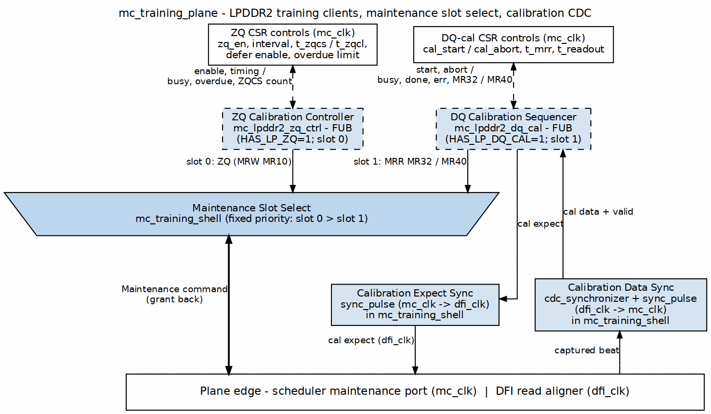

<!-- RTL Design Sherpa Documentation Header -->
<table>
<tr>
<td width="80">
  
</td>
<td>
  <strong>RTL Design Sherpa</strong> · <em>Learning Hardware Design Through Practice</em> 
  
    <a href="https://github.com/sean-galloway/RTLDesignSherpa">GitHub</a> ·
    <a href="https://github.com/sean-galloway/RTLDesignSherpa/blob/main/docs/DOCUMENTATION_INDEX.md">Documentation Index</a> ·
    <a href="https://github.com/sean-galloway/RTLDesignSherpa/blob/main/LICENSE">MIT License</a>
  
</td>
</tr>
</table>

---

<!-- End Header -->

# `mc_training_plane` — LPDDR2 training clients on the generic shell

**Modules:** `mc_training_plane.sv`, `mc_training_shell.sv`  
**Location:** `common-ip/rtl/macro/`  
**Category:** Plane-4 training plane (maintenance-traffic client)  
**Status:** implemented; instantiated directly by `pumice_core` (both clients enabled)

The plane-stack role of this block — where it sits between the scheduler and the PHY calibration sideband — is defined in the family architecture book ([common_has](../../common_has/common_has_index.md)). This chapter describes the plane's composition, the generic shell inside it, and how a product configures it.

## Composition

`mc_training_plane` is two layers (`macro/mc_training_plane.sv:7-15`):

- **The LPDDR2 training clients**, each behind a build parameter: `mc_lpddr2_zq_ctrl` (`u_zq`, slot 0, `HAS_LP_ZQ`) and `mc_lpddr2_dq_cal` (`u_lp_cal`, slot 1, `HAS_LP_DQ_CAL`) (`macro/mc_training_plane.sv:112-195`). With a parameter at 0 the client is not elaborated, its slot request is tied low, and its status outputs read 0.
- **`mc_training_shell`** (`u_shell`), the generic, dependency-inverted part: a fixed-priority maintenance-slot bus, a single generic `trn_cmd` output, and the `mc_clk`/`dfi_clk` calibration-data crossing (`macro/mc_training_shell.sv:7-16`). Its `slot_*` ports are internal to the plane; the plane drives them from the clients (`macro/mc_training_plane.sv:200-225`).

The plane, not a product wrapper, owns the slot mapping, the command shapes, and the sideband wiring. A product chooses only parameters. Further training children (CA training, write leveling) would be added as more slots on the shell.

### Slot mapping

| Slot | Client | Priority | Command shape | `slot_extra` (MRR flag) |
|------|--------|----------|---------------|-------------------------|
| 0 | `mc_lpddr2_zq_ctrl` | highest | MRW to MR10 (`OP_MRS`, row `{4'd0, MR10, OP}`, OP `0x56` ZQCS / `0xAB` ZQCL) | `1'b0` |
| 1 | `mc_lpddr2_dq_cal` | lowest | MRR to MR32 then MR40 (`OP_MRS`, row from `mrr_row(MA)`) | `1'b1` |

ZQ is periodic maintenance and outranks DQ calibration, which is a firmware-initiated one-shot. For `NUM_SLOTS == 2` the mapping is fixed; for other values the plane assigns ZQ to slot 0 and DQ calibration to slot 1, sets `slot_extra[s] = s[0]`, and leaves any further slots idle (`macro/mc_training_plane.sv:212-223`). The shell's `trn_cmd_extra_o[0]` leaves the plane as `trn_cmd_mrr_o` (`macro/mc_training_plane.sv:265`).

### Maintenance-slot arbitration (shell)

The highest-priority requesting slot drives the generic `trn_cmd_*` output to the scheduler; lower-priority slots wait. Priority is fixed, not round-robin: slot 0 > slot 1 > ... > slot `NUM_SLOTS-1` (`macro/mc_training_shell.sv:64-74`). Grant is returned only to the selected slot: `slot_grant_o[g] = slot_req_i[g] && trn_cmd_grant_i && (w_sel == g)` (`macro/mc_training_shell.sv:80-85`).

### One-active `trn_cmd` mux (shell)

Only one slot's payload reaches the scheduler at a time. The output command is assembled directly from the selected slot's `slot_op_i`, `slot_bank_i`, `slot_row_i`, and `slot_extra_i` (`macro/mc_training_shell.sv:75-78`). The shell never re-encodes the command; the clients produce the opcode, bank, row, and MRR flag.

### `mc_clk`/`dfi_clk` CDC placement (shell)

All calibration-sideband crossing for the plane lives inside the shell, using the repo's standard cells:

- `cal_expect` (mc_clk domain, from `mc_lpddr2_dq_cal`) crosses down to `cal_expect_o` (dfi_clk domain) through `sync_pulse` with three stages (`macro/mc_training_shell.sv:90-97`).
- `cal_data_i` (dfi_clk domain) crosses up to the mc_clk domain through `cdc_synchronizer` with `WIDTH = CAL_DATA_WIDTH` and three flops (`macro/mc_training_shell.sv:99-104`).
- `cal_valid_i` (dfi_clk domain) crosses up to the mc_clk domain through `sync_pulse` with three stages (`macro/mc_training_shell.sv:106-113`).

The synchronized data and valid feed `mc_lpddr2_dq_cal` directly, so both clients run entirely in the mc_clk domain.

### Status aggregation

`cal_busy_o = zq_busy_o || dq_cal busy`; `cal_done_o`, `cal_err_o`, `mrr32_data_o` and `mrr40_data_o` come from `mc_lpddr2_dq_cal`; `zq_busy_o`, `zq_overdue_o` and `zqcs_total_o` from `mc_lpddr2_zq_ctrl` (`macro/mc_training_plane.sv:270-274`).

## Boundary doctrine: training searches stay PHY-side

The common training plane owns the JEDEC maintenance-command sequencing and the calibration-control CSR plane. The actual delay-tap, bitslip, and phase-search mechanisms stay on the PHY side of the documented contract (`../../phy_cal_csr_contract.md`). In other words, the core issues ZQ (MRW to MR10) and MRR commands and captures returned beats; firmware plus the PHY walk the taps and compare patterns.

## Parameters

| Parameter | Type | Default | Description |
|-----------|------|---------|-------------|
| `NUM_SLOTS` | `int` | 2 | Number of fixed-priority maintenance slots on the shell. (`macro/mc_training_plane.sv:27`) |
| `BKW` | `int` | 3 | Bank field width for the slots and `trn_cmd_bank_o`. (`macro/mc_training_plane.sv:28`) |
| `ROW_WIDTH` | `int` | 14 | Row field width for the slots and `trn_cmd_row_o`. (`macro/mc_training_plane.sv:29`) |
| `EXTRA_WIDTH` | `int` | 1 | Side-band width per slot; bit 0 is the MRR flag. (`macro/mc_training_plane.sv:30`) |
| `CAL_DATA_WIDTH` | `int` | 1 | Width of `cal_data_i` and the captured MRR data; set to the DFI read-data width. (`macro/mc_training_plane.sv:31`) |
| `HAS_LP_ZQ` | `bit` | 1 | Build `mc_lpddr2_zq_ctrl` on slot 0. (`macro/mc_training_plane.sv:32`) |
| `HAS_LP_DQ_CAL` | `bit` | 1 | Build `mc_lpddr2_dq_cal` on slot 1. (`macro/mc_training_plane.sv:33`) |

## Ports

### Clock and reset

| Signal | Direction | Width | Description |
|--------|-----------|-------|-------------|
| `mc_clk` | in | 1 | Controller clock. (`macro/mc_training_plane.sv:35`) |
| `mc_rst_n` | in | 1 | Active-low reset. (`macro/mc_training_plane.sv:36`) |

### Runtime enable / build guard

| Signal | Direction | Width | Description |
|--------|-----------|-------|-------------|
| `init_done_i` | in | 1 | Training FUBs run only after DRAM init completes. (`macro/mc_training_plane.sv:39`) |
| `memtype_i` | in | `memtype_e` | DRAM type (DDR2 / LPDDR2). (`macro/mc_training_plane.sv:40`) |

### CSR controls

| Signal | Direction | Width | Description |
|--------|-----------|-------|-------------|
| `zq_en_i` | in | 1 | Enable periodic LPDDR2 ZQ calibration. (`macro/mc_training_plane.sv:43`) |
| `zq_defer_en_i` | in | 1 | Enable demand-deferred ZQ placement. (`macro/mc_training_plane.sv:44`) |
| `zq_interval_i` | in | 32 | ZQCS interval in controller clocks. (`macro/mc_training_plane.sv:45`) |
| `t_zqcs_i` | in | 16 | ZQCS command post-grant hold time. (`macro/mc_training_plane.sv:46`) |
| `t_zqcl_i` | in | 16 | ZQCL command post-grant hold time. (`macro/mc_training_plane.sv:47`) |
| `zq_overdue_max_i` | in | 13 | Overdue-escalation threshold to ZQCL. (`macro/mc_training_plane.sv:48`) |
| `cal_start_i` | in | 1 | One-shot start for LPDDR2 DQ calibration. (`macro/mc_training_plane.sv:50`) |
| `cal_abort_i` | in | 1 | Abort in-flight DQ calibration. (`macro/mc_training_plane.sv:51`) |
| `t_mrr_i` | in | 16 | MRR command interval. (`macro/mc_training_plane.sv:52`) |
| `t_readout_i` | in | 16 | Readout capture window. (`macro/mc_training_plane.sv:53`) |

### Maintenance command channel to the scheduler

| Signal | Direction | Width | Description |
|--------|-----------|-------|-------------|
| `trn_cmd_req_o` | out | 1 | Aggregate maintenance request. (`macro/mc_training_plane.sv:56`) |
| `trn_cmd_grant_i` | in | 1 | Arbiter grant. (`macro/mc_training_plane.sv:57`) |
| `trn_cmd_op_o` | out | `dram_op_e` | Opcode of the selected slot. (`macro/mc_training_plane.sv:58`) |
| `trn_cmd_bank_o` | out | `BKW` | Bank of the selected slot. (`macro/mc_training_plane.sv:59`) |
| `trn_cmd_row_o` | out | `ROW_WIDTH` | Row of the selected slot. (`macro/mc_training_plane.sv:60`) |
| `trn_cmd_mrr_o` | out | 1 | MRR side-band flag to the scheduler. (`macro/mc_training_plane.sv:61`) |

### DFI-plane calibration sideband

| Signal | Direction | Width | Description |
|--------|-----------|-------|-------------|
| `dfi_clk` | in | 1 | DFI/PHY clock. (`macro/mc_training_plane.sv:64`) |
| `dfi_rstn` | in | 1 | Active-low DFI reset. (`macro/mc_training_plane.sv:65`) |
| `cal_expect_o` | out | 1 | dfi_clk-domain arm pulse to the PHY/read aligner. (`macro/mc_training_plane.sv:66`) |
| `cal_data_i` | in | `CAL_DATA_WIDTH` | dfi_clk-domain captured beat. (`macro/mc_training_plane.sv:67`) |
| `cal_valid_i` | in | 1 | dfi_clk-domain "data landed" pulse. (`macro/mc_training_plane.sv:68`) |

### Telemetry / status

| Signal | Direction | Width | Description |
|--------|-----------|-------|-------------|
| `cal_busy_o` | out | 1 | Either training client is active. (`macro/mc_training_plane.sv:71`) |
| `cal_done_o` | out | 1 | DQ calibration completed (sticky). (`macro/mc_training_plane.sv:72`) |
| `cal_err_o` | out | 1 | DQ calibration error (sticky). (`macro/mc_training_plane.sv:73`) |
| `mrr32_data_o` | out | `CAL_DATA_WIDTH` | Captured MR32 read data. (`macro/mc_training_plane.sv:74`) |
| `mrr40_data_o` | out | `CAL_DATA_WIDTH` | Captured MR40 read data. (`macro/mc_training_plane.sv:75`) |
| `zq_busy_o` | out | 1 | ZQ calibration is active. (`macro/mc_training_plane.sv:76`) |
| `zq_overdue_o` | out | 1 | ZQ is overdue. (`macro/mc_training_plane.sv:77`) |
| `zqcs_total_o` | out | 16 | Count of completed ZQCS operations. (`macro/mc_training_plane.sv:78`) |

## Product integration

A product instantiates `mc_training_plane` directly and:

1. Chooses its clients with `HAS_LP_ZQ` / `HAS_LP_DQ_CAL`.
2. Sets `BKW`, `ROW_WIDTH`, `EXTRA_WIDTH` to match its scheduler's maintenance slot, and `CAL_DATA_WIDTH` to its DFI read-data width.
3. Connects `trn_cmd_*` to the scheduler's generic maintenance slot (`maint_req_i` / `maint_grant_o` / `maint_op_i` / `maint_bank_i` / `maint_row_i`, with `trn_cmd_mrr_o` on `maint_extra_i[0]` and `cal_busy_o` on `maint_busy_i`).
4. Connects `cal_expect_o` / `cal_data_i` / `cal_valid_i` to the DFI plane's read-aligner calibration sideband, and the CSR controls and status to its register block.

Run gating (`init_done`, `memtype == LPDDR2`) and JEDEC command packing live in the client FUBs, not in the shell, so a DDR2 run leaves the plane inert without a rebuild.

### Pumice

`pumice_core` instantiates the plane as `u_train_plane` with `NUM_SLOTS = 2`, `EXTRA_WIDTH = 1`, `CAL_DATA_WIDTH = DFI_DATA_WIDTH`, and both clients enabled (`research-ip/pumice-ddr2-lpddr2/rtl/top/pumice_core.sv:756-797`). Until 2026-10-11 pumice reached the shell through its own `pumice_training_plane` wrapper around pumice-local `pumice_zq_ctrl` / `pumice_lp_cal`; those FUBs became `mc_lpddr2_zq_ctrl` / `mc_lpddr2_dq_cal`, the composition moved into this plane, and the wrapper was removed. The clients' behaviour and measured history are still documented in the pumice MAS ([ZQ control](../../../../research-ip/pumice-ddr2-lpddr2/docs/pumice_mas/ch02_blocks/23_zq_ctrl.md), [DQ calibration](../../../../research-ip/pumice-ddr2-lpddr2/docs/pumice_mas/ch02_blocks/24_lp_cal.md)) and the pumice HAS [Training chapter](../../../../research-ip/pumice-ddr2-lpddr2/docs/pumice_has/ch03_architecture/09_training.md).

## ZQ placement as a maintenance client

ZQ calibration is a maintenance-class request: it raises slot 0, waits for its grant, and never preempts an in-flight demand command. The plane preserves the BUG-003 discipline: the scheduler holds demand-class traffic during the post-grant hold (`cal_busy_o` onto `maint_busy_i`, folded into the fire stage) so that `w_fire_out == cmd_valid_o && cmd_ready_i` holds by construction, and the training plane never touches the pick cone (pumice MAS [`23_zq_ctrl`](../../../../research-ip/pumice-ddr2-lpddr2/docs/pumice_mas/ch02_blocks/23_zq_ctrl.md)).

`mc_lpddr2_zq_ctrl.demand_i` is tied to `1'b0` inside the plane (`macro/mc_training_plane.sv:125`). This means the Mode-C deferral entry condition (`zq_defer_en_i && demand_i`) can never fire, the overdue/ZQCL escalation path is dormant, and `zq_overdue_o` never sets. The FSM keeps the policy; it needs only one wire to make it live.

## Plane-only versus pumice-proven

| Capability | Provenance |
|------------|------------|
| 2-slot fixed-priority arbitration (ZQ > DQ cal) | pumice-proven |
| Generic `trn_cmd_*` output mapped to the scheduler maintenance slot | pumice-proven |
| `sync_pulse` + `cdc_synchronizer` calibration sideband crossing | pumice-proven at `CAL_DATA_WIDTH = 128` |
| `HAS_LP_ZQ = 0` / `HAS_LP_DQ_CAL = 0` builds | plane-only; no product builds them |
| `NUM_SLOTS > 2` | plane-only; extra slots stay idle |
| `EXTRA_WIDTH > 1` or multi-bit side-band semantics | plane-only |
| Re-arbitration/round-robin policy | not implemented |
| Multi-rank ZQ overlap policy | not implemented; pumice is single-rank |
| `cal_expect` from more than one client | not implemented; only `mc_lpddr2_dq_cal` drives it |

## Open questions

- **Demand wiring for Mode-C ZQ placement.** Should the plane expose a `demand_i` port so the scheduler's demand indicator reaches `mc_lpddr2_zq_ctrl` instead of the internal tie-off?
- **Slot-width defaults.** The clients produce 3-bit bank and 18-bit row fields whose top four row bits are zero, so `ROW_WIDTH` must be at least 14 to carry `{MA[5:0], OP[7:0]}`; the defaults (`BKW = 3`, `ROW_WIDTH = 14`) are exactly that floor. Is the default `EXTRA_WIDTH = 1` still useful once MRR flags graduate to a dedicated scheduler field?
- **Multi-client `cal_expect`.** If the plane ever composes more than one calibration child that needs `cal_expect`, the shell's single `cal_expect_i` must be muxed or widened. No design exists yet.
