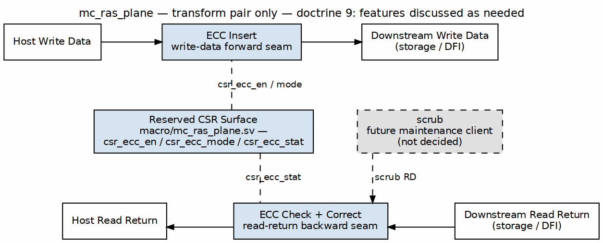

<!-- RTL Design Sherpa Documentation Header -->
<table>
<tr>
<td width="80">
  
</td>
<td>
  <strong>RTL Design Sherpa</strong> · <em>Learning Hardware Design Through Practice</em> 
  
    <a href="https://github.com/sean-galloway/RTLDesignSherpa">GitHub</a> ·
    <a href="https://github.com/sean-galloway/RTLDesignSherpa/blob/main/docs/DOCUMENTATION_INDEX.md">Documentation Index</a> ·
    <a href="https://github.com/sean-galloway/RTLDesignSherpa/blob/main/LICENSE">MIT License</a>
  
</td>
</tr>
</table>

---

<!-- End Header -->

# Chapter 6 — `mc_ras_plane`

`mc_ras_plane` is the Reliability/Availability/Serviceability transform plane on the two memory-data seams: write-data forward and read-return backward (`macro/mc_ras_plane.sv:8-9`). The common-ip extraction intentionally leaves it a skeleton; the only binding decisions are the module boundary, the transform-pair placement, the `HAS_ECC` parameter intent, and a reserved CSR surface. The architecture context is in the family HAS ([`common_has`](../../common_has/common_has_index.md)); this chapter does not restate it.

The plane is not yet instantiated into any research controller ([`mc_ras_plane_knobs.md`](../../mc_ras_plane_knobs.md)).

## Fixed decisions

- **Module boundary.** Two AXI-like streaming seams, one in each direction, plus a four-signal CSR surface and a `busy_o` indicator (`macro/mc_ras_plane.sv:27-69`).
- **Transform-pair placement.** ECC insertion belongs on the write-data forward seam; ECC check belongs on the read-return backward seam. The pair wraps either the storage plane or a DFI plane, depending on where the code word is carried. This placement is the only RAS structure with two customers today ([`common_has` doctrine 9](../../common_has/ch04_doctrine/01_new_doctrines.md)).
- **`HAS_ECC` intent.** `0` = `ECC_OFF` (default and only implemented value), `1` = `ECC_DETECT` reserved, `2` = `ECC_CORRECT` reserved (`macro/mc_ras_plane.sv:22-23`).
- **Reserved CSR surface.** `csr_ecc_en_i`, `csr_ecc_mode_i`, and `csr_ecc_stat_o` exist at the boundary; when `HAS_ECC = ECC_OFF` the status port reads zero (`macro/mc_ras_plane.sv:62-66`, `86`). The full field layout is recorded in [`mc_ras_plane_knobs.md`](../../mc_ras_plane_knobs.md).
- **Scrubber relationship.** When added, the scrubber will be a maintenance-class client of the scheduler/prospect pool, peer to refresh and training, injecting read descriptors that reuse existing read-snoop hazard rules ([`mc_ras_plane_knobs.md`](../../mc_ras_plane_knobs.md)).

## Parameters

| Parameter | Default | Description | RTL |
|---|---|---|---|
| `DATA_WIDTH` | `64` | Data beat width on both seams | `macro/mc_ras_plane.sv:20` |
| `STRB_WIDTH` | `DATA_WIDTH/8` | Byte-strobe width on the write seam | `macro/mc_ras_plane.sv:21` |
| `HAS_ECC` | `0` | `0=OFF`, `1=DETECT` (reserved), `2=CORRECT` (reserved) | `macro/mc_ras_plane.sv:23` |
| `ECC_MODE` | `0` | Reserved knob for in-band vs. side-band code placement | `macro/mc_ras_plane.sv:25` |
| `ECC_CODE_WIDTH` | `8` | Reserved knob for ECC code-word width | `macro/mc_ras_plane.sv:26` |

## Ports

### Write-data forward seam (upstream → downstream)

| Port | Direction | Width | Description | RTL |
|---|---|---|---|---|
| `wdata_valid_i` | input | 1 | Upstream write-data valid | `macro/mc_ras_plane.sv:34` |
| `wdata_ready_o` | output | 1 | Upstream write-data ready | `macro/mc_ras_plane.sv:35` |
| `wdata_data_i` | input | `DATA_WIDTH` | Upstream write data | `macro/mc_ras_plane.sv:36` |
| `wdata_strb_i` | input | `STRB_WIDTH` | Upstream write strobe | `macro/mc_ras_plane.sv:37` |
| `wdata_last_i` | input | 1 | Upstream write last beat | `macro/mc_ras_plane.sv:38` |
| `wdata_valid_o` | output | 1 | Downstream write-data valid | `macro/mc_ras_plane.sv:40` |
| `wdata_ready_i` | input | 1 | Downstream write-data ready | `macro/mc_ras_plane.sv:41` |
| `wdata_data_o` | output | `DATA_WIDTH` | Downstream write data | `macro/mc_ras_plane.sv:42` |
| `wdata_strb_o` | output | `STRB_WIDTH` | Downstream write strobe | `macro/mc_ras_plane.sv:43` |
| `wdata_last_o` | output | 1 | Downstream write last beat | `macro/mc_ras_plane.sv:44` |

### Read-return backward seam (downstream → upstream)

| Port | Direction | Width | Description | RTL |
|---|---|---|---|---|
| `rdata_valid_i` | input | 1 | Downstream read-return valid | `macro/mc_ras_plane.sv:49` |
| `rdata_ready_o` | output | 1 | Downstream read-return ready | `macro/mc_ras_plane.sv:50` |
| `rdata_data_i` | input | `DATA_WIDTH` | Downstream read data | `macro/mc_ras_plane.sv:51` |
| `rdata_resp_i` | input | 2 | Downstream read response | `macro/mc_ras_plane.sv:52` |
| `rdata_last_i` | input | 1 | Downstream read last beat | `macro/mc_ras_plane.sv:53` |
| `rdata_valid_o` | output | 1 | Upstream read-return valid | `macro/mc_ras_plane.sv:55` |
| `rdata_ready_i` | input | 1 | Upstream read-return ready | `macro/mc_ras_plane.sv:56` |
| `rdata_data_o` | output | `DATA_WIDTH` | Upstream read data | `macro/mc_ras_plane.sv:57` |
| `rdata_resp_o` | output | 2 | Upstream read response | `macro/mc_ras_plane.sv:58` |
| `rdata_last_o` | output | 1 | Upstream read last beat | `macro/mc_ras_plane.sv:59` |

### Reserved CSR surface

| Port | Direction | Width | Description | RTL |
|---|---|---|---|---|
| `csr_ecc_en_i` | input | 1 | Master ECC enable; no effect when `HAS_ECC = OFF` | `macro/mc_ras_plane.sv:64` |
| `csr_ecc_mode_i` | input | 2 | ECC operating mode; reserved | `macro/mc_ras_plane.sv:65` |
| `csr_ecc_stat_o` | output | 32 | ECC status; reads zero when `HAS_ECC = OFF` | `macro/mc_ras_plane.sv:66` |
| `busy_o` | output | 1 | Plane busy indicator; tied low | `macro/mc_ras_plane.sv:68` |

## Bypass property

A build that does not need RAS features omits this plane entirely; absence is a true bypass, not a stub. When the plane is present, both `gen_ecc_off` and `gen_ecc_reserved` reduce to bit-identical passthrough assigns (`macro/mc_ras_plane.sv:71-105`). The RTL comment notes that the `HAS_ECC = 0` branch contains "no combinational logic beyond the assigns themselves" (`macro/mc_ras_plane.sv:72-73`).

## Explicitly not decided

Per doctrine 9, any RAS feature beyond the transform pair (ECC insert/check) plus scrub-as-maintenance-client is out of scope until a real enabling customer appears ([`common_has` doctrine 9](../../common_has/ch04_doctrine/01_new_doctrines.md)). In particular:

- The ECC encoder, decoder, and syndrome logic are not implemented (`macro/mc_ras_plane.sv:88-90`).
- `ECC_MODE` and `ECC_CODE_WIDTH` are documented reserved knobs but have no RTL effect (`macro/mc_ras_plane.sv:24-26`).
- The scrubber has no implementation; its scheduler interface is deferred to the scheduler-merge task ([`mc_ras_plane_knobs.md`](../../mc_ras_plane_knobs.md)).

## Open questions

- Which side of the storage/DFI boundary hosts the ECC code word? The transform-pair placement is fixed, but the partner has not selected the code-word carrier.
- What error-response encoding appears on `rdata_resp_o` when `HAS_ECC = DETECT/CORRECT`? The `rdata_resp` width is two bits (`macro/mc_ras_plane.sv:52`), but no encoding is assigned.
