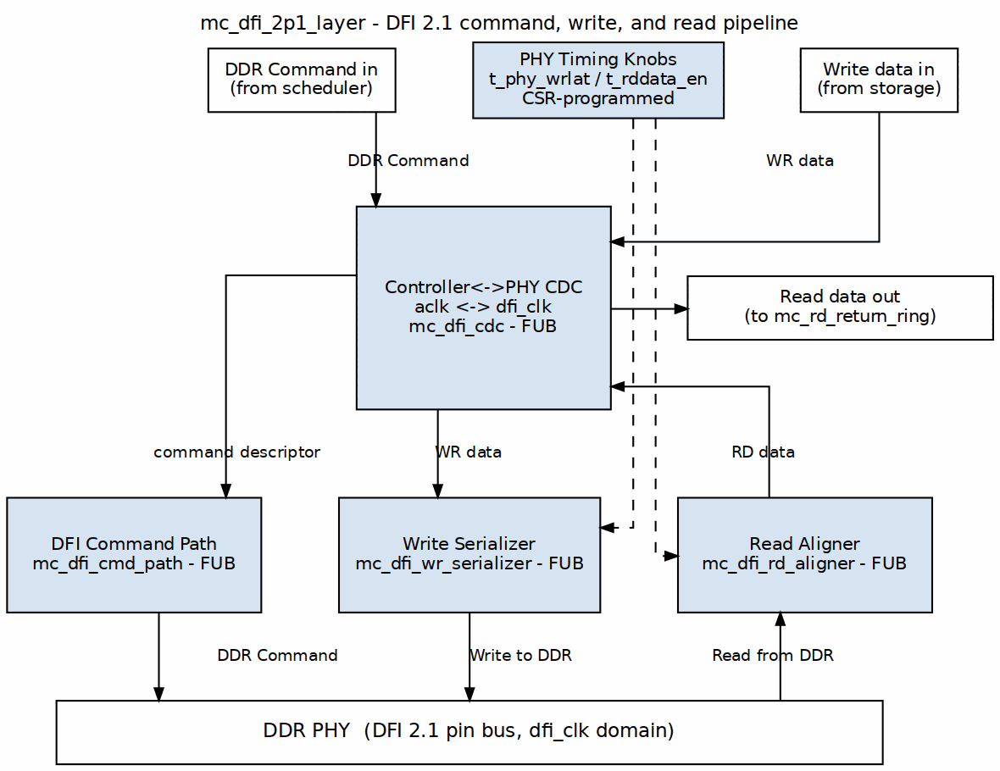

<!-- RTL Design Sherpa Documentation Header -->
<table>
<tr>
<td width="80">
  
</td>
<td>
  <strong>RTL Design Sherpa</strong> · <em>Learning Hardware Design Through Practice</em> 
  
    <a href="https://github.com/sean-galloway/RTLDesignSherpa">GitHub</a> ·
    <a href="https://github.com/sean-galloway/RTLDesignSherpa/blob/main/docs/DOCUMENTATION_INDEX.md">Documentation Index</a> ·
    <a href="https://github.com/sean-galloway/RTLDesignSherpa/blob/main/LICENSE">MIT License</a>
  
</td>
</tr>
</table>

---

<!-- End Header -->

# `mc_dfi_2p1_layer` — DFI 2.1 Command / Write / Read Pipeline

**Module:** `mc_dfi_2p1_layer.sv` · **Location:** `common-ip/rtl/macro/`

> Architectural context is in the family HAS ([common_has](../../common_has/common_has_index.md)); this chapter documents the block microarchitecture only.

## Purpose

`mc_dfi_2p1_layer` is the common DFI 2.1 PHY-facing layer. It presents controller-clock command, write-data, and read-data streams on one side and the DFI 2.1 pin bus on the other, and owns the single controller-to-PHY clock-domain crossing plus the DFI-clock command path, write serializer, and read aligner (`macro/mc_dfi_2p1_layer.sv:8-12`, `macro/mc_dfi_2p1_layer.sv:32`). Its datapath unit is the **DFI word**; one FIFO word equals one DFI cycle, so the path is bubble-free at rate (`macro/mc_dfi_2p1_layer.sv:24-25`).

## Sub-FUBs and clock domains

| Instance | Domain | Role | File |
|----------|--------|------|------|
| `u_cdc` | `ctl_clk` ↔ `dfi_clk` | The single family CDC: async `gaxi_fifo_async` FIFOs for cmd, wrdata, rddata; token crossings for `init_start`/`init_complete` | `fub/mc_dfi_cdc.sv:30` |
| `u_cmd` | `dfi_clk` | Command FIFO → multi-phase DFI command bus; emits `wr_fire`/`rd_fire` strobes | `fub/mc_dfi_cmd_path.sv:47` |
| `u_wr` | `dfi_clk` | Write-data FIFO → `dfi_wrdata`/`dfi_wrdata_en`/`dfi_wrdata_mask` at `t_phy_wrlat` | `fub/mc_dfi_wr_serializer.sv:29` |
| `u_rd` | `dfi_clk` | `dfi_rddata` capture → read-return FIFO at `t_rddata_en` | `fub/mc_dfi_rd_aligner.sv:38` |

## The single controller↔PHY clock-domain crossing

`mc_dfi_cdc` is the only place the controller and PHY clock domains meet (`fub/mc_dfi_cdc.sv:8-12`). It uses `gaxi_fifo_async` for every crossing — cmd, wrdata, rddata, plus one-bit token FIFOs for `init_start` and `init_complete` — and prohibits hand-rolled synchronizers or open-loop bit crossings (`fub/mc_dfi_cdc.sv:11-12`).

The level signals `init_start_i` and `dfi_init_complete_i` cross as **event tokens**: a rising edge on the source pushes a 1-bit token; the sink pops it into a sticky latch (`fub/mc_dfi_cdc.sv:20-22`, `fub/mc_dfi_cdc.sv:188-248`). The write path also pushes a `pwr_staged` token per complete write burst so the command path cannot issue a WR ahead of its data (`fub/mc_dfi_cdc.sv:86-93`).

## DFI_RATE gearing and bus geometry

`DFI_RATE` is the compile-time maximum number of DRAM beats per DFI word (phase count). The layer derives the DFI bus widths from it (`macro/mc_dfi_2p1_layer.sv:70-82`):

| Derived width | Formula |
|---------------|---------|
| `DFI_DATA_WIDTH` | `DRAM_BEAT_WIDTH * DFI_RATE` |
| `DFI_STRB_WIDTH` | `DFI_DATA_WIDTH / 8` |
| `DFI_EN_WIDTH` | `DFI_RATE` |
| `DFI_VALID_WIDTH` | `DFI_RATE` |
| `DFI_ADDR_BUS_W` | `ROW_WIDTH * DFI_RATE` |
| `DFI_BANK_BUS_W` | `$clog2(NUM_BANKS) * DFI_RATE` |
| `DFI_CTRL_BUS_W` | `1 * DFI_RATE` |
| `DFI_CS_BUS_W` | `NUM_RANKS * DFI_RATE` |

At runtime `gear_i` selects the active rate within the compile-time maximum: `active_rate = 1 << gear_i` (`macro/mc_dfi_2p1_layer.sv:143-148`). The layer builds a per-phase active mask `w_phase_active` and gates `dfi_wrdata_en_o`/`dfi_rddata_en_o` to the active phases (`macro/mc_dfi_2p1_layer.sv:202-211`). At `gear_i = $clog2(DFI_RATE)` the mask is all-ones and the outputs are bit-identical to the unmasked FUB outputs.

## Command path

`mc_dfi_cmd_path` pops the abstract command stream from the CDC FIFO, unpacks `{mrr, ap, col, row, bank, rank, op}`, and drives the multi-phase DFI command bus (`fub/mc_dfi_cmd_path.sv:8-10`). It places READ on `rd_phase_i` and WRITE on `wr_phase_i`; everything else lands on phase 0 (`fub/mc_dfi_cmd_path.sv:231-238`).

The path performs **no JEDEC timing enforcement**: all delays come from the scheduler. The only remaining holds are structural — a read may not issue unless the aligner has a free slot, and a write may not issue before its data is staged (`fub/mc_dfi_cmd_path.sv:175-214`). This policy followed pumice `BUG-017` (was `PUMICE-042`): holding columns for `tRTW`/`tWTR` here compressed REF→ACT spacing in the in-order FIFO and caused 180 consecutive reads to return an undriven DQ bus (`fub/mc_dfi_cmd_path.sv:181-190`; see pumice MAS [`15_gear_dfi.md`](../../../../research-ip/pumice-ddr2-lpddr2/docs/pumice_mas/ch02_blocks/15_gear_dfi.md)).

For sub-DFI-word packing, `N_SUBCMD` sub-column-commands of one scheduled column command are issued in a single DFI cycle at phases `{base, base+sub_phase_stride_i, ...}` and columns `{col, col+sub_col_stride_i, ...}` (`fub/mc_dfi_cmd_path.sv:216-227`). The per-sub formatter buses merge by OR for address/bank/odt and AND for the active-low control strobes (`fub/mc_dfi_cmd_path.sv:308-332`). One `wr_fire`/`rd_fire` group strobe is emitted per packed group, so the data paths drive/capture the single DFI word once (`fub/mc_dfi_cmd_path.sv:396-411`).

## Write serializer

`mc_dfi_wr_serializer` is stateless. On `wr_fire_i` it matures after `t_phy_wrlat_i` DFI cycles, then streams one DFI word per cycle from the FIFO onto `dfi_wrdata_o` until `wd_last_i` (`fub/mc_dfi_wr_serializer.sv:8-11`, `fub/mc_dfi_wr_serializer.sv:64-75`). It tracks matured-but-not-finished bursts in `r_owed` and drives whenever a burst is owed and the FIFO has a word (`fub/mc_dfi_wr_serializer.sv:91-99`). `dfi_wrdata_mask_o = ~wd_strb_i` while driving (`fub/mc_dfi_wr_serializer.sv:22`, `fub/mc_dfi_wr_serializer.sv:113`).

## Read aligner

`mc_dfi_rd_aligner` admits a read on `op_valid_i && op_ready_o`. `op_ready_o` deasserts when `MAX_OUTSTANDING` reads are already in flight (`fub/mc_dfi_rd_aligner.sv:18-25`, `fub/mc_dfi_rd_aligner.sv:91-98`). On admission it drives `dfi_rddata_en_o` for `EN_CYC` cycles starting `t_rddata_en_i` cycles later (`fub/mc_dfi_rd_aligner.sv:100-120`). It captures `dfi_rddata_i` whenever `dfi_rddata_valid_i` is asserted and a read is outstanding, pushing `{last, resp=OKAY, data}` into the read FIFO (`fub/mc_dfi_rd_aligner.sv:127-166`).

The capture uses a combinational enable-window credit to reject the PHY preamble valid before the read window; a registered credit dropped the first word in the a7gated model (`fub/mc_dfi_rd_aligner.sv:132-146`). The 2.1 layer enables the calibration sideband: `cal_expect_i` arms a one-shot capture of the first valid beat into `cal_data_o`/`cal_valid_o` (`fub/mc_dfi_rd_aligner.sv:169-201`).

The read-return FIFO must cover the whole read-admission domain; `RD_FIFO_DEPTH` defaults to 32 because depth 16 dropped beats under a paced-but-adjacent burst schedule (`macro/mc_dfi_2p1_layer.sv:55-63`).

## PHY timing knobs

| Knob | Width | Programmed by | Measured pumice value |
|------|-------|---------------|----------------------|
| `t_phy_wrlat_i` | `[7:0]` | `PHY_TIMING` CSR, bits 7:0 | 1 on Nexys A7 a7ddrphy (`research-ip/pumice-ddr2-lpddr2/docs/pumice_mas/ch04_apb_config/02_csr_map.md:272`) |
| `t_rddata_en_i` | `[7:0]` | `PHY_TIMING` CSR, bits 15:8 | 6 on Nexys A7 a7ddrphy (`research-ip/pumice-ddr2-lpddr2/docs/pumice_mas/ch04_apb_config/02_csr_map.md:273`) |
| `rd_phase_i` / `wr_phase_i` | `PHW` | `DFI_PHASE` CSR | 0 / 0 on Nexys A7 (`research-ip/pumice-ddr2-lpddr2/docs/pumice_mas/ch05_programming/04_error_handling.md:67`) |

These PHY-integration knobs are not datapath constants; pumice is the measured customer (Nexys A7, 66.67 / 75 MHz) (`common-ip/docs/common_has/ch02_architecture/02_descriptor_seam.md:97`). The board-validated tuple (2026-07-21) is `rd_phase=0`, `t_rddata_en=6`, `t_phy_wrlat=1`, plus harness `DFI_TUNING.rddata_delay=7` (`research-ip/pumice-ddr2-lpddr2/docs/pumice_mas/ch04_apb_config/03_runtime_overrides.md:97`).

## Parameters

| Parameter | Default | Description |
|-----------|---------|-------------|
| `NUM_RANKS` | 1 | CS/rank fan-out |
| `NUM_BANKS` | 8 | Number of banks |
| `ROW_WIDTH` | 14 | Row / address width |
| `COL_WIDTH` | 10 | Column width |
| `DFI_RATE` | 2 | Compile-time max DRAM beats per DFI word |
| `DRAM_BEAT_WIDTH` | 64 | One DRAM beat data width |
| `DFI_BEATS_PER_BURST` | 8 | DRAM beats per burst |
| `N_SUBCMD` | 1 | Max sub-column-commands packed into one DFI word |
| `SUB_COL_STRIDE` | 1 | Compile-time max device-word column stride |
| `SUB_PHASE_STRIDE` | derived | Compile-time max DFI-phase stride between packed sub-bursts |
| `SUBW_MAX` | derived | Width holding `N_SUBCMD` |
| `BURST_WORDS` | derived | DFI words per burst-group |
| `CMD_FIFO_DEPTH` | 8 | CDC command FIFO depth |
| `WD_FIFO_DEPTH` | 16 | CDC write-data FIFO depth |
| `RD_FIFO_DEPTH` | 32 | CDC read-return FIFO depth |
| `N_FLOP_CROSS` | 2 | Async-FIFO pointer synchronizer stages |
| `USE_JOHNSON` | 0 | Pointer encoding: 0=Gray, 1=Johnson |
| `DFI_DATA_WIDTH` | derived | `DRAM_BEAT_WIDTH * DFI_RATE` |
| `DFI_STRB_WIDTH` | derived | `DFI_DATA_WIDTH / 8` |
| `DFI_EN_WIDTH` | derived | `DFI_RATE` |
| `DFI_VALID_WIDTH` | derived | `DFI_RATE` |
| `DFI_ADDR_WIDTH` | derived | `ROW_WIDTH` |
| `DFI_BANK_WIDTH` | derived | `$clog2(NUM_BANKS)` |
| `DFI_CTRL_WIDTH` | 1 | Control strobe width |
| `DFI_CS_WIDTH` | derived | `NUM_RANKS` |
| `DFI_ADDR_BUS_W` | derived | `DFI_ADDR_WIDTH * DFI_RATE` |
| `DFI_BANK_BUS_W` | derived | `DFI_BANK_WIDTH * DFI_RATE` |
| `DFI_CTRL_BUS_W` | derived | `DFI_CTRL_WIDTH * DFI_RATE` |
| `DFI_CS_BUS_W` | derived | `DFI_CS_WIDTH * DFI_RATE` |
| `RKW` | derived | Rank index width |
| `BKW` | derived | Bank index width |
| `PHW` | derived | Phase index width |
| `CMD_HISTORY_EN` | 0 | DFI-wire command-history scoreboard enable (sim only) |
| `HIST_T_RCD` / `HIST_T_RP` / `HIST_T_RAS` / `HIST_T_RFC` / `HIST_T_WTR` / `HIST_T_RTW` | 0 | Command-history timing constants |
| `BL_WORDS` | derived | Alias of `BURST_WORDS` |
| `RD_MAX_OUTSTANDING` | 16 | Read-aligner outstanding-read tracking depth |
| `RD_EN_CYC` | derived | `rddata_en` window width |
| `CMD_DW` | derived | Command FIFO payload width |
| `WD_DW` | derived | Write-data FIFO payload width `{last,strb,data}` |
| `RD_DW` | derived | Read-return FIFO payload width `{last,resp,data}` |

## Ports

### Controller domain (`ctl_clk`)

| Signal | Direction | Width | Description |
|--------|-----------|-------|-------------|
| `ctl_clk` | in | 1 | Controller clock |
| `ctl_rstn` | in | 1 | Controller reset (active low) |
| `cmd_valid_i` | in | 1 | Command stream valid (from scheduler) |
| `cmd_ready_o` | out | 1 | Command stream ready |
| `cmd_data_i` | in | `[CMD_DW-1:0]` | Packed `{op,rank,bank,row,col,ap}` |
| `wd_valid_i` | in | 1 | Write-data stream valid (from WR CAM) |
| `wd_ready_o` | out | 1 | Write-data stream ready |
| `wd_data_i` | in | `[WD_DW-1:0]` | Packed `{last,strb,data}` DFI-word granular |
| `rd_valid_o` | out | 1 | Read-return stream valid (to RD CAM) |
| `rd_ready_i` | in | 1 | Read-return stream ready |
| `rd_data_o` | out | `[RD_DW-1:0]` | Packed `{last,resp,data}` |
| `init_start_i` | in | 1 | Init-start request (controller side) |
| `init_complete_o` | out | 1 | Init-complete indication (controller side) |

### PHY DFI domain (`dfi_clk`)

| Signal | Direction | Width | Description |
|--------|-----------|-------|-------------|
| `dfi_clk` | in | 1 | DFI / PHY clock |
| `dfi_rstn` | in | 1 | DFI reset (active low) |
| `memtype_i` | in | `memtype_e` | DDR2 / LPDDR2 selector |
| `rd_phase_i` | in | `[PHW-1:0]` | DFI phase carrying READ command |
| `wr_phase_i` | in | `[PHW-1:0]` | DFI phase carrying WRITE command |
| `t_phy_wrlat_i` | in | `[7:0]` | WR cmd → `dfi_wrdata_en` delay |
| `t_rddata_en_i` | in | `[7:0]` | RD cmd → `dfi_rddata_en` window delay |
| `gear_i` | in | `[1:0]` | Active gear: `active_rate = 1 << gear_i` |
| `n_subcmd_i` | in | `[SUBW_MAX-1:0]` | Active sub-column commands per DFI word |
| `sub_col_stride_i` | in | `[COL_WIDTH-1:0]` | Active device-word column stride |
| `sub_phase_stride_i` | in | `[PHW-1:0]` | Active DFI-phase stride between sub-bursts |
| `dfi_address_o` | out | `[DFI_ADDR_BUS_W-1:0]` | DFI address bus |
| `dfi_bank_o` | out | `[DFI_BANK_BUS_W-1:0]` | DFI bank bus |
| `dfi_cas_n_o` | out | `[DFI_CTRL_BUS_W-1:0]` | DFI CAS# (active low) |
| `dfi_ras_n_o` | out | `[DFI_CTRL_BUS_W-1:0]` | DFI RAS# (active low) |
| `dfi_we_n_o` | out | `[DFI_CTRL_BUS_W-1:0]` | DFI WE# (active low) |
| `dfi_cs_n_o` | out | `[DFI_CS_BUS_W-1:0]` | DFI chip-select (active low) |
| `dfi_odt_o` | out | `[DFI_CS_BUS_W-1:0]` | DFI ODT |
| `dfi_wrdata_o` | out | `[DFI_DATA_WIDTH-1:0]` | DFI write data |
| `dfi_wrdata_en_o` | out | `[DFI_EN_WIDTH-1:0]` | DFI write-data enable |
| `dfi_wrdata_mask_o` | out | `[DFI_STRB_WIDTH-1:0]` | DFI write-data mask |
| `dfi_rddata_en_o` | out | `[DFI_EN_WIDTH-1:0]` | DFI read-data enable |
| `dfi_rddata_i` | in | `[DFI_DATA_WIDTH-1:0]` | DFI read data |
| `dfi_rddata_valid_i` | in | `[DFI_VALID_WIDTH-1:0]` | DFI read-data valid |
| `cal_expect_i` | in | 1 | Calibration capture arm |
| `cal_data_o` | out | `[DFI_DATA_WIDTH-1:0]` | Calibration captured data |
| `cal_valid_o` | out | 1 | Calibration capture valid |
| `dfi_init_start_o` | out | 1 | DFI init-start to PHY |
| `dfi_init_complete_i` | in | 1 | DFI init-complete from PHY |

## Open questions

- The `fire_rank_o` output of `mc_dfi_cmd_path` is currently unused inside `mc_dfi_2p1_layer` (`macro/mc_dfi_2p1_layer.sv:375` ties it off). Open question: is this a reserved hook for per-rank ODT or training, or should it be removed?
- `db_wr_dbi_en_i`/`wd_dbi_i` and `rd_dbi_en_i`/`dfi_rddata_dbi_i` are tied off in the 2.1 layer (`macro/mc_dfi_2p1_layer.sv:336-337`, `macro/mc_dfi_2p1_layer.sv:367-369`), matching the DFI 2.1 no-DBI contract. The serializer/aligner `HAS_DBI` parameters default to 0 and are not exposed by the layer.
- Re-leveling (re-runs of `init_start`/`init_complete`) is marked future work in the CDC comments because the event-token crossing is monotonic (`fub/mc_dfi_cdc.sv:22`).
