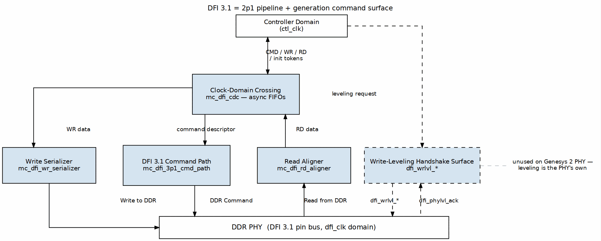

<!-- RTL Design Sherpa Documentation Header -->
<table>
<tr>
<td width="80">
  
</td>
<td>
  <strong>RTL Design Sherpa</strong> · <em>Learning Hardware Design Through Practice</em> 
  
    <a href="https://github.com/sean-galloway/RTLDesignSherpa">GitHub</a> ·
    <a href="https://github.com/sean-galloway/RTLDesignSherpa/blob/main/docs/DOCUMENTATION_INDEX.md">Documentation Index</a> ·
    <a href="https://github.com/sean-galloway/RTLDesignSherpa/blob/main/LICENSE">MIT License</a>
  
</td>
</tr>
</table>

---

<!-- End Header -->

# Chapter 8 — `mc_dfi_3p1_plane`

**Module:** `macro/mc_dfi_3p1_plane.sv`  
**Family boundary:** DFI 3.1 controller/PHY seam  
**Status:** extracted from `scoria_dfi_plane` during the Phase 2 common-plane reorg; consumed today by `scoria_core` (`research-ip/scoria-ddr3-lpddr3/rtl/top/scoria_core.sv:866`).

## Purpose and scope

`mc_dfi_3p1_plane` holds the single `ctl_clk`/`dfi_clk` crossing in the controller and presents the controller-clock command/write-data/read-data streams on one side and the DFI 3.1 pin bus on the other (`macro/mc_dfi_3p1_plane.sv:8-12`). It is a constant-latency conduit: all JEDEC spacing is enforced upstream in the scheduler, and this plane must not stall the in-order command stream (`fub/mc_dfi_3p1_cmd_path.sv:160-184`).

## What is inherited unchanged from the 2.1 pipeline

The internal datapath unit is one DFI word; one FIFO word equals one DFI cycle, so the crossing is bubble-free (`macro/mc_dfi_3p1_plane.sv:19-20`). The 2.1 and 3.1 planes share these child instances and behaviours:

- **`mc_dfi_cdc`** — the single async-FIFO crossing for command, write data, read data, and init start/complete (`macro/mc_dfi_3p1_plane.sv:254`).
- **`mc_dfi_wr_serializer`** — delays write data by `t_phy_wrlat_i` and drives `dfi_wrdata_o`/`dfi_wrdata_en_o`/`dfi_wrdata_mask_o` (`macro/mc_dfi_3p1_plane.sv:350`).
- **`mc_dfi_rd_aligner`** — delays `dfi_rddata_en_o` by `t_rddata_en_i` and captures read data into the return FIFO (`macro/mc_dfi_3p1_plane.sv:373`).
- **Active-gear phase mask** — `gear_i` selects the active DFI rate; the unmasked `dfi_wrdata_en`/`dfi_rddata_en` from the serializer/aligner are gated by `w_phase_active` before the pins. At `gear_i == log2(DFI_RATE)` the mask is all-ones (`macro/mc_dfi_3p1_plane.sv:221-238`).

## What the 3.1 delta adds

The generation delta is concentrated in the command path and the write-leveling surface.

### Command path: `mc_dfi_3p1_cmd_path`

The 3.1 plane instantiates `fub/mc_dfi_3p1_cmd_path.sv` (`macro/mc_dfi_3p1_plane.sv:300`) in place of the 2.1 `mc_dfi_cmd_path`. The 3.1 path:

- Drops the optional 2.1 mode-register-read bit; the command word is `{ap, col, row, bank, rank, op}` (`fub/mc_dfi_3p1_cmd_path.sv:99-101`, `fub/mc_dfi_3p1_cmd_path.sv:158`).
- Formats commands through the silicon-proven `scoria_dfi_cmd_formatter` (`fub/mc_dfi_3p1_cmd_path.sv:255`).
- Supports sub-DFI-word burst packing via `N_SUBCMD`, `SUB_COL_STRIDE`, and `SUB_PHASE_STRIDE`: when `N_SUBCMD > 1`, one scheduled column command fans out into `N_SUBCMD` sub-commands placed on distinct DFI phases of the same cycle, and the per-sub buses merge by AND for control/CS and OR for address/bank/ODT (`fub/mc_dfi_3p1_cmd_path.sv:199-215`, `fub/mc_dfi_3p1_cmd_path.sv:291-315`).
- Uses the `scoria_cmd_history_checker` when `CMD_HISTORY_EN` is set (`fub/mc_dfi_3p1_cmd_path.sv:333-352`).

Clause-level DFI 3.1 pin semantics and the per-PHY integration contract are owned by the scoria book (`../../../research-ip/scoria-ddr3-lpddr3/docs/scoria_mas/ch03_interfaces/02_dfi_v31_pins.md`); this chapter does not restate them.

### Write-leveling CDC

The 3.1 plane adds the DDR3 write-leveling handshake crossing. Because the plane owns the only `ctl_clk`/`dfi_clk` boundary, routing these signals through it avoids an unsynchronized crossing (`macro/mc_dfi_3p1_plane.sv:184-189`). Slow levels use `cdc_synchronizer` flop chains; the one-cycle `wl_strobe_i` pulse uses `sync_pulse` so the pulse count survives arbitrary clock ratios (`macro/mc_dfi_3p1_plane.sv:192-195`, `macro/mc_dfi_3p1_plane.sv:425-470`). Active-low `_n` signals are inverted to active-high for synchronization and inverted again at the output to avoid spurious assertions out of reset (`macro/mc_dfi_3p1_plane.sv:409-422`).

The scoria book states that this PHY family does not implement the DFI leveling handshake, so on the Genesys 2 build these pins are unused and write leveling is the PHY's own (`../../../research-ip/scoria-ddr3-lpddr3/docs/scoria_mas/ch03_interfaces/02_dfi_v31_pins.md:123`). The protocol state machine is documented in the scoria MAS (`../../../research-ip/scoria-ddr3-lpddr3/docs/scoria_mas/ch02_blocks/20_wrlvl_ifc.md`).

### Calibration sideband removed

The 2.1 plane exposes `cal_expect_i`, `cal_data_o`, and `cal_valid_o` on the `dfi_clk` domain (`macro/mc_dfi_2p1_plane.sv:173-176`). The 3.1 plane removes these ports and ties `HAS_CAL_CAPTURE` to 0 inside `mc_dfi_rd_aligner` (`macro/mc_dfi_3p1_plane.sv:380`).

## Parameters

| Parameter | Default | Description |
|---|---|---|
| `NUM_RANKS` | 1 | DRAM ranks. |
| `NUM_CS` | `NUM_RANKS` | Chip selects. |
| `NUM_BANKS` | 8 | DRAM banks. |
| `ROW_WIDTH` | 14 | Row address width. |
| `COL_WIDTH` | 10 | Column address width. |
| `DFI_RATE` | 2 | Compile-time max DFI phases per clock. |
| `DRAM_BEAT_WIDTH` | 64 | DRAM beat width. |
| `DFI_BEATS_PER_BURST` | 8 | DRAM beats per burst (`BL_PUMICE`). |
| `N_SUBCMD` | 1 | Compile-time max sub-commands packed into one DFI word. |
| `SUB_COL_STRIDE` | 1 | Compile-time max column stride between sub-bursts. |
| `SUB_PHASE_STRIDE` | `(N_SUBCMD>1)?(DFI_RATE/N_SUBCMD):1` | Compile-time max DFI-phase stride between packed sub-bursts. |
| `SUBW_MAX` | `$clog2(N_SUBCMD+1)` | Width holding active `N_SUBCMD`. |
| `BURST_WORDS` | `(DFI_BEATS_PER_BURST>=DFI_RATE)?(DFI_BEATS_PER_BURST/DFI_RATE):1` | DFI words per burst group; clamped to 1 in the sub-word regime. |
| `CMD_FIFO_DEPTH` | 8 | Command async FIFO depth. |
| `WD_FIFO_DEPTH` | 16 | Write-data async FIFO depth. |
| `RD_FIFO_DEPTH` | 32 | Read-data async FIFO depth. Required because `dfi_rddata_valid` is fire-and-forget; depth 16 dropped beats under paced adjacent bursts (`macro/mc_dfi_3p1_plane.sv:56-64`). |
| `N_FLOP_CROSS` | 2 | Pointer synchronizer flop stages. |
| `USE_JOHNSON` | 0 | Async FIFO pointer encoding: 0 = Gray, 1 = Johnson. |
| `CMD_HISTORY_EN` | 0 | Enable DFI-wire command-history scoreboard (sim only). |
| `HIST_T_RCD` | 0 | History checker `tRCD`. |
| `HIST_T_RP` | 0 | History checker `tRP`. |
| `HIST_T_RAS` | 0 | History checker `tRAS`. |
| `HIST_T_RFC` | 0 | History checker `tRFC`. |
| `HIST_T_WTR` | 0 | History checker `tWTR`. |
| `HIST_T_RTW` | 0 | History checker `tRTW`. |
| `BL_WORDS` | `BURST_WORDS` | Alias exposed to the read aligner. |
| `RD_MAX_OUTSTANDING` | 16 | Read aligner outstanding-read tracking depth. |
| `RD_EN_CYC` | `BL_WORDS` | `dfi_rddata_en` window width. The default is wrong when `DRAM_BEAT_WIDTH > DRAM_DEVICE_WIDTH`; scoria overrides explicitly (`macro/mc_dfi_3p1_plane.sv:104-112`). |

: Table 8.1: `mc_dfi_3p1_plane` parameters

Derived geometry parameters (`DFI_DATA_WIDTH`, `DFI_STRB_WIDTH`, `DFI_EN_WIDTH`, `DFI_VALID_WIDTH`, `DFI_ADDR_WIDTH`, `DFI_BANK_WIDTH`, `DFI_CTRL_WIDTH`, `DFI_CS_WIDTH`, the `*_BUS_W` widths, `RKW`, `BKW`, `PHW`, and FIFO payload widths `CMD_DW`/`WD_DW`/`RD_DW`) are computed in `macro/mc_dfi_3p1_plane.sv:71-116`.

## Ports

### Controller domain (`ctl_clk`)

| Signal | Direction | Width | Description |
|---|---|---|---|
| `ctl_clk` | in | 1 | Controller clock. |
| `ctl_rstn` | in | 1 | Controller reset, active-low. |
| `cmd_valid_i` | in | 1 | Command valid from scheduler. |
| `cmd_ready_o` | out | 1 | Command ready to scheduler. |
| `cmd_data_i` | in | `CMD_DW` | Packed command `{ap, col, row, bank, rank, op}`. |
| `wd_valid_i` | in | 1 | Write-data valid. |
| `wd_ready_o` | out | 1 | Write-data ready. |
| `wd_data_i` | in | `WD_DW` | Write data `{last, strb, data}`. |
| `rd_valid_o` | out | 1 | Read-data valid. |
| `rd_ready_i` | in | 1 | Read-data ready. |
| `rd_data_o` | out | `RD_DW` | Read data `{last, resp, data}`. |
| `init_start_i` | in | 1 | Init start level. |
| `init_complete_o` | out | 1 | Init complete sticky. |

: Table 8.2: Controller-domain ports

### PHY DFI domain (`dfi_clk`)

| Signal | Direction | Width | Description |
|---|---|---|---|
| `dfi_clk` | in | 1 | DFI clock. |
| `dfi_rstn` | in | 1 | DFI reset, active-low. |
| `memtype_i` | in | `memtype_e` | DRAM type (DDR3/LPDDR3). |
| `rd_phase_i` | in | `PHW` | Read-command DFI phase. |
| `wr_phase_i` | in | `PHW` | Write-command DFI phase. |
| `t_phy_wrlat_i` | in | 8 | WR command to `dfi_wrdata_en` delay. |
| `t_rddata_en_i` | in | 8 | RD command to `dfi_rddata_en` delay. |
| `gear_i` | in | 2 | Active DFI gear ratio selector. |
| `n_subcmd_i` | in | `SUBW_MAX` | Active sub-commands per DFI word. |
| `sub_col_stride_i` | in | `COL_WIDTH` | Active column stride. |
| `sub_phase_stride_i` | in | `PHW` | Active phase stride. |
| `dfi_address_o` | out | `DFI_ADDR_BUS_W` | DFI address bus. |
| `dfi_bank_o` | out | `DFI_BANK_BUS_W` | DFI bank bus. |
| `dfi_cas_n_o` | out | `DFI_CTRL_BUS_W` | DFI CAS#. |
| `dfi_ras_n_o` | out | `DFI_CTRL_BUS_W` | DFI RAS#. |
| `dfi_we_n_o` | out | `DFI_CTRL_BUS_W` | DFI WE#. |
| `dfi_cs_n_o` | out | `DFI_CS_BUS_W` | DFI chip select. |
| `dfi_odt_o` | out | `DFI_CS_BUS_W` | DFI ODT. |
| `dfi_wrdata_o` | out | `DFI_DATA_WIDTH` | DFI write data. |
| `dfi_wrdata_en_o` | out | `DFI_EN_WIDTH` | DFI write data enable. |
| `dfi_wrdata_mask_o` | out | `DFI_STRB_WIDTH` | DFI write data mask. |
| `dfi_rddata_en_o` | out | `DFI_EN_WIDTH` | DFI read data enable. |
| `dfi_rddata_i` | in | `DFI_DATA_WIDTH` | DFI read data. |
| `dfi_rddata_valid_i` | in | `DFI_VALID_WIDTH` | DFI read data valid. |
| `dfi_init_start_o` | out | 1 | DFI init start sticky. |
| `dfi_init_complete_i` | in | 1 | DFI init complete level. |

: Table 8.3: PHY DFI-domain ports

### Write-leveling crossing ports

| Signal | Direction | Width | Description |
|---|---|---|---|
| `wl_req_cs_n_i` | in | `NUM_CS` | Leveling request from scheduler, active-low. |
| `wl_wrlvl_cs_n_i` | in | `NUM_CS` | WRLVL mode from scheduler, active-low. |
| `wl_strobe_i` | in | 1 | One-cycle strobe from scheduler. |
| `wl_ack_cs_n_o` | out | `NUM_CS` | PHY ack to scheduler, active-low. |
| `wl_prime_dq_o` | out | 1 | Prime DQ to scheduler. |
| `dfi_phylvl_req_cs_n_o` | out | `NUM_CS` | Leveled request to PHY, active-low. |
| `dfi_phylvl_ack_cs_n_i` | in | `NUM_CS` | PHY ack, active-low. |
| `dfi_phy_wrlvl_cs_n_o` | out | `NUM_CS` | Leveled WRLVL mode to PHY, active-low. |
| `dfi_wrlvl_strobe_o` | out | 1 | Leveled one-cycle strobe to PHY. |
| `dfi_prime_dq_i` | in | 1 | Prime DQ from PHY. |

: Table 8.4: Write-leveling crossing ports

## Family-boundary doctrine

DFI revision is a family boundary, not a tunable parameter: a given controller instance commits to one DFI generation at compile time. The rationale and lineage are in the architecture book (`../common_has/ch03_dfi_generations/01_dfi_planes.md`).

## Open questions and verification notes

- `scoria_core.sv` at `research-ip/scoria-ddr3-lpddr3/rtl/top/scoria_core.sv:866` instantiates `mc_dfi_3p1_plane` and wires every write-leveling port (`research-ip/scoria-ddr3-lpddr3/rtl/top/scoria_core.sv:937-947`), yet a stale comment at `research-ip/scoria-ddr3-lpddr3/rtl/top/scoria_core.sv:234` claims the handshake does not go through the plane. The RTL wiring is the operative fact; the comment is inconsistent.
- The sibling scoria MAS chapter (`../../../research-ip/scoria-ddr3-lpddr3/docs/scoria_mas/ch02_blocks/03_dfi_plane.md`) still documents the removed `scoria_dfi_plane`; no `scoria_dfi_plane.sv` or `scoria_dfi_cmd_path.sv` remains in the scoria RTL tree (`Glob` returned no matches). That chapter is therefore out of date with respect to current RTL.
