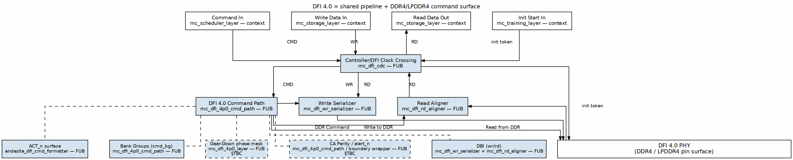

<!-- RTL Design Sherpa Documentation Header -->
<table>
<tr>
<td width="80">
  
</td>
<td>
  <strong>RTL Design Sherpa</strong> · <em>Learning Hardware Design Through Practice</em> 
  
    <a href="https://github.com/sean-galloway/RTLDesignSherpa">GitHub</a> ·
    <a href="https://github.com/sean-galloway/RTLDesignSherpa/blob/main/docs/DOCUMENTATION_INDEX.md">Documentation Index</a> ·
    <a href="https://github.com/sean-galloway/RTLDesignSherpa/blob/main/LICENSE">MIT License</a>
  
</td>
</tr>
</table>

---

<!-- End Header -->

# `mc_dfi_4p0_layer` — DFI 4.0 Generation Delta

`mc_dfi_4p0_layer` is the common DFI 4.0 boundary block extracted from `andesite_dfi_layer` during the Phase 2 common-layer reorganization (`mc_dfi_4p0_layer.sv:20`). It holds the single controller-clock to DFI-clock crossing and the `dfi_clk`-domain datapath that turns the family streams into the DFI 4.0 pin surface.

*DFI 4.0 = shared pipeline + DDR4/LPDDR4 command surface*

## Inherited shared pipeline

The layer instantiates four shared FUBs (`mc_dfi_4p0_layer.sv:14-18`): `mc_dfi_cdc` for the async command/write/read/init-token crossings (`mc_dfi_4p0_layer.sv:220-259`), `mc_dfi_4p0_cmd_path` for the widened scheduler word to DFI 4.0 pins (`mc_dfi_4p0_layer.sv:266-297`), `mc_dfi_wr_serializer` with `HAS_DBI=1` (`mc_dfi_4p0_layer.sv:302-321`), and `mc_dfi_rd_aligner` with `HAS_DBI=1` (`mc_dfi_4p0_layer.sv:326-354`). Training pins live on rock-specific `mc_training_layer` wrappers, not here (`mc_dfi_4p0_layer.sv:25`).

## What the 4.0 delta adds

### Command path (`mc_dfi_4p0_cmd_path`)

The command path accepts the widened word `{ap, col, row, bg, bank, rank, op}` (`mc_dfi_4p0_cmd_path.sv:91-99`); the `bg` field is the structural delta over the 3.1 word (`mc_dfi_4p0_cmd_path.sv:22-23`). It presents each accepted command to the rock-local P1 single-shot formatter `andesite_dfi_cmd_formatter` for one cycle and exposes the registered DFI pin vector plus fire strobes (`mc_dfi_4p0_cmd_path.sv:8-13`). Structural readiness is the only backpressure (`mc_dfi_4p0_cmd_path.sv:104-109`), per the carried scoria `TASK-007` contract (`mc_dfi_4p0_cmd_path.sv:107`). The `CMD_HISTORY_EN` parameter is audit-only and not instantiated in v1 (`mc_dfi_4p0_cmd_path.sv:41-45`). Address routing: `OP_MRS`/`OP_ZQCL` payload rides `ROW`; `OP_RD`/`OP_RDA`/`OP_WR`/`OP_WRA` merge `ap` into JEDEC A10; `OP_PREA` forces A10 high and `OP_PRE` clears it (`mc_dfi_4p0_cmd_path.sv:145-152`).

**ACT_n.** `dfi_act_n_o` is driven by `andesite_dfi_cmd_formatter` together with `dfi_ras_n_o`, `dfi_cas_n_o`, and `dfi_we_n_o` (`mc_dfi_4p0_cmd_path.sv:178-181`), forming the DFI 4.0 activate surface (andesite HAS §3.1 Control Interface).

**Bank groups.** `dfi_bg_o` is driven from the unpacked `w_bg` field (`mc_dfi_4p0_cmd_path.sv:95`, `142`), giving the DFI 4.0 bank-group address (andesite HAS §3.1 Control Interface).

**CA parity.** `parity_en_i` feeds the formatter to generate `dfi_parity_in_o` (`mc_dfi_4p0_cmd_path.sv:60`, `176`, `186`; andesite HAS §3.5.7 CRC and CA Parity). The hw/fw split of any parity-error counting machinery is an open question inherited from the andesite HAS §TBC(TASK-005).

**Gear-down.** `gear_i[1:0]` selects the active DFI rate as `1 << gear_i`; the phase-active mask is applied to `dfi_wrdata_en_o` and `dfi_rddata_en_o` (`mc_dfi_4p0_layer.sv:182-195`). The andesite HAS states that the init sequencer drives gear-down entry after init (andesite HAS §3.13 Geardown Mode); that sequencing is not visible in this common block's RTL §TBC(TASK-005).

**DBI.** Write DBI travels with the CDC word `{last,strb,dbi,data}` and is driven through `dfi_wrdata_mask_o` (`mc_dfi_4p0_layer.sv:75`, `96`, `148`, `302-321`). Read DBI enters on `dfi_rddata_dbi_i` and exits on `rd_dbi_o` (`mc_dfi_4p0_layer.sv:103`, `155`, `326-354`); both child instances set `HAS_DBI=1` (`mc_dfi_4p0_layer.sv:305`, `333`). This matches the andesite HAS correction that DFI 4.0 has no `dfi_wrdata_dbi` pin (andesite HAS §3.2.1 Write Data Mask/Write DBI, §3.3.1 Read DBI).

**Alert_n.** `dfi_alert_n*` handling is not in this layer; the andesite HAS places it in a boundary `alert_n` submodule surfaced through `dfi_error` (andesite HAS §3.5.7 CRC and CA Parity), while the common layer leaves alerts to the rock training wrapper (`mc_dfi_4p0_layer.sv:25`) §TBC(TASK-005).

## What the layer leaves unimplemented

| Omission | Rationale | Citation |
|---|---|---|
| DDR5-oriented 4.x features | No DDR5 target | andesite HAS §2.2.1, §2.2.2 |
| Frequency ratios beyond inherited 1:4 | No board PHY to consume them | andesite HAS §4.9 |
| `dfi_lp_*` request consumption | Dormant-pair condition; requests stay presented | andesite HAS §3.7 |
| Training pins | Live on `mc_training_layer` rock wrappers | `mc_dfi_4p0_layer.sv:25`; andesite HAS §3.6 |

`dfi_cke_o` is registered from `cke_i`, not produced by the command-path formatter (`mc_dfi_4p0_layer.sv:125`, `362-373`). At `NUM_RANKS=1`, `dfi_wrdata_cs_o` and `dfi_rddata_cs_o` are driven zero, matching the scoria v3.1 precedent (`mc_dfi_4p0_layer.sv:30-31`, `359-360`).

## Parameters

### `mc_dfi_4p0_layer`

| Parameter | Default | Description |
|---|---|---|
| `NUM_RANKS` | 1 | Ranks |
| `NUM_BANKS` | 8 | Banks per group |
| `NUM_BG` | 4 | Bank groups |
| `ROW_WIDTH` | 14 | Row width |
| `COL_WIDTH` | 10 | Column width |
| `ADDR_WIDTH` | 18 | DFI address width |
| `DFI_RATE` | 2 | DFI:DRAM clock ratio minus one (1:4 default) |
| `DRAM_BEAT_WIDTH` | 64 | DRAM beat width |
| `DFI_DATA_WIDTH` | `DRAM_BEAT_WIDTH * DFI_RATE` | DFI data width |
| `CMD_FIFO_DEPTH` | 8 | Command FIFO depth |
| `WD_FIFO_DEPTH` | 16 | Write-data FIFO depth |
| `RD_FIFO_DEPTH` | 32 | Read-data FIFO depth |
| `RD_MAX_OUTSTANDING` | 16 | Read-aligner outstanding depth |
| `RD_EN_CYC` | 4 | `dfi_rddata_en` window (DFI cycles) |
| `BL_WORDS` | `RD_EN_CYC` | DFI words per read |
| `N_FLOP_CROSS` | 2 | CDC synchronizer flops |
| `USE_JOHNSON` | 0 | 0 = Gray, 1 = Johnson |
| `DFI_STRB_WIDTH` | `DFI_DATA_WIDTH / 8` | Byte/mask/DBI width |
| `DFI_EN_WIDTH` | `DFI_RATE` | `dfi_*data_en` width |
| `DFI_VALID_WIDTH` | `DFI_RATE` | `dfi_rddata_valid` width |
| `BANK_WIDTH` | `$clog2(NUM_BANKS)` | Bank address width |
| `BG_WIDTH` | 2 | Bank-group width |
| `RKW` | `(NUM_RANKS > 1) ? $clog2(NUM_RANKS) : 1` | Rank index width |
| `BKW` | `$clog2(NUM_BANKS)` | Bank index in command word |
| `BGW` | `(NUM_BG > 1) ? $clog2(NUM_BG) : 1` | Bank-group index in command word |
| `PHW` | `(DFI_RATE > 1) ? $clog2(DFI_RATE) : 1` | Phase index width |
| `CMD_DW` | `$bits(dram_op_e) + RKW + BKW + BGW + ROW_WIDTH + COL_WIDTH + 1` | Command word `{ap,col,row,bg,bank,rank,op}` |
| `WD_DW` | `1 + DFI_STRB_WIDTH + DFI_STRB_WIDTH + DFI_DATA_WIDTH` | Write-data CDC payload `{last,strb,dbi,data}` |
| `RD_DW` | `1 + 2 + DFI_STRB_WIDTH + DFI_DATA_WIDTH` | Read-data CDC payload `{last,resp,dbi,data}` |

## Ports

### `mc_dfi_4p0_layer` — controller domain (`ctl_clk`)

| Port | Direction | Width | Description |
|---|---|---|---|
| `ctl_clk` | input | 1 | Controller clock |
| `ctl_rstn` | input | 1 | Controller reset |
| `cmd_valid_i` | input | 1 | Command valid |
| `cmd_ready_o` | output | 1 | Command ready |
| `cmd_data_i` | input | `[CMD_DW-1:0]` | Command word |
| `wd_valid_i` | input | 1 | Write-data valid |
| `wd_ready_o` | output | 1 | Write-data ready |
| `wd_data_i` | input | `[DFI_DATA_WIDTH-1:0]` | Write data |
| `wd_strb_i` | input | `[DFI_STRB_WIDTH-1:0]` | Write byte strobe |
| `wd_dbi_i` | input | `[DFI_STRB_WIDTH-1:0]` | Write DBI |
| `wd_last_i` | input | 1 | Last word of burst |
| `rd_valid_o` | output | 1 | Read-data valid |
| `rd_ready_i` | input | 1 | Read-data ready |
| `rd_data_o` | output | `[DFI_DATA_WIDTH-1:0]` | Read data |
| `rd_dbi_o` | output | `[DFI_STRB_WIDTH-1:0]` | Read DBI |
| `rd_resp_o` | output | `[1:0]` | Read response |
| `rd_last_o` | output | 1 | Last word of read return |
| `init_busy_i` | input | 1 | Macro init busy; crossed to `dfi_init_start_o` |
| `init_done_i` | input | 1 | Macro init done (unused) |
| `rd_dbi_en_i` | input | 1 | Read DBI enable |
| `wr_dbi_en_i` | input | 1 | Write DBI enable |
| `memtype_i` | input | `memtype_e` | Memory type |
| `parity_en_i` | input | 1 | CA parity enable |
| `gear_i` | input | `[1:0]` | Gear-down selector |
| `rd_phase_i` | input | `[PHW-1:0]` | Read phase (unused) |
| `wr_phase_i` | input | `[PHW-1:0]` | Write phase (unused) |
| `t_phy_wrlat_i` | input | `[7:0]` | WR cmd to `dfi_wrdata_en` |
| `t_rddata_en_i` | input | `[7:0]` | RD cmd to `dfi_rddata_en` |
| `cke_i` | input | 1 | CKE from P1 init sequencer |

### `mc_dfi_4p0_layer` — PHY DFI domain (`dfi_clk`)

| Port | Direction | Width | Description |
|---|---|---|---|
| `dfi_clk` | input | 1 | DFI clock |
| `dfi_rstn` | input | 1 | DFI reset |
| `dfi_address_o` | output | `[ADDR_WIDTH-1:0]` | Address |
| `dfi_bank_o` | output | `[BANK_WIDTH-1:0]` | Bank |
| `dfi_bg_o` | output | `[BG_WIDTH-1:0]` | Bank group |
| `dfi_act_n_o` | output | 1 | Activate command |
| `dfi_ras_n_o` | output | 1 | RAS_n |
| `dfi_cas_n_o` | output | 1 | CAS_n |
| `dfi_we_n_o` | output | 1 | WE_n |
| `dfi_cs_o` | output | `[NUM_RANKS-1:0]` | Chip select |
| `dfi_cke_o` | output | 1 | CKE, registered from `cke_i` |
| `dfi_parity_in_o` | output | 1 | CA parity |
| `dfi_wrdata_o` | output | `[DFI_DATA_WIDTH-1:0]` | Write data |
| `dfi_wrdata_en_o` | output | `[DFI_EN_WIDTH-1:0]` | Write data enable, phase-masked |
| `dfi_wrdata_mask_o` | output | `[DFI_STRB_WIDTH-1:0]` | Write data mask / write DBI |
| `dfi_wrdata_cs_o` | output | `[NUM_RANKS-1:0]` | Write data chip select (zero at `NUM_RANKS=1`) |
| `dfi_rddata_en_o` | output | `[DFI_EN_WIDTH-1:0]` | Read data enable, phase-masked |
| `dfi_rddata_i` | input | `[DFI_DATA_WIDTH-1:0]` | Read data |
| `dfi_rddata_valid_i` | input | `[DFI_VALID_WIDTH-1:0]` | Read data valid |
| `dfi_rddata_dbi_i` | input | `[DFI_STRB_WIDTH-1:0]` | Read DBI |
| `dfi_rddata_cs_o` | output | `[NUM_RANKS-1:0]` | Read data chip select (zero at `NUM_RANKS=1`) |
| `dfi_init_start_o` | output | 1 | Init start, CDC token of `init_busy_i` |
| `dfi_init_complete_i` | input | 1 | Init complete |

### `mc_dfi_4p0_cmd_path` — `dfi_clk` domain

| Port | Direction | Width | Description |
|---|---|---|---|
| `dfi_clk` | input | 1 | DFI clock |
| `dfi_rstn` | input | 1 | DFI reset |
| `memtype_i` | input | `memtype_e` | Memory type |
| `parity_en_i` | input | 1 | CA parity enable |
| `cmd_valid_i` | input | 1 | Command valid |
| `cmd_ready_o` | output | 1 | Command ready |
| `cmd_data_i` | input | `[CMD_DW-1:0]` | Command word |
| `rd_op_ready_i` | input | 1 | Read-op ready from aligner |
| `wr_op_ready_i` | input | 1 | Write-op ready (staged token) |
| `wr_fire_o` | output | 1 | Write fired, registered |
| `rd_fire_o` | output | 1 | Read fired, registered |
| `fire_rank_o` | output | `[RKW-1:0]` | Rank of fired command |
| `wr_accept_o` | output | 1 | Pop staged write-data token |
| `dfi_address_o` | output | `[ADDR_WIDTH-1:0]` | Address |
| `dfi_bank_o` | output | `[BANK_WIDTH-1:0]` | Bank |
| `dfi_bg_o` | output | `[BG_WIDTH-1:0]` | Bank group |
| `dfi_act_n_o` | output | 1 | Activate command |
| `dfi_ras_n_o` | output | 1 | RAS_n |
| `dfi_cas_n_o` | output | 1 | CAS_n |
| `dfi_we_n_o` | output | 1 | WE_n |
| `dfi_cs_o` | output | `[NUM_RANKS-1:0]` | Chip select |
| `dfi_cke_o` | output | 1 | Placeholder CKE from formatter |
| `dfi_parity_in_o` | output | 1 | CA parity |

## Family boundary rule

The rule that assigns each controller generation to its DFI revision, and the doctrine for what belongs at the controller/PHY seam, is owned by the family architecture specification: see [`common_has` chapter 3](../../common_has/ch03_dfi_generations/01_dfi_layers.md). The lineage summary lives at [`../../03_dfi_boundary_lineage.md`](../../03_dfi_boundary_lineage.md), and the andesite HAS clause-level DFI 4.0 surface is at [`../../../research-ip/andesite-ddr4-lpddr4/docs/andesite_has/ch04_interfaces/01_dfi_v40.md`](../../../../research-ip/andesite-ddr4-lpddr4/docs/andesite_has/ch04_interfaces/01_dfi_v40.md).

## Verification record

As of today, andesite's top-level RTL instantiates `mc_dfi_4p0_layer` directly (`research-ip/andesite-ddr4-lpddr4/rtl/top/andesite_core.sv:882`) and the andesite filelists pull in `common-ip/rtl/filelists/macro/mc_dfi_4p0_layer.f` (`research-ip/andesite-ddr4-lpddr4/rtl/filelists/andesite_all.f:19`, `andesite_core.f:46`). The rock-local `andesite_dfi_layer` is no longer the top boundary; only its P1 formatter `andesite_dfi_cmd_formatter` remains inside `mc_dfi_4p0_cmd_path`.
